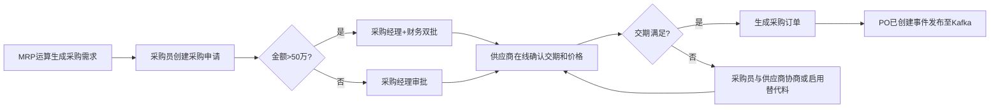
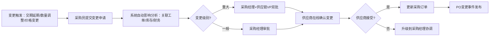
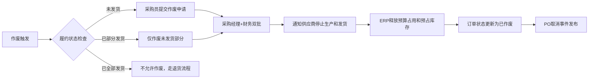

# 手机厂商企业架构可视化浏览系统需求与设计方案

> 文档目标：基于当前项目中的《手机厂商企业架构规划总纲》及第1章至第6章独立文档、Excel附件和HTML配图，设计一个可视化浏览与架构穿透分析系统。本文只输出需求与设计方案，不生成程序代码。
> 技术栈约束：后端 Python 3.11+ / Flask / SQLite；前端 React 18 + TypeScript + Vite + Shadcn UI + Tailwind CSS；可视化 AntV X6、ECharts、Mermaid；架构图后续采用 architecture-diagram 技能生成浅色主流架构图风格。

---

## 1. 建设目标

本系统不是简单的Markdown文档阅读器，而是一个面向企业架构内容的结构化浏览、可视化呈现和影响分析平台。系统需要将现有手机制造行业企业架构规划资料结构化为架构元数据，支持用户围绕业务域、数据域、应用系统、技术平台和实施项目逐层浏览，并以LTC从线索到回款端到端流程为核心主线，穿透查看流程阶段背后的业务能力、数据对象、应用系统、API接口、能力中心和技术支撑。

核心目标包括：

1. 将第1章至第6章文档和Excel附件结构化入库，形成可查询、可关联、可扩展的企业架构元数据。
2. 支持业务架构、数据架构、应用架构、技术架构四类视图的树状分层浏览和图形化展示。
3. 围绕LTC端到端流程提供“流程-阶段-业务能力-数据-API-应用系统-能力中心”的穿透分析。
4. 支持业务能力与流程、业务与数据、应用与数据、应用与接口、API与能力中心等矩阵可视化。
5. 支持影响分析：当业务能力、流程、数据对象、API或应用发生变更时，快速识别受影响的业务域、系统、接口、数据对象和实施项目。

---

## 2. 用户角色

| 用户角色 | 主要诉求 | 典型操作 |
|----------|----------|----------|
| 企业架构师 | 快速浏览全域架构、验证4A一致性、分析变更影响 | 浏览业务/数据/应用/技术架构，查看LTC穿透链路，维护架构关系 |
| 业务负责人 | 理解端到端流程、业务能力归属、流程协同关系 | 查看业务域、业务能力、流程图、LTC阶段支撑能力 |
| 数据架构师 | 管理数据域、数据对象、主数据和流程数据映射 | 查看数据域树、ER图、LTC读写数据、数据影响分析 |
| 应用架构师 | 理解应用组合、能力中心、API和系统边界 | 查看应用功能架构、接口清单、应用与数据/API矩阵 |
| 技术架构师 | 理解技术中台、基础设施、部署和运行支撑 | 查看技术平台组件、部署视图、应用到技术资源映射 |
| 项目经理/PMO | 理解实施项目、迁移波次、依赖和收益 | 查看项目组合、路线图、架构依赖和实施影响 |
| 管理层 | 快速理解企业架构全貌和核心价值链 | 浏览总览看板、LTC端到端视图、关键指标和收益视图 |

---

## 3. 系统范围

### 3.1 纳入范围

1. 文档结构化管理：总纲、第1-6章Markdown文档、Excel附件、HTML配图索引。
2. 业务架构浏览：业务域、L4业务能力、LTC L5-L7活动、业务流程图。
3. 数据架构浏览：数据域、数据对象、字段、主数据、概念/逻辑模型。
4. 应用架构浏览：应用组合、应用功能、能力中心、API接口、集成链路。
5. 技术架构浏览：技术中台、微服务组件、基础设施、部署分区、安全容灾。
6. LTC端到端穿透：阶段、活动、业务能力、数据读写、API、应用系统、能力中心。
7. 矩阵可视化：能力-流程、流程-数据、应用-数据、应用-接口、API-能力中心。
8. 影响分析：从任一架构对象出发，分析上下游依赖。
9. 基础元数据管理：导入、查询、维护、版本标识。

### 3.2 暂不纳入范围

1. 不实现复杂BPMN流程引擎执行。
2. 不实现真实企业系统接口调用。
3. 不实现多租户和复杂权限体系，初期只做管理员/只读用户两类权限。
4. 不实现在线协同编辑，初期以结构化录入和导入为主。
5. 不替代EA建模工具，只做当前架构规划成果的可视化浏览和分析。

---

## 4. 总体产品结构

系统一级导航建议如下：

```text
+--------------------------------------------------------------+
|  手机厂商企业架构可视化平台                                  |
+--------------------------------------------------------------+
| 总览 | 业务架构 | 数据架构 | 应用架构 | 技术架构 | LTC穿透 |
| 矩阵分析 | 影响分析 | 元数据管理 | 文档资料                    |
+--------------------------------------------------------------+
|                                                              |
|  左侧导航树 / 筛选器        |       右侧图形与内容工作区       |
|                             |                                  |
+--------------------------------------------------------------+
```

各模块定位：

| 模块 | 说明 |
|------|------|
| 总览 | 展示企业架构全貌、4A关系、LTC主链路和关键对象数量 |
| 业务架构 | 按业务域和业务能力逐层浏览，底层查看流程 |
| 数据架构 | 按数据域和数据对象逐层浏览，查看ER/字段/主数据 |
| 应用架构 | 按应用域、应用系统、一级功能、接口逐层浏览 |
| 技术架构 | 查看技术中台、部署架构、基础设施和技术组件 |
| LTC穿透 | 围绕端到端流程做跨架构穿透分析 |
| 矩阵分析 | 查看业务、数据、应用、API之间的二维矩阵 |
| 影响分析 | 从任一对象出发进行依赖网络分析 |
| 元数据管理 | 管理结构化入库的数据、版本和导入任务 |
| 文档资料 | 原始Markdown、Excel附件、HTML配图索引浏览 |

---

## 5. 总体架构设计

### 5.1 逻辑架构

```text
+--------------------------------------------------------------+
|                         React 前端                           |
|--------------------------------------------------------------|
| Shadcn UI  | Tree Browser | Detail Panel | Matrix View        |
| AntV X6    | ECharts      | Mermaid      | Markdown Viewer    |
+------------------------------+-------------------------------+
                               |
                               | REST API / JSON
                               v
+--------------------------------------------------------------+
|                         Flask 后端                           |
|--------------------------------------------------------------|
| Document API | Architecture API | LTC API | Matrix API        |
| Impact API   | Metadata API     | Import API | Search API      |
+------------------------------+-------------------------------+
                               |
                               | SQLAlchemy / sqlite3
                               v
+--------------------------------------------------------------+
|                         SQLite 数据库                        |
|--------------------------------------------------------------|
| 文档表 | 业务架构表 | 数据架构表 | 应用架构表 | 技术架构表 |
| LTC映射表 | API表 | 矩阵表 | 通用关系边表 | 版本表       |
+--------------------------------------------------------------+
                               |
                               v
+--------------------------------------------------------------+
|                         原始资料层                           |
|--------------------------------------------------------------|
| Markdown章节 | Excel附件 | HTML配图 | 后续生成的架构图       |
+--------------------------------------------------------------+
```

### 5.2 数据处理思路

```text
原始文档/附件
     |
     v
结构化抽取
     |
     +--> 章节、段落、表格、附件索引
     +--> 业务域、业务能力、流程、活动
     +--> 数据域、数据对象、字段、主数据
     +--> 应用系统、功能、能力中心、API
     +--> 技术组件、平台、部署分区
     +--> LTC阶段、活动、读写数据、API支撑
     |
     v
SQLite元数据模型
     |
     v
图形化浏览 + 关系穿透 + 影响分析
```

---

## 6. 业务架构可视化需求

### 6.1 页面布局

业务架构页面采用左侧树状浏览、右侧内容工作区。

```text
+--------------------------------------------------------------+
| 业务架构                                                     |
+--------------------------+-----------------------------------+
| 业务域树                 | 当前节点标题 / 路径面包屑          |
|                          |-----------------------------------|
| - D01 战略与经营管理     | 业务能力架构图 / 流程图 / 表格      |
| - D02 产品研发           |                                   |
| - D03 供应链管理         |                                   |
|   - 招投标管理           |                                   |
|   - 计划管理             |                                   |
|   - 采购管理             |                                   |
|     - 采购订单管理       |                                   |
|       - 订单创建流程     |                                   |
|       - 订单变更流程     |                                   |
|       - 订单作废流程     |                                   |
| - D04 生产制造           |                                   |
+--------------------------+-----------------------------------+
```

### 6.2 树层级设计

业务架构树按第2章业务架构设计，建议层级如下：

```text
业务架构
  L1 企业业务架构
    L2 业务域
      L3 能力组
        L4 业务组件能力
          L5 业务流程组
            L6 具体流程
              L7 活动/步骤
```

其中：

| 层级 | 示例 | 右侧展示方式 |
------|------|--------------|
| L1 | 企业业务架构 | 企业业务能力总览图 |
| L2 | 供应链管理 | 供应链业务能力架构图 |
| L3 | 采购管理 | 采购能力组架构图 |
| L4 | 采购订单管理 | 采购订单管理能力卡片和流程入口 |
| L5/L6 | 订单创建、订单变更、订单作废 | Mermaid流程图、流程说明、输入输出 |
| L7 | 创建采购申请、审批、生成订单 | 活动明细、角色、数据、应用/API |

### 6.3 业务能力架构图

L1到L3节点右侧展示业务能力架构图，图形风格类似应用功能架构图，以分组矩形、能力卡片和层级布局为主。

```text
+--------------------------------------------------------------+
| 供应链管理                                                   |
+-------------------+-------------------+----------------------+
| 招投标管理        | 计划管理          | 采购管理             |
| - 供应商寻源      | - 需求预测        | - 采购申请           |
| - 招标发布        | - S&OP            | - 采购订单管理       |
| - 投标评审        | - MRP             | - 框架协议管理       |
+-------------------+-------------------+----------------------+
| 库存管理          | 物流协同          | 供应商绩效           |
| - 库存查询        | - ASN协同         | - 交付评价           |
| - 库存预占        | - 到货预约        | - 质量评价           |
+-------------------+-------------------+----------------------+
```

### 6.4 最底层业务流程展示

当用户点击最底层业务能力，例如“采购订单管理”，右侧显示流程Tab。

```text
+--------------------------------------------------------------+
| 采购订单管理                                                 |
+--------------------------------------------------------------+
| 能力说明 | 流程图 | 输入输出 | 数据对象 | 应用/API | 影响分析 |
+--------------------------------------------------------------+
| Tabs: [订单创建] [订单变更] [订单作废] [订单关闭]             |
+--------------------------------------------------------------+
| 当前Tab: 订单创建                                            |
|                                                              |
|  Mermaid流程渲染区                                           |
|  +--------------------------------------------------------+  |
|  | 采购需求 -> 采购申请 -> 审批 -> 供应商确认 -> 订单下达 |  |
|  +--------------------------------------------------------+  |
|                                                              |
|  下方：活动清单、角色、输入数据、输出数据、支撑应用/API       |
+--------------------------------------------------------------+
```

### 6.5 采购订单管理完整样例

左侧树：

```text
业务架构
  供应链管理
    采购管理
      采购订单管理
        订单创建流程
        订单变更流程
        订单作废流程
```

订单创建流程活动：

| 活动 | 说明 | 角色 | 读取数据 | 产生数据 | 支撑应用/API |
|------|------|------|----------|----------|--------------|
| 采购需求生成 | MRP或人工生成采购需求 | 计划员 | MRP结果、库存、BOM | 采购需求 | APS、ERP |
| 采购申请创建 | 将需求转成采购申请 | 采购员 | 采购需求、供应商、物料 | 采购申请 | ERP/SRM |
| 采购申请审批 | 按金额、品类、组织审批 | 采购经理 | 采购申请、预算 | 审批记录 | ERP、OA |
| 供应商确认 | 供应商确认交期和数量 | 供应商 | 采购申请、框架协议 | 交期确认 | SRM |
| 采购订单下达 | 生成正式采购订单 | 采购员 | 供应商确认、价格协议 | 采购订单 | ERP/SRM |

订单创建流程ASCII图：

```text
+-----------+     +-----------+     +-----------+     +-------------+     +-------------+
| 需求生成  | --> | 申请创建  | --> | 申请审批  | --> | 供应商确认  | --> | 订单下达    |
+-----------+     +-----------+     +-----------+     +-------------+     +-------------+
      |                 |                 |                   |                  |
      v                 v                 v                   v                  v
  MRP/库存/BOM      采购申请          审批记录           交期确认           采购订单
```

订单变更流程：

```text
+-----------+     +-----------+     +-----------+     +-------------+     +-------------+
| 变更申请  | --> | 影响评估  | --> | 变更审批  | --> | 供应商确认  | --> | 订单更新    |
+-----------+     +-----------+     +-----------+     +-------------+     +-------------+
```

订单作废流程：

```text
+-----------+     +-------------+     +-----------+     +-------------+     +-------------+
| 作废申请  | --> | 履约状态检查| --> | 作废审批  | --> | 供应商通知  | --> | 订单关闭    |
+-----------+     +-------------+     +-----------+     +-------------+     +-------------+
```

前端实现上，流程图可由Mermaid渲染，活动数据来自`business_process`和`process_activity`表。

---

## 7. 数据架构可视化需求

### 7.1 页面布局

```text
+--------------------------------------------------------------+
| 数据架构                                                     |
+--------------------------+-----------------------------------+
| 数据域树                 | 当前数据域/对象详情                |
|                          |-----------------------------------|
| - DD01 战略与经营数据域  | 数据架构图 / ER图 / 字段表         |
| - DD02 产品研发数据域    |                                   |
| - DD03 供应链数据域      |                                   |
|   - 供应商数据           |                                   |
|   - 采购数据             |                                   |
|   - 库存数据             |                                   |
| - DD10 财务管理数据域    |                                   |
+--------------------------+-----------------------------------+
```

### 7.2 数据域层级

```text
数据架构
  L1 企业数据架构
    L2 数据域
      L3 数据主题/数据分组
        L4 数据对象/候选表
          字段/属性
          数据关系
          主数据标识
          来源系统
          消费系统/API
```

### 7.3 L1-L3数据架构图

L1-L3展示数据域和数据对象分组图。

```text
+--------------------------------------------------------------+
| 企业数据架构                                                 |
+-------------------+-------------------+----------------------+
| 产品研发数据域    | 供应链数据域      | 生产制造数据域       |
| - 产品            | - 供应商          | - 工单               |
| - SKU             | - 采购订单        | - 工艺               |
| - BOM             | - 库存            | - 质量检测           |
+-------------------+-------------------+----------------------+
| 销售渠道数据域    | 客户服务数据域    | 财务管理数据域       |
| - 客户            | - 服务工单        | - 应收               |
| - 销售订单        | - 维修单          | - 发票               |
| - 渠道伙伴        | - 备件            | - 收款               |
+-------------------+-------------------+----------------------+
```

### 7.4 数据对象详情

点击数据对象后，右侧展示：

1. 基本信息：对象名称、所属数据域、对象类型、是否主数据、Owner。
2. 核心字段：字段名、类型、是否必填、说明。
3. 关系图：与其他数据对象的关联。
4. 来源和消费：由哪些流程产生，被哪些应用/API消费。
5. 影响分析入口。

数据对象关系ASCII示例：

```text
+----------+       1     N       +------------+       N     1       +----------+
|  客户    |-------------------->| 销售订单   |-------------------->|  SKU     |
+----------+                     +------------+                     +----------+
                                      |
                                      | 1
                                      v N
                                 +------------+
                                 | 订单行     |
                                 +------------+
```

---

## 8. 应用架构可视化需求

### 8.1 页面布局

```text
+--------------------------------------------------------------+
| 应用架构                                                     |
+--------------------------+-----------------------------------+
| 应用树                   | 应用功能架构图 / 清单              |
|                          |-----------------------------------|
| - 应用架构               |                                   |
|   - 前台应用             |                                   |
|   - 业务应用             |                                   |
|     - CRM                |                                   |
|     - OMS                |                                   |
|       - 功能清单         |                                   |
|       - 接口清单         |                                   |
|   - 能力中心             |                                   |
|   - 数据能力中心         |                                   |
+--------------------------+-----------------------------------+
```

### 8.2 应用架构层级

```text
应用架构
  L1 应用总体架构
    L2 应用分层
      L3 应用系统/能力中心
        L4 一级功能组
          功能清单
          接口清单
```

当点击L1-L3节点时，右侧展示应用功能架构图。

```text
+--------------------------------------------------------------+
| 应用功能架构                                                 |
+-------------------+-------------------+----------------------+
| 前台触点          | 业务应用          | 能力中心             |
| - 官网/商城       | - CRM             | - 客户中心           |
| - 门店POS         | - OMS             | - 产品中心           |
| - App             | - APS             | - 订单中心           |
|                   | - SRM             | - 库存中心           |
+-------------------+-------------------+----------------------+
| 数据能力中心      | 集成平台          | 技术中台             |
| - 主数据服务      | - API网关         | - 容器云             |
| - 指标服务        | - iPaaS           | - DevOps             |
+-------------------+-------------------+----------------------+
```

### 8.3 应用最底层节点

点击具体应用系统，例如OMS，显示两个子节点：

```text
OMS全渠道订单管理
  功能清单
  接口清单
```

功能清单展示：

| 一级功能 | 功能说明 | 支撑业务能力 | 依赖能力中心 | 读写数据 |
|----------|----------|--------------|--------------|----------|
| 订单接入 | 接收多渠道订单 | 订单管理 | 订单中心、客户中心、产品中心 | 销售订单、客户、SKU |
| 履约路由 | 根据库存和规则选择履约节点 | 履约管理 | 库存中心、计划中心 | 库存、履约单 |
| 异常处理 | 处理缺货、拦截、取消等异常 | 订单异常管理 | 订单中心、财务结算中心 | 异常单、退款 |

接口清单展示：

| API | 能力说明 | 来源系统/能力中心 | 消费方 | 数据对象 |
|-----|----------|-------------------|--------|----------|
| POST /orders | 创建订单 | 订单中心/OMS | 电商、POS、CRM | 销售订单 |
| GET /orders/{id}/status | 查询订单状态 | 订单中心/OMS | App、客服、CRM | 订单状态 |
| POST /inventory/reservations | 库存预占 | 库存中心/WMS | OMS | 库存预占 |

---

## 9. 技术架构可视化需求

技术架构不适合简单按文档树展示，应采用“技术平台分层 + 部署拓扑 + 支撑关系”三类视图。

### 9.1 技术平台分层视图

```text
+--------------------------------------------------------------+
| 云原生技术中台                                               |
+--------------------------------------------------------------+
| 开发态                                                       |
| 低代码平台 | DevOps流水线 | 代码仓库 | 制品库 | 安全扫描       |
+--------------------------------------------------------------+
| 运行态                                                       |
| 容器云 | API网关 | iPaaS | 微服务治理 | 消息 | 缓存 | 配置中心 |
+--------------------------------------------------------------+
| 运维态                                                       |
| 日志 | 指标 | 链路追踪 | 告警 | AIOps | FinOps | 容灾备份     |
+--------------------------------------------------------------+
| 基础设施                                                     |
| 计算 | 存储 | 网络 | 私有云 | 区域云 | 工厂边缘节点           |
+--------------------------------------------------------------+
```

### 9.2 部署架构视图

```text
+-------------------+        +-------------------+        +-------------------+
| 总部私有云         |        | 海外区域云         |        | 工厂边缘云         |
|-------------------|        |-------------------|        |-------------------|
| CRM/OMS/ERP        |<------>| 区域渠道/服务应用  |        | MES/设备采集       |
| 能力中心           |        | 区域数据驻留       |        | 边缘缓存/网关      |
| 数据中台           |        | 本地合规审计       |        | 低时延生产控制     |
+-------------------+        +-------------------+        +-------------------+
          |                              |                            |
          +-------------- SD-WAN / 专线 / VPN / 零信任 ---------------+
```

### 9.3 技术支撑关系

技术架构需要支持从应用系统反查技术组件：

```text
OMS
  -> 容器云集群
  -> API网关
  -> iPaaS
  -> 消息队列
  -> Redis缓存
  -> PostgreSQL/MySQL
  -> 日志/指标/链路追踪
  -> 同城灾备
```

---

## 10. LTC端到端穿透分析需求

### 10.1 LTC总览

LTC流程按当前架构文档统一为七个阶段：

```text
+------------+   +------------+   +------------+   +------------+
| 市场与商机 |-->| 销售与下单 |-->| 计划与供应 |-->| 生产制造   |
+------------+   +------------+   +------------+   +------------+
                                                            |
                                                            v
+------------+   +------------+   +------------+   +------------+
| 财务回款   |<--| 客户服务   |<--| 物流交付   |<--| 成品入库   |
+------------+   +------------+   +------------+   +------------+
```

说明：实际展示时，生产制造到物流交付之间可包含成品入库/出库准备节点，但架构主线仍按七阶段管理。

### 10.2 阶段详情

点击任一阶段，例如“销售与下单”，显示该阶段的跨架构信息。

```text
+--------------------------------------------------------------+
| LTC > 销售与下单                                             |
+--------------------------------------------------------------+
| 阶段活动                                                     |
| - 渠道价格与促销校验                                         |
| - 订单创建与客户确认                                         |
| - 信用/库存/合规检查                                         |
+--------------------------------------------------------------+
| 支撑业务能力                                                 |
| 销售与渠道.订单管理 | 市场营销.价格促销 | 财务管理.信用管理   |
+--------------------------------------------------------------+
| 依赖/产生数据                                                |
| 读: 客户、渠道、门店、SKU、价格政策、库存、信用额度           |
| 写: 报价、销售订单、订单行、库存预占、合规校验记录           |
+--------------------------------------------------------------+
| API能力                                                      |
| 订单中心.POST /orders                                        |
| 产品中心.GET /skus/{sku_id}                                  |
| 库存中心.POST /inventory/reservations                        |
| 财务结算中心.POST /receivables/confirm                       |
+--------------------------------------------------------------+
| 支撑应用                                                     |
| CRM | OMS | WMS | ERP | GRC                                  |
+--------------------------------------------------------------+
```

### 10.3 穿透链路

系统必须支持如下穿透：

```text
LTC端到端流程
  -> 阶段：销售与下单
    -> 活动：订单创建与客户确认
      -> 业务域：销售与渠道
        -> 业务能力：订单管理
          -> 业务组件：订单中心
            -> API：POST /orders
              -> 应用系统：OMS
                -> 数据对象：销售订单、订单行、客户、SKU
                  -> 数据表/字段：sales_order, sales_order_line, customer, sku
```

也要支持反向穿透：

```text
数据对象：销售订单
  -> 被哪些流程产生
  -> 被哪些活动读取/更新
  -> 被哪些应用维护
  -> 被哪些API暴露
  -> 影响哪些报表/指标
  -> 影响哪些实施项目
```

### 10.4 LTC视图类型

| 视图 | 可视化组件 | 说明 |
|------|------------|------|
| 阶段流程图 | Mermaid / X6 | 展示端到端阶段和活动 |
| 阶段支撑图 | X6 | 阶段到业务能力、API、系统、数据的穿透 |
| 知识网络图 | ECharts Graph | 以阶段为中心展示关联对象网络 |
| 阶段读写表 | Shadcn Table | 读取数据和产生数据 |
| API支撑表 | Shadcn Table | 阶段活动依赖的API、来源系统、能力中心 |
| 影响分析图 | ECharts Graph / X6 | 从选中对象扩展上下游影响 |

---

## 11. 矩阵可视化需求

### 11.1 矩阵类型

| 矩阵 | 行 | 列 | 单元格含义 |
|------|----|----|------------|
| 业务能力-业务流程矩阵 | 业务能力 | 流程/活动 | 能力是否支撑流程 |
| 业务流程-数据矩阵 | 流程/活动 | 数据对象 | C/R/U/D或读写关系 |
| 应用-数据矩阵 | 应用系统 | 数据对象 | Owner、读、写、同步 |
| 应用-接口矩阵 | 应用系统 | API接口 | 提供、消费 |
| API-能力中心矩阵 | API接口 | 能力中心 | API归属和能力边界 |
| 项目-架构对象矩阵 | 实施项目 | 业务/数据/应用/技术对象 | 项目建设或影响对象 |

### 11.2 矩阵展示样式

```text
+----------------+----------+----------+----------+----------+
| 流程/数据对象   | 客户     | SKU      | 销售订单 | 库存     |
+----------------+----------+----------+----------+----------+
| 线索采集        | R        |          |          |          |
| 订单创建        | R        | R        | C        |          |
| 库存预占        |          | R        | R        | U        |
| 发货交付        |          | R        | R/U      | U        |
| 收款核销        | R        |          | R        |          |
+----------------+----------+----------+----------+----------+
```

交互要求：

1. 单元格点击后显示证据来源：章节、附件、表格行、说明。
2. 支持按业务域、应用系统、数据域过滤。
3. 支持导出CSV。
4. 支持从矩阵单元跳转到影响分析。

---

## 12. 影响分析需求

### 12.1 典型场景

场景：SKU编码规则发生变化。

系统应分析：

```text
SKU数据对象变更
  -> 数据域：产品研发数据域、销售渠道数据域、供应链数据域
  -> 业务流程：产品发布、订单创建、库存预占、MRP运算、出库发货
  -> 应用系统：PLM、OMS、APS、WMS、MES、ERP
  -> API：GET /skus/{sku_id}, GET /boms/{sku_id}/effective
  -> 能力中心：产品中心、库存中心、计划中心
  -> 实施项目：PLM/IPD、OMS、APS、WMS、能力中心一期
```

### 12.2 影响分析图

```text
                          +-------------+
                          |  实施项目   |
                          +-------------+
                                ^
                                |
+----------+      +----------+  |   +----------+      +----------+
| 业务流程 |<-----| 数据对象 |----->| API接口  |----->| 应用系统 |
+----------+      +----------+      +----------+      +----------+
      ^                |                 |                  |
      |                v                 v                  v
+----------+      +----------+      +----------+      +----------+
| 业务能力 |      | 数据域   |      | 能力中心 |      | 技术组件 |
+----------+      +----------+      +----------+      +----------+
```

### 12.3 影响分析规则

影响分析基于通用关系边表`ea_relation`实现。每类关系有方向、强度、证据来源和关系类型。

| 起点对象 | 关系 | 终点对象 | 示例 |
|----------|------|----------|------|
| 流程活动 | reads | 数据对象 | 订单创建 reads 客户 |
| 流程活动 | creates | 数据对象 | 订单创建 creates 销售订单 |
| 流程活动 | uses_api | API | 订单创建 uses_api POST /orders |
| API | provided_by | 能力中心 | POST /orders provided_by 订单中心 |
| API | implemented_by | 应用系统 | POST /orders implemented_by OMS |
| 应用系统 | owns | 数据对象 | OMS owns 销售订单 |
| 应用系统 | deployed_on | 技术组件 | OMS deployed_on 容器云 |
| 实施项目 | builds | 应用系统/API/能力中心 | P03 builds OMS |

---

## 13. 数据库设计

### 13.1 设计原则

1. SQLite作为元数据存储，不存储大文件正文，只存储路径、摘要和结构化片段。
2. 采用“专用实体表 + 通用关系边表”的组合方式。
3. 所有架构对象都应具备统一ID、名称、编码、类型、描述、来源和版本。
4. 跨架构穿透统一通过`ea_relation`表达，避免每种关系都新建一张表导致扩展困难。
5. 对常用高频查询保留专用映射表，例如LTC阶段数据映射、API支撑表。

### 13.2 通用文档表

#### ea_document

| 字段 | 类型 | 说明 |
|------|------|------|
| id | INTEGER PK | 文档ID |
| doc_code | TEXT | 文档编码，如 CH2 |
| title | TEXT | 文档标题 |
| doc_type | TEXT | markdown/excel/html/docx |
| file_path | TEXT | 文件路径 |
| chapter_no | TEXT | 章节号 |
| version | TEXT | 版本 |
| summary | TEXT | 摘要 |
| created_at | TEXT | 创建时间 |
| updated_at | TEXT | 更新时间 |

#### ea_section

| 字段 | 类型 | 说明 |
|------|------|------|
| id | INTEGER PK | 段落ID |
| document_id | INTEGER | 所属文档 |
| section_no | TEXT | 章节号，如2.3.2 |
| title | TEXT | 标题 |
| level | INTEGER | 标题层级 |
| content_md | TEXT | Markdown内容片段 |
| source_line_start | INTEGER | 来源起始行 |
| source_line_end | INTEGER | 来源结束行 |

### 13.3 架构对象统一表

#### ea_object

| 字段 | 类型 | 说明 |
|------|------|------|
| id | INTEGER PK | 对象ID |
| object_uid | TEXT UNIQUE | 全局唯一编码 |
| object_type | TEXT | business_domain/capability/process/data_object/application/api/tech_component/project等 |
| object_code | TEXT | 业务编码，如D03、BC01 |
| name | TEXT | 名称 |
| parent_id | INTEGER | 父对象ID |
| level | INTEGER | 层级 |
| description | TEXT | 描述 |
| owner | TEXT | 责任人/责任组织 |
| source_doc_id | INTEGER | 来源文档 |
| source_ref | TEXT | 来源章节/附件 |
| status | TEXT | active/inactive/draft |
| version | TEXT | 版本 |

用途：为影响分析、搜索、关系图提供统一节点。

### 13.4 业务架构表

#### business_domain

| 字段 | 类型 | 说明 |
|------|------|------|
| id | INTEGER PK | 业务域ID |
| domain_code | TEXT | D01-D14 |
| name | TEXT | 业务域名称 |
| description | TEXT | 说明 |
| domain_type | TEXT | core/support/governance |
| owner | TEXT | 业务Owner |
| kpi | TEXT | 关键指标 |

#### business_capability

| 字段 | 类型 | 说明 |
|------|------|------|
| id | INTEGER PK | 能力ID |
| capability_code | TEXT | 能力编码 |
| name | TEXT | 能力名称 |
| domain_id | INTEGER | 所属业务域 |
| parent_id | INTEGER | 父能力 |
| level | INTEGER | L1-L4 |
| description | TEXT | 能力说明 |
| component_flag | INTEGER | 是否L4业务组件 |
| maturity | TEXT | 当前成熟度 |
| target_maturity | TEXT | 目标成熟度 |
| priority | TEXT | 优先级 |

#### business_process

| 字段 | 类型 | 说明 |
|------|------|------|
| id | INTEGER PK | 流程ID |
| process_code | TEXT | 流程编码 |
| name | TEXT | 流程名称 |
| capability_id | INTEGER | 关联业务能力 |
| process_group | TEXT | 流程组，如采购订单管理 |
| mermaid_text | TEXT | Mermaid流程定义 |
| description | TEXT | 流程说明 |
| owner | TEXT | 流程Owner |

#### process_activity

| 字段 | 类型 | 说明 |
|------|------|------|
| id | INTEGER PK | 活动ID |
| process_id | INTEGER | 所属流程 |
| activity_code | TEXT | 活动编码 |
| name | TEXT | 活动名称 |
| sequence_no | INTEGER | 顺序 |
| role | TEXT | 角色 |
| input_desc | TEXT | 输入 |
| output_desc | TEXT | 输出 |
| control_point | TEXT | 控制点 |

### 13.5 数据架构表

#### data_domain

| 字段 | 类型 | 说明 |
|------|------|------|
| id | INTEGER PK | 数据域ID |
| domain_code | TEXT | DD01-DD14 |
| name | TEXT | 数据域名称 |
| business_domain_id | INTEGER | 对应业务域 |
| description | TEXT | 说明 |
| owner | TEXT | 数据Owner |

#### data_object

| 字段 | 类型 | 说明 |
|------|------|------|
| id | INTEGER PK | 数据对象ID |
| object_code | TEXT | 对象编码 |
| name | TEXT | 对象名称 |
| data_domain_id | INTEGER | 所属数据域 |
| object_type | TEXT | master/transaction/reference/metric/log |
| candidate_table | TEXT | 候选表名 |
| description | TEXT | 说明 |
| owner | TEXT | 数据Owner |
| master_flag | INTEGER | 是否主数据 |

#### data_field

| 字段 | 类型 | 说明 |
|------|------|------|
| id | INTEGER PK | 字段ID |
| data_object_id | INTEGER | 所属数据对象 |
| field_name | TEXT | 字段名 |
| field_code | TEXT | 字段编码 |
| data_type | TEXT | 数据类型 |
| required_flag | INTEGER | 是否必填 |
| pk_flag | INTEGER | 是否主键 |
| description | TEXT | 字段说明 |

#### data_object_relation

| 字段 | 类型 | 说明 |
|------|------|------|
| id | INTEGER PK | 关系ID |
| from_object_id | INTEGER | 起始数据对象 |
| to_object_id | INTEGER | 目标数据对象 |
| relation_type | TEXT | one_to_many/many_to_one/reference/composition |
| description | TEXT | 关系说明 |

### 13.6 应用架构表

#### application

| 字段 | 类型 | 说明 |
|------|------|------|
| id | INTEGER PK | 应用ID |
| app_code | TEXT | 应用编码 |
| name | TEXT | 应用名称 |
| app_type | TEXT | business/platform/data/security |
| business_domain_id | INTEGER | 对应业务域 |
| description | TEXT | 应用说明 |
| owner | TEXT | 系统Owner |
| deployment_mode | TEXT | private_cloud/public_cloud/edge |

#### app_function

| 字段 | 类型 | 说明 |
|------|------|------|
| id | INTEGER PK | 功能ID |
| application_id | INTEGER | 所属应用 |
| function_code | TEXT | 功能编码 |
| name | TEXT | 功能名称 |
| parent_id | INTEGER | 父功能 |
| level | INTEGER | 功能层级 |
| description | TEXT | 功能说明 |
| capability_id | INTEGER | 对应业务能力 |

#### capability_center

| 字段 | 类型 | 说明 |
|------|------|------|
| id | INTEGER PK | 能力中心ID |
| center_code | TEXT | BC01等 |
| name | TEXT | 能力中心名称 |
| core_object | TEXT | 核心共享对象 |
| description | TEXT | 能力边界 |
| owner | TEXT | 能力Owner |
| typical_system | TEXT | 典型承载系统 |

#### api_interface

| 字段 | 类型 | 说明 |
|------|------|------|
| id | INTEGER PK | API ID |
| api_code | TEXT | API编码 |
| name | TEXT | API名称 |
| method | TEXT | GET/POST/PUT/DELETE |
| path | TEXT | API路径 |
| capability_center_id | INTEGER | 所属能力中心 |
| provider_app_id | INTEGER | 提供应用 |
| description | TEXT | 能力说明 |
| input_desc | TEXT | 输入 |
| output_desc | TEXT | 输出 |
| data_object_id | INTEGER | 主要数据对象 |

### 13.7 技术架构表

#### tech_component

| 字段 | 类型 | 说明 |
|------|------|------|
| id | INTEGER PK | 技术组件ID |
| component_code | TEXT | 组件编码 |
| name | TEXT | 名称 |
| component_type | TEXT | container/devops/ipaas/database/security/observability等 |
| layer | TEXT | development/runtime/operation/infrastructure |
| description | TEXT | 说明 |
| vendor_or_stack | TEXT | 技术栈或厂商 |
| status | TEXT | planned/active/deprecated |

#### deployment_node

| 字段 | 类型 | 说明 |
|------|------|------|
| id | INTEGER PK | 部署节点ID |
| node_code | TEXT | 节点编码 |
| name | TEXT | 节点名称 |
| node_type | TEXT | private_cloud/region_cloud/edge/datacenter |
| location | TEXT | 地点 |
| description | TEXT | 说明 |

#### app_deployment

| 字段 | 类型 | 说明 |
|------|------|------|
| id | INTEGER PK | 部署关系ID |
| application_id | INTEGER | 应用 |
| deployment_node_id | INTEGER | 部署节点 |
| tech_component_id | INTEGER | 依赖技术组件 |
| environment | TEXT | prod/test/dev |
| description | TEXT | 说明 |

### 13.8 LTC专题表

#### value_stream

| 字段 | 类型 | 说明 |
|------|------|------|
| id | INTEGER PK | 价值流ID |
| stream_code | TEXT | VF01/VF02 |
| name | TEXT | 价值流名称 |
| description | TEXT | 说明 |
| owner | TEXT | 价值流Owner |

#### value_stage

| 字段 | 类型 | 说明 |
|------|------|------|
| id | INTEGER PK | 阶段ID |
| stream_id | INTEGER | 所属价值流 |
| stage_code | TEXT | 阶段编码 |
| name | TEXT | 阶段名称 |
| sequence_no | INTEGER | 顺序 |
| description | TEXT | 说明 |

#### stage_activity

| 字段 | 类型 | 说明 |
|------|------|------|
| id | INTEGER PK | 阶段活动ID |
| stage_id | INTEGER | 所属阶段 |
| activity_name | TEXT | 活动名称 |
| sequence_no | INTEGER | 顺序 |
| description | TEXT | 活动说明 |
| process_id | INTEGER | 对应业务流程 |

#### stage_business_support

| 字段 | 类型 | 说明 |
|------|------|------|
| id | INTEGER PK | ID |
| stage_id | INTEGER | LTC阶段 |
| activity_id | INTEGER | 阶段活动 |
| business_domain_id | INTEGER | 业务域 |
| capability_id | INTEGER | 业务能力 |
| support_desc | TEXT | 支撑说明 |

#### stage_data_mapping

| 字段 | 类型 | 说明 |
|------|------|------|
| id | INTEGER PK | ID |
| stage_id | INTEGER | LTC阶段 |
| activity_id | INTEGER | 阶段活动 |
| data_object_id | INTEGER | 数据对象 |
| usage_type | TEXT | read/create/update/delete |
| description | TEXT | 说明 |

#### stage_api_mapping

| 字段 | 类型 | 说明 |
|------|------|------|
| id | INTEGER PK | ID |
| stage_id | INTEGER | LTC阶段 |
| activity_id | INTEGER | 阶段活动 |
| api_id | INTEGER | API |
| application_id | INTEGER | 支撑应用 |
| capability_center_id | INTEGER | 能力中心 |
| support_desc | TEXT | 支撑说明 |

### 13.9 通用关系表

#### ea_relation

| 字段 | 类型 | 说明 |
|------|------|------|
| id | INTEGER PK | 关系ID |
| from_object_uid | TEXT | 起点对象UID |
| from_object_type | TEXT | 起点类型 |
| relation_type | TEXT | reads/creates/uses_api/provided_by/implemented_by等 |
| to_object_uid | TEXT | 终点对象UID |
| to_object_type | TEXT | 终点类型 |
| weight | REAL | 关系强度 |
| source_ref | TEXT | 来源章节/附件 |
| description | TEXT | 说明 |

### 13.10 矩阵表

#### matrix_definition

| 字段 | 类型 | 说明 |
|------|------|------|
| id | INTEGER PK | 矩阵ID |
| matrix_code | TEXT | 矩阵编码 |
| name | TEXT | 矩阵名称 |
| row_object_type | TEXT | 行对象类型 |
| col_object_type | TEXT | 列对象类型 |
| description | TEXT | 说明 |

#### matrix_cell

| 字段 | 类型 | 说明 |
|------|------|------|
| id | INTEGER PK | 单元格ID |
| matrix_id | INTEGER | 矩阵ID |
| row_object_uid | TEXT | 行对象 |
| col_object_uid | TEXT | 列对象 |
| value | TEXT | C/R/U/D、provide/consume等 |
| evidence | TEXT | 证据说明 |
| source_ref | TEXT | 来源 |

### 13.11 项目与实施表

#### implementation_project

| 字段 | 类型 | 说明 |
|------|------|------|
| id | INTEGER PK | 项目ID |
| project_code | TEXT | P01等 |
| name | TEXT | 项目名称 |
| project_group | TEXT | 项目群 |
| priority | TEXT | P0/P1/P2 |
| time_window | TEXT | 建议时间窗 |
| owner | TEXT | 牵头责任 |
| description | TEXT | 建设内容 |
| acceptance_metric | TEXT | 验收指标 |

#### implementation_wave

| 字段 | 类型 | 说明 |
|------|------|------|
| id | INTEGER PK | 波次ID |
| wave_code | TEXT | Wave0-Wave4 |
| name | TEXT | 波次名称 |
| time_window | TEXT | 时间窗 |
| theme | TEXT | 阶段主题 |
| key_deliverables | TEXT | 关键交付 |
| exit_criteria | TEXT | 退出条件 |

---

## 14. 后端API设计

### 14.0 当前数据库落地基线

当前已经在`code/ea_visualization.sqlite`中完成SQLite建表和数据初始化。后续开发应直接以该数据库和`code/backend/init_db.py`为基线，不再重新设计一套表结构。若后续表结构需要调整，必须同步修改初始化脚本并保证脚本可从零重建数据库。

当前已落地表如下：

```text
api_interface
app_deployment
app_function
application
business_capability
business_domain
business_process
capability_center
data_domain
data_field
data_object
data_object_relation
deployment_node
ea_document
ea_object
ea_relation
ea_section
implementation_project
implementation_wave
matrix_cell
matrix_definition
process_activity
stage_activity
stage_api_mapping
stage_business_support
stage_data_mapping
tech_component
value_stage
value_stream
```

当前初始化数据基线：

| 表 | 当前记录数 | 说明 |
|----|------------|------|
| ea_document | 55 | Markdown章节、Excel附件等资料索引 |
| ea_section | 792 | Markdown章节结构化片段 |
| ea_object | 701 | 统一架构对象节点 |
| business_domain | 14 | 全企业业务域 |
| business_capability | 345 | L3/L4业务能力和业务组件 |
| business_process | 10 | LTC阶段流程和采购订单模拟流程 |
| process_activity | 37 | 业务流程活动 |
| data_domain | 14 | 全域数据域 |
| data_object | 170 | 数据对象，含补充模拟对象 |
| data_field | 706 | 数据对象字段 |
| data_object_relation | 22 | 概念/逻辑实体关系 |
| application | 21 | 规划应用系统 |
| app_function | 75 | 应用一级功能 |
| capability_center | 13 | 业务能力中心 |
| api_interface | 30 | 能力中心API |
| tech_component | 25 | 技术中台和微服务组件 |
| deployment_node | 4 | 总部私有云、海外区域云、工厂边缘云、灾备中心 |
| app_deployment | 0 | 预留表，首版可暂不展示具体应用部署关系 |
| value_stream | 8 | 企业端到端价值流 |
| value_stage | 7 | LTC七阶段 |
| stage_activity | 22 | LTC阶段活动 |
| stage_business_support | 49 | LTC阶段业务能力支撑 |
| stage_data_mapping | 193 | LTC阶段数据读写映射 |
| stage_api_mapping | 53 | LTC阶段API支撑映射 |
| implementation_project | 18 | 实施项目 |
| implementation_wave | 5 | 迁移波次 |
| ea_relation | 823 | 通用关系边 |
| matrix_definition | 4 | 矩阵定义 |
| matrix_cell | 252 | 矩阵单元 |

补充说明：

1. `app_deployment`当前为空，作为第二阶段部署拓扑细化预留。首版技术架构页面可先基于`tech_component`和`deployment_node`展示技术平台与部署节点，不强依赖应用部署明细。
2. `ea_relation`已经可支撑一跳、二跳和多跳影响分析，首版影响分析应优先基于该表实现。
3. `stage_business_support`、`stage_data_mapping`、`stage_api_mapping`已经全部具备`activity_id`，不存在空活动引用。
4. “售后服务”已在初始化阶段归一为“客户服务”，后续前端显示统一使用“客户服务”。
5. “商品中心/合规风控中心”已统一为“产品中心/合规风险中心”。

### 14.1 基础API

| API | 方法 | 说明 |
|-----|------|------|
| /api/health | GET | 健康检查 |
| /api/documents | GET | 文档列表 |
| /api/documents/{id} | GET | 文档详情 |
| /api/search | GET | 全局搜索 |

### 14.2 架构浏览API

| API | 方法 | 说明 |
|-----|------|------|
| /api/business/tree | GET | 业务架构树 |
| /api/business/capabilities/{id} | GET | 业务能力详情 |
| /api/business/processes/{id} | GET | 流程详情 |
| /api/data/tree | GET | 数据架构树 |
| /api/data/objects/{id} | GET | 数据对象详情 |
| /api/app/tree | GET | 应用架构树 |
| /api/app/applications/{id} | GET | 应用详情 |
| /api/app/apis/{id} | GET | API详情 |
| /api/tech/tree | GET | 技术架构树 |
| /api/tech/components/{id} | GET | 技术组件详情 |

### 14.3 LTC专题API

| API | 方法 | 说明 |
|-----|------|------|
| /api/ltc/overview | GET | LTC总览 |
| /api/ltc/stages | GET | LTC阶段列表 |
| /api/ltc/stages/{id} | GET | 阶段详情 |
| /api/ltc/stages/{id}/business | GET | 阶段支撑业务能力 |
| /api/ltc/stages/{id}/data | GET | 阶段读写数据 |
| /api/ltc/stages/{id}/apis | GET | 阶段API支撑 |
| /api/ltc/stages/{id}/graph | GET | 阶段穿透关系图 |

### 14.4 矩阵与影响分析API

| API | 方法 | 说明 |
|-----|------|------|
| /api/matrices | GET | 矩阵定义列表 |
| /api/matrices/{code} | GET | 矩阵数据 |
| /api/impact | GET | 影响分析，参数object_uid、depth、relation_type |
| /api/graph/neighbors | GET | 获取对象邻接关系 |
| /api/graph/path | GET | 两个对象之间路径 |

### 14.5 导入API

| API | 方法 | 说明 |
|-----|------|------|
| /api/import/scan | POST | 扫描本地文档和附件 |
| /api/import/markdown | POST | 导入Markdown结构 |
| /api/import/excel | POST | 导入Excel附件 |
| /api/import/rebuild-relations | POST | 重建关系边 |

### 14.6 API响应契约

后端统一返回JSON。成功响应格式：

```json
{
  "success": true,
  "data": {},
  "meta": {
    "request_id": "uuid",
    "count": 0
  }
}
```

失败响应格式：

```json
{
  "success": false,
  "error": {
    "code": "NOT_FOUND",
    "message": "对象不存在"
  }
}
```

树节点统一结构：

```json
{
  "id": "business_domain:D03",
  "uid": "business_domain:D03",
  "type": "business_domain",
  "code": "D03",
  "name": "供应链管理",
  "level": 2,
  "hasChildren": true,
  "children": []
}
```

详情页统一结构：

```json
{
  "object": {
    "uid": "data_object:DO-001",
    "type": "data_object",
    "code": "DO-001",
    "name": "客户",
    "description": "客户主数据",
    "owner": "销售运营"
  },
  "sections": [
    {
      "title": "核心字段",
      "type": "table",
      "data": []
    },
    {
      "title": "关系图",
      "type": "graph",
      "data": {
        "nodes": [],
        "edges": []
      }
    }
  ]
}
```

图数据统一结构：

```json
{
  "nodes": [
    {
      "id": "api:API-001",
      "label": "GET /customers/{id}",
      "type": "api",
      "data": {}
    }
  ],
  "edges": [
    {
      "id": "edge-1",
      "source": "stage_activity:订单创建",
      "target": "api:API-001",
      "label": "uses_api",
      "type": "uses_api"
    }
  ]
}
```

矩阵接口返回结构：

```json
{
  "matrix": {
    "code": "M01",
    "name": "业务流程-数据矩阵"
  },
  "rows": [
    {
      "uid": "stage_activity:销售与下单-订单创建与客户确认",
      "name": "订单创建与客户确认"
    }
  ],
  "columns": [
    {
      "uid": "data_object:DO-001",
      "name": "客户"
    }
  ],
  "cells": [
    {
      "row_uid": "stage_activity:销售与下单-订单创建与客户确认",
      "col_uid": "data_object:DO-001",
      "value": "read",
      "evidence": "销售与下单/订单创建与客户确认 -> 客户"
    }
  ]
}
```

### 14.7 必须优先实现的查询接口

为了支持后续静默编程，首版后端必须先实现以下查询接口：

| 优先级 | API | 关键SQL来源 | 前端用途 |
|--------|-----|-------------|----------|
| P0 | /api/business/tree | business_domain、business_capability、business_process | 业务架构左侧树 |
| P0 | /api/data/tree | data_domain、data_object、data_field | 数据架构左侧树 |
| P0 | /api/app/tree | application、app_function、api_interface、capability_center | 应用架构左侧树 |
| P0 | /api/ltc/overview | value_stream、value_stage、stage_activity | LTC总览 |
| P0 | /api/ltc/stages/{id}/graph | stage_*映射表、ea_relation | LTC穿透图 |
| P0 | /api/impact | ea_relation | 影响分析 |
| P1 | /api/matrices/{code} | matrix_definition、matrix_cell | 矩阵分析 |
| P1 | /api/objects/{uid} | ea_object及各实体表 | 通用对象详情 |

### 14.8 后端实现约定

后续编码时，后端建议目录如下：

```text
code/backend/
  app.py
  config.py
  db.py
  init_db.py
  requirements.txt
  routes/
    documents.py
    business.py
    data_arch.py
    applications.py
    technology.py
    ltc.py
    matrix.py
    impact.py
  services/
    tree_service.py
    graph_service.py
    matrix_service.py
    impact_service.py
  schemas/
    common.py
```

约定：

1. 数据库文件固定为`code/ea_visualization.sqlite`。
2. 后端启动时不自动重建数据库，重建数据库只通过`python code/backend/init_db.py`执行。
3. Flask API统一加`/api`前缀。
4. 首版可直接使用`sqlite3`标准库；如使用SQLAlchemy，必须保持现有表名和字段名不变。
5. 所有接口必须支持CORS，方便Vite前端本地开发。
6. 列表接口默认返回全部数据，后续再增加分页；矩阵和影响分析接口应支持过滤参数。

---

## 15. 前端页面设计

### 15.1 路由

| 路由 | 页面 |
|------|------|
| / | 总览 |
| /business | 业务架构 |
| /data | 数据架构 |
| /applications | 应用架构 |
| /technology | 技术架构 |
| /ltc | LTC端到端穿透 |
| /matrix | 矩阵分析 |
| /impact | 影响分析 |
| /metadata | 元数据管理 |
| /documents | 文档资料 |

### 15.2 主要组件

| 组件 | 说明 |
|------|------|
| AppShell | 顶部导航、侧边栏、页面容器 |
| ArchitectureTree | 业务/数据/应用/技术通用树 |
| CapabilityDiagram | 能力架构图，基于X6 |
| DataDomainDiagram | 数据域图，基于X6 |
| ERDiagram | ER图，基于X6 |
| ProcessMermaidViewer | Mermaid流程图渲染 |
| MatrixGrid | 矩阵表格 |
| ImpactGraph | ECharts关系网络图 |
| DetailPanel | 对象详情 |
| EvidenceDrawer | 来源证据抽屉 |
| SourceLink | 跳转原始章节/附件 |

### 15.3 前端实现约定

后续编码时，前端建议目录如下：

```text
code/frontend/
  package.json
  vite.config.ts
  tailwind.config.js
  src/
    main.tsx
    App.tsx
    api/
      client.ts
      business.ts
      dataArch.ts
      applications.ts
      technology.ts
      ltc.ts
      matrix.ts
      impact.ts
    components/
      layout/
      tree/
      graph/
      matrix/
      markdown/
      detail/
    pages/
      OverviewPage.tsx
      BusinessPage.tsx
      DataArchitecturePage.tsx
      ApplicationPage.tsx
      TechnologyPage.tsx
      LtcPage.tsx
      MatrixPage.tsx
      ImpactPage.tsx
      DocumentsPage.tsx
    types/
      architecture.ts
```

UI约定：

1. 整体采用浅色系、企业级后台风格，不做营销型首页。
2. 页面首屏应直接进入可浏览的架构工作台。
3. 左侧树固定宽度，右侧内容区支持图形、表格、详情Tab切换。
4. 所有图节点点击后应打开右侧详情抽屉或详情面板。
5. X6图用于能力架构、数据域图、应用功能架构；ECharts用于关系网络和影响分析；Mermaid用于流程图。
6. 数据量较小时不做虚拟滚动；但矩阵表应预留横向滚动。
7. 图形组件应接收统一`nodes/edges`结构，避免每个页面重复实现转换逻辑。

### 15.4 页面级数据绑定

| 页面 | 主要接口 | 主要组件 |
|------|----------|----------|
| 总览 | /api/ltc/overview、/api/summary | 指标卡、LTC阶段图、架构对象统计 |
| 业务架构 | /api/business/tree、/api/objects/{uid} | ArchitectureTree、CapabilityDiagram、ProcessMermaidViewer |
| 数据架构 | /api/data/tree、/api/objects/{uid} | ArchitectureTree、DataDomainDiagram、ERDiagram、字段表 |
| 应用架构 | /api/app/tree、/api/objects/{uid} | ArchitectureTree、CapabilityDiagram、接口表 |
| 技术架构 | /api/tech/tree、/api/objects/{uid} | 技术中台分层图、部署节点图 |
| LTC穿透 | /api/ltc/overview、/api/ltc/stages/{id}/graph | 阶段流程图、穿透图、读写数据表、API表 |
| 矩阵分析 | /api/matrices、/api/matrices/{code} | MatrixGrid、EvidenceDrawer |
| 影响分析 | /api/impact | ImpactGraph、对象详情 |
| 文档资料 | /api/documents | 文档列表、章节浏览 |

---

## 16. 可视化组件选型

| 场景 | 组件 | 理由 |
|------|------|------|
| 能力架构图 | AntV X6 | 节点可分组、可拖拽、可扩展 |
| ER图 | AntV X6 | 实体关系清晰，可显示字段 |
| BPMN/流程图 | Mermaid + X6 | Mermaid适合快速流程渲染，X6适合复杂交互 |
| 知识网络 | ECharts Graph | 支持力导向图、关系过滤和节点高亮 |
| 统计图表 | ECharts | 成熟稳定，适合仪表盘 |
| Markdown流程片段 | Mermaid | 与文档内容兼容 |
| 架构图 | architecture-diagram技能 | 后续生成浅色主流架构图风格 |

---

## 17. 数据导入策略

### 17.1 初始导入顺序

```text
1. 导入总纲和第1-6章Markdown
2. 导入附件2业务架构Excel
3. 导入附件3数据架构Excel
4. 导入附件4应用架构Excel
5. 导入附件5技术架构Excel
6. 导入附件6实施规划Excel
7. 生成ea_object统一对象
8. 生成ea_relation通用关系边
9. 生成矩阵缓存数据
10. 生成前端树结构缓存
```

### 17.2 数据来源优先级

| 数据类型 | 优先来源 | 备用来源 |
|----------|----------|----------|
| 业务域 | 附件2-1 | 第2章Markdown |
| L4业务能力 | 附件2-8 | 第2章2.3 |
| LTC活动 | 附件2-7 | 第2章2.5 |
| LTC组件支撑 | 附件2-9 | 第2章2.6 |
| 数据域/对象 | 附件3-1/3-3 | 第3章3.2/3.4 |
| 主数据 | 附件3-5 | 第3章3.6 |
| LTC数据映射 | 附件3-8 | 第3章3.7 |
| 应用系统 | 附件4-1 | 第4章4.2 |
| API接口 | 附件4-4/4-6 | 第4章4.3 |
| LTC应用API映射 | 附件4-7 | 第4章4.6 |
| 技术组件 | 附件5-6/5-8 | 第5章 |
| 实施项目 | 附件6-1/6-7/6-8 | 第6章 |

---

## 18. MVP版本规划

### 18.1 MVP范围

第一阶段建议只实现最核心闭环：

1. 元数据导入：手工或脚本导入业务、数据、应用、LTC关键表。
2. 业务架构树：支持业务域、能力、流程浏览。
3. 数据架构树：支持数据域、数据对象、字段浏览。
4. 应用架构树：支持应用、功能、API浏览。
5. LTC穿透：支持七阶段、阶段活动、业务能力、数据读写、API、应用展示。
6. 影响分析：基于`ea_relation`做一跳和二跳关系分析。
7. 矩阵：先实现流程-数据矩阵、应用-接口矩阵。

### 18.0 当前已完成基础

当前已经完成MVP的数据库基础工作：

1. `code/backend/init_db.py`已建立完整表结构。
2. `code/ea_visualization.sqlite`已完成初始化。
3. 已完成业务、数据、应用、技术、LTC、实施项目和矩阵基础数据入库。
4. 已补充采购订单管理的创建、变更、作废三条L5-L7模拟流程。
5. 已具备支撑LTC穿透分析的一跳和二跳关系数据。

后续静默编程应从“后端查询API”和“前端可视化页面”开始，不需要重新做数据库设计。

### 18.2 MVP交付优先级

```text
P0:
  - 数据库模型
  - 元数据导入
  - 业务/数据/应用三类树浏览
  - LTC穿透主页面
  - API和数据映射表

P1:
  - X6能力图/数据域图
  - Mermaid流程图
  - ECharts影响分析图
  - 矩阵分析

P2:
  - 技术架构部署视图
  - 架构图生成与管理
  - 版本对比
  - 变更影响报告导出
```

### 18.3 后续静默编程任务拆分

建议后续按以下顺序开发：

```text
Step 1 后端基础工程
  - 创建Flask应用
  - 配置SQLite连接
  - 实现统一响应格式
  - 实现健康检查和CORS

Step 2 后端核心查询API
  - 业务架构树
  - 数据架构树
  - 应用架构树
  - 技术架构树
  - 通用对象详情

Step 3 LTC专题API
  - LTC总览
  - 阶段详情
  - 阶段业务/数据/API支撑
  - 阶段穿透图

Step 4 影响分析与矩阵API
  - ea_relation邻接查询
  - 多跳影响分析
  - 矩阵定义和矩阵单元查询

Step 5 前端基础工程
  - Vite React TypeScript初始化
  - Tailwind/Shadcn配置
  - AppShell和路由
  - API Client

Step 6 前端核心页面
  - 总览
  - 业务架构
  - 数据架构
  - 应用架构
  - LTC穿透

Step 7 可视化增强
  - X6能力图
  - Mermaid流程图
  - ECharts影响分析图
  - 矩阵分析表

Step 8 验证和修正
  - 本地启动后端和前端
  - 检查关键页面数据
  - 用LTC销售与下单、采购订单管理做端到端验收
```

### 18.4 首版必须可演示的场景

首版完成后必须能演示以下三个场景：

场景1：业务架构浏览采购订单管理

```text
业务架构 -> 供应链管理 -> 采购管理 -> 采购订单管理
  -> 查看订单创建流程
  -> 查看订单变更流程
  -> 查看订单作废流程
```

场景2：LTC销售与下单阶段穿透

```text
LTC穿透 -> 销售与下单
  -> 查看渠道价格与促销校验、订单创建与客户确认、信用/库存/合规检查
  -> 查看读取/产生的数据对象
  -> 查看依赖API
  -> 查看支撑应用系统
```

场景3：SKU数据对象影响分析

```text
影响分析 -> 输入或选择 SKU
  -> 展示关联流程活动
  -> 展示关联API
  -> 展示关联应用系统
  -> 展示能力中心和数据域
```

---

## 19. 验收标准

### 19.1 功能验收

| 编号 | 验收项 | 标准 |
|------|--------|------|
| A01 | 业务架构浏览 | 能按14个业务域逐层浏览到L4能力和流程 |
| A02 | 数据架构浏览 | 能按14个数据域浏览数据对象和字段 |
| A03 | 应用架构浏览 | 能浏览应用系统、一级功能、接口清单 |
| A04 | LTC穿透 | 能从LTC阶段穿透到业务能力、数据、API、应用 |
| A05 | 反向分析 | 能从数据对象/API/应用反查影响流程和项目 |
| A06 | 矩阵分析 | 至少支持流程-数据、应用-接口两类矩阵 |
| A07 | 来源追溯 | 关键对象能看到来源章节或附件 |
| A08 | 图形展示 | 能展示能力图、流程图、关系网络图 |
| A09 | 静默重建 | 执行`python code/backend/init_db.py`可从零重建数据库 |
| A10 | 采购订单样例 | 可浏览采购订单创建、变更、作废三条流程 |

### 19.2 数据验收

| 编号 | 验收项 | 标准 |
|------|--------|------|
| D01 | 业务域覆盖 | 14个业务域完整入库 |
| D02 | 数据域覆盖 | 14个数据域完整入库 |
| D03 | LTC阶段覆盖 | 7个LTC阶段完整入库 |
| D04 | LTC活动覆盖 | 至少22个LTC阶段活动完整入库 |
| D05 | 能力中心覆盖 | 13个核心能力中心完整入库 |
| D06 | 应用覆盖 | 至少21个应用系统完整入库 |
| D07 | API覆盖 | 至少30个能力中心API完整入库 |
| D08 | 数据对象覆盖 | 至少170个数据对象完整入库 |
| D09 | 关系边覆盖 | 至少823条通用关系边入库 |
| D10 | 矩阵覆盖 | 至少4类矩阵、252条矩阵单元入库 |
| D11 | 映射完整性 | stage_business_support、stage_data_mapping、stage_api_mapping均无空activity_id |

### 19.3 开发验收

| 编号 | 验收项 | 标准 |
|------|--------|------|
| DEV01 | 后端启动 | Flask服务可在本地启动并访问`/api/health` |
| DEV02 | 前端启动 | Vite前端可本地启动并访问首页 |
| DEV03 | API连通 | 前端可正常访问后端API并展示数据库数据 |
| DEV04 | 无硬编码业务数据 | 页面数据来自SQLite/API，不在前端硬编码架构内容 |
| DEV05 | 页面无空白 | 总览、业务、数据、应用、LTC、矩阵、影响分析页面均有可见内容 |
| DEV06 | 图形可交互 | X6/ECharts/Mermaid视图至少支持节点点击查看详情 |

---

## 20. 后续扩展方向

1. 增加版本管理：支持V1/V2架构对比。
2. 增加AI问答：基于结构化元数据和文档片段问答。
3. 增加变更单：输入业务变更，自动生成影响分析报告。
4. 增加架构评分：根据完整性、一致性、复用率、API纳管率评分。
5. 增加图谱数据库适配：后续可从SQLite迁移到Neo4j或PostgreSQL+AGE。
6. 增加导出能力：导出影响分析、矩阵、阶段穿透报告为Markdown/PDF。

---

## 21. 关键设计结论

1. 系统核心不是“文档展示”，而是“架构对象和关系的结构化管理”。
2. LTC是最重要的端到端穿透主线，必须作为独立专题模型建表。
3. 业务、数据、应用、技术四类架构均采用树状浏览加右侧图形/表格详情。
4. 跨架构集成关系统一沉淀在`ea_relation`，影响分析和知识网络都基于它实现。
5. 数据库设计应兼顾专用查询和通用图谱扩展，因此采用“实体表+通用关系边表+矩阵缓存表”的组合。
6. 当前手机制造企业架构文档已经具备结构化入库基础，优先导入第2-6章附件中的业务能力、数据对象、应用API、技术组件和实施项目。

---

## 22. 需补充完善的核心内容

### 22.1 LTC全阶段详细数据设计

当前`stage_data_mapping`表已包含193条阶段数据映射，但需要确保每个阶段的"读取数据"和"产生数据"完整覆盖。以下是七个阶段必须入库的最小数据对象集合：

**阶段1：市场与商机（M2L）**

| 活动 | 读取数据对象（最小集） | 产生/更新数据对象（最小集） |
|------|----------------------|---------------------------|
| 品牌策略与目标人群定义 | product, sku, user_tag | campaign, target_audience |
| Campaign策划与预算分配 | product, budget, channel, media_resource | campaign, marketing_content, media_placement |
| 线索采集与用户授权 | campaign, touchpoint, consent_template | lead, privacy_consent, behavior_log |
| 线索评分与MQL移交 | lead, user_profile, behavior_log | mql, lead_score_record, marketing_attribution |

**阶段2：销售与下单（L2O）**

| 活动 | 读取数据对象（最小集） | 产生/更新数据对象（最小集） |
|------|----------------------|---------------------------|
| 渠道价格与促销校验 | customer, channel_partner, store, sku, price_policy, promotion | valid_quote, promotion_validation |
| 订单创建与客户确认 | customer, user_account, store, sku, quote, shipping_address | sales_order, sales_order_line, cart_snapshot |
| 信用/库存/合规检查 | sales_order, inventory, credit_limit, regional_regulation, risk_list | inventory_reservation, credit_check_result, compliance_check_result |

**阶段3：计划与供应（O2D）**

| 活动 | 读取数据对象（最小集） | 产生/更新数据对象（最小集） |
|------|----------------------|---------------------------|
| 需求汇总与S&OP平衡 | demand_forecast, sales_order, channel_inventory, campaign, capacity, budget | sop_plan, supply_demand_gap |
| MRP运算与采购需求生成 | sop_plan, mps, bom, material, inventory, asn_notice | purchase_requisition, net_requirement |
| 供应商交期确认与风险预警 | purchase_requisition, supplier, contract, purchase_order, supplier_risk | purchase_order, promise_commitment, risk_alert |

**阶段4：生产制造（P2M）**

| 活动 | 读取数据对象（最小集） | 产生/更新数据对象（最小集） |
|------|----------------------|---------------------------|
| 主生产计划与详细排产 | sop_plan, purchase_promise, inventory, production_line, equipment, routing | mps, production_schedule, work_order |
| 工单开工与物料齐套 | work_order, bom, inventory, equipment, personnel_certification | start_permit, material_picking, feeding_check |
| SMT/组装/测试执行 | work_order, routing, equipment_params, material_batch, personnel | operation_record, quality_inspection, imei_trace |
| 质量异常与CAPA闭环 | quality_inspection, imei_trace, fault_code, bom | quality_anomaly, capa, ecn_suggestion |

**阶段5：物流交付（D2C）**

| 活动 | 读取数据对象（最小集） | 产生/更新数据对象（最小集） |
|------|----------------------|---------------------------|
| 订单履约路由 | sales_order, inventory, warehouse, store, logistics_sla, regional_rule | route_result, inventory_reservation, delivery_task |
| 拣货复核与出库 | delivery_task, inventory, sku, imei, channel_code | pick_record, outbound_order, logistics_order, imei_bind |
| 运输在途与签收确认 | outbound_order, logistics_order, tracking, customer | intransit_tracking, delivery_receipt, exception_record |

**阶段6：客户服务（I2R）**

| 活动 | 读取数据对象（最小集） | 产生/更新数据对象（最小集） |
|------|----------------------|---------------------------|
| 报修受理与保修校验 | user_account, sales_order, imei_trace, warranty_policy, member_benefit | service_ticket, warranty_check, appointment |
| 检测诊断与维修执行 | service_ticket, imei_trace, fault_code, spare_part_inventory, repair_knowledge | repair_order, spare_part_usage, repair_record, old_part |
| 服务回访与质量回流 | repair_record, nps_feedback, fault_code, customer_complaint, quality_inspection | nps_feedback, quality_issue, capa_trigger, improvement_item |

**阶段7：财务回款（F2C）**

| 活动 | 读取数据对象（最小集） | 产生/更新数据对象（最小集） |
|------|----------------------|---------------------------|
| 应收确认与对账 | sales_order, delivery_receipt, price_policy, promotion, customer | accounts_receivable, invoice, reconciliation |
| 回款核销与返利结算 | accounts_receivable, bank_statement, channel_policy, promotion_subsidy, contract | payment_match, rebate_settlement, aging_analysis |

### 22.2 技术架构可视化增强设计

技术架构不适合简单的树状浏览，应采用"三层视图"组合：

**视图1：技术中台分层能力地图（X6图形）**

```text
+--------------------------------------------------------------+
|                   云原生技术中台                               |
+--------------------------------------------------------------+
| [开发态]                                                      |
| ┌──────┐ ┌──────┐ ┌──────┐ ┌──────┐ ┌──────┐              |
| │微服务│ │低代码│ │API   │ │GitLab│ │SAST  │              |
| │框架  │ │平台  │ │设计  │ │CI/CD │ │扫描  │              |
| └──────┘ └──────┘ └──────┘ └──────┘ └──────┘              |
+--------------------------------------------------------------+
| [运行态]                                                      |
| ┌──────┐ ┌──────┐ ┌──────┐ ┌──────┐ ┌──────┐              |
| │容器云│ │API   │ │iPaaS │ │服务  │ │中间件│              |
| │K8s   │ │网关  │ │集成  │ │网格  │ │PaaS  │              |
| └──────┘ └──────┘ └──────┘ └──────┘ └──────┘              |
+--------------------------------------------------------------+
| [运维态]    [数据平台]    [安全平台]                          |
+--------------------------------------------------------------+
| [基础设施：私有云 | 区域云 | 边缘节点 | 灾备中心]              |
+--------------------------------------------------------------+
```

**视图2：部署拓扑网络图（ECharts Graph）**

以`deployment_node`为节点，`app_deployment`为边，展示应用在哪个节点部署、依赖哪些技术组件。节点颜色按部署类型区分（私有云=蓝、区域云=绿、边缘=橙、灾备=灰）。

**视图3：应用-技术支撑关系表（Shadcn Table）**

从应用系统出发，展示其依赖的全部技术组件列表。例如OMS：

| 应用 | 技术组件 | 组件类型 | 部署节点 | SLA要求 |
|------|---------|---------|---------|---------|
| OMS | K8s集群-生产 | container | 总部私有云-AZ1+AZ2 | 99.99% |
| OMS | API网关-APISIX | api_gateway | 总部DMZ | 99.99% |
| OMS | Kafka-Cluster-01 | message | 总部私有云 | 99.95% |
| OMS | Redis-Cluster-OMS | cache | 总部私有云 | 99.99% |
| OMS | PostgreSQL-TDSQL | database | 总部私有云 | 99.99% |

技术架构页面左侧不采用纯树结构，而采用"技术分层Tab + 部署节点Tab + 应用支撑Tab"三Tab切换，右侧展示对应视图。

### 22.3 前端状态管理与数据流设计

**全局状态建议使用React Context + useReducer，不引入Redux等重型状态库：**

```text
ArchitectureContext
  ├── currentView: 'business' | 'data' | 'app' | 'tech' | 'ltc' | 'matrix' | 'impact'
  ├── selectedNode: { uid, type, data }  // 当前选中的树节点
  ├── expandedNodes: Set<string>         // 展开的树节点UID集合
  ├── tabState: Record<string, string>   // 每个页面的Tab状态
  └── filterState: { domain?, level?, type? }  // 全局筛选条件
```

**API Client层设计：**

```typescript
// code/frontend/src/api/client.ts
const API_BASE = 'http://localhost:5000/api';

async function fetchAPI<T>(path: string): Promise<T> {
  const res = await fetch(`${API_BASE}${path}`);
  if (!res.ok) throw new Error(`API error: ${res.status}`);
  const json = await res.json();
  if (!json.success) throw new Error(json.error?.message || 'Unknown error');
  return json.data;
}
```

所有API模块（business.ts/dataArch.ts等）基于此client构建，统一错误处理和类型推导。

### 22.4 架构图自动生成策略

系统需要两类图形展示：

**A类：数据驱动的自动图表（X6/ECharts/Mermaid）**

这类图表完全由后端API返回的数据驱动渲染，不需要预先生成图片：
- 能力架构图：从`/api/business/capability-tree/{domain_id}`获取能力树数据，X6自动布局
- 数据域图：从`/api/data/domain-tree`获取数据域树，X6自动布局
- ER图：从`data_object_relation`读取实体关系，X6自动布局
- LTC穿透图：从`/api/ltc/stages/{id}/graph`获取nodes/edges，ECharts渲染
- 流程图：从`business_process.mermaid_text`读取Mermaid定义
- 知识网络：从`ea_relation`按UID展开，ECharts力导向图

**B类：预生成的架构全景图（PNG引用）**

对于不频繁变动的全景图（如4A追溯矩阵、数字线程视图），直接引用`image/html/`目录下的PNG截图，通过Markdown Viewer组件展示。系统提供"架构图索引"页面，按章节分类列出所有HTML和PNG架构图。

### 22.5 采购订单管理完整数据案例

按照需求，供应链管理-采购管理-采购订单管理必须是一个完整的多流程样例。以下为数据库中的完整流程定义：

**流程1：订单创建流程（procurement_order_create）**



关联活动（7个）：采购需求生成、采购申请创建、采购申请审批、供应商交期确认、采购订单生成、PO事件发布、异常协商处理。

**流程2：订单变更流程（procurement_order_change）**



关联活动（7个）：变更触发识别、变更申请、影响分析、变更审批、供应商确认、订单更新、变更事件发布。

**流程3：订单作废流程（procurement_order_cancel）**



关联活动（7个）：作废触发、履约检查、作废申请、作废审批、供应商通知、资源释放、状态与事件更新。

### 22.6 后端关键查询实现参考

以下为几个核心查询的后端实现伪代码参考：

**业务架构树（/api/business/tree）：**

```python
def get_business_tree():
    # 1. 查询所有业务域
    domains = db.query("SELECT * FROM business_domain ORDER BY id")
    tree = []
    for d in domains:
        node = {
            "uid": f"business_domain:{d['domain_code']}",
            "type": "business_domain",
            "code": d['domain_code'], "name": d['name'],
            "level": 2, "hasChildren": True, "children": []
        }
        # 2. 查询该域下的L3能力组
        caps_l3 = db.query(
            "SELECT * FROM business_capability WHERE domain_id=? AND level=3",
            [d['id']])
        for c3 in caps_l3:
            c3_node = build_capability_node(c3)
            # 3. 查询L4能力和关联流程
            caps_l4 = db.query(
                "SELECT * FROM business_capability WHERE parent_id=? AND level=4",
                [c3['id']])
            for c4 in caps_l4:
                c4_node = build_capability_node(c4)
                # 4. 查询关联业务流程组
                processes = db.query(
                    "SELECT id, process_code, name FROM business_process WHERE capability_id=?",
                    [c4['id']])
                for p in processes:
                    p_node = {
                        "uid": f"business_process:{p['process_code']}",
                        "type": "business_process",
                        "code": p['process_code'],
                        "name": p['name'],
                        "level": 6, "hasChildren": True,
                        "children": []  # 活动在点击展开时懒加载
                    }
                    c4_node["children"].append(p_node)
                c3_node["children"].append(c4_node)
            node["children"].append(c3_node)
        tree.append(node)
    return tree
```

**LTC阶段穿透图（/api/ltc/stages/{id}/graph）：**

```python
def get_stage_graph(stage_id):
    # 以LTC阶段活动为中心，扩展关联对象
    stage = db.query_one("SELECT * FROM value_stage WHERE id=?", [stage_id])
    activities = db.query("SELECT * FROM stage_activity WHERE stage_id=?", [stage_id])

    nodes = [
        {"id": f"value_stage:{stage['stage_code']}",
         "label": stage['name'], "type": "value_stage", "category": "stage"}
    ]
    edges = []

    for act in activities:
        act_id = f"stage_activity:{act['activity_name']}"
        nodes.append({"id": act_id, "label": act['activity_name'],
                       "type": "stage_activity", "category": "activity"})
        edges.append({"source": f"value_stage:{stage['stage_code']}",
                      "target": act_id, "label": "contains", "type": "contains"})

        # 查询业务能力支撑
        biz_supports = db.query(
            "SELECT bs.*, bc.name as cap_name, bd.name as domain_name "
            "FROM stage_business_support bs "
            "JOIN business_capability bc ON bs.capability_id=bc.id "
            "JOIN business_domain bd ON bs.business_domain_id=bd.id "
            "WHERE bs.activity_id=?", [act['id']])
        for bs in biz_supports:
            cap_id = f"business_capability:{bs['capability_id']}"
            nodes.append({"id": cap_id, "label": bs['cap_name'],
                          "type": "business_capability", "category": "capability"})
            edges.append({"source": act_id, "target": cap_id,
                          "label": "supported_by", "type": "supported_by"})

        # 查询数据映射
        data_mappings = db.query(
            "SELECT sd.*, dob.name as obj_name, dob.object_type "
            "FROM stage_data_mapping sd "
            "JOIN data_object dob ON sd.data_object_id=dob.id "
            "WHERE sd.activity_id=?", [act['id']])
        for dm in data_mappings:
            obj_id = f"data_object:{dm['data_object_id']}"
            nodes.append({"id": obj_id, "label": dm['obj_name'],
                          "type": "data_object", "category": dm['usage_type']})
            edges.append({"source": act_id, "target": obj_id,
                          "label": dm['usage_type'], "type": dm['usage_type']})

        # 查询API支撑
        api_mappings = db.query(
            "SELECT sa.*, ai.name as api_name, ai.method, ai.path, "
            "app.name as app_name, cc.name as center_name "
            "FROM stage_api_mapping sa "
            "JOIN api_interface ai ON sa.api_id=ai.id "
            "LEFT JOIN application app ON sa.application_id=app.id "
            "LEFT JOIN capability_center cc ON sa.capability_center_id=cc.id "
            "WHERE sa.activity_id=?", [act['id']])
        for am in api_mappings:
            api_id = f"api_interface:{am['api_id']}"
            nodes.append({"id": api_id, "label": f"{am['method']} {am['path']}",
                          "type": "api_interface", "category": "api"})
            edges.append({"source": act_id, "target": api_id,
                          "label": "uses_api", "type": "uses_api"})
            if am.get('app_name'):
                app_id = f"application:{am['application_id']}"
                edges.append({"source": api_id, "target": app_id,
                              "label": "implemented_by", "type": "implemented_by"})

    return {"nodes": nodes, "edges": edges}
```

### 22.7 前端可视化组件详细设计

**业务能力架构图（CapabilityDiagram）使用AntV X6实现要点：**

```typescript
// 节点分组：按L3能力组划分group
// 每个L4能力为一个矩形节点，节点内显示能力名称和优先级标识
// 颜色按优先级区分：P0=红色边框、P1=橙色、P2=蓝色

interface CapabilityNode {
  id: string;
  name: string;
  level: number;
  group: string;    // 所属L3能力组
  priority: 'P0' | 'P1' | 'P2';
  maturity: string;
}

// X6 Graph配置
const graph = new Graph({
  container: containerRef.current,
  width: 800,
  height: 600,
  grid: { size: 10, visible: true },
  connecting: { router: 'manhattan' },
  // 使用dagre自动布局
  layout: { type: 'dagre', rankdir: 'TB', nodesep: 20, ranksep: 40 }
});
```

**LTC阶段流程图（StageFlowDiagram）使用Mermaid + 交互层实现要点：**

Mermaid负责渲染阶段流程图，在SVG渲染完成后注入点击事件，使每个阶段节点可点击跳转到阶段详情：

```typescript
// Mermaid渲染后注入交互
const svg = containerRef.current.querySelector('svg');
if (svg) {
  const nodes = svg.querySelectorAll('.node');
  nodes.forEach((node, index) => {
    node.style.cursor = 'pointer';
    node.addEventListener('click', () => {
      const stageId = stageData[index]?.id;
      if (stageId) onStageClick(stageId);
    });
  });
}
```

### 22.8 测试策略

| 测试类型 | 范围 | 工具 |
|---------|------|------|
| 数据库重建测试 | `init_db.py`可从零重建完整数据库 | pytest + sqlite3 |
| 后端API测试 | 所有P0 API返回正确的JSON结构和数据 | pytest + Flask test client |
| 前端组件测试 | 树组件渲染、图形组件接收props、Tab切换 | Vitest + React Testing Library |
| 端到端验收测试 | 3个MVP场景的完整操作流程 | 手工验收（首版不做E2E自动化） |

**数据库重建验收脚本参考：**

```python
# tests/test_init_db.py
def test_rebuild_database():
    """验证init_db.py可从零重建数据库"""
    import subprocess, os
    db_path = "code/ea_visualization_test.sqlite"
    if os.path.exists(db_path):
        os.remove(db_path)
    result = subprocess.run(["python", "code/backend/init_db.py"], capture_output=True)
    assert result.returncode == 0
    # 验证核心表存在且有数据
    import sqlite3
    conn = sqlite3.connect(db_path)
    tables = ["business_domain", "data_domain", "application", "value_stage",
              "ea_relation", "stage_data_mapping", "stage_api_mapping"]
    for t in tables:
        count = conn.execute(f"SELECT COUNT(*) FROM {t}").fetchone()[0]
        assert count > 0, f"Table {t} is empty"
    conn.close()
```

### 22.9 已实现代码基线说明

当前`code/`目录下已完成的基础代码：

```text
code/
  ea_visualization.sqlite          # SQLite数据库（已完成建表+数据初始化）
  backend/
    app.py                         # Flask应用入口
    init_db.py                     # 数据库初始化和数据导入脚本（核心文件）
    config.py                      # 数据库路径等配置
    requirements.txt               # Python依赖清单
    routes/                         # （待开发）API路由
      __init__.py
    services/                       # （待开发）业务逻辑层
      __init__.py
    schemas/                        # （待开发）数据校验
      __init__.py
  frontend/                         # （待开发）React前端工程
```

已完成：数据库表结构（25张表）、核心架构元数据入库（170个数据对象、345个业务能力、30+API、823条关系边）、LTC全链路映射数据（193条阶段数据映射、53条API映射、49条业务支撑映射）。

待开发：后端Flask API路由（/api/business/tree、/api/data/tree、/api/app/tree、/api/ltc/stages/{id}/graph、/api/impact等）、前端React工程（Vite + TypeScript + Shadcn UI + AntV X6 + ECharts + Mermaid）、前后端联调。

---

## 23. 可视化效果全面优化方案（替换原有6-12节的设计思路）

> **核心理念**：当前方案将架构图交给X6/ECharts动态渲染，效果粗糙且缺乏专业感。优化方案的核心思路是"**静态精品架构图 + 动态可交互热点层**"，类似于LeanIX和Ardoq等专业EA工具的做法。L1-L3层级的全景图使用architecture-diagram技能预生成高保真SVG，L4以下细节使用动态组件，两者通过热点（Hotspot）联动，实现"看全景→点热点→钻细节"的流畅体验。

### 23.1 静态架构图生成策略（architecture-diagram技能）

所有L1-L3级别的全景架构图，均通过architecture-diagram技能预生成SVG图片，而非前端X6运行时绘制。这些SVG图片作为各架构视图的"画布底层"，具有以下优势：

- 专业美观：architecture-diagram技能输出采用浅色系、分组矩形、渐变配色、统一字体，视觉效果远优于运行时自动布局
- 热点可嵌入：SVG天然支持在生成时预埋带有`data-hotspot`属性的可点击区域
- 性能优异：静态图片加载远快于运行时图形计算，大图可支持平移缩放
- 一致性：所有架构图保持统一设计语言（与html/目录下已有架构图风格一致）

**需预生成的静态架构图清单（共约15张）：**

| 图编号 | 图名称 | 用途 | 所属页面 | 热点区域 |
|--------|--------|------|---------|---------|
| A01 | 企业业务能力总览全景图 | 14个业务域×L3能力组全貌 | 业务架构-L1 | 每个L2业务域为热点 |
| A02 | 企业数据域总览全景图 | 14个数据域×L3数据主题全貌 | 数据架构-L1 | 每个L2数据域为热点 |
| A03 | 平台+应用总览全景图 | 前台/业务应用/能力中心/数据能力中心/技术平台五层 | 应用架构-L1 | 每层每个应用/中心为热点 |
| A04 | 云原生技术中台全景图 | 开发态/运行态/运维态/安全态+基础设施 | 技术架构 | 每个子系统为热点 |
| A05-A18 | 14个业务域逐域能力架构图 | 每个业务域的L3能力组和L4能力卡片 | 业务架构-L2 | 每个L3组和L4能力为热点 |
| LTC01 | LTC端到端七阶段全景图 | 七阶段+关键活动+阶段间数据流 | LTC总览 | 每个阶段为热点 |
| LTC01-DTL | LTC数字线程穿透图 | 四条数据主干全链路 | LTC穿透 | 每个节点为热点 |

**生成时机**：架构图在系统初始化时通过architecture-diagram技能一次性生成，存入`code/frontend/public/arch-images/`目录。该目录与`html/`目录独立，优先使用`html/`目录下已存在的优质架构图。

### 23.2 右侧内容区的三层展示模式

摒弃原来单一的"右侧显示图形或表格"模式，改为根据点击节点的层级自动切换三种展示模式：

**模式一：全景图模式（L1-L2节点）**

点击L1或L2层级节点时，右侧展示预生成的静态架构全景图（SVG）。图上覆盖透明的HTML热点区域（position:absolute定位），鼠标悬停高亮，点击热点触发向下钻取。

```text
+------------------------------------------------------------------+
|  [面包屑: 业务架构 > 供应链管理]                    [返回全景]    |
+------------------------------------------------------------------+
|                                                                  |
|   ┌──────────────────────────────────────────────────────────┐   |
|   │                                                          │   |
|   │    （预生成的供应链管理业务能力架构图 SVG，浅色系）       │   |
|   │                                                          │   |
|   │   ┌─────────────┐  ┌─────────────┐  ┌─────────────┐      │   |
|   │   │ 招投标管理  │  │ 计划管理    │  │ 采购管理    │      │   |
|   │   │ ▸ 供应商寻源│  │ ▸ 需求预测  │  │ ▸ 采购申请  │      │   |
|   │   │ ▸ 招标发布  │  │ ▸ S&OP      │  │ ▸ 采购订单  │◀热点 │   |
|   │   └─────────────┘  └─────────────┘  └─────────────┘      │   |
|   │                                                          │   |
|   └──────────────────────────────────────────────────────────┘   |
|                                                                  |
+------------------------------------------------------------------+
|  底部信息栏：14个L2域 | 62个L3能力组 | 184+个L4能力 | 8条价值流  |
+------------------------------------------------------------------+
```

**模式二：能力卡片模式（L3-L4节点）**

点击L3或L4节点时，右侧展示该能力组的"能力卡片阵列"。每个L4能力为一张卡片，包含名称、优先级标识、简短描述和快速操作按钮。卡片采用浅色系配色，P0红色边框、P1橙色、P2蓝色。

点击卡片进入业务流程详情；点击卡片上的"关联"图标直接跳转到数据对象或API视角。

```text
+------------------------------------------------------------------+
|  采购管理 > L4能力卡片                                           |
+------------------------------------------------------------------+
|  ┌──────────────────┐  ┌──────────────────┐  ┌──────────────────┐ |
|  │ P0 采购订单管理  │  │ P1 采购申请管理  │  │ P1 框架协议管理  │ |
|  │ ──────────────── │  │ ──────────────── │  │ ──────────────── │ |
|  │ 输入:PO/供应商   │  │ 输入:MRP/库存    │  │ 输入:定标/条款   │ |
|  │ 输出:交期/ASN    │  │ 输出:采购申请    │  │ 输出:框架协议    │ |
|  │ [查看流程] [关联]│  │ [查看流程] [关联]│  │ [查看流程] [关联]│ |
|  └──────────────────┘  └──────────────────┘  └──────────────────┘ |
|  ┌──────────────────┐  ┌──────────────────┐                       |
|  │ P1 交期确认      │  │ P2 到货协同      │                      |
|  │ ...              │  │ ...              │                      |
|  └──────────────────┘  └──────────────────┘                       |
+------------------------------------------------------------------+
```

**模式三：流程与穿透模式（L5-L7节点）**

点击L5以下节点时，右侧进入"流程+穿透"双栏布局：左侧45%宽度为Mermaid流程图，右侧55%宽度为与该流程关联的四维穿透信息（数据对象/API/应用/能力中心），以Tab切换展示。

```text
+------------------------------------+------------------------------------------+
|  订单创建流程（Mermaid渲染）       |  流程穿透信息  [数据] [API] [应用] [能力] |
|                                    |------------------------------------------|
|  ┌──────┐    ┌──────┐    ┌──────┐  |  📊 读取数据（4个）                      |
|  │ 需求 │───→│ 申请 │───→│ 审批 │  |  ┌──────────┬────────┬───────┐          |
|  │ 生成 │    │ 创建 │    │      │  |  │ 数据对象 │ 读取方式│ 来源  │          |
|  └──────┘    └──────┘    └──────┘  |  ├──────────┼────────┼───────┤          |
|      │            │           │    |  │ 物料     │ R      │ MDM   │          |
|      ▼            ▼           ▼    |  │ 供应商   │ R      │ MDM   │          |
|  MRP/库存    采购申请     审批记录 |  │ 框架协议 │ R      │ SRM   │          |
|                                    |  │ 需求预测 │ R      │ APS   │          |
|  ┌──────┐    ┌──────┐              |  └──────────┴────────┴───────┘          |
|  │ 确认 │───→│ 下达 │              |  📝 产生数据（2个）                      |
|  │ 交期 │    │ 订单 │              |  ┌──────────┬────────┬───────┐          |
|  └──────┘    └──────┘              |  │ 数据对象 │ 操作   │ 去向  │          |
|      │            │                |  ├──────────┼────────┼───────┤          |
|      ▼            ▼                |  │ 采购订单 │ Create │ ERP   │          |
|  交期承诺     采购订单             |  │ 交期承诺 │ Create │ SRM   │          |
|                                    |  └──────────┴────────┴───────┘          |
+------------------------------------+------------------------------------------+
```

### 23.3 LTC穿透分析的交互重新设计

LTC穿透是系统最核心的功能，当前设计将它作为独立页面过于割裂。优化方案将其重新设计为**全屏沉浸式穿透画布**：

**LTC穿透页面全屏布局：**

```text
┌──────────────────────────────────────────────────────────────────┐
│  LTC端到端流程穿透分析                    [阶段筛选▼] [导出报告] │
├──────────────────────────────────────────────────────────────────┤
│                                                                  │
│   ┌──────┐   ┌──────┐   ┌──────┐   ┌──────┐   ┌──────┐   ┌──────┐
│   │ 1.   │   │ 2.   │   │ 3.   │   │ 4.   │   │ 5.   │   │ 6.   │
│   │市场  │──→│销售  │──→│计划  │──→│生产  │──→│物流  │──→│客户  │
│   │商机  │   │下单  │   │供应  │   │制造  │   │交付  │   │服务  │
│   └──┬───┘   └──┬───┘   └──┬───┘   └──┬───┘   └──┬───┘   └──┬───┘
│      │          │          │          │          │          │
│      │          │          │          │          │          │
│      ▼          ▼          ▼          ▼          ▼          ▼
│   ┌──────┐   ┌──────┐   ┌──────┐   ┌──────┐   ┌──────┐   ┌──────┐
│   │ 7.   │◀──│      │   │      │   │      │   │      │   │      │
│   │财务  │   │ 阶段 │   │ 阶段 │   │ 阶段 │   │ 阶段 │   │ 阶段 │
│   │回款  │   │ 详细 │   │ 详细 │   │ 详细 │   │ 详细 │   │ 详细 │
│   └──────┘   └──────┘   └──────┘   └──────┘   └──────┘   └──────┘
│                                                                  │
├──────────────────────────────────────────────────────────────────┤
│  当前选中阶段：销售与下单  [╳]                                   │
│──────────────────────────────────────────────────────────────────│
│  阶段活动               │  业务能力支撑       │  数据读写          │
│  • 渠道价格与促销校验   │  销售与渠道         │  读:客户/渠道/SKU  │
│  • 订单创建与客户确认   │  ▸ 渠道管理         │  读:价格/库存/信用  │
│  • 信用/库存/合规检查   │  ▸ 价格促销         │  写:报价/销售订单   │
│                         │  ▸ 订单管理         │  写:库存预占/校验   │
│                         │  财务管理           │                    │
│                         │  ▸ 信用管理         │                    │
│──────────────────────────────────────────────────────────────────│
│  API支撑                        │  应用系统                       │
│  POST /pricing/calculate (价)   │  CRM ──→ OMS ──→ WMS            │
│  POST /orders (订)              │          │                      │
│  POST /inventory/atp-query (库) │          └──→ ERP ──→ GRC       │
│  POST /receivables/confirm (财) │                                   │
├──────────────────────────────────────────────────────────────────┤
│  [展开全阶段数据流图] [查看阶段影响分析] [导出阶段报告]            │
└──────────────────────────────────────────────────────────────────┘
```

**关键交互设计：**

1. **阶段点击**：点击底部或顶部的任一阶段，中间区域立即切换到该阶段的详细穿透信息（业务能力/数据读写/API/应用四栏并排展示）。
2. **阶段连线流动动画**：阶段之间的箭头带有流动光效，表示数据流转方向。
3. **数据对象高亮追溯**：在"数据读写"栏点击任一数据对象（如"销售订单"），所有使用该数据对象的阶段和API同时高亮。
4. **全屏数据流图**：点击"展开全阶段数据流图"，系统以ECharts桑基图（Sankey Diagram）展示LTC端到端数据流转——从市场洞察→Campaign→线索→订单→库存→工单→IMEI→签收→应收→回款的数据流动。
5. **阶段对比模式**：可同时选中两个阶段，对比它们的业务能力/数据/API差异。

### 23.4 架构图热点交互技术方案

静态SVG图上的热点交互是优化方案的关键技术。实现方式如下：

**方案：SVG Overlay + CSS定位**

```
前端加载预生成的SVG图片 → 从后端API获取该图片的热点坐标映射
→ 在SVG上方覆盖透明的HTML绝对定位层
→ 每个热点对应一个<div>，position:absolute
→ 鼠标悬停高亮（CSS transition）+ tooltip
→ 点击触发右侧树选中对应节点或切换到对应详情
```

**热点数据API结构：**

```json
{
  "imageId": "A03-D03",
  "imageSrc": "/arch-images/business-capability-D03.svg",
  "hotspots": [
    {
      "id": "hs-001",
      "targetUid": "business_capability:L4-采购订单管理",
      "targetType": "business_capability",
      "x": 450, "y": 180, "width": 160, "height": 80,
      "label": "采购订单管理",
      "priority": "P0"
    },
    {
      "id": "hs-002",
      "targetUid": "business_capability:L4-需求预测",
      "targetType": "business_capability", 
      "x": 180, "y": 100, "width": 140, "height": 70,
      "label": "需求预测",
      "priority": "P0"
    }
  ]
}
```

热点坐标在architecture-diagram技能生成SVG时一同输出（skill需支持输出热点映射JSON）。对于已有的html/目录下的架构图，手动标注热点坐标。

### 23.5 影响分析的交互增强

当前影响分析设计为独立的"搜索→展示图"模式。优化为"随时随地触发影响分析"：

**触发方式：**
- 任何节点旁都有一个"影响分析"图标按钮（🔗），点击后右侧滑出影响分析面板
- 影响分析面板以**力导向图 + 表格双视图**展示
- 力导向图：中心为触发对象，向外展开1-3层关联对象（业务能力/数据/API/应用/技术组件），不同颜色区分类型，连线标注关系（reads/creates/uses_api/implemented_by），支持拖拽和缩放
- 表格视图：按影响类型分组列出所有受影响对象，含来源证据（章节/附件引用）

**影响分析面板布局：**

```text
+------------------------------------------------------------------+
|  影响分析：SKU编码变更                              [图/表] [导出] |
+------------------------------------------------------------------+
|                                                                  |
|   ┌─ 图模式 ─────────────────────────────────────────────────┐  |
|   │                                                          │  |
|   │         (ECharts力导向图, SKU节点居中)                   │  |
|   │                                                          │  |
|   │    [业务流程]────[数据对象:SKU]────[API接口]             │  |
|   │        │              │               │                  │  |
|   │    ┌───┴───┐     ┌───┴───┐      ┌──┴────────┐          │  |
|   │    │产品发布│     │产品研发│      │GET /skus  │          │  |
|   │    │订单创建│     │数据域  │      │GET /boms  │          │  |
|   │    │库存预占│     └───────┘      │POST /orders│          │  |
|   │    └───────┘                     └───────────┘          │  |
|   │                                                          │  |
|   └──────────────────────────────────────────────────────────┘  |
|                                                                  |
|   影响范围概览:                                                   |
|   🔴 业务流程: 产品发布, 订单创建, 库存预占, MRP, 出库发货(5)    |
|   🟠 数据对象: 销售订单, BOM, 库存, 工单, IMEI, 签收(6)          |
|   🔵 应用系统: PLM, OMS, APS, WMS, MES, ERP(6)                   |
|   🟢 API接口: GET /skus/{id}, GET /boms/effective, POST /orders  |
|              POST /inventory/reservations(4)                      |
|   🟣 能力中心: 产品中心, 库存中心, 订单中心, 计划中心(4)         |
|   🟡 实施项目: P01 MDM, P04 OMS, P05 PLM, P09 APS(4)           |
+------------------------------------------------------------------+
```

### 23.6 可视化组件选型优化

| 场景 | 原方案 | 优化方案 | 理由 |
|------|--------|---------|------|
| L1-L3全景架构图 | X6动态绘制 | **architecture-diagram技能预生成SVG+热点层** | 专业美观，与文档中架构图风格一致 |
| 能力卡片 | 无此设计 | **自定义React组件** | 卡片陈列适合展示能力列表，交互友好 |
| 流程图（L5-L7） | Mermaid | **Mermaid + 右侧穿透面板** | Mermaid适合流程，右侧面板补全上下文 |
| LTC全阶段数据流 | 无此设计 | **ECharts桑基图** | 桑基图最适合展示端到端数据流转量和方向 |
| 影响分析 | ECharts Graph | **ECharts力导向图 + 表格汇总** | 双视图兼顾"直观感受"和"精确列表" |
| ER图 | X6 | **X6（保留）** | ER图有成熟X6插件支持 |
| 矩阵分析 | Shadcn Table | **Shadcn Table + 热力图颜色编码** | 矩阵单元格按CRUD着色，一目了然 |
| 统计指标卡 | 无此设计 | **自定义组件** | 总览页面的对象数量、关系数量统计 |

### 23.7 总览页面的重新设计

总览页面不应只是"指标卡堆砌"，而应该是一张**可交互的企业架构总览画布**：

```text
┌──────────────────────────────────────────────────────────────────┐
│  企业架构总览                                  最后更新: 2026-07 │
├──────────────────────────────────────────────────────────────────┤
│                                                                  │
│   ┌─────────────┐   ┌─────────────┐   ┌─────────────┐            │
│   │ 14个业务域  │   │ 184+L4能力  │   │ 8条价值流   │            │
│   │ 6核心+8支撑 │──→│ P0: 8个     │──→│ LTC为主线   │            │
│   └─────────────┘   └─────────────┘   └─────────────┘            │
│                                                                  │
│   ┌──────────────────── 4A架构总览 ─────────────────────────┐   │
│   │                                                          │   │
│   │   （预生成的4A追溯矩阵全景图 SVG + 热点层）               │   │
│   │                                                          │   │
│   └──────────────────────────────────────────────────────────┘   │
│                                                                  │
│   ┌──────────┐  ┌──────────┐  ┌──────────┐  ┌──────────┐        │
│   │ 数据架构 │  │ 应用架构 │  │ 技术架构 │  │ 实施规划 │        │
│   │ ──────── │  │ ──────── │  │ ──────── │  │ ──────── │        │
│   │ 14数据域 │  │ 21应用   │  │ 25组件   │  │ 18项目   │        │
│   │ 170+对象 │  │ 13能力中心│  │ 4级部署  │  │ 5波次    │        │
│   │ 19主数据 │  │ 30+API   │  │ 6层安全  │  │ 3年路线  │        │
│   └──────────┘  └──────────┘  └──────────┘  └──────────┘        │
│                                                                  │
│   ┌──────────── LTC端到端快览 ─────────────────────────────┐    │
│   │  [市场]→[销售]→[计划]→[制造]→[物流]→[服务]→[财务]     │    │
│   │  （LTC01-DTL数字线程穿透图缩略版）                      │    │
│   │  [进入LTC全屏穿透分析]                                   │    │
│   └──────────────────────────────────────────────────────────┘    │
│                                                                  │
│   ┌─ 快速导航 ──────────────────────────────────────────────┐   │
│   │ [业务架构] [数据架构] [应用架构] [LTC穿透] [影响分析]     │   │
│   └──────────────────────────────────────────────────────────┘   │
└──────────────────────────────────────────────────────────────────┘
```

### 23.8 核心技术实现要点

**静态SVG热点交互组件（ArchImageHotspot）：**

```typescript
// 核心组件：在静态SVG架构图上叠加可交互热点层
interface ArchImageHotspotProps {
  imageSrc: string;           // SVG图片路径
  hotspots: Hotspot[];        // 热点坐标和关联对象
  onHotspotClick: (targetUid: string, targetType: string) => void;
  highlightedUid?: string;    // 当前高亮的对象UID（来自其他视图的选择）
}

// 使用方式：业务架构页右侧
<ArchImageHotspot 
  imageSrc="/arch-images/business-capability-D03.svg"
  hotspots={api.getHotspots('A03-D03')}
  onHotspotClick={(uid, type) => {
    // 同步更新左侧树选中状态
    setSelectedTreeNode(uid);
    // 如果点击的是L4能力，下方展开能力卡片
    if (type === 'business_capability' && level === 4) {
      showCapabilityCards(uid);
    }
  }}
/>
```

**桑基图（Sankey）用于LTC数据流转：**

```typescript
// LTC全阶段数据流转桑基图
// 节点：7个LTC阶段 + 核心数据对象
// 边：数据对象在阶段间的流动（线宽=数据量/重要性）
const sankeyOption = {
  series: [{
    type: 'sankey',
    layout: 'none',
    data: [
      { name: '市场与商机' }, { name: '线索' }, { name: 'Campaign' },
      { name: '销售与下单' }, { name: '销售订单' }, { name: '库存预占' },
      { name: '计划与供应' }, { name: 'S&OP计划' }, { name: '采购订单' },
      { name: '生产制造' }, { name: '工单' }, { name: 'IMEI' },
      { name: '物流交付' }, { name: '签收记录' },
      { name: '客户服务' }, { name: '服务工单' },
      { name: '财务回款' }, { name: '应收单' }
    ],
    links: [
      { source: '市场与商机', target: '线索', value: 8 },
      { source: '线索', target: '销售与下单', value: 5 },
      { source: '销售与下单', target: '销售订单', value: 10 },
      // ... 完整链路
    ]
  }]
};
```

### 23.9 页面交互效果约定

| 交互效果 | 实现方式 | 适用场景 |
|---------|---------|---------|
| 热点悬停高亮 | CSS scale(1.05) + box-shadow + 名称tooltip | SVG热点层 |
| 树节点选中联动 | 右侧对象高亮（SVG热点边框变蓝） | 左侧树选中任意节点 |
| 数据对象追溯高亮 | 所有关联节点同时边框高亮+连线加粗 | LTC穿透/影响分析 |
| 面包屑导航 | Shadcn Breadcrumb组件 | 所有页面顶部 |
| 右键上下文菜单 | 自定义ContextMenu（查看详情/影响分析/复制链接） | 所有节点 |
| 对象详情抽屉 | Shadcn Sheet（右侧滑出，宽度50%） | 点击"详情"按钮 |
| 架构图缩放平移 | svg-pan-zoom库 | 全景图模式 |
| 阶段流动光效 | CSS animation（dashoffset动画） | LTC阶段连线 |

### 23.10 与现有html/目录架构图的衔接

`html/`目录下已有70+张架构图（图1-1到图6-8等），这些图已经具有专业视觉效果。系统应充分利用这些已有资产：

- **直接引用**：全景图模式优先使用`html/`目录下已有架构图（如`图-4A追溯矩阵全景图`用于总览页，`图-数字线程LTC全景图`用于LTC穿透页）
- **热点补充**：为已有图片补充热点坐标JSON（这些图在生成时未输出热点映射，需手动标注）
- **新图生成**：仅当现有目录下没有对应架构图时，才使用architecture-diagram技能生成新图
- **优先级**：html/已有图 > architecture-diagram新生成 > X6运行时渲染
