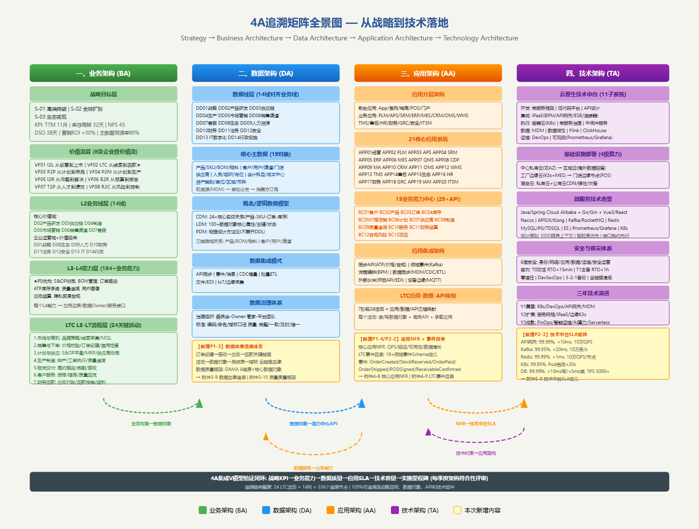
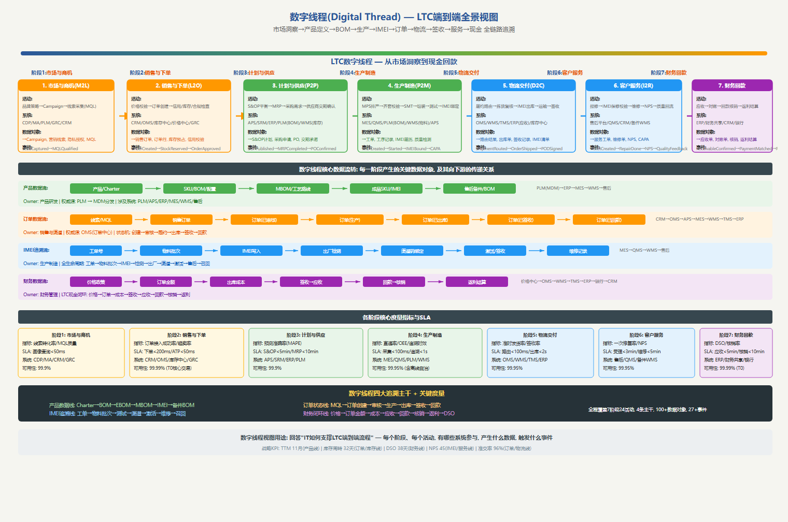

# 手机厂商企业架构规划文档（基于 TOGAF ADM 方法论）

> **说明**：本文档以"典型国产手机厂商（vivo/OPPO 类企业）"为对象，依据 TOGAF 9.2 的 ADM（Architecture Development Method）架构开发方法编制。当前交付物为"细化至四级小标题+内容摘要"的结构化总纲，用于评审整体架构规划框架；后续将基于此总纲填充完整内容、配图与附件。本文档所有配图位置与说明、附件引用地址均已标注，配图暂不绘制。

---

## 文档信息

| 项目 | 内容 |
|------|------|
| 文档名称 | 手机厂商企业架构总体规划（EA Master Plan） |
| 适用对象 | 手机研发制造与销售企业（以 vivo/OPPO 类为参照） |
| 方法论 | TOGAF 9.2 ADM + 业务模型、价值流、能力地图 |
| 覆盖范围 | 战略、业务、数据、应用、技术、实施六大架构域 |
| 文档版本 | V0.1（总纲版） |
| 交付形式 | Markdown 总纲 + 附件（Excel/Word）+ 配图（待绘制） |

---

# 第1章 企业战略与业务目标（Phase A：架构愿景）

> 本章对应 TOGAF ADM 的预备阶段与 A 阶段（架构愿景），承接企业总体战略，明确业务目标、关键成功因素与架构愿景，为后续业务/数据/应用/技术架构提供方向性约束。

## 1.1 战略背景与环境分析

### 1.1.1 宏观环境与行业趋势
#### 1.1.1.1 全球智能手机市场趋势
**内容摘要**：基于 PEST 与行业数据，分析全球及中国智能手机市场近五年出货量、均价、换机周期与存量格局。指出市场进入存量竞争、高端化与折叠屏/影像/AI 成为新增长极，厂商需从规模驱动转向价值与生态驱动，为架构规划提供外部约束与机会窗口。
**配图**：图1-1 战略环境分析 PEST 框架图
**附件**：[附件1-1 宏观环境PEST分析数据表.xlsx](./附件/附件1-1_宏观环境PEST分析数据表.xlsx)

#### 1.1.1.2 技术革新与消费升级
**内容摘要**：梳理 AI 大模型、端侧算力、影像传感器、折叠屏、卫星通信、快充与 IoT 互联等关键技术的成熟度与商业化节奏，结合用户从"硬件参数"向"体验与生态"升级的消费需求变化，明确技术-需求双轮驱动对企业数字化能力的新要求。
**配图**：图1-1 战略环境分析 PEST 框架图
**附件**：[附件1-1 宏观环境PEST分析数据表.xlsx](./附件/附件1-1_宏观环境PEST分析数据表.xlsx)

### 1.1.2 竞争格局与标杆分析
#### 1.1.2.1 头部厂商竞争态势
**内容摘要**：对比苹果、三星、华为、小米、OPPO、vivo 等头部厂商在份额、产品矩阵、渠道、研发与生态上的差异化打法，识别本企业在高端突破、海外扩张、IoT 生态与软件服务上的相对位置与短板，为战略目标设定提供竞争基准。
**配图**：图1-2 竞争格局与标杆对比雷达图
**附件**：[附件1-2 竞争格局与标杆对比数据.xlsx](./附件/附件1-2_竞争格局与标杆对比数据.xlsx)

#### 1.1.2.2 标杆企业最佳实践
**内容摘要**：选取 2-3 家标杆企业在研发数字化（IPD）、智能供应链、全渠道营销中台、全球化 IT 支撑与数据驱动运营方面的最佳实践，提炼可借鉴的架构能力要素，作为本企业目标架构设计的参考蓝本与差距对标基准。
**配图**：图1-2 竞争格局与标杆对比雷达图
**附件**：[附件1-2 竞争格局与标杆对比数据.xlsx](./附件/附件1-2_竞争格局与标杆对比数据.xlsx)

### 1.1.3 企业发展现状与能力盘点
#### 1.1.3.1 业务规模与经营现状
**内容摘要**：盘点企业当前产品线、年出货量、营收结构、渠道结构（线上/线下/运营商）、海外市场占比与利润率等关键经营指标，刻画业务基本盘，识别增长瓶颈与结构性问题，作为战略制定与架构投入产出的基线输入。
**配图**：图1-3 企业战略屋（Strategy House）背景数据
**附件**：[附件1-3 企业能力盘点评估表.xlsx](./附件/附件1-3_企业能力盘点评估表.xlsx)

#### 1.1.3.2 数字化能力现状评估
**内容摘要**：从业务在线化、数据贯通、应用集成、云化与基础设施韧性五个维度评估企业数字化现状，识别系统孤岛、数据散落、研发-供应链协同弱、海外 IT 支撑不足等痛点，量化能力成熟度，为架构愿景与实施优先级提供依据。
**配图**：图1-6 架构能力成熟度雷达图
**附件**：[附件1-3 企业能力盘点评估表.xlsx](./附件/附件1-3_企业能力盘点评估表.xlsx)

### 1.1.4 战略差距与驱动因素
#### 1.1.4.1 能力差距分析
**内容摘要**：将标杆最佳实践与现状评估对比，定位在产品创新速度、供应链柔性、全渠道一致性、数据驱动决策与全球化支撑五个方面的能力差距，明确"必须补齐"与"可渐进建设"的优先级，形成战略差距清单驱动后续架构域设计。
**配图**：图1-6 架构能力成熟度雷达图
**附件**：[附件1-3 企业能力盘点评估表.xlsx](./附件/附件1-3_企业能力盘点评估表.xlsx)

#### 1.1.4.2 转型驱动因素
**内容摘要**：归纳推动企业架构转型的内外部驱动因素，包括存量竞争下的效率诉求、高端化对研发协同的要求、出海对本地化 IT 的需求、AI 对数据与算力底座的需求，形成驱动因素-影响-优先级映射，支撑战略举措立项。
**配图**：图1-4 战略目标因果关系图（战略地图）
**附件**：[附件1-4 战略目标分解与KPI指标表.xlsx](./附件/附件1-4_战略目标分解与KPI指标表.xlsx)

## 1.2 企业愿景与使命

### 1.2.1 企业愿景陈述
#### 1.2.1.1 长期愿景目标
**内容摘要**：明确企业未来 5-10 年的长期愿景，例如"成为以用户导向与设计驱动全球领先的科技品牌"，界定愿景在用户、产品、技术、生态与全球化五个层面的内涵，作为所有架构决策的最终价值锚点与文化共识基础。
**配图**：图1-3 企业战略屋（Strategy House）
**附件**：[附件1-4 战略目标分解与KPI指标表.xlsx](./附件/附件1-4_战略目标分解与KPI指标表.xlsx)

#### 1.2.1.2 愿景落地路径
**内容摘要**：将长期愿景拆解为可执行的阶段性演进路径（短期夯实底座、中期能力突破、长期生态领先），定义每个阶段的标志性能力与架构状态，确保愿景不悬空，能够通过业务与 IT 架构的渐进建设逐步兑现。
**配图**：图1-4 战略目标因果关系图（战略地图）
**附件**：[附件1-4 战略目标分解与KPI指标表.xlsx](./附件/附件1-4_战略目标分解与KPI指标表.xlsx)

### 1.2.2 企业使命与价值主张
#### 1.2.2.1 使命陈述
**内容摘要**：界定企业存在的根本目的，如"以科技与设计为全球用户创造愉悦的数字生活体验"，阐明对消费者、员工、伙伴与社会创造的价值，使架构规划在资源分配时始终服务于企业的核心使命而非局部优化。
**配图**：图1-3 企业战略屋（Strategy House）
**附件**：[附件1-4 战略目标分解与KPI指标表.xlsx](./附件/附件1-4_战略目标分解与KPI指标表.xlsx)

#### 1.2.2.2 用户价值主张
**内容摘要**：提炼面向不同用户群（大众、年轻潮玩、影像爱好者、高端商务）的差异化价值主张，明确"为何选我"，并将价值主张转化为对产品、渠道、服务与软件体验的能力要求，向下游业务架构的能力设计传递需求信号。
**配图**：图1-2 竞争格局与标杆对比雷达图
**附件**：[附件1-2 竞争格局与标杆对比数据.xlsx](./附件/附件1-2_竞争格局与标杆对比数据.xlsx)

### 1.2.3 品牌定位与差异化
#### 1.2.3.1 品牌战略定位
**内容摘要**：明确主品牌与子品牌（性能/影像/性价比/海外）的矩阵定位与边界，避免内部蚕食；定义品牌向上的关键支撑（研发、设计、服务），并映射到需要重点投入的业务能力与数字化平台，保障定位可被运营落地。
**配图**：图1-3 企业战略屋（Strategy House）
**附件**：[附件1-4 战略目标分解与KPI指标表.xlsx](./附件/附件1-4_战略目标分解与KPI指标表.xlsx)

#### 1.2.3.2 差异化竞争策略
**内容摘要**：识别可被架构固化的差异化能力，如影像算法闭环、本地化渠道中台、柔性供应链与用户社区运营，明确哪些靠产品、哪些靠数据与平台取胜，形成"战略-能力-系统"的差异化传导链，避免同质化价格战。
**配图**：图1-4 战略目标因果关系图（战略地图）
**附件**：[附件1-2 竞争格局与标杆对比数据.xlsx](./附件/附件1-2_竞争格局与标杆对比数据.xlsx)

## 1.3 业务战略目标体系

### 1.3.1 总体战略目标
#### 1.3.1.1 战略总纲
**内容摘要**：以"战略屋"形式汇总企业总体战略目标：以用户与设计为内核，构建研发-供应链-营销-服务一体化能力，实现高端突破、全球扩张与生态变现三大跃迁，并锁定营收、份额、利润率与 NPS 等顶层目标，统领各架构域。
**配图**：图1-3 企业战略屋（Strategy House）
**附件**：[附件1-4 战略目标分解与KPI指标表.xlsx](./附件/附件1-4_战略目标分解与KPI指标表.xlsx)

#### 1.3.1.2 战略优先级
**内容摘要**：对战略举措按"影响度-紧迫度-可行性"进行优先级排序，明确先夯实数据底座与研发协同、再攻高端与出海、后建生态平台的节奏，避免资源分散；优先级结论直接指导第6章实施路线图的批次编排。
**配图**：图1-4 战略目标因果关系图（战略地图）
**附件**：[附件1-4 战略目标分解与KPI指标表.xlsx](./附件/附件1-4_战略目标分解与KPI指标表.xlsx)

### 1.3.2 业务增长战略
#### 1.3.2.1 国内存量经营
**内容摘要**：针对国内存量市场，制定以用户运营、换机激励、渠道效率与以旧换新为核心的精细化经营战略，要求架构支撑全域用户画像、精准营销与渠道库存可视，提升单客价值与复购率，稳住基本盘利润。
**配图**：图1-4 战略目标因果关系图（战略地图）
**附件**：[附件1-4 战略目标分解与KPI指标表.xlsx](./附件/附件1-4_战略目标分解与KPI指标表.xlsx)

#### 1.3.2.2 高端化突破
**内容摘要**：明确高端产品线的技术制高点（影像、折叠、AI），要求研发 IPD 协同、旗舰供应链管理、高端体验服务与品牌营销一体化；架构需保障高端产品从立项到交付的质量一致性与快速迭代能力。
**配图**：图1-4 战略目标因果关系图（战略地图）
**附件**：[附件1-4 战略目标分解与KPI指标表.xlsx](./附件/附件1-4_战略目标分解与KPI指标表.xlsx)

### 1.3.3 全球化战略
#### 1.3.3.1 海外市场布局
**内容摘要**：规划东南亚、南亚、欧洲、拉美等区域的分阶段进入策略，明确产品线、渠道模式与本地合规要求；架构需提供多语言、多币种、多税制、本地数据驻留与区域 IT 独立可运营的能力支撑体系。
**配图**：图1-4 战略目标因果关系图（战略地图）
**附件**：[附件1-4 战略目标分解与KPI指标表.xlsx](./附件/附件1-4_战略目标分解与KPI指标表.xlsx)

#### 1.3.3.2 本地化运营
**内容摘要**：强调海外本地化研发、生产、营销与售后运营的支撑能力，要求架构具备区域数据隔离、全球-本地混合云、本地伙伴集成与合规审计能力，平衡全球统一标准与区域灵活适配的"中心-边缘"治理模式。
**配图**：图1-3 企业战略屋（Strategy House）
**附件**：[附件1-4 战略目标分解与KPI指标表.xlsx](./附件/附件1-4_战略目标分解与KPI指标表.xlsx)

### 1.3.4 生态与数字化战略
#### 1.3.4.1 IoT 生态构建
**内容摘要**：规划以手机为核心的 IoT（穿戴、音频、平板、智能家居）生态，明确设备互联、统一账号、场景联动与开发者平台战略；架构需提供设备接入、生态伙伴管理与跨端服务编排的能力底座。
**配图**：图1-4 战略目标因果关系图（战略地图）
**附件**：[附件1-4 战略目标分解与KPI指标表.xlsx](./附件/附件1-4_战略目标分解与KPI指标表.xlsx)

#### 1.3.4.2 数字化运营转型
**内容摘要**：确立"以数据驱动经营"的转型战略，推动研产供销服全链路在线化与智能化，建设统一数据中台与 AI 能力平台；将数字化作为贯穿各业务域的横向使能战略，提升决策速度与运营效率。
**配图**：图1-4 战略目标因果关系图（战略地图）
**附件**：[附件1-4 战略目标分解与KPI指标表.xlsx](./附件/附件1-4_战略目标分解与KPI指标表.xlsx)

## 1.4 关键成功因素与绩效指标

### 1.4.1 关键成功因素
#### 1.4.1.1 产品创新能力
**内容摘要**：将"快速将技术与用户洞察转化为有竞争力产品"列为首要关键成功因素，要求架构支撑需求洞察、IPD 协同、仿真验证与供应链快速打样的端到端能力，缩短产品上市周期（TTM）并提升爆款命中率。
**配图**：图1-6 架构能力成熟度雷达图
**附件**：[附件1-5 干系人登记册.xlsx](./附件/附件1-5_干系人登记册.xlsx)

#### 1.4.1.2 供应链韧性
**内容摘要**：把"成本、交期、质量与抗风险并重"的供应链韧性列为关键成功因素，要求架构实现计划-采购-制造-物流的可视与协同、关键物料风险预警与多源供应，保障旺季交付与地缘不确定性下的业务连续性。
**配图**：图1-6 架构能力成熟度雷达图
**附件**：[附件1-5 干系人登记册.xlsx](./附件/附件1-5_干系人登记册.xlsx)

### 1.4.2 战略 KPI 指标体系
#### 1.4.2.1 KPI 框架设计
**内容摘要**：基于战略地图构建财务、客户、内部流程、学习成长四层 KPI 框架，覆盖营收、份额、毛利率、NPS、TTM、库存周转、交付准交率等，确保战略目标可量化、可追踪，并为数据架构的指标主题域提供源头定义。
**配图**：图1-4 战略目标因果关系图（战略地图）
**附件**：[附件1-4 战略目标分解与KPI指标表.xlsx](./附件/附件1-4_战略目标分解与KPI指标表.xlsx)

#### 1.4.2.2 指标分解与责任
**内容摘要**：将顶层 KPI 逐层分解到业务域、流程、岗位与系统，明确数据 owner 与采集口径，形成"指标-责任人-数据源"映射表，确保每项指标有人负责、有系统取数，为后续数据治理与主数据管理奠定责任基础。
**配图**：图1-4 战略目标因果关系图（战略地图）
**附件**：[附件1-4 战略目标分解与KPI指标表.xlsx](./附件/附件1-4_战略目标分解与KPI指标表.xlsx)

### 1.4.3 目标值与里程碑
#### 1.4.3.1 阶段性目标值
**内容摘要**：为各 KPI 设定分年度（Y1/Y2/Y3）目标值与基线对比，形成可考核的目标卡；目标值作为实施规划收益评估的基准，并随架构能力建设进度动态校准，保证战略可落地、可复盘。
**配图**：图1-4 战略目标因果关系图（战略地图）
**附件**：[附件1-4 战略目标分解与KPI指标表.xlsx](./附件/附件1-4_战略目标分解与KPI指标表.xlsx)

#### 1.4.3.2 关键里程碑
**内容摘要**：定义支撑战略目标达成的关键里程碑（如中台上线、海外区域云启用、高端产品交付），标注时间窗与前置依赖，作为路线图节点的验收锚点，与第6章实施路线图里程碑一一对应。
**配图**：图1-4 战略目标因果关系图（战略地图）
**附件**：[附件1-4 战略目标分解与KPI指标表.xlsx](./附件/附件1-4_战略目标分解与KPI指标表.xlsx)

## 1.5 架构愿景与干系人

### 1.5.1 干系人识别与分析
#### 1.5.1.1 干系人地图
**内容摘要**：识别董事会、业务总裁、研发/供应链/营销/IT 负责人、区域 GM、财务、合规及外部监管等干系人，绘制干系人地图并按权力-利益分类，明确各群体在架构规划中的角色与介入方式，保障共识与决策效率。
**配图**：图1-5 干系人地图与关注点矩阵
**附件**：[附件1-5 干系人登记册.xlsx](./附件/附件1-5_干系人登记册.xlsx)

#### 1.5.1.2 关注点矩阵
**内容摘要**：建立"干系人-关注点-架构诉求"矩阵，例如 CEO 关注投资回报、CIO 关注集成与治理、业务负责人关注易用与效率、合规关注数据出境，据此裁剪架构视图与沟通策略，提升干系人参与质量。
**配图**：图1-5 干系人地图与关注点矩阵
**附件**：[附件1-5 干系人登记册.xlsx](./附件/附件1-5_干系人登记册.xlsx)

### 1.5.2 架构原则
#### 1.5.2.1 业务架构原则
**内容摘要**：制定业务架构原则，如"以用户为中心、端到端闭环、能力可复用、流程标准化与灵活并存"，作为业务域划分、流程设计与组织协同的评判准则，确保业务架构服务于战略而非局部便利。
**配图**：（无配图）
**附件**：[附件1-6 架构原则清单.xlsx](./附件/附件1-6_架构原则清单.xlsx)

#### 1.5.2.2 技术架构原则
**内容摘要**：制定技术架构原则，如"平台化与中台化、云原生优先、数据同源、安全内建、开放 API、自主可控"，指导后续应用与技术架构选型，避免重复建设与厂商锁定，支撑长期演进与合规要求。
**配图**：（无配图）
**附件**：[附件1-6 架构原则清单.xlsx](./附件/附件1-6_架构原则清单.xlsx)

### 1.5.3 架构愿景声明
#### 1.5.3.1 目标架构愿景
**内容摘要**：形成一句话式的架构愿景："构建以用户为中心、数据驱动、平台支撑、全球一体的智慧型企业"，描绘未来目标架构的业务敏捷、数据贯通、应用服务化、技术云化的整体形态，统一全员对 EA 的期待。
**配图**：（无配图）
**附件**：（无附件）

#### 1.5.3.2 价值与收益预期
**内容摘要**：定性描述架构建设带来的价值：上市周期缩短、库存下降、营销 ROI 提升、海外扩张提速与运维成本降低，量化预期收益区间，作为争取预算与推动治理的说服依据，并与第6章收益分析衔接。
**配图**：图1-6 架构能力成熟度雷达图
**附件**：[附件1-4 战略目标分解与KPI指标表.xlsx](./附件/附件1-4_战略目标分解与KPI指标表.xlsx)

### 1.5.4 架构能力成熟度
#### 1.5.4.1 成熟度评估模型
**内容摘要**：采用 TOGAF/CMMI 风格的 EA 能力成熟度模型（初始-重复-定义-管理-优化五级），从治理、业务、数据、应用、技术五个维度建立评估量表，为标准化的现状打分与差距分析提供统一尺度。
**配图**：图1-6 架构能力成熟度雷达图
**附件**：[附件1-3 企业能力盘点评估表.xlsx](./附件/附件1-3_企业能力盘点评估表.xlsx)

#### 1.5.4.2 现状与差距
**内容摘要**：基于成熟度模型对企业当前 EA 能力打分，定位治理缺失、数据孤岛、应用烟囱、云化不足等差距，形成"现状级-目标级"差距清单，作为后续各架构域目标状态设计与实施投入的决策输入。
**配图**：图1-6 架构能力成熟度雷达图
**附件**：[附件1-3 企业能力盘点评估表.xlsx](./附件/附件1-3_企业能力盘点评估表.xlsx)

---

### 1.5.5 企业架构方法论定位与知识体系
#### 1.5.5.1 架构层级与分类澄清
**内容摘要**：澄清 EA、解决方案、系统/软件架构的层级边界：EA 如城市规划定义"做什么"（4A 战略约束），解决方案架构如片区改造整合多系统解决特定问题，系统/软件架构如盖楼落地。避免规划层级混淆，明确本规划属 EA 层，向下衔接 4+1 视图的软件架构细化，向上承接战略。
**配图**：图1-7 EA 知识体系与架构分类澄清图
**附件**：[附件1-7 架构分类与EA知识体系说明.docx](./附件/附件1-7_架构分类与EA知识体系说明.docx)

#### 1.5.5.2 EA 知识体系与主线
**内容摘要**：建立"业务+技术+管理"三维融合的 EA 知识体系：上游延展 BLM/商业模式/价值链，下游延展云原生/CMMI/敏捷/IPD。确立贯穿全文主线"业务驱动 IT → 数据驱动业务 → 架构落地"，并以信息化→数字化→智能化三阶段为演进坐标，作为架构决策的总领原则。
**配图**：图1-7 EA 知识体系与架构分类澄清图
**附件**：[附件1-7 架构分类与EA知识体系说明.docx](./附件/附件1-7_架构分类与EA知识体系说明.docx)

#### 1.5.5.3 TOGAF10 适配要点
**内容摘要**：吸收 TOGAF 10 模块化（洋葱式）结构，将战略、BLM、商业模式画布正式引入 EA 规划（原仅作输入），并强化 SOA 思想贯穿 4A、业务能力为枢纽、敏捷基于垂直业务场景短迭代。据此调整 ADM 应用方式，使本规划既遵循标准又适配企业敏捷转型。
**配图**：（无配图）
**附件**：[附件1-7 架构分类与EA知识体系说明.docx](./附件/附件1-7_架构分类与EA知识体系说明.docx)

### 1.5.6 智能时代企业架构演进（本体驱动范式重构）
#### 1.5.6.1 三阶段演进与 AI 落点
**内容摘要**：划分信息化（流程驱动、数据附属）→数字化（数据驱动、数据中台反哺）→智能化（模型驱动、数据+算法+大模型）三阶段，明确 AI 不另立第 5 个"A"，其能力拆回 4A：算力属技术架构、大模型底座属应用平台层、多模态数据扩展数据架构，避免架构域误设。
**配图**：图1-8 本体驱动 EA 范式重构
**附件**：[附件1-7 架构分类与EA知识体系说明.docx](./附件/附件1-7_架构分类与EA知识体系说明.docx)

#### 1.5.6.2 EA 四不足与三缺口
**内容摘要**：指出传统 EA 四不足：概念边界模糊、行为建模缺失、规则不可机器推理、数据来龙去脉断裂；对应本体的三缺口：语义统一、过程保留、动态推理。说明为何需在本体语义底座上重构，弥补描述性静态对齐、缺失预测性动态推导的能力短板。
**配图**：图1-8 本体驱动 EA 范式重构
**附件**：[附件1-7 架构分类与EA知识体系说明.docx](./附件/附件1-7_架构分类与EA知识体系说明.docx)

#### 1.5.6.3 范式重构三方向
**内容摘要**：提出重构三方向：①4A 之下增设本体语义底座，四层均为其投影；②建立实例数据向上归纳的双向建模机制；③以 LLM 抽取初始本体、推理引擎自动推导影响链，替代人工影响分析。架构师从"生产文档"转向"维护活性架构知识库"，保留战略翻译与治理三核心价值。
**配图**：图1-8 本体驱动 EA 范式重构
**附件**：[附件1-7 架构分类与EA知识体系说明.docx](./附件/附件1-7_架构分类与EA知识体系说明.docx)

## 1.6 本章小结
**内容摘要**：总结第1章形成的战略目标、关键成功因素、KPI、架构愿景、干系人和架构原则，作为第2-6章业务、数据、应用、技术和实施规划的统一战略输入。
**配图**：（无配图）
**附件**：（无附件）

# 第2章 业务架构（Phase B：业务架构）

> 本章对应 TOGAF ADM B 阶段，基于第1章战略目标和企业架构核心方法论，建立覆盖全企业的业务域、L4业务能力、端到端价值流和LTC关键流程展开，并明确业务组件如何支撑后续数据、应用和技术架构。

## 2.1 业务架构总体方法
**内容摘要**：说明业务架构从战略、价值链和端到端流程出发，通过自顶向下能力分解与自底向上流程/数据/CRUD聚合形成业务组件。明确全企业能力规划覆盖到L4，LTC等核心价值链进一步展开到L5-L7，为数据对象识别、应用系统规划和实施项目拆分提供统一输入。
**配图**：图2-1 业务架构框架与视图总览、图2-11 业务架构Y/V模型与四类交互矩阵
**附件**：[附件2-6 业务交互矩阵与行业参考模型.xlsx](./附件/附件2-6_业务交互矩阵与行业参考模型.xlsx)

## 2.2 全企业业务域划分
**内容摘要**：业务域从原先“核心业务+职场支撑”调整为14个全企业业务域：战略与经营管理、产品研发、供应链管理、生产制造、市场营销、销售与渠道、客户服务、生态与互联网服务、人力资源、财务管理、法务与合规、安全管理、IT与数字化、行政与设施。该划分直接作为第3章数据域分组和第4章应用组合规划的上游依据。
**配图**：图2-3 业务能力地图
**附件**：[附件2-1 业务域与职责明细表.xlsx](./附件/附件2-1_业务域与职责明细表.xlsx)

## 2.3 企业L4业务能力架构
**内容摘要**：按14个业务域逐层分解企业L4业务能力，L4颗粒度作为业务组件能力单元，可映射到应用组件、业务能力中心、API服务和实施项目。能力分解不仅覆盖产品研发、供应链、制造和营销销售，也覆盖人力、财务、法务、合规、安全、IT和行政等全域运营能力。
**配图**：图2-3 业务能力地图、图2-3b 业务能力地图L2-L3-L4完整展开、图2-9 业务能力热力图
**附件**：[附件2-4 业务能力热力图数据.xlsx](./附件/附件2-4_业务能力热力图数据.xlsx)、[附件2-8 L4业务能力分解表.xlsx](./附件/附件2-8_L4业务能力分解表.xlsx)

## 2.4 企业端到端价值流
**内容摘要**：定义8条企业端到端价值流：I2L从创意到上市、LTC从线索到回款、P2P从计划到采购、P2M从计划到生产、I2R从问题到解决、B2R从预算到报告、T2P从人才到绩效、R2C从风险到控制。每条价值流均说明触发、参与业务域、关键输出和架构意义。
**配图**：图2-5 端到端价值流地图
**附件**：[附件2-2 端到端价值流清单.xlsx](./附件/附件2-2_端到端价值流清单.xlsx)

## 2.5 LTC核心价值流L5-L7展开
**内容摘要**：围绕“市场与商机、销售与下单、计划与供应、生产制造、物流交付、客户服务、财务回款”七个阶段，进一步展开LTC关键活动到L5-L7，说明活动内容、责任角色、输入输出、控制点和业务规则，为第3章数据映射、第4章应用/API映射和第6章LTC项目群提供基础。
**配图**：图2-8 营销服务价值流
**附件**：[附件2-7 LTC关键活动L5-L7明细.xlsx](./附件/附件2-7_LTC关键活动L5-L7明细.xlsx)

## 2.6 业务组件如何支撑LTC端到端流程
**内容摘要**：按LTC七个阶段分别建立“活动-业务组件-组件能力”映射，明确客户管理、商机管理、价格促销、订单管理、计划管理、库存管理、制造执行、物流交付、服务管理和财务结算等业务组件如何支撑端到端流程。该映射是第4章能力中心/API规划和第6章实施项目依赖的关键桥梁。
**配图**：图2-11 业务架构Y/V模型与四类交互矩阵
**附件**：[附件2-9 业务组件支撑LTC映射.xlsx](./附件/附件2-9_业务组件支撑LTC映射.xlsx)

## 2.7 组织、角色与治理
**内容摘要**：明确端到端价值流Owner、业务域Owner、流程Owner、数据Owner和业务架构治理职责，强调跨域流程不能只由单个部门负责，而应通过业务架构治理机制保证能力、流程、数据和系统的一致性。
**配图**：图2-10 业务角色与职责RACI矩阵
**附件**：[附件2-5 业务角色与技能矩阵.xlsx](./附件/附件2-5_业务角色与技能矩阵.xlsx)

## 2.8 业务架构制品与附件
**内容摘要**：汇总业务域、价值流、流程清单、RACI、能力热力图、业务交互矩阵、LTC明细、L4能力分解和业务组件支撑LTC映射等制品，作为后续数据、应用、技术和实施规划的共同输入。
**配图**：第2章配图索引
**附件**：[附件2-1至附件2-9](./附件/)

## 2.9 本章小结
**内容摘要**：总结第2章形成的全企业业务域、L4业务能力、企业价值流、LTC L5-L7展开和业务组件支撑关系，明确其对第3章数据对象、第4章应用能力中心和第6章实施项目群的约束。
**配图**：（无配图）
**附件**：（无附件）

# 第3章 数据架构（Phase C：信息系统架构 - 数据部分）

> 本章对应 TOGAF ADM C 阶段的数据架构部分，承接第2章业务域、L4能力和LTC流程，形成全域数据域、数据对象、概念模型、逻辑模型、主数据和流程数据映射。

## 3.1 数据架构定位与建模方法
**内容摘要**：说明数据架构如何从业务流程分析识别业务对象，再将业务对象转化为数据对象，并进一步形成概念模型、逻辑模型和物理模型方法论。强调物理建模只给出设计方法和需补充的物理属性，不在本章展开详细DDL。
**配图**：图3-1 数据架构总体蓝图
**附件**：[附件3-3 概念逻辑数据模型表.xlsx](./附件/附件3-3_概念逻辑数据模型表.xlsx)

## 3.2 全域数据域规划（L1-L4）
**内容摘要**：数据域与第2章14个业务域保持一致，覆盖战略、研发、供应链、制造、营销、销售、服务、生态、人力、财务、法务、安全、IT和行政全域。L4层级落到具体数据对象或候选数据库表，避免只覆盖核心业务而遗漏企业运营域。
**配图**：图3-2 数据主题域关系图、图3-11 数据域L2-L3-L4完整分解图
**附件**：[附件3-1 数据主题域与实体目录.xlsx](./附件/附件3-1_数据主题域与实体目录.xlsx)、[附件3-2 数据资产盘点表.xlsx](./附件/附件3-2_数据资产盘点表.xlsx)

## 3.3 概念数据模型（CDM）
**内容摘要**：从客户、产品、物料、BOM、供应商、订单、库存、计划、生产、质量、服务、财务、人力、组织等核心实体出发，说明企业级概念实体及其关键关系，为逻辑模型和主数据治理提供统一语义。
**配图**：图3-3 概念数据模型ER图
**附件**：[附件3-3 概念逻辑数据模型表.xlsx](./附件/附件3-3_概念逻辑数据模型表.xlsx)

## 3.4 逻辑数据模型（LDM）
**内容摘要**：给出全域核心数据对象的逻辑属性，覆盖核心业务和企业运营域。重点补足人员、组织、岗位、财务科目、成本中心、资产类别、合同、风险事项、安全事件等非LTC对象，使数据架构与业务架构全域覆盖保持一致。
**配图**：图3-4 逻辑数据模型分层图
**附件**：[附件3-3 概念逻辑数据模型表.xlsx](./附件/附件3-3_概念逻辑数据模型表.xlsx)

## 3.5 物理数据模型（PDM）方法论
**内容摘要**：说明物理模型在逻辑模型基础上增加数据库类型、表名、字段类型、索引、分区、主外键、唯一约束、审计字段、归档策略和性能设计等内容，并给出设计原则，不在本章输出完整物理模型。
**配图**：图3-4 逻辑数据模型分层图
**附件**：[附件3-3 概念逻辑数据模型表.xlsx](./附件/附件3-3_概念逻辑数据模型表.xlsx)

## 3.6 主数据管理
**内容摘要**：详细识别人员、组织、岗位、供应商、客户、用户账号、渠道伙伴、门店、产品、SKU、物料、BOM、会计科目、成本中心、资产类别、单位、区域、币种等核心主数据对象，明确Owner、权威源和治理要求。
**配图**：图3-5 主数据管理架构
**附件**：[附件3-5 主数据清单.xlsx](./附件/附件3-5_主数据清单.xlsx)

## 3.7 LTC流程与数据映射
**内容摘要**：按第2章LTC七个阶段建立“活动-依赖数据-产生/更新数据”映射，说明每个阶段读取哪些主数据、交易数据和状态数据，又产生哪些商机、订单、计划、库存、生产、物流、服务和财务数据对象。
**配图**：图3-7 数据集成与生命周期
**附件**：[附件3-8 LTC流程数据映射.xlsx](./附件/附件3-8_LTC流程数据映射.xlsx)

## 3.8 数据治理、标准与质量
**内容摘要**：建立数据治理组织、数据Owner机制、数据标准、质量规则、质量监控和问题闭环。数据治理与主数据、数据模型和应用上线准入联动，避免应用项目先上线再补数据治理。
**配图**：图3-6 数据治理组织与流程
**附件**：[附件3-4 数据标准与质量规则.xlsx](./附件/附件3-4_数据标准与质量规则.xlsx)、[附件3-7 数据治理双态模型.xlsx](./附件/附件3-7_数据治理双态模型.xlsx)

## 3.9 数据集成与生命周期
**内容摘要**：规划批处理、实时流、API、消息和数据服务等集成模式，说明数据从创建、使用、共享、归档到销毁的生命周期策略，并与第4章iPaaS/API和第5章技术中台衔接。
**配图**：图3-7 数据集成与生命周期
**附件**：[附件3-6 数据集成接口清单.xlsx](./附件/附件3-6_数据集成接口清单.xlsx)

## 3.10 本章小结
**内容摘要**：总结第3章形成的全域数据域、核心数据对象、概念模型、逻辑模型、主数据清单和LTC流程数据映射，明确数据架构对应用系统、API服务和实施上线准入的支撑作用。
**配图**：（无配图）
**附件**：（无附件）

# 第4章 应用架构（Phase C：信息系统架构 - 应用部分）

> 本章对应 TOGAF ADM C 阶段的应用架构部分，以第2章业务能力和第3章数据对象为输入，规划“平台+应用”的应用功能架构、业务能力中心、数据能力中心、API和集成架构。

## 4.1 平台+应用构建思路
**内容摘要**：明确应用架构不是系统清单，而是业务能力落地方式。采用“上层业务应用+业务能力中心+数据能力中心+集成平台+技术中台”的平台化构建思路，将可复用能力下沉到能力中心，将数据服务沉淀到数据能力中心。
**配图**：图4-1 应用架构总体蓝图、图4-4 应用分层架构
**附件**：[附件4-6 中台与微服务拆分设计.xlsx](./附件/附件4-6_中台与微服务拆分设计.xlsx)

## 4.2 应用功能架构规划
**内容摘要**：规划21类IT应用，并重点说明PLM、APS、SRM、MES、CDP、MA、CRM、OMS、WMS、TMS、售后服务平台、HR、财务共享、GRC、安全运营与IAM等核心应用。应用功能按一级功能展开，并与业务域和L3能力组对应。
**配图**：图4-2 应用组合地图、图4-3 应用功能架构矩阵、图4-13 应用功能L2-L3-L4分解图、图4-16 供应链应用三级功能架构图、图4-17 PLM三级功能架构图、图4-18 MES三级功能架构图
**附件**：[附件4-1 应用系统清单.xlsx](./附件/附件4-1_应用系统清单.xlsx)、[附件4-2 应用功能矩阵.xlsx](./附件/附件4-2_应用功能矩阵.xlsx)、[附件4-3 核心应用系统需求规格索引.xlsx](./附件/附件4-3_核心应用系统需求规格索引.xlsx)

## 4.3 业务能力中心与数据能力中心
**内容摘要**：围绕客户中心、产品中心、订单中心、库存中心、价格促销中心、计划中心、供应商中心、制造中心、质量追溯中心、服务中心、财务结算中心、合规风险中心、项目中心等共享业务对象规划能力中心，并给出对外API能力。数据能力中心提供主数据、指标、标签、画像、数据服务和数据资产目录。
**配图**：图4-3 业务能力中心架构
**附件**：[附件4-6 中台与微服务拆分设计.xlsx](./附件/附件4-6_中台与微服务拆分设计.xlsx)

## 4.4 上层应用功能对能力中心的引用
**内容摘要**：建立上层应用一级功能与能力中心/API的引用关系，说明CRM、OMS、APS、SRM、MES、WMS、TMS、售后服务、财务共享等系统如何调用客户、产品、订单、库存、计划、供应商、财务结算等共享能力。
**配图**：图4-3 业务能力中心架构
**附件**：[附件4-6 中台与微服务拆分设计.xlsx](./附件/附件4-6_中台与微服务拆分设计.xlsx)

## 4.5 应用集成架构规划
**内容摘要**：将应用集成架构与应用功能架构分开说明，采用API网关、iPaaS、消息总线、数据同步和文件传输等模式管理跨系统协同，并明确PLM-ERP、CRM-OMS、OMS-WMS/TMS、OMS-财务、MES-QMS等关键链路。
**配图**：图4-6 应用集成架构、图4-15 业务系统集成与数据流关系图
**附件**：[附件4-4 应用接口与集成清单.xlsx](./附件/附件4-4_应用接口与集成清单.xlsx)

## 4.6 LTC流程的应用、数据与API映射
**内容摘要**：按第2章LTC七个阶段建立应用、数据和API映射，说明每个活动依赖哪些应用、读取/产生哪些数据、调用哪些能力中心API，从而把业务流程、数据对象和应用服务连接为一条可落地的实现链。
**配图**：图4-14 LTC阶段活动应用数据API明细矩阵、图2-13 LTC阶段业务组件数据API支撑矩阵
**附件**：[附件4-7 LTC流程应用数据API映射.xlsx](./附件/附件4-7_LTC流程应用数据API映射.xlsx)

## 4.7 应用治理与演进
**内容摘要**：说明应用组合治理、系统边界治理、API治理、架构符合性评审和应用演进原则。新建系统优先复用能力中心和数据能力中心，避免重复建设和点对点接口扩散。
**配图**：图4-8 应用成熟度与演进路线
**附件**：[附件4-5 应用成熟度评估表.xlsx](./附件/附件4-5_应用成熟度评估表.xlsx)

## 4.8 本章小结
**内容摘要**：总结第4章形成的平台+应用构建思路、应用组合、业务能力中心、数据能力中心、应用集成架构和LTC应用数据API映射，明确应用架构是业务能力和数据资产的落地实现。
**配图**：（无配图）
**附件**：（无附件）

# 第5章 技术架构（Phase D：技术架构）

> 本章对应 TOGAF ADM D 阶段，承接第4章应用架构和集成架构，规划云原生技术中台、微服务开发框架、基础设施测算、私有云数据中心、安全容灾和技术演进路线。

## 5.1 技术架构定位
**内容摘要**：明确技术架构不仅是IT基础设施，还包括支撑应用交付和运行的云原生技术中台。技术架构与第4章应用系统、能力中心、API集成和数据能力中心保持一致，为应用现代化提供开发、运行、运维和安全底座。
**配图**：图5-1 技术架构总体蓝图
**附件**：[附件5-1 基础设施资产清单.xlsx](./附件/附件5-1_基础设施资产清单.xlsx)

## 5.2 云原生技术中台总体架构
**内容摘要**：规划低代码平台、iPaaS集成平台、容器云、DevOps、微服务治理、云原生中间件、数据平台、可观测、DevSecOps等技术中台子系统，形成开发态、运行态、运维态一体化平台。
**配图**：图5-9 云原生技术中台架构
**附件**：[附件5-6 云原生技术中台规划.xlsx](./附件/附件5-6_云原生技术中台规划.xlsx)

## 5.3 微服务开发框架与技术组件选型
**内容摘要**：给出微服务开发框架、网关、注册配置、消息、缓存、数据库、链路追踪、日志、监控、熔断限流、安全认证和测试工具的选型建议，并说明设计时治理和运行时治理要求。
**配图**：图5-4 容器与云原生平台
**附件**：[附件5-8 微服务开发框架与组件选型.xlsx](./附件/附件5-8_微服务开发框架与组件选型.xlsx)、[附件5-5 技术选型标准清单.xlsx](./附件/附件5-5_技术选型标准清单.xlsx)

## 5.4 IT基础设施需求测算模型
**内容摘要**：建立基于业务量、交易峰值、用户并发、数据增长、接口调用、日志留存和容灾等级的资源测算模型，并以OMS系统为样例说明计算、存储、网络和中间件资源如何估算。
**配图**：图5-2 基础设施架构
**附件**：[附件5-7 基础设施资源测算模型.xlsx](./附件/附件5-7_基础设施资源测算模型.xlsx)

## 5.5 IT基础设施与私有云数据中心部署架构
**内容摘要**：规划企业内部网络、私有云数据中心分区、生产/测试/灾备环境、中心云、区域云和边缘云部署模式，支撑总部、海外区域、工厂边缘和互联网渠道的多场景运行。
**配图**：图5-2 基础设施架构、图5-3 混合云/多云架构
**附件**：[附件5-2 云平台资源规划表.xlsx](./附件/附件5-2_云平台资源规划表.xlsx)

## 5.6 安全、容灾与运行治理
**内容摘要**：规划安全架构、身份访问、网络分区、应用安全、数据安全、日志审计、灾备备份、RTO/RPO、演练机制和运行治理，保证云原生和能力中心化之后的安全合规和业务连续性。
**配图**：图5-5 信息安全体系框架、图5-7 容灾备份架构
**附件**：[附件5-3 安全合规检查清单.xlsx](./附件/附件5-3_安全合规检查清单.xlsx)、[附件5-4 容灾备份策略表.xlsx](./附件/附件5-4_容灾备份策略表.xlsx)

## 5.7 技术选型与演进路线
**内容摘要**：形成技术选型原则和三年演进路线：Y1建设平台底座和标准规范，Y2支撑能力中心和核心应用云原生化，Y3推进低代码、AI平台、AIOps、FinOps和多区域云管理。
**配图**：图5-8 技术选型标准体系、图5-10 云原生双轮驱动
**附件**：[附件5-5 技术选型标准清单.xlsx](./附件/附件5-5_技术选型标准清单.xlsx)

## 5.8 本章小结
**内容摘要**：总结第5章形成的云原生技术中台、微服务开发框架、资源测算模型、私有云数据中心部署、安全容灾和技术演进路线，明确其对第4章应用和第6章实施项目的支撑关系。
**配图**：（无配图）
**附件**：（无附件）

# 第6章 实施规划（Phase E/F/G：机会与方案、迁移规划、实施治理）

> 本章对应 TOGAF ADM E（机会与方案）、F（迁移规划）、G（实施治理）阶段，将第 2-5 章的业务、数据、应用和技术目标架构转化为可执行的项目组合、迁移波次、治理机制、投资预算、风险控制和价值度量。

## 6.1 实施规划定位与总体策略
**内容摘要**：明确第6章在企业架构中的承接关系：不是单纯系统上线计划，而是以价值流牵引、能力组件落地、数据先行、平台支撑、分波迁移为主线，将 L4 业务能力、数据对象、应用系统、能力中心、API 和技术中台转化为实施对象。
**配图**：图6-1 实施总体路线图
**附件**：[附件6-1 实施项目组合清单.xlsx](./附件/附件6-1_实施项目组合清单.xlsx)

## 6.2 现状调研、差距分析与实施机会识别
**内容摘要**：把现状调研前置到实施规划入口，沿业务流程、业务数据、应用功能、接口集成、技术部署和组织职责六条线识别差距，并将差距归并为 LTC 打通、IPD/BOM一体化、供应链计划协同、智能制造、主数据治理、能力中心、技术中台、安全合规等实施机会。
**配图**：图6-6 现状调研与差距分析框架
**附件**：[附件6-7 架构依赖与项目群路线图.xlsx](./附件/附件6-7_架构依赖与项目群路线图.xlsx)

## 6.3 项目组合规划
**内容摘要**：将项目组合分为业务价值链项目群、数据治理项目群、应用与能力中心项目群、技术中台与基础设施项目群、治理与变革项目群五类，形成18个核心项目清单和P0/P1/P2优先级模型。
**配图**：图6-2 项目组合优先级矩阵
**附件**：[附件6-1 实施项目组合清单.xlsx](./附件/附件6-1_实施项目组合清单.xlsx)、[附件6-7 架构依赖与项目群路线图.xlsx](./附件/附件6-7_架构依赖与项目群路线图.xlsx)

## 6.4 三年路线图与迁移波次
**内容摘要**：按照 Y1 夯实底座、Y2 打通链路、Y3 智能运营的节奏设计 Wave0-Wave4 迁移路线，明确八个关键里程碑，并给出主数据权威源、双轨运行、API代理、灰度切换、数据补偿和旧系统退役等新旧共存策略。
**配图**：图6-1 实施总体路线图、图6-3 迁移批次与过渡架构
**附件**：[附件6-3 迁移批次计划表.xlsx](./附件/附件6-3_迁移批次计划表.xlsx)

## 6.5 重点实施专题规划
**内容摘要**：围绕LTC端到端项目群、数据治理与主数据、应用与能力中心、技术中台与基础设施、组织变革与能力建设五个专题展开，明确每个专题的实施顺序、关键交付、依赖关系和验收指标。
**配图**：图6-7 4A集成V模型与域级映射、图6-8 IT组织重塑与敏捷铁三角
**附件**：[附件6-8 能力中心实施波次计划.xlsx](./附件/附件6-8_能力中心实施波次计划.xlsx)、[附件6-6 4A集成与敏捷组织.xlsx](./附件/附件6-6_4A集成与敏捷组织.xlsx)

## 6.6 实施治理机制
**内容摘要**：建立EA指导委员会、项目组合PMO、架构评审组、数据治理委员会、上线变更委员会五类治理机制，并把立项评审、方案评审、上线评审和运营评审作为架构落地的硬门禁。
**配图**：图6-4 实施治理组织
**附件**：[附件6-6 4A集成与敏捷组织.xlsx](./附件/附件6-6_4A集成与敏捷组织.xlsx)

## 6.7 投资估算、资源计划与收益模型
**内容摘要**：建立项目群、费用类型和年度节奏三维投资模型，明确软件许可、实施服务、自研人力、云资源与基础设施、数据治理与安全合规、培训变革等投资结构，并以TTM、库存周转、准时交付率、DSO、营销ROI、服务闭环率和IT交付周期衡量收益。
**配图**：图6-5 投资与收益结构图
**附件**：[附件6-2 投资估算与预算表.xlsx](./附件/附件6-2_投资估算与预算表.xlsx)、[附件6-5 收益量化评估表.xlsx](./附件/附件6-5_收益量化评估表.xlsx)

## 6.8 风险管理与保障措施
**内容摘要**：识别业务协同、数据质量、项目并行、系统切换、架构偏离、供应商锁定、用户采用、安全合规等关键风险，建立上线准入、回退机制、供应商合同治理和应急演练要求。
**配图**：（无配图）
**附件**：[附件6-4 风险登记册.xlsx](./附件/附件6-4_风险登记册.xlsx)

## 6.9 验收、运营与持续改进
**内容摘要**：把验收从项目交付扩展为项目验收、架构验收、业务价值验收和运营验收，要求上线后进入3-6个月价值观察期，并将流程、数据、API、架构决策、测试资产和运营指标纳入企业架构资产库。
**配图**：（无配图）
**附件**：[附件6-9 上线验收与价值度量清单.xlsx](./附件/附件6-9_上线验收与价值度量清单.xlsx)

## 6.10 本章小结
**内容摘要**：总结第6章形成的项目组合、迁移波次、治理机制、投资收益、风险控制和验收运营闭环，说明企业架构如何从蓝图转化为可建设、可运营、可度量和可持续演进的实施路线。
**配图**：（无配图）
**附件**：（无附件）

---

# 4A集成与跨域治理视图

本章汇总四个关键的跨域架构制品，形成从"追溯→决策→影响分析→可视化"的完整治理闭环。

## 跨域视图1：统一4A追溯矩阵【P1-1】

统一4A追溯矩阵以LTC 24个关键活动为行，以14个跨域维度为列，建立从战略目标→业务能力→数据对象→应用API→消息事件→技术组件→SLA→实施项目的完整追溯链。每个LTC活动可追溯至其依赖的全部4A元素，解决了此前多个附件分散映射的问题。详见附件：[附件-4A追溯矩阵](./附件/附件-4A追溯矩阵.xlsx)。

## 跨域视图2：架构决策记录（ADR）【新增-建议2】

ADR是防止架构知识流失的关键机制。每个关键架构决策记录：背景/问题、决策内容、考虑的备选方案、决策后果、关联架构原则和复审日期。

**已记录的5个关键ADR:**

| ADR编号 | 标题 | 决策 | 关联4A域 |
|---------|------|------|---------|
| ADR-001 | OMS自研 vs 采购 | 自研OMS核心交易链路+集成SaaS周边 | AA/DA |
| ADR-002 | 事件总线选择 | Kafka作为主力事件总线（10万条/s,exactly-once）| TA/AA |
| ADR-003 | ERP核心部署模式 | 核心财务保持虚拟化，外围渐进容器化 | TA/AA |
| ADR-004 | 库存中心独立建设 | 库存中心独立于WMS，Redis缓存ATP查询 | AA/DA/TA |
| ADR-005 | MES边缘部署 | 边缘K3s+离线自治（4h缓冲，<50ms本地延迟）| TA/AA |

ADR采用标准模板（含12个字段），每个ADR在决策后定期复审。详见附件：[附件-ADR架构决策记录](./附件/附件-ADR架构决策记录.xlsx)。

## 跨域视图3：变更影响分析模型【新增-建议3】

当4A架构任一层发生变化时，通过影响分析矩阵快速评估对全链路的波及范围。覆盖LTC核心链路的6个典型变更场景：

| 场景ID | 变更描述 | 影响等级 | 影响范围（4A全链路） | 响应SLA |
|--------|---------|---------|---------------------|---------|
| CIA-001 | 新增海外区域（巴西） | HIGH | BA:8个L4能力 / DA:7个对象 / AA:7个系统 / TA:5个组件 | <1周 |
| CIA-002 | 新增折叠屏产品线 | HIGH | BA:7个能力 / DA:6个对象 / AA:5个系统 / TA:3个组件 | <2周 |
| CIA-003 | OMS新增反欺诈规则 | MEDIUM | BA:2个能力 / DA:3个对象 / AA:3个系统 / TA:4个组件 | <3天 |
| CIA-004 | 关键物料新增替代料 | HIGH | BA:5个能力 / DA:6个对象 / AA:5个系统 / TA:3个组件 | <1周 |
| CIA-005 | 新增区域税务规则（VAT）| MEDIUM | BA:3个能力 / DA:5个对象 / AA:4个系统 / TA:3个组件 | <2周 |
| CIA-006 | K8s版本升级(1.28→1.31) | HIGH | AA:全部K8s应用 / TA:全部K8s组件 | <4周 |

影响传播路径覆盖4种方向：BA→DA→AA→TA(自上而下)、DA→BA/AA(双向)、AA→TA(自下而上)、TA→AA(自下而上)。详见附件：[附件-变更影响分析矩阵](./附件/附件-变更影响分析矩阵.xlsx)。

## 跨域视图4：数字线程（Digital Thread）【P1-2】

数字线程视图以LTC 7阶段时间轴为主线，展示产品数据线（Charter→BOM→IMEI→备件BOM）、订单状态线（MQL→订单创建→生产→签收→回款）、IMEI追溯线（工单→物料批次→测试→渠道→维修→召回）和财务闭环线（价格→订单金额→成本→应收→回款→核销→返利→DSO）四条主干的数据流转、系统归属和状态转换。每个阶段标注核心度量指标和SLA要求。

---

# 配图清单（全部配图位置与说明）

> 说明：以下配图均按"先占位、后绘制"原则，在对应章节已标注引用位置；绘制时统一采用深色主题/扁平化风格，图例见 2.6.1.2。

| 编号 | 配图名称 | 出现章节 | 配图说明 |
|------|----------|----------|----------|
| 图1-1 | 战略环境分析 PEST 框架图 | 1.1.1 | 以 PEST 四维度呈现宏观环境要素及对本企业的影响，含趋势箭头与权重标注。 |
| 图1-2 | 竞争格局与标杆对比雷达图 | 1.1.2 | 多厂商在份额/研发/渠道/生态/高端等维度的雷达对比，标注本企业位置。 |
| 图1-3 | 企业战略屋（Strategy House） | 1.2/1.3 | 以"屋顶-支柱-地基"结构表达愿景、战略目标与支撑举措的层级关系。 |
| 图1-4 | 战略目标因果关系图（战略地图） | 1.3/1.4 | 财务-客户-流程-成长四层因果链路，连接战略举措与 KPI 目标值。 |
| 图1-5 | 干系人地图与关注点矩阵 | 1.5.1 | 权力-利益矩阵叠加各干系人关注点与架构诉求。 |
| 图1-6 | 架构能力成熟度雷达图 | 1.1.3/1.5.4 | 治理/业务/数据/应用/技术五维成熟度现状与目标对比。 |
| 图2-1 | 业务架构框架与视图总览 | 2.1.1 | 展示所采用的业务架构框架、视图类型及相互关系的元模型图。 |
| 图2-2 | 商业模式画布 | 2.1.2 | 九宫格商业模式画布，标注收入结构与价值主张。 |
| 图2-3 | L4业务能力架构图 | 2.3 | 按L1价值流、L2业务域、L3能力组、L4能力单元展示全企业能力。 |
| 图2-3b | 业务能力地图L2-L3-L4完整展开 | 2.3.2 | 14个业务域逐层展示L3能力组和L4业务组件能力单元。 |
| 图2-4 | 组织架构成品图 | 2.2 | 集团-事业部-区域三层组织架构及业务域归属。 |
| 图2-5 | 端到端价值流地图 | 2.2.3/2.3.1 | 核心价值流阶段、参与者与痛点耗时的端到端地图。 |
| 图2-6 | 产品研发（IPD）流程泳道图 | 2.3.2/2.4.1 | 跨职能泳道展示 IPD 六阶段与决策评审点。 |
| 图2-7 | 供应链计划到交付流程 | 2.3.3/2.4.2 | 计划-采购-生产-发运全链路流程与系统接口。 |
| 图2-8 | 营销服务价值流 | 2.3.4/2.4.3/2.4.4 | 获客到留存及售后体验的用户全生命周期流程。 |
| 图2-9 | 业务能力热力图 | 2.1.3/2.5.2 | 重要度×成熟度二维热力，红黄绿标识建设优先级。 |
| 图2-10 | 业务角色与职责 RACI 矩阵 | 2.5.3 | 关键流程×角色的职责分配（R/A/C/I）矩阵。 |
| 图3-1 | 数据架构总体蓝图 | 3.1 | 数据架构目标态总览：主题域、平台、治理与流转。 |
| 图3-2 | 数据主题域模型 | 3.2 | 各数据主题域及其相互关系的领域模型图。 |
| 图3-3 | 企业级概念数据模型（ER） | 3.2.2/3.3.1 | 高层实体及关系的 ER 图，标注基数与关键规则。 |
| 图3-4 | 逻辑/物理数据模型示意 | 3.3.2/3.3.3 | 逻辑表结构到物理存储（分区/分库）的映射示意。 |
| 图3-5 | 数据治理组织与流程 | 3.4 | 三级治理组织与标准/质量/元数据管理流程。 |
| 图3-6 | 主数据管理架构 | 3.4.3 | MDM 平台主数据生命周期与分发订阅架构。 |
| 图3-7 | 数据流转与集成拓扑 | 3.5.1/3.5.2 | 源-采集-总线-中台-消费的批流一体数据管道拓扑。 |
| 图3-8 | 数据生命周期管理 | 3.5.3 | 数据产生到销毁各阶段策略与存储介质示意。 |
| 图4-1 | 应用架构总体蓝图 | 4.1 | 应用架构目标态总览：分层、中台、核心系统。 |
| 图4-2 | 应用组合地图 | 4.2.1 | 按业务域罗列现有与规划系统的应用全景图。 |
| 图4-3 | 应用功能覆盖矩阵 | 4.2.2 | 业务能力×应用系统的覆盖程度热力矩阵。 |
| 图4-4 | 应用分层架构 | 4.2.3 | 接入层-中台层-后台层-数据平台层分层图。 |
| 图4-5 | 核心应用系统交互图 | 4.3 | PLM/ERP/SCM/MES/CRM/生态等核心系统交互关系。 |
| 图4-6 | 应用集成架构（ESB/API） | 4.4.1/4.4.3 | API 网关+集成总线的系统解耦集成拓扑。 |
| 图4-7 | 微服务与 API 治理 | 4.4.2 | 服务注册、网格、API 目录与治理闭环示意。 |
| 图4-8 | 应用成熟度与演进路线 | 4.5 | 应用成熟度热力与迁移/淘汰演进路线。 |
| 图5-1 | 技术架构总体蓝图 | 5.1 | 技术架构目标态总览：云、网络、安全、容灾。 |
| 图5-2 | 基础设施架构 | 5.2 | 计算/存储/网络三级算力与园区/广域网络。 |
| 图5-3 | 混合云/多云架构 | 5.3.1 | 私有云+公有云+区域节点的多云管理架构。 |
| 图5-4 | 容器与云原生平台 | 5.3.2/5.3.3 | K8s 容器平台、编排与服务网格技术栈。 |
| 图5-5 | 信息安全体系框架 | 5.4.1 | 纵深防御与 DevSecOps 的安全体系框架。 |
| 图5-6 | 网络安全与零信任架构 | 5.4.2 | 零信任身份中心与微隔离网络防护架构。 |
| 图5-7 | 容灾备份架构 | 5.4.3 | 双活/异地灾备与 3-2-1 备份策略架构。 |
| 图5-8 | 技术选型标准体系 | 5.5 | 各层技术栈推荐/受限/禁止清单与选型流程。 |
| 图6-1 | 实施总体路线图（甘特/时间轴） | 6.1 | 跨三年分阶段项目排布与里程碑时间轴。 |
| 图6-2 | 项目组合优先级矩阵 | 6.1.3 | 价值×紧迫度×可行性三维项目优先级气泡图。 |
| 图6-3 | 迁移批次与过渡架构 | 6.2 | 迁移波次、过渡状态与共存策略演进图。 |
| 图6-4 | 实施治理组织 | 6.3 | 三级治理组织与角色 RACI 及管控机制。 |
| 图6-5 | 投资与收益结构图 | 6.4 | 投资结构、分年预算与累计收益曲线对照。 |
| 图1-7 | EA 知识体系与架构分类澄清图 | 1.5.5 | 架构层级分类（城市规划/片区/盖楼比喻）与 EA 知识体系三维框架。 |
| 图1-8 | 本体驱动 EA 范式重构 | 1.5.6 | 信息化→数字化→智能化三阶段、EA 四不足/三缺口、重构三方向。 |
| 图2-11 | 业务架构 Y/V 模型与四类交互矩阵 | 2.1.4 | 能力地图双循环、Y/V 模型与 CRUD/组件/流程/功能四类矩阵示例。 |
| 图2-12 | 业务解决方案与行业参考模型 | 2.4.5 | AS-IS→差距→TO-BE 业务方案与 SCOR/IPD 等参考模型映射。 |
| 图2-13 | LTC阶段-业务组件-数据-API支撑矩阵 | 2.6 | 按LTC七阶段展示业务组件、读写数据、应用系统和API能力综合映射。 |
| 图3-9 | 数据驱动双义与数据链视图 | 3.1.3 | 数据驱动决策 vs 业务、流向反转与端到端数据链。 |
| 图3-10 | 数据治理双态模型 | 3.4.5 | 静态标准模型 + 动态全生命周期双态治理模型。 |
| 图3-11 | 数据域L2-L3-L4完整分解图 | 3.2.2 | 14个数据域、数据对象组和L4数据对象/候选表完整展开。 |
| 图4-9 | 业务中台与能力中心架构 | 4.2.4 | 能力中心层、组合编排层与三类微服务模块形态。 |
| 图4-10 | 微服务拆分与分布式单元架构 | 4.5.3 | 业务驱动拆分、按域拆库与分布式单元多组织部署。 |
| 图4-11 | AI 平台层与智能应用架构 | 4.5.4 | AI 平台层（模型/推理/知识库）与智能应用场景。 |
| 图4-12 | 低代码平台定位 | 4.5.5 | 低代码在云原生中台上的定位、边界与集成关系。 |
| 图4-13 | 应用功能L2-L3-L4分解图 | 4.2 | 核心应用从业务域、业务系统到一级功能与三级菜单能力的逐层拆解。 |
| 图4-14 | LTC阶段活动-应用-数据-API明细矩阵 | 4.6 | 按阶段活动展开业务组件、读写数据、应用系统和API接口。 |
| 图4-15 | 业务系统集成与数据流关系图 | 4.5 | PLM、ERP、MES、OMS、WMS、TMS、SRM和数据平台的数据流集成关系。 |
| 图4-16 | 供应链应用三级功能架构图 | 4.2 | APS、SRM、ERP采购库存、WMS/TMS的三级功能架构。 |
| 图4-17 | PLM三级功能架构图 | 4.2 | PLM从产品规划、IPD、BOM变更到验证认证的三级功能架构。 |
| 图4-18 | MES三级功能架构图 | 4.2 | MES从工单执行、物料设备、质量追溯到现场协同的三级功能架构。 |
| 图5-9 | 云原生技术中台（PaaS）架构 | 5.1.3/5.3.4 | 容器云+DevOps+微服务的三层技术中台与抽象演进。 |
| 图5-10 | 云原生双轮驱动 | 5.1.3 | 架构升级与研发过程改进双轮驱动示意。 |
| 图6-6 | 现状调研与差距分析框架 | 6.1.4 | 调研前置、两类差距问题与差距清单生成。 |
| 图6-7 | 4A 集成 V 模型与域级映射 | 6.3.4 | 4A 集成 V 模型闭环与业务/数据/应用域一一映射。 |
| 图6-8 | IT 组织重塑与敏捷铁三角 | 6.3.5 | 前后端组织拆分与业务+IT+运营敏捷铁三角。 |
| 图-4A追溯 | 4A追溯矩阵全景图【P1-1】 | 跨域 | 战略→业务→数据→应用→技术 全链追溯视图,覆盖LTC 24活动×14追溯维度。 |
| 图-数字线程 | 数字线程LTC全景图【P1-2】 | 跨域 | 四条数据主干(产品/订单/IMEI/财务)全链路流转视图。 |
| - | 架构决策记录ADR【新增-建议2】 | 跨域 | 5个关键ADR(OMS自研/Kafka选型/ERP部署/库存中心/MES边缘)+12字段标准模板。 |
| 图-数据血缘 | LTC关键链路数据血缘追溯图【新增P1-3】 | 第3章 | 订单创建/库存预占/签收应收/IMEI追溯四条链路端到端血缘。 |
| 图-应用NFR | 核心应用NFR全景图【新增P1-4】 | 第4章 | 13个核心应用峰值QPS/延迟/可用性/弹性/特殊NFR全景。 |
| 图-能力依赖 | 业务能力依赖网络图【新增P2-1】 | 第2章 | 7条LTC关键能力依赖链及瓶颈能力硬依赖关系。 |
| 图-事件流 | LTC事件流拓扑图【新增P2-2】 | 第4章 | 27个LTC领域事件×Producer/Consumer×Topic/QoS拓扑图。 |
| 图-中台SLA | 云原生技术中台SLA全景图【新增P2-3】 | 第5章 | 20个技术中台组件×四级SLA×七维指标全景。 |

---

# 附件清单（引用地址与说明）

| 编号 | 附件名称 | 文件地址 | 说明 |
|------|----------|----------|------|
| 附件1-1 | 宏观环境PEST分析数据表 | [./附件/附件1-1_宏观环境PEST分析数据表.xlsx](./附件/附件1-1_宏观环境PEST分析数据表.xlsx) | 宏观环境、行业趋势和影响因素。 |
| 附件1-2 | 竞争格局与标杆对比数据 | [./附件/附件1-2_竞争格局与标杆对比数据.xlsx](./附件/附件1-2_竞争格局与标杆对比数据.xlsx) | 竞争厂商与标杆实践对比。 |
| 附件1-3 | 企业能力盘点评估表 | [./附件/附件1-3_企业能力盘点评估表.xlsx](./附件/附件1-3_企业能力盘点评估表.xlsx) | 当前能力成熟度与差距。 |
| 附件1-4 | 战略目标分解与KPI指标表 | [./附件/附件1-4_战略目标分解与KPI指标表.xlsx](./附件/附件1-4_战略目标分解与KPI指标表.xlsx) | 战略目标、KPI和里程碑。 |
| 附件1-5 | 干系人登记册 | [./附件/附件1-5_干系人登记册.xlsx](./附件/附件1-5_干系人登记册.xlsx) | 干系人、关注点和影响力。 |
| 附件1-6 | 架构原则清单 | [./附件/附件1-6_架构原则清单.xlsx](./附件/附件1-6_架构原则清单.xlsx) | 业务、数据、应用、技术架构原则。 |
| 附件1-7 | 架构分类与EA知识体系说明 | [./附件/附件1-7_架构分类与EA知识体系说明.docx](./附件/附件1-7_架构分类与EA知识体系说明.docx) | 架构层级澄清、EA知识体系与TOGAF10适配。 |
| 附件2-1 | 业务域与职责明细表 | [./附件/附件2-1_业务域与职责明细表.xlsx](./附件/附件2-1_业务域与职责明细表.xlsx) | 14个业务域职责与边界。 |
| 附件2-2 | 端到端价值流清单 | [./附件/附件2-2_端到端价值流清单.xlsx](./附件/附件2-2_端到端价值流清单.xlsx) | 8条企业级端到端价值流。 |
| 附件2-3 | 业务流程清单与RACI | [./附件/附件2-3_业务流程清单与RACI.xlsx](./附件/附件2-3_业务流程清单与RACI.xlsx) | 流程、角色和责任矩阵。 |
| 附件2-4 | 业务能力热力图数据 | [./附件/附件2-4_业务能力热力图数据.xlsx](./附件/附件2-4_业务能力热力图数据.xlsx) | 能力重要度、成熟度和优先级。 |
| 附件2-5 | 业务角色与技能矩阵 | [./附件/附件2-5_业务角色与技能矩阵.xlsx](./附件/附件2-5_业务角色与技能矩阵.xlsx) | 业务角色、职责和数字化技能。 |
| 附件2-6 | 业务交互矩阵与行业参考模型 | [./附件/附件2-6_业务交互矩阵与行业参考模型.xlsx](./附件/附件2-6_业务交互矩阵与行业参考模型.xlsx) | 业务交互、CRUD矩阵和行业模型裁剪。 |
| 附件2-7 | LTC关键活动L5-L7明细 | [./附件/附件2-7_LTC关键活动L5-L7明细.xlsx](./附件/附件2-7_LTC关键活动L5-L7明细.xlsx) | LTC阶段、活动、输入输出和控制点。 |
| 附件2-8 | L4业务能力分解表 | [./附件/附件2-8_L4业务能力分解表.xlsx](./附件/附件2-8_L4业务能力分解表.xlsx) | 14个业务域L4能力和组件单元。 |
| 附件2-9 | 业务组件支撑LTC映射 | [./附件/附件2-9_业务组件支撑LTC映射.xlsx](./附件/附件2-9_业务组件支撑LTC映射.xlsx) | LTC活动到业务组件和能力的映射。 |
| 附件3-1 | 数据主题域与实体目录 | [./附件/附件3-1_数据主题域与实体目录.xlsx](./附件/附件3-1_数据主题域与实体目录.xlsx) | 全域数据域和L4数据对象。 |
| 附件3-2 | 数据资产盘点表 | [./附件/附件3-2_数据资产盘点表.xlsx](./附件/附件3-2_数据资产盘点表.xlsx) | 数据资产、来源系统和责任人。 |
| 附件3-3 | 概念逻辑数据模型表 | [./附件/附件3-3_概念逻辑数据模型表.xlsx](./附件/附件3-3_概念逻辑数据模型表.xlsx) | 概念实体、逻辑对象和核心字段。 |
| 附件3-4 | 数据标准与质量规则 | [./附件/附件3-4_数据标准与质量规则.xlsx](./附件/附件3-4_数据标准与质量规则.xlsx) | 数据标准、质量规则和校验口径。 |
| 附件3-5 | 主数据清单 | [./附件/附件3-5_主数据清单.xlsx](./附件/附件3-5_主数据清单.xlsx) | 核心主数据对象、Owner和权威源。 |
| 附件3-6 | 数据集成接口清单 | [./附件/附件3-6_数据集成接口清单.xlsx](./附件/附件3-6_数据集成接口清单.xlsx) | 数据集成方式、接口和同步策略。 |
| 附件3-7 | 数据治理双态模型 | [./附件/附件3-7_数据治理双态模型.xlsx](./附件/附件3-7_数据治理双态模型.xlsx) | 稳态治理和项目态治理机制。 |
| 附件3-8 | LTC流程数据映射 | [./附件/附件3-8_LTC流程数据映射.xlsx](./附件/附件3-8_LTC流程数据映射.xlsx) | LTC活动依赖和产生的数据对象。 |
| 附件4-1 | 应用系统清单 | [./附件/附件4-1_应用系统清单.xlsx](./附件/附件4-1_应用系统清单.xlsx) | 应用组合、业务域和系统定位。 |
| 附件4-2 | 应用功能矩阵 | [./附件/附件4-2_应用功能矩阵.xlsx](./附件/附件4-2_应用功能矩阵.xlsx) | 应用一级功能和能力映射。 |
| 附件4-3 | 核心应用系统需求规格索引 | [./附件/附件4-3_核心应用系统需求规格索引.xlsx](./附件/附件4-3_核心应用系统需求规格索引.xlsx) | 核心应用功能需求索引。 |
| 附件4-4 | 应用接口与集成清单 | [./附件/附件4-4_应用接口与集成清单.xlsx](./附件/附件4-4_应用接口与集成清单.xlsx) | 应用接口、集成模式和链路。 |
| 附件4-5 | 应用成熟度评估表 | [./附件/附件4-5_应用成熟度评估表.xlsx](./附件/附件4-5_应用成熟度评估表.xlsx) | 应用成熟度和演进建议。 |
| 附件4-6 | 中台与微服务拆分设计 | [./附件/附件4-6_中台与微服务拆分设计.xlsx](./附件/附件4-6_中台与微服务拆分设计.xlsx) | 能力中心、API和微服务拆分。 |
| 附件4-7 | LTC流程应用数据API映射 | [./附件/附件4-7_LTC流程应用数据API映射.xlsx](./附件/附件4-7_LTC流程应用数据API映射.xlsx) | LTC活动到应用、数据和API的映射。 |
| 附件5-1 | 基础设施资产清单 | [./附件/附件5-1_基础设施资产清单.xlsx](./附件/附件5-1_基础设施资产清单.xlsx) | 基础设施资源、网络和环境资产。 |
| 附件5-2 | 云平台资源规划表 | [./附件/附件5-2_云平台资源规划表.xlsx](./附件/附件5-2_云平台资源规划表.xlsx) | 云资源规格、区域分布和成本。 |
| 附件5-3 | 安全合规检查清单 | [./附件/附件5-3_安全合规检查清单.xlsx](./附件/附件5-3_安全合规检查清单.xlsx) | 安全、隐私和合规控制项。 |
| 附件5-4 | 容灾备份策略表 | [./附件/附件5-4_容灾备份策略表.xlsx](./附件/附件5-4_容灾备份策略表.xlsx) | RTO/RPO、备份和演练计划。 |
| 附件5-5 | 技术选型标准清单 | [./附件/附件5-5_技术选型标准清单.xlsx](./附件/附件5-5_技术选型标准清单.xlsx) | 技术栈推荐、受限和禁止项。 |
| 附件5-6 | 云原生技术中台规划 | [./附件/附件5-6_云原生技术中台规划.xlsx](./附件/附件5-6_云原生技术中台规划.xlsx) | 技术中台子系统和演进路线。 |
| 附件5-7 | 基础设施资源测算模型 | [./附件/附件5-7_基础设施资源测算模型.xlsx](./附件/附件5-7_基础设施资源测算模型.xlsx) | 业务量到计算、存储和网络资源测算。 |
| 附件5-8 | 微服务开发框架与组件选型 | [./附件/附件5-8_微服务开发框架与组件选型.xlsx](./附件/附件5-8_微服务开发框架与组件选型.xlsx) | 微服务框架、组件和治理选型。 |
| 附件6-1 | 实施项目组合清单 | [./附件/附件6-1_实施项目组合清单.xlsx](./附件/附件6-1_实施项目组合清单.xlsx) | 项目范围、工期、依赖与优先级。 |
| 附件6-2 | 投资估算与预算表 | [./附件/附件6-2_投资估算与预算表.xlsx](./附件/附件6-2_投资估算与预算表.xlsx) | 投资结构、分年预算与现金流。 |
| 附件6-3 | 迁移批次计划表 | [./附件/附件6-3_迁移批次计划表.xlsx](./附件/附件6-3_迁移批次计划表.xlsx) | 迁移波次、窗口、负责人与状态。 |
| 附件6-4 | 风险登记册 | [./附件/附件6-4_风险登记册.xlsx](./附件/附件6-4_风险登记册.xlsx) | 风险识别、评级、应对与责任人。 |
| 附件6-5 | 收益量化评估表 | [./附件/附件6-5_收益量化评估表.xlsx](./附件/附件6-5_收益量化评估表.xlsx) | 收益分类、量化模型与归因口径。 |
| 附件6-6 | 4A集成与敏捷组织 | [./附件/附件6-6_4A集成与敏捷组织.xlsx](./附件/附件6-6_4A集成与敏捷组织.xlsx) | 治理组织、4A集成和敏捷切片。 |
| 附件6-7 | 架构依赖与项目群路线图 | [./附件/附件6-7_架构依赖与项目群路线图.xlsx](./附件/附件6-7_架构依赖与项目群路线图.xlsx) | 项目群波次、前后置依赖和架构控制点。 |
| 附件6-8 | 能力中心实施波次计划 | [./附件/附件6-8_能力中心实施波次计划.xlsx](./附件/附件6-8_能力中心实施波次计划.xlsx) | 能力中心上线波次和API服务。 |
| 附件6-9 | 上线验收与价值度量清单 | [./附件/附件6-9_上线验收与价值度量清单.xlsx](./附件/附件6-9_上线验收与价值度量清单.xlsx) | 项目、架构、业务价值和运营验收指标。 |
| 附件-4A追溯 | 4A追溯矩阵【P1-1】 | [./附件/附件-4A追溯矩阵.xlsx](./附件/附件-4A追溯矩阵.xlsx) | LTC 24活动×14维4A追溯+域级映射+关键指标追溯。 |
| 附件-ADR | 架构决策记录【新增-建议2】 | [./附件/附件-ADR架构决策记录.xlsx](./附件/附件-ADR架构决策记录.xlsx) | 5个已批准ADR+12字段空白模板。 |
| 附件-CIA | 变更影响分析矩阵【新增-建议3】 | [./附件/附件-变更影响分析矩阵.xlsx](./附件/附件-变更影响分析矩阵.xlsx) | 6个典型变更场景+影响传播路径+4A全链路评估。 |
| 附件2-10 | 业务能力依赖关系矩阵【新增P2-1】 | [./附件/附件2-10_业务能力依赖关系矩阵.xlsx](./附件/附件2-10_业务能力依赖关系矩阵.xlsx) | 24个L4能力依赖关系+7条关键依赖链分析。 |
| 附件3-9 | 数据血缘追溯【新增P1-3】 | [./附件/附件3-9_数据血缘追溯.xlsx](./附件/附件3-9_数据血缘追溯.xlsx) | LTC 4条关键链路18节点端到端数据血缘。 |
| 附件3-10 | 数据质量度量框架【新增P2-4】 | [./附件/附件3-10_数据质量度量框架.xlsx](./附件/附件3-10_数据质量度量框架.xlsx) | DAMA 6维度×23核心对象质量矩阵+7 KPI仪表板。 |
| 附件4-8 | 核心应用NFR需求表【新增P1-4】 | [./附件/附件4-8_核心应用NFR需求表.xlsx](./附件/附件4-8_核心应用NFR需求表.xlsx) | 13个核心应用NFR基线和5个架构决策(ADR)。 |
| 附件4-9 | LTC事件目录【新增P2-2】 | [./附件/附件4-9_LTC事件目录.xlsx](./附件/附件4-9_LTC事件目录.xlsx) | 27个LTC领域事件规格和事件流拓扑。 |
| 附件5-9 | 技术中台SLA定义【新增P2-3】 | [./附件/附件5-9_技术中台SLA定义.xlsx](./附件/附件5-9_技术中台SLA定义.xlsx) | 20个技术中台组件四级SLA矩阵。 |

## 文档修订记录

| 版本 | 日期 | 修订人 | 说明 |
|------|------|--------|------|
| V0.1 | 2026-07-16 | 架构规划组 | 完成四级小标题总纲、内容摘要、配图与附件引用。 |
| V0.2 | 2026-07-17 | 架构规划组 | P1-1~P1-4 + P2-1~P2-4 优化:新增4A追溯矩阵、数字线程视图、数据血缘追溯、核心应用NFR、业务能力依赖模型、LTC事件目录、技术中台SLA、数据质量度量框架。新增8个Excel附件 + 7个HTML架构图 + 跨域4A追溯集成视图。 |

> 下一步：基于本总纲逐章填充完整内容，绘制配图（图1-1 至 图6-8，其中 1-7/1-8、2-11/2-12、3-9/3-10/3-11、4-9~4-18、5-9/5-10、6-6~6-8 为已添加配图），并编制上述 49 个 Excel/Word 附件模板（含本次新增8个）。
