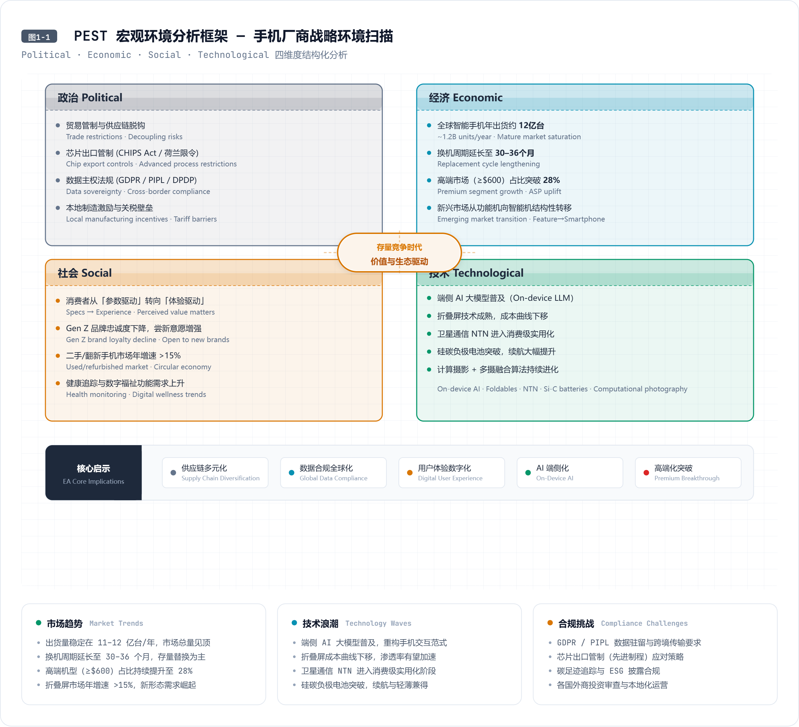
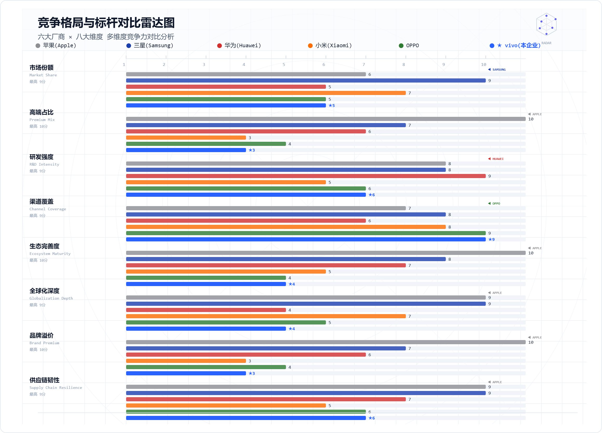
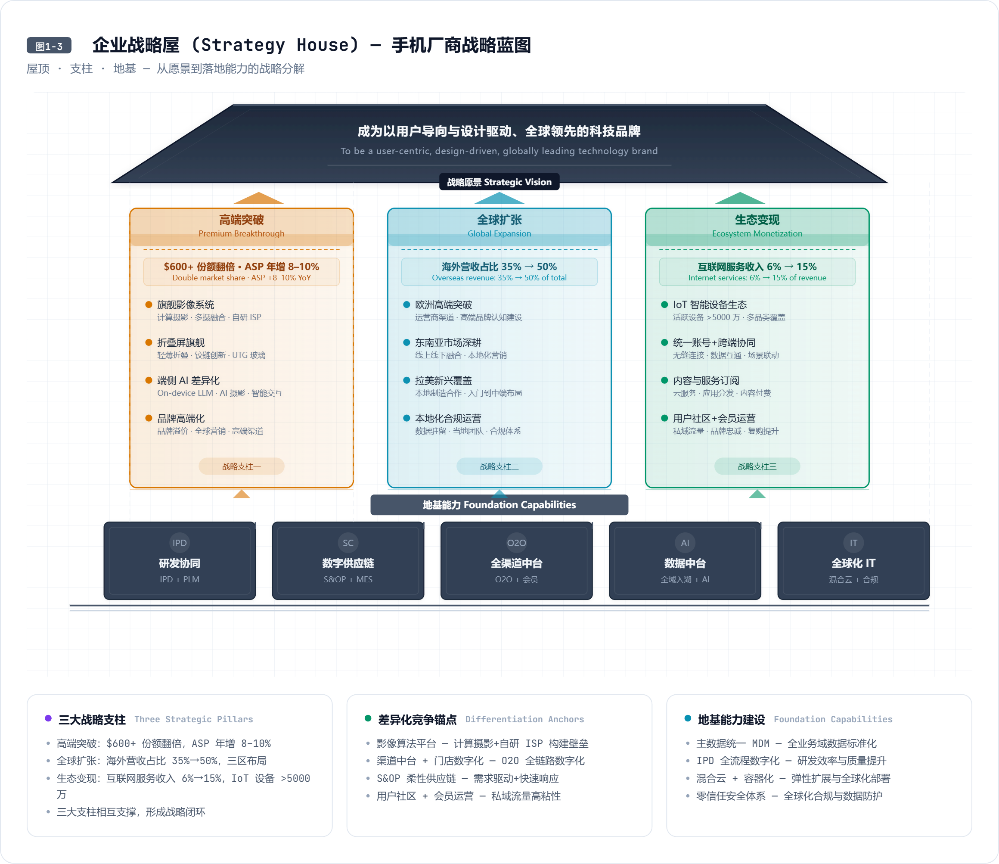
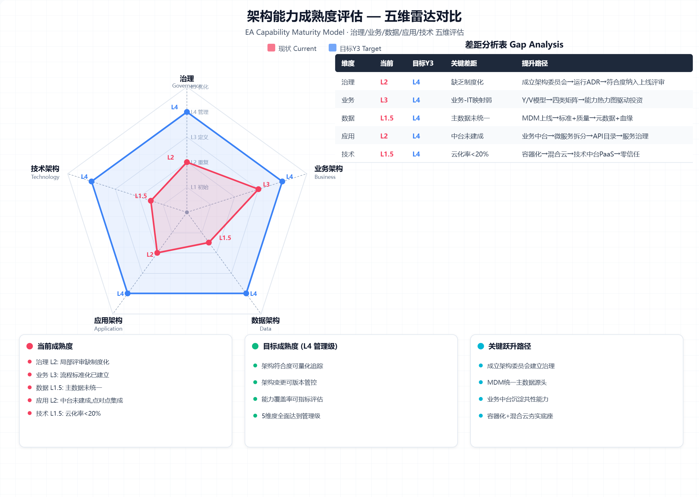
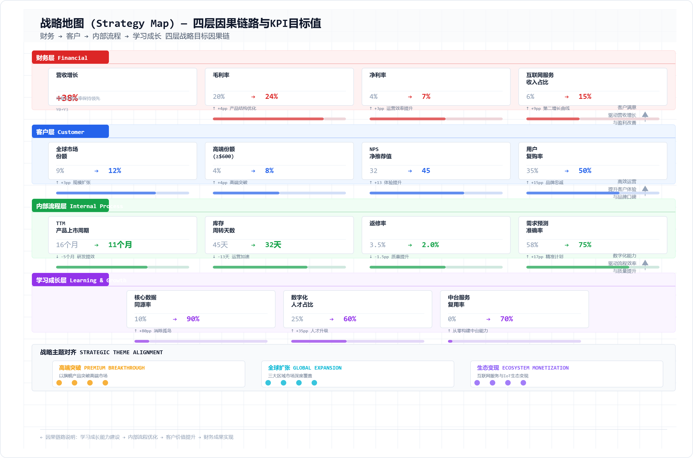
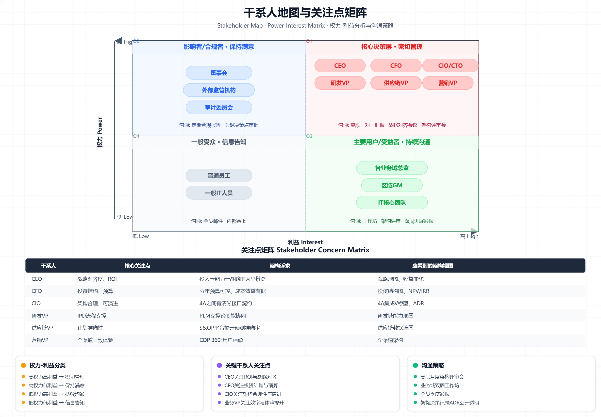
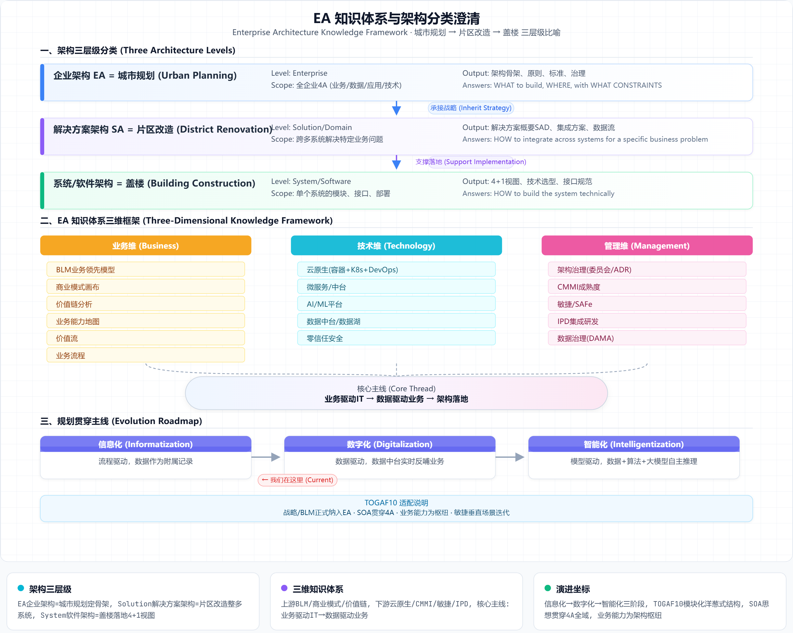
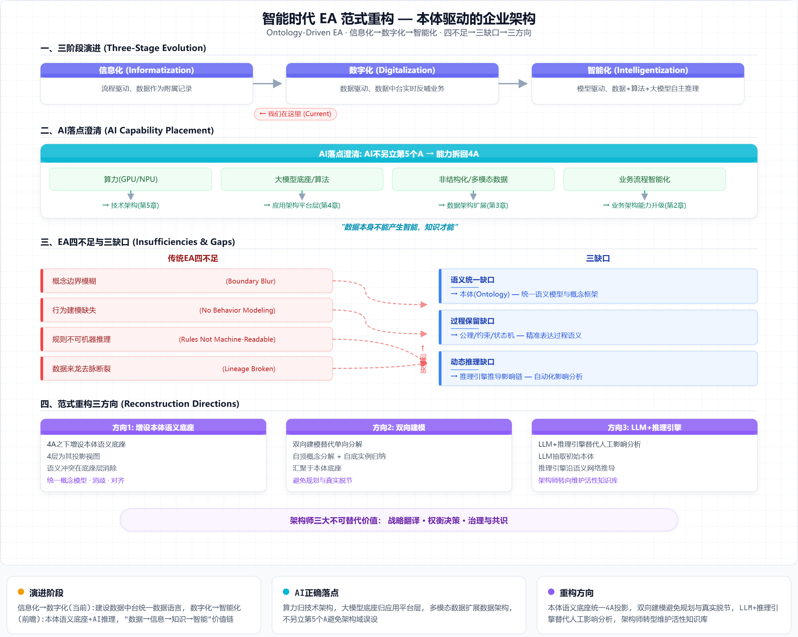

# 第1章 企业战略与业务目标（Phase A：架构愿景）

> **文档归属**：《手机厂商企业架构总体规划》第 1 章
> **对应 TOGAF ADM 阶段**：预备阶段（Preliminary） + A 阶段（架构愿景，Architecture Vision）
> **章节目标**：承接企业总体战略，明确宏观环境、竞争格局与自身能力现状，定义企业愿景、使命、业务战略目标体系，识别关键成功因素与战略 KPI，最终形成架构愿景、架构原则、干系人地图，并确立贯穿全规划的 EA 方法论定位与智能时代演进主张。
> **配套附件**：[附件1-1 宏观环境PEST分析数据表](./附件/附件1-1_宏观环境PEST分析数据表.xlsx)、[附件1-2 竞争格局与标杆对比数据](./附件/附件1-2_竞争格局与标杆对比数据.xlsx)、[附件1-3 企业能力盘点评估表](./附件/附件1-3_企业能力盘点评估表.xlsx)、[附件1-4 战略目标分解与KPI指标表](./附件/附件1-4_战略目标分解与KPI指标表.xlsx)、[附件1-5 干系人登记册](./附件/附件1-5_干系人登记册.xlsx)、[附件1-6 架构原则清单](./附件/附件1-6_架构原则清单.xlsx)、[附件1-7 架构分类与EA知识体系说明](./附件/附件1-7_架构分类与EA知识体系说明.docx)

---

## 1.1 战略背景与环境分析

企业架构规划不能凭空设计，必须建立在对宏观环境、竞争态势与自身能力的系统诊断之上。本章作为架构规划的起点，首先进行"外部扫描→内部盘点→差距定位"的三步诊断，为后续战略目标与架构愿景提供事实基线。

### 1.1.1 宏观环境与行业趋势

#### 1.1.1.1 全球智能手机市场趋势

**核心判断**：全球智能手机市场已从增量竞争全面转入存量竞争，年出货量趋于平稳，高端化、折叠屏、影像与 AI 成为结构性增长极，厂商增长逻辑正从"规模驱动"转向"价值与生态驱动"。

基于 PEST 框架与行业数据的系统分析揭示以下关键趋势：

**政治与法规维度（P）**：
- 地缘政治持续影响全球供应链格局，芯片出口管制与实体清单政策迫使手机厂商重构多元化供应体系，关键元器件（SoC、射频、存储）的自主可控从"加分项"变为"生存项"。
- 各国数据主权立法加速——欧盟 GDPR、中国《个人信息保护法》、印度数据本地化法案、巴西 LGPD——对手机厂商的全球化数据合规提出高标准要求，数据跨境传输、用户隐私同意管理、本地数据驻留成为海外运营的刚性约束。
- 贸易摩擦引发关税波动，推动厂商在东南亚、南亚、拉美布局本地化制造与组装，从"中国制造出口"转向"区域制造服务区域"。

**经济维度（E）**：
- 全球智能手机年出货量稳定在约 11~12 亿台区间，中国市场贡献约 23%~25% 份额。换机周期从 24 个月持续拉长至 30~36 个月，消费者换机意愿下降主要受硬件创新边际递减与宏观经济不确定性双重影响。
- 价格结构持续上行：高端机型（≥600 美元）与超高端机型（≥1000 美元）占比从 2020 年的约 18% 提升至 2025 年的约 28%；折叠屏手机年出货量突破 2000 万台并保持两位数增速。
- 新兴市场（东南亚、非洲、拉美）仍存在功能机向智能机的结构性转换红利，但客单价偏低，利润贡献有限，需以规模摊薄固定成本。
- 汇率波动（特别是新兴市场货币贬值）对海外营收的人民币折算造成持续压力，要求财务与供应链架构具备多币种对冲与本地化采购能力。

**社会文化维度（S）**：
- 消费者购买决策从"跑分参数"转向"综合体验"：影像能力（日常出片率而非实验室跑分）、系统流畅度、隐私保护、外观设计成为首要购买驱动因素。
- 年轻用户（Z 世代）品牌忠诚度下降，更依赖社交媒体口碑与短视频种草决策，要求品牌建设与用户运营从"渠道推力"转向"内容引力"。
- 二手手机与翻新机市场规模快速增长，高残值率成为高端品牌的重要竞争壁垒，同时带动以旧换新、循环经济的商业模式创新。
- 健康管理与数字福祉意识提升，屏幕使用时间管理、护眼认证、心率/睡眠监测等健康功能从差异化卖点变为标配期望。

**技术维度（T）**：
- 端侧 AI 大模型（LLM on Device）与 NPU 算力普及标志着手机进入"智能体时代"：本地实时翻译、AI 影像增强、智能摘要、个性化语音助手成为系统级能力，倒逼端侧算力、模型压缩与隐私计算技术的成熟。
- 折叠屏铰链与 UTG 超薄玻璃持续迭代，成本曲线下移推动折叠屏从超高端向中高端下沉，预计 2027 年折叠屏渗透率将达到 5%~8%。
- 硅碳负极电池与固态电池技术突破将使旗舰机续航提升 20%~30%，缓解用户续航焦虑并改变产品定义逻辑。
- 卫星通信（NTN）从应急场景向短消息、IoT 回传扩展，成为高端机型差异化的重要锚点。

综合来看，存量竞争时代要求手机厂商的架构规划从"支撑海量交易与快速扩张"升级为"支撑高端突破、精细化用户运营、跨端生态协同与全球化合规运营"四位一体的能力底座。

**配图**：图1-1 战略环境分析 PEST 框架图（见 [html/图1-1_PEST框架图.html](./html/图1-1_PEST框架图.html)）

**附件**：[附件1-1 宏观环境PEST分析数据表](./附件/附件1-1_宏观环境PEST分析数据表.xlsx)
#### 1.1.1.2 技术革新与消费升级

**核心判断**：AI 大模型端侧化、影像传感突破、折叠形态成熟、卫星通信普及与 IoT 互联深化五大技术浪潮正与用户从"买硬件"到"买体验+服务"的需求升级形成共振，技术-需求双轮驱动对企业数字化底座提出前所未有的要求。

**五大技术浪潮的具体影响**：

其一，**AI 端侧化重新定义产品力**。从高通骁龙 8 系、联发科天玑旗舰平台的 NPU 算力演进来看，端侧推理能力每代提升约 2~3 倍。手机厂商需建设 AI 模型训练与部署平台，将影像算法（AI 超分、夜景增强、人像虚化）、语音助手、实时翻译、文档摘要等能力统一纳入 AI 中台管理，支撑跨产品线的算法复用与快速迭代。这要求应用架构层规划统一的模型服务与推理引擎，技术架构层规划 GPU/NPU 算力池。

其二，**影像传感与计算摄影持续内卷**。1 英寸大底传感器、可变光圈、潜望长焦的硬件竞赛之外，真正的差异化来自计算摄影——多帧合成、语义分割、AI 调色、视频虚化等算法能力。这要求建立从"影像算法研发→效果评测→OTA 推送→用户反馈"的数据闭环，数据架构需承载海量影像样本与标注数据。

其三，**折叠屏从尝鲜走向主力**。铰链寿命、折痕控制、应用适配三大痛点正在被逐一攻克。折叠屏的研发复杂度（软硬件协同、铰链供应链、UTG 良率）远高于直板机，要求 PLM 系统支撑更严格的 DFX 评审与多方案并行管理。

其四，**卫星通信从应急到实用**。从短报文到语音通话到 IoT 数据回传，卫星通信需要与地面蜂窝网络实现无缝切换，要求技术架构在通信协议栈、天线设计与云端调度层面进行适配。

其五，**IoT 跨端互联构建生态护城河**。手机作为控制中枢，与穿戴设备、平板、PC、智能家居的互联体验直接影响用户留存。跨端服务编排（如手机上复制、平板上粘贴）要求统一账号、设备发现、近场通信与云端同步的技术底座。

**消费升级的核心变化**：用户价值感知从"硬件参数可量化"转向"体验难以参数化"——系统动效流畅度、应用打开速度、拍照成片率、续航安全感、隐私透明度。这对架构提出三重含义：①产品研发需建设用户体验度量平台，将主观体验转化为可追踪、可优化的工程指标；②数据架构需承载全域用户行为数据，形成 360° 用户视图；③应用架构需支持快速迭代的 A/B 实验与灰度发布能力。

**配图**：图1-1 战略环境分析 PEST 框架图（见 [html/图1-1_PEST框架图.html](./html/图1-1_PEST框架图.html)）
**附件**：[附件1-1 宏观环境PEST分析数据表](./附件/附件1-1_宏观环境PEST分析数据表.xlsx)

### 1.1.2 竞争格局与标杆分析

#### 1.1.2.1 头部厂商竞争态势

**核心判断**：全球 TOP6 手机厂商（苹果、三星、华为、小米、OPPO、vivo）在份额、产品、渠道、研发、生态五个维度形成差异化格局。本企业在出货规模上属于第一梯队（全球年出货量 8000 万~1.2 亿台区间），但在高端份额、海外本地化深度、互联网服务收入占比三个维度上仍存在显著差距。

**各维度对比分析**（详见附件1-2）：

**份额与市场覆盖**：苹果占据全球高端市场（≥600 美元）约 60%~65% 的份额，依靠 iOS 生态锁定高净值用户群；三星凭借全球渠道网络与全价格带覆盖维持出货量第一，但在中国市场近乎归零；华为制裁后聚焦国内高端市场，Mate/P 系列品牌溢价强劲，但海外 GMS 缺失制约全球化；小米凭借线上效率与印度/欧洲市场突破，出货量位居前三，但 ASP 偏低、高端认可度仍在爬坡；OPPO/vivo 深耕线下渠道与影像差异化，全球份额稳定在 8%~10% 区间。

**研发强度与专利储备**：头部厂商年研发投入占营收 5%~10%（约 50 亿~200 亿人民币）。苹果的 A/M 系列自研芯片、iOS 生态垂直整合构成最强护城河；华为的影像（XMAGE）、通信与鸿蒙 OS 的技术纵深领先；三星在屏幕、存储、折叠铰链等核心元器件领域具有供应链垂直整合优势。本企业在影像算法与快充技术上已有差异化积累，但在芯片自研、OS 内核与基础软件能力上仍主要依赖供应链伙伴。

**渠道与零售模式**：苹果的直营零售店（Apple Store）+ 线上商城占据了用户触达的制高点，控制了品牌叙事与定价权。安卓厂商高度依赖第三方线下经销商与运营商渠道，渠道层级多、价盘管控难、终端数据回流少。国内 OV 系通过"代理商-经销商-门店"三级深耕线下，在低线城市具备渠道纵深优势，但渠道数字化程度仍偏低，经销商库存与终端动销数据未能实时回流。

**生态与服务收入**：苹果的服务收入（App Store、Apple Music、iCloud、Apple Pay 等）已超过 850 亿美元/年，占营收比约 22%，毛利率超过 70%，成为对抗硬件周期性波动的稳定器。华为鸿蒙生态（HMS + 应用市场 + 云空间 + 视频/音乐）在国内已形成一定规模。本企业的互联网服务收入占比预估在 5%~8%，主要来自应用商店与游戏分发，生态变现能力与标杆差距明显。

**配图**：图1-2 竞争格局与标杆对比雷达图（见 [html/图1-2_竞争格局雷达图.html](./html/图1-2_竞争格局雷达图.html)）

**附件**：[附件1-2 竞争格局与标杆对比数据](./附件/附件1-2_竞争格局与标杆对比数据.xlsx)
#### 1.1.2.2 标杆企业最佳实践

**核心判断**：选取苹果、华为、三星三家标杆企业，提炼其在研发数字化（IPD 体系）、智能供应链（S&OP+多级库存）、全渠道营销中台、全球化 IT 支撑与数据驱动运营五个方面的最佳实践，作为本企业目标架构设计的参考蓝本与差距对标基准。

**苹果的垂直整合与极致体验闭环**：苹果将硬件、软件、服务深度垂直整合，自研 SoC 芯片、自研 OS、自建零售体系，形成"硬件定义→软件体验→服务变现"的最强闭环。其架构启示：①产品数据（BOM、设计、工艺、测试）在企业内部单一可信源，从 ID 设计到量产的全链路在 PLM+ERP 中无缝贯通；②用户数据（Apple ID、iCloud、App Store、Apple Pay）统一于一个账号体系，跨设备、跨服务的数据资产沉淀再反哺产品改进与服务推荐；③零售门店（Apple Store）通过统一的 POS、库存、Genius Bar 系统实现全球一致的到店体验。

**华为的 IPD 研发体系与供应链韧性**：华为自 1998 年引入 IBM IPD（集成产品研发）体系，经过二十余年持续优化，已将产品从概念到上市的平均周期控制在 12~15 个月（复杂旗舰），需求变更率降低 40%+，研发资源复用率提升 30%+。其架构启示：①IPD 流程通过 PLM 系统强控——六个阶段（概念、计划、开发、验证、发布、生命周期）各设决策评审点（DCP），未经评审不得进入下一阶段；②研发与供应链通过"器件标准化、模块化平台、多源供应"三层策略实现韧性：核心芯片提前备货 6~12 个月，非核心器件建立 3 家以上替代供应商，关键物料 BOM 中的多源方案在 PLM 中预置；③全球化 IT 采用"中心标准+区域适配"模式：深圳总部制定全球统一的数据标准与核心系统（ERP/PLM/MDM），海外区域云承载本地化应用与数据驻留，通过 API 网关实现受控的数据跨境交换。

**三星的供应链垂直整合与敏捷制造**：三星依托自有屏幕、存储、芯片、电池的供应链垂直整合，在元器件议价、产能保障与新品首发上具备天然优势。其架构启示：①S&OP（销售与运营计划）体系通过统一计划平台将全球 50+ 销售公司的需求预测汇总，与供应链的产能计划、物料计划形成月度滚动对焦，预测准确率提升 15%+；②制造执行体系（MES）在全球工厂间实现"工艺方案一键复制"，新工厂从建设到满产周期缩短 30%；③数据驱动运营方面，三星通过 CDP（客户数据平台）整合全球 10 亿+设备激活数据与会员数据，支撑精准营销与产品改进。

**配图**：图1-2 竞争格局与标杆对比雷达图（见 [html/图1-2_竞争格局雷达图.html](./html/图1-2_竞争格局雷达图.html)）
**附件**：[附件1-2 竞争格局与标杆对比数据](./附件/附件1-2_竞争格局与标杆对比数据.xlsx)

### 1.1.3 企业发展现状与能力盘点

#### 1.1.3.1 业务规模与经营现状

**核心判断**：本企业已具备年出货量千万级、全价格带覆盖的规模基础，但增长瓶颈显现——高端占比偏低（售价 600 美元以上机型出货占比不足 15%）、海外本地化运营偏弱（海外营收占比约 35% 但利润贡献不足 20%）、互联网服务收入占比低（约 5%~8%）、毛利率受原材料与渠道费用双重挤压。

**产品线与出货结构**：企业形成"旗舰（X 系列）—次旗舰（S 系列）—中端（Y 系列）—入门（Z 系列）"四层产品矩阵。出货量结构中，入门与中端机型占比约 65%，贡献约 40% 的营收；次旗舰与旗舰占比约 35%，贡献约 60% 的营收。旗舰机型的 ASP（平均售价）约为行业标杆的 60%~70%，高端品牌溢价尚未建立。产品线间的元器件复用率（平台化率）偏低，导致研发投入分散、供应链规模效应未充分发挥。

**渠道结构**：线下渠道贡献约 70% 的出货量（其中授权经销商体系占 50%，运营商渠道占 15%，品牌直营/专卖店占 5%），线上渠道贡献约 30%（自营电商+平台电商+直播电商）。渠道库存周转天数平均约 45 天，高于行业标杆（苹果约 25 天、小米约 35 天），资金占用成本显著。海外市场目前以东南亚与南亚分销模式为主，本地化团队薄弱，营销与售后高度依赖当地代理商。

**盈利结构**：硬件毛利约为 18%~22%（行业标杆苹果约 38%+、三星约 30%+），净利率约 3%~5%。互联网服务收入主要来自应用商店分发与预装，ARPU 值偏低，尚未形成订阅制（云空间/音乐/视频）的规模化收入。IoT 生态设备（耳机、手表、平板）出货量快速增长但利润率不高，生态协同效应（带动手机复购）尚未量化激活。

**配图**：图1-3 企业战略屋（Strategy House）（见 [html/图1-3_企业战略屋.html](./html/图1-3_企业战略屋.html)）

**附件**：[附件1-3 企业能力盘点评估表](./附件/附件1-3_企业能力盘点评估表.xlsx)
#### 1.1.3.2 数字化能力现状评估

**核心判断**：从业务在线化、数据贯通、应用集成、云化与基础设施韧性五个维度综合评估，本企业当前数字化能力处于"局部信息化、尚未全局数字化"阶段。核心交易系统（ERP/PLM/MES）基本在线，但用户运营、营销自动化和售后体验环节数字化程度参差；主数据未统一，跨域口径不一，分析高度依赖人工 Excel 报表；点对点接口蔓延，中台与 API 网关尚未成型；IT 基础设施以私有化部署为主，云化率不足 20%。

**五维度详细评估**（量化评分见附件1-3）：

**业务在线化（评分 2.5/5）**：研发侧的 PLM 系统覆盖了 BOM 管理与变更控制，但需求管理、仿真验证与知识库仍大量依赖离线文档和邮件流转。供应链侧的 ERP 实现了财务-采购-库存的基础核算，但 S&OP 计划协同仍以 Excel 为主，供应商协同缺乏统一门户。营销侧的 CRM 覆盖了线索与客户基础信息管理，但 CDP（客户数据平台）与 MA（营销自动化）尚未建设，用户画像依赖离线标签加工。制造侧的 MES 已在主力工厂上线，但多工厂间工艺方案未统一，设备物联（IIoT）覆盖率不足 30%。

**数据贯通（评分 1.5/5）**：核心主数据（产品/SKU、物料、供应商、客户、门店）尚未建立统一的 MDM（主数据管理）平台，各系统各自维护一套编码，"一物多码"、"同码异物"现象普遍。跨域数据口径不一致——例如，财务口径的"出货"与供应链口径的"出货"定义不同，导致月度经营分析会陷入"对数字"而非"分析数字"。数据分析高度依赖 IT 部门手工提取，从提出需求到拿到报表平均需要 3~5 个工作日，自助分析能力缺失。

**应用集成（评分 1.5/5）**：核心系统间大多采用点对点接口（WebService/文件传输），约 60% 的接口缺乏统一规范与监控，故障发现依赖业务用户报障而非系统主动告警。ESB/API 网关尚未建立，新系统接入平均需要 2~3 周的接口联调，阻碍业务敏捷创新。全球区域应用与总部核心系统之间的数据同步存在 T+1 甚至 T+2 的延迟，海外实时库存不可见。

**云化成熟度（评分 1.5/5）**：核心系统（ERP/PLM/MES）以私有化裸金属或 VMware 虚拟化部署为主，弹性伸缩能力缺失；每年的新品发布与大促（618/双11）前需要提前 2 个月进行硬件扩容，活动结束后资源闲置。容器与 K8s 平台仅在部分边缘应用试点，DevOps 与 CI/CD 体系未建立。公有云使用仅限 CDN 与少量海外测试环境，混合云策略尚未制定。

**韧性（评分 2/5）**：核心系统的灾备以同城机房冷备为主，RTO（恢复时间目标）为 4~8 小时（核心交易）到 24 小时（一般系统），RPO（恢复点目标）为 15 分钟到 24 小时不等。同城双活与异地灾备尚未实现，应对机房级故障的能力不足。安全体系以边界防护为主，零信任架构未实施，DevSecOps 未落地。

**配图**：图1-6 架构能力成熟度雷达图（见 [html/图1-6_架构能力成熟度雷达图.html](./html/图1-6_架构能力成熟度雷达图.html)）

**附件**：[附件1-3 企业能力盘点评估表](./附件/附件1-3_企业能力盘点评估表.xlsx)

### 1.1.4 战略差距与驱动因素

#### 1.1.4.1 能力差距分析

**核心判断**：将标杆企业最佳实践与本企业现状进行系统对比，识别出产品创新速度、供应链柔性、全渠道一致性、数据驱动决策、全球化支撑五个关键能力差距。这些差距中，"数据贯通"与"研发协同"属于"必须立即补齐"的基础性差距，"全渠道中台"与"全球化 IT"属于"可随业务拓展渐进建设"的增长性差距。

**差距1：产品创新速度不足**。当前从需求洞察到量产上市的平均周期（TTM）约为 14~18 个月，行业标杆约为 10~12 个月。差距根源在于：需求管理缺乏统一平台（市场洞察、用户反馈、竞品分析分散在多个渠道），需求优先级排序依赖主观判断而非数据驱动；IPD 流程中评审门（DCP）的系统化管控不充分，阶段转换缺乏质量门禁；研发与供应链协同滞后——早期可制造性/可采购性评审参与太晚，导致后期设计变更频繁（单机型平均 ECN 数量约为标杆的 1.5~2 倍）。

**差距2：供应链柔性不足**。库存周转天数约 45 天 vs 标杆约 25~35 天；需求预测准确率（MAPE）约 55%~60% vs 标杆约 70%~75%；关键物料缺料导致的新品延期每年 1~2 次。差距根源：S&OP 流程未真正拉通销售、计划与采购三层，计划仍以 Excel 离线编制；供应商协同缺乏统一门户（预测共享、订单确认、ASN 发货通知、质量反馈均通过邮件/微信传递）；多级库存（中心仓-区域仓-门店库存）之间缺乏联合优化与可视化。

**差距3：全渠道一致体验缺失**。线上线下的会员、权益、库存未打通——线上购买的手机无法在线下门店享受一致的服务体验（如换机、维修）；全渠道库存不共享，顾客在线上下单后线下门店有货却无法履约。会员权益在自营渠道与经销商门店不互通，造成用户忠诚度分散。

**差距4：数据驱动决策能力薄弱**。经营分析报告以 T+1 甚至 T+3 的频率生成，且 70% 以上的数据加工依赖人工 Excel 操作；缺乏统一的经营指标口径（GMV、出货量、激活量、NPS、库存周转的定义在各部门间不一致）；AI/ML 在需求预测、营销精准投放、质量异常预警等场景的应用几乎空白。

**差距5：全球化 IT 支撑不足**。海外区域 IT 系统以独立采购为主（各区域自行采购 ERP/CRM），与总部的核心系统无法实现数据互通；海外用户数据未实现本地驻留，存在 GDPR 等合规风险；多语言、多币种、多税制的本地化能力薄弱，海外开新市场 IT 支撑从准备到上线平均需要 6 个月以上。

**配图**：图1-6 架构能力成熟度雷达图（见 [html/图1-6_架构能力成熟度雷达图.html](./html/图1-6_架构能力成熟度雷达图.html)）
**附件**：[附件1-3 企业能力盘点评估表](./附件/附件1-3_企业能力盘点评估表.xlsx)

#### 1.1.4.2 转型驱动因素

**核心判断**：推动企业架构转型的内外部驱动因素可归纳为四股力量——存量竞争下的效率压力、高端化突破对研发-供应链协同的更高要求、出海扩张对本地化 IT 的刚性需求、AI 浪潮对数据与算力底座的倒逼。四股力量相互叠加，使架构转型从"可选项"变为"必选项"。

**驱动因素映射与优先级**：

| 驱动因素 | 对企业的具体影响 | 对架构的核心诉求 | 优先级 |
|----------|-----------------|-----------------|--------|
| 存量竞争→效率 | 换机周期拉长，获客成本上升，必须通过运营效率（库存周转/营销 ROI/渠道效率）获取利润空间 | 数据中台实现全域数据贯通、经营分析实时化 | 高 |
| 高端化→协同 | 高端用户对产品体验一致性、服务品质、品牌感知要求极高，旗舰机研发复杂度上升 | IPD 全流程数字化、质量全链路追溯、高端服务体验闭环 | 高 |
| 出海→本地化 | 海外市场（欧洲、拉美、东南亚）对数据驻留、本地合规、多语言多币种、本地化运营提出刚性要求 | 全球-区域混合云架构、区域数据隔离、系统多租户与本地合规适配 | 中 |
| AI 浪潮→底座 | 端侧 AI 大模型、影像算法、语音助手等智能化能力成为产品差异化关键，数据与算力底座从"支撑系统"变为"生产要素" | AI 平台（模型训练/推理/知识库）、统一数据湖、GPU/NPU 算力池 | 中 |

上述驱动因素印证了一个核心逻辑：**本企业的架构转型不是 IT 部门的技术升级项目，而是支撑企业战略转型（从规模驱动到价值驱动、从国内主导向全球运营、从硬件销售向生态变现）的数字底座重构**。

**配图**：图1-4 战略目标因果关系图（战略地图）（见 [html/图1-4_战略地图.html](./html/图1-4_战略地图.html)）

**附件**：[附件1-4 战略目标分解与KPI指标表](./附件/附件1-4_战略目标分解与KPI指标表.xlsx)
---

## 1.2 企业愿景与使命

在厘清环境、现状与差距之后，本章明确企业的长期愿景、使命与价值主张。愿景是架构规划的"北极星"——所有 IT 投资与架构决策最终必须服务于愿景的实现，而非局部优化或技术炫技。

### 1.2.1 企业愿景陈述

#### 1.2.1.1 长期愿景目标

**核心判断**：企业未来 5~10 年的长期愿景定义为**"成为以用户导向与设计驱动、全球领先的科技品牌"**。这一愿景从五个层面展开，共同构成所有架构决策的终极价值锚点。

**愿景五层内涵**：

**用户导向**：将"用户洞察驱动产品决策"嵌入组织基因与系统流程。从用户需求发现→需求验证→产品定义→上市后用户反馈回流，形成全域、实时、闭环的用户中心运营模式。这意味着架构需建设统一用户中心、CDP（客户数据平台）与用户反馈闭环系统，让用户的声音直通产品团队与决策层，而非经过层层过滤的二手报告。

**设计驱动**：以工业设计、交互体验与影像美学建立品牌差异化心智。设计不仅是外观（CMF），更是系统动效、交互逻辑、触感反馈、影像色彩科学等软硬一体体验的整体。这意味着架构需支撑从设计概念→设计评审→设计验证→设计变更的全链路数字化管理，设计师与工程师在同一平台上协作而非"甩图过墙"。

**技术领先**：不追求参数的全面领先，而是在影像、AI、快充、折叠形态等用户可感知的核心赛道建立技术制高点。这意味着研发投入需聚焦，架构需支持"压强式投入"的研发项目管理与知识资产沉淀——让每一次技术突破可复用、可追溯、可传承。

**生态协同**：构建以智能手机为核心的 IoT（穿戴/音频/平板/智能家居）软硬一体生态。生态的价值在于提升用户的跨端粘性与 LTV（生命周期价值），而非单纯增加 SKU 数量。这意味着架构需建设统一账号、设备管理、跨端服务编排与生态伙伴管理平台，为"一个用户、多端协同、一致体验"提供底座。

**全球领先**：在东南亚、欧洲、拉美等关键区域进入市场前列，品牌认知从"性价比中国品牌"升级为"值得信赖的全球科技品牌"。这意味着架构需具备全球-区域分层运营的能力——全球统一数据标准、区域数据驻留、本地化应用快速部署。

**配图**：图1-3 企业战略屋（Strategy House）（见 [html/图1-3_企业战略屋.html](./html/图1-3_企业战略屋.html)）
**附件**：[附件1-4 战略目标分解与KPI指标表](./附件/附件1-4_战略目标分解与KPI指标表.xlsx)

#### 1.2.1.2 愿景落地路径

**核心判断**：将长期愿景拆解为三阶段演进路径，每阶段定义标志性能力与架构状态，确保愿景不悬空——短期夯实数据与系统底座、中期核心能力突破、长期生态与智能全面领先。

**阶段一：奠基期（Y1-Y2）——"打通经络、统一语言"**。聚焦"三个统一"：统一主数据（产品/物料/客户/供应商/门店编码与属性在企业范围内一致）、统一核心链路（LTC 从线索到回款全流程在线贯通、IPD 从需求到上市全流程在线贯通）、统一数据中台雏形（十大主题域数据入湖、核心指标口径统一、BI 报表自助化）。这一阶段不追求大面积系统替换，而是优先解决"数据不通、口径不一、手工报表满天飞"的基础痛点。

**阶段二：突破期（Y2-Y3）——"建设能力、支撑增长"**。聚焦"两个中台+一个全球化"：业务中台（用户/商品/订单/营销/供应链五大能力中心）投入运营，前台应用基于中台能力快速编排；数据中台成熟运营，AI/ML 模型在需求预测、精准营销、质量异常检测等场景产生可量化收益；海外区域云（欧洲、东南亚）建成，支撑本地化业务运营与数据驻留合规。

**阶段三：领先期（Y3+）——"智能驱动、生态变现"**。全面服务化、智能化、全球化一体运营：AI 平台支撑影像算法、语音助手、营销智能体等场景全面落地；IoT 生态规模化变现，设备活跃度与用户 LTV 显著提升；全球化 IT 实现"一套核心、多区域部署、本地灵活适配"的稳态运营。

**配图**：图1-4 战略目标因果关系图（战略地图）（见 [html/图1-4_战略地图.html](./html/图1-4_战略地图.html)）
**附件**：[附件1-4 战略目标分解与KPI指标表](./附件/附件1-4_战略目标分解与KPI指标表.xlsx)

### 1.2.2 企业使命与价值主张

#### 1.2.2.1 使命陈述

**核心判断**：企业存在的根本目的定义为**"以科技与设计为全球用户创造愉悦的数字生活体验"**。这一使命不仅是一句品牌宣言，更是资源分配与架构设计的试金石——凡是不能直接或间接服务于"用户愉悦体验"的投入，都应受到严格审视。

使命从四个维度阐释价值承诺：

- **对消费者**：提供好用（流畅、稳定、安全）、好看（设计美学、影像品质）、可信赖（隐私保护、持续更新、完善售后）的产品与服务——这意味着架构需将 NPS（净推荐值）、用户满意度、复购率等指标纳入系统级的可追踪体系，而非停留在年度调研报告。
- **对员工**：提供成长平台与价值认同——数字化办公平台应提升效率而非制造内耗，知识管理系统应沉淀组织记忆而非依赖个人英雄。
- **对生态伙伴**：开放协同、共赢生态——开放平台（API 网关、开发者门户、伙伴管理）是生态构建的关键使能器，架构需支撑从"封闭自研"到"开放协作"的模式转变。
- **对社会**：绿色制造、隐私保护与数字普惠——碳中和承诺要求供应链、制造、物流全链条的碳足迹可追踪、可报告，隐私保护要求数据架构具备"最小够用、分级分类、用户同意管理"的内建合规能力。

**配图**：图1-3 企业战略屋（Strategy House）（见 [html/图1-3_企业战略屋.html](./html/图1-3_企业战略屋.html)）
**附件**：[附件1-4 战略目标分解与KPI指标表](./附件/附件1-4_战略目标分解与KPI指标表.xlsx)

#### 1.2.2.2 用户价值主张

**核心判断**：面向四个核心用户群，提炼差异化的价值主张，明确"为何选我而非竞品"，并将每个主张转化为对产品、渠道、服务与软件体验的具体能力要求。

| 用户群 | 核心诉求 | 价值主张 | 对架构的能力要求 |
|--------|---------|---------|-----------------|
| 大众用户 | 性价比、续航、信号可靠 | "同价位最好的综合体验"——长续航+信号好+系统流畅+售后放心 | 供应链降本、质量可靠性体系、服务工单系统 |
| 年轻潮玩 | 设计颜值、影像社交、个性化 | "你的社交名片"——拍人好看、外观出众、社区活跃 | 影像算法平台、用户社区运营、个性化推荐引擎 |
| 影像爱好者 | 计算摄影、色彩科学、专业模式 | "口袋里的专业相机"——出片即大片、色彩真实、操控专业 | 影像算法闭环（研发→评测→OTA→反馈）、影像社区 |
| 高端商务 | 质感、安全、隐私、跨端协同 | "值得信赖的商务伴侣"——安全可控、跨设备无缝流转、服务尊享 | 端到端安全架构（零信任+加密+隐私合规）、跨端协同引擎、VIP 服务系统 |

差异化价值主张的核心竞争逻辑是"错位竞争"——不与苹果在"生态封闭一致性"上硬碰硬，不与三星在"供应链垂直整合"上正面冲撞，而是以"设计+影像+本地化体验"构成差异化铁三角，在用户可感知的关键体验上做到极致。

**配图**：图1-2 竞争格局与标杆对比雷达图（见 [html/图1-2_竞争格局雷达图.html](./html/图1-2_竞争格局雷达图.html)）
**附件**：[附件1-2 竞争格局与标杆对比数据](./附件/附件1-2_竞争格局与标杆对比数据.xlsx)

### 1.2.3 品牌定位与差异化

#### 1.2.3.1 品牌战略定位

**核心判断**：明确主品牌与子品牌的矩阵定位与边界——主品牌承载高端化与科技形象，子品牌分别卡位性能发烧、影像潮流、性价比走量，各品牌在价格带、渠道侧重与目标人群上边界清晰，避免内部蚕食与用户认知混淆。

**品牌矩阵定义**：

- **主品牌（X 系列旗舰 + S 系列次旗舰）**：定位 2500~6000+ 元，面向追求综合体验与品牌信赖的中高端用户。主品牌是"品牌向上"的承载，需在影像、设计、系统体验上持续投入以建立高端心智。其数字化支撑需要高端体验闭环（VIP 客服、门店尊享服务、专属权益）。
- **子品牌 A（性能系列）**：定位 1500~3000 元，面向游戏玩家与参数敏感型用户，主打极致性能与散热，线上为主线下为辅。架构需支撑快速迭代（短 TTM、线上爆品打法）和社区运营（用户参与内测、共创）。
- **子品牌 B（影像潮流系列）**：定位 2000~4000 元，面向年轻女性用户与影像社交爱好者，主打人像摄影、设计颜值与社区互动。架构需支撑影像算法创新闭环、社区 UGC 与内容运营。
- **子品牌 C（海外/线上走量系列）**：定位 800~2000 元，面向价格敏感用户与海外新兴市场，主打基础体验可靠+极致性价比，线上渠道为主。

品牌矩阵的维护需要架构在三个层面提供支撑：①统一的品牌数据中台（各品牌用户画像、渠道表现、营销 ROI 多维度对比与分析）；②统一的商品/产品中台（各品牌共享的技术平台、元器件、软件框架，避免重复造轮子）；③差异化的前台应用（各品牌在营销自动化、社区运营、门店体验上的灵活适配）。

**配图**：图1-3 企业战略屋（Strategy House）（见 [html/图1-3_企业战略屋.html](./html/图1-3_企业战略屋.html)）
**附件**：[附件1-4 战略目标分解与KPI指标表](./附件/附件1-4_战略目标分解与KPI指标表.xlsx)

#### 1.2.3.2 差异化竞争策略

**核心判断**：识别可被架构固化的差异化能力，形成"战略→能力→系统"的逐层传导链。本企业选择**影像算法平台、柔性供应链、全渠道中台、用户社区运营**四个差异化锚点，以数字化架构将其从"人的能力"固化为"系统的能力"，避免差异化仅依赖少数关键人才而不可持续。

**差异化传导链**：

| 战略差异化点 | 核心能力诉求 | 需要架构固化的系统支撑 |
|------------|------------|---------------------|
| 影像领先 | 影像算法研发→效果评测→OTA 推送→用户反馈的快速闭环迭代 | AI 影像算法平台（模型训练/评测/部署）、用户反馈数据管道、OTA 灰度推送 |
| 渠道深耕 | 经销商-门店-导购-消费者四层渠道数字化，全渠道库存/会员/权益统一 | 渠道中台（门店管理/库存共享/会员权益）、全渠道订单路由、经销商门户 |
| 敏捷供应 | S&OP 协同计划、多级库存优化、关键物料风险预警与多源供应 | 供应链计划平台、供应商协同门户、仓储物流可视化 |
| 用户粘性 | 用户社区运营、会员成长与权益、以旧换新与复购激励 | 用户中心（统一账号/会员/权益）、CDP（客户数据平台）、MA（营销自动化） |

差异化竞争策略的根本逻辑是：在手机行业高度同质化的红海中，能够持续产生差异化的不是"做了什么"，而是"做的方式是否被系统固化从而不可模仿"。竞争对手可以复制一款影像旗舰的硬件配置，但无法复制你的影像算法从采集数据→训练模型→部署到用户→收集反馈→优化模型的**系统化闭环能力**——这就是架构的战略价值。

**配图**：图1-4 战略目标因果关系图（战略地图）（见 [html/图1-4_战略地图.html](./html/图1-4_战略地图.html)）
**附件**：[附件1-2 竞争格局与标杆对比数据](./附件/附件1-2_竞争格局与标杆对比数据.xlsx)

---

## 1.3 业务战略目标体系

在愿景与使命之下，本章构建可量化、可追踪、可分解的业务战略目标体系。目标体系采用"战略屋+战略地图+四层 KPI"三层框架，确保战略意图能够穿透到业务执行层面。

### 1.3.1 总体战略目标

#### 1.3.1.1 战略总纲（战略屋）

**核心判断**：以"战略屋"形式汇总企业总体战略，形成全员可理解、可对齐的战略一页纸。战略屋的"屋顶-支柱-地基"三层结构分别对应"为什么-做什么-靠什么"，是后续所有架构域设计的战略输入。

**战略屋结构**：

- **屋顶（愿景目标）**：成为以用户导向与设计驱动、全球领先的科技品牌
- **三大战略支柱（战略主题）**：
  - **高端突破**：旗舰系列在600美元以上价位段市场份额三年内翻倍，ASP 年均提升 8%~10%。高端突破的核心杠杆是影像技术领先、折叠屏产品线布局、高端服务体系（管家服务、VIP 门店体验、延保计划）建设
  - **全球扩张**：海外营收占比从 35% 提升至 50%+，在欧洲、东南亚、拉美三个战略区域建立本地化运营能力。全球扩张的核心杠杆是区域云与数据驻留、本地化营销与售后支撑、多币种多税制的集团 ERP 与财务共享
  - **生态变现**：互联网服务收入占比从 5%~8% 提升至 15%+，IoT 生态设备活跃用户数突破 5000 万。生态变现的核心杠杆是统一用户中心（一个账号横跨手机/IoT/服务）、内容与增值服务矩阵（云空间/影音/主题）、开放平台与开发者生态

- **地基（支撑能力）**：
  - 研发协同：IPD 全流程数字化、PLM 单一产品数据源
  - 数字供应链：S&OP 统一计划、MES 制造执行、供应商协同门户
  - 全渠道：统一会员/权益/库存的 O2O 中台
  - 数据中台：全域数据入湖、统一指标口径、AI/ML 建模平台
  - 全球化 IT：混合云底座、区域数据驻留、多组织 ERP

**配图**：图1-3 企业战略屋（Strategy House）（见 [html/图1-3_企业战略屋.html](./html/图1-3_企业战略屋.html)）
**附件**：[附件1-4 战略目标分解与KPI指标表](./附件/附件1-4_战略目标分解与KPI指标表.xlsx)

#### 1.3.1.2 战略优先级

**核心判断**：三大战略主题不能齐头并进，必须按"影响度×紧迫度×可行性"三维排序资源投放。优先级结论直接指导第 6 章实施路线图的批次编排与项目组合排序。

**优先级矩阵**：

| 优先级 | 战略举措 | 排序依据 | 关键依赖 |
|--------|---------|---------|---------|
| **P0（立即启动）** | 数据底座与主数据统一、研产协同数字化 | 是所有其他战略举措的数据与系统基础，缺乏时高端化与全球化都无法有效推进 | 组织（数据治理委员会）、技术（MDM/数据中台平台选型） |
| **P1（Y1-Y2重点）** | 高端突破（旗舰产品交付、IPD 深化） | 高端化是品牌向上的主战场，需要较长的能力建设周期（研发、供应链、服务三重升级） | P0 数据底座、P0 研发协同 |
| **P2（Y2-Y3重点）** | 全球化 IT（海外区域云、本地化合规、全球 ERP） | 海外扩张速度快但品牌与合规风险高，需在国内核心能力稳定后再发力全球化 | P0 数据底座、P1 高端供应链能力 |
| **P3（Y3+）** | 生态平台与 AI 智能化 | 生态需要足够的用户基数和设备覆盖才具备规模效应，AI 智能化需数据中台成熟后再全面铺开 | P1 高端用户基础、数据中台成熟度 |

**配图**：图1-4 战略目标因果关系图（战略地图）（见 [html/图1-4_战略地图.html](./html/图1-4_战略地图.html)）
**附件**：[附件1-4 战略目标分解与KPI指标表](./附件/附件1-4_战略目标分解与KPI指标表.xlsx)

### 1.3.2 业务增长战略

#### 1.3.2.1 国内存量经营

**核心判断**：国内手机市场已进入零和博弈——每卖出一部手机就意味着竞品少卖一部。存量经营的核心不是"撒网获新客"，而是"深耕老用户、提升单客 LTV、降低换机流失率"。

**关键举措与架构诉求**：

**统一用户视图与全生命周期运营**：将散落在 CRM、电商、售后、IoT、社区各系统的用户数据汇入一个统一用户中心，构建 360° 用户画像（人口属性、设备信息、购买历史、服务记录、应用偏好、社区行为）。基于用户全生命周期阶段（新机激活→使用养成→服务触发→换机窗口→老机回收），设计自动化触达策略：新机激活 7 天内推送新手引导与会员权益、使用 18~24 个月触发以旧换新优惠、保修到期前推送延保服务。

**渠道数字化与动销可视化**：将线下经销商-门店-导购三层渠道数字化，通过门店数字化的 POS/进销存系统和导购工具（企业微信集成），实现从品牌出货→经销商库存→门店库存→终端激活的端到端数据可视。这将从根本上改变当前"经销商压货→数据不可见→牛鞭效应→旺季缺货淡季积压"的恶性循环。

**以旧换新与循环经济**：建设以旧换新平台（估价→回收→翻新→二次销售），将老用户换机流失转化为新机销售机会，同时通过官方翻新机在下沉市场与二手平台竞争中占据主动。以旧换新率（trade-in rate）是衡量用户品牌忠诚度的重要先行指标。

**配图**：图1-4 战略目标因果关系图（战略地图）（见 [html/图1-4_战略地图.html](./html/图1-4_战略地图.html)）
**附件**：[附件1-4 战略目标分解与KPI指标表](./附件/附件1-4_战略目标分解与KPI指标表.xlsx)

#### 1.3.2.2 高端化突破

**核心判断**：高端化不是靠堆料就能实现的。苹果在 600 美元以上价位段的份额超过 60%，靠的是"A 系列芯片+iOS 生态+Apple Store 零售体验+服务矩阵"的系统性优势。本企业要实现高端突破，必须在产品力、品牌力、渠道力与服务力的每一个触点上都达到甚至超越用户预期。

**五个关键战场**：

**产品力**：旗舰系列必须在影像（特别是人像摄影与夜景视频）、系统流畅度（应用打开速度、动效帧率、老化后的性能保持率）和 ID 设计三个维度建立显著差异化。这意味着研发 IPD 流程中需将上述三个体验维度设定为"不可妥协的体验基线（Experience Baseline）"，任何低于基线的设计方案不得通过决策评审。

**品牌力**：高端品牌的建立需要时间与一致性。品牌策略的核心是从"功能叙事"（我有多快、我有多强）转向"价值叙事"（我能让你变得更好），并在所有消费者触点（广告、包装、门店、售后、社区）保持一致的品牌调性。

**渠道力**：高端用户看重购买体验——门店环境、导购专业度、真机体验、售后便捷性。需要在核心城市的品牌旗舰店和体验店中提供媲美 Apple Store 的到店体验，同时建设高端服务 VIP 通道（专属客服、上门维修、优先换机）。

**服务力**：高端用户对故障容忍度极低。需要建设高端服务体系——专属客服通道（30 秒接通）、VIP 到店服务（免排队）、备用机提供、数据迁移协助、碎屏/进水意外保障等。这些服务产品的配置、销售、履约、核销需要通过统一的权益中台进行管理。

**数据力**：高端用户的偏好、行为、痛点需要通过 CDP 精准捕获与标记，形成高端用户专属的标签体系，驱动从产品定义→营销触达→服务体验的全链路精细化运营，而非将高端用户淹没在通用用户池中。

**配图**：图1-4 战略目标因果关系图（战略地图）（见 [html/图1-4_战略地图.html](./html/图1-4_战略地图.html)）
**附件**：[附件1-4 战略目标分解与KPI指标表](./附件/附件1-4_战略目标分解与KPI指标表.xlsx)

### 1.3.3 全球化战略

#### 1.3.3.1 海外市场布局

**核心判断**：海外扩张遵循"先易后难、以点带面"的区域策略。东南亚与南亚以走量型产品+本地分销+线上渠道快速抢占份额；欧洲以中高端产品+品牌旗舰店+运营商绑定建立品牌认知；拉美以运营商深度合作+本地制造试点规避关税壁垒。

**区域差异化策略与架构需求**：

- **东南亚/南亚（走量获客）**：产品以 150~300 美元机型为主；渠道以线上电商（Shopee/Lazada/Flipkart）和本地大型零售商为核心；架构需支撑多语言（泰语/越南语/印尼语/印地语等）的电商平台对接、本地的售后工单与备件系统、与本地物流服务商的 API 集成。
- **欧洲（高端建品牌）**：产品以 400~800 欧元中高端机型为主（强调影像与设计）；渠道以运营商（Vodafone/Deutsche Telekom/Orange）和品牌旗舰店为核心；架构需支撑严格的 GDPR 数据驻留与同意管理、欧盟 CE/WEEE/RoHS 合规要求的数字化管理、经销商门店的品牌体验一致性管控。
- **拉美（运营商+本地制造）**：产品以 200~400 美元中端机型为主；渠道以运营商（América Móvil/Telefónica）的合约机与补贴为核心；架构需支撑本地 KD（散件组装）工厂的制造执行系统（MES）、巴西 LGPD 数据合规、高关税环境下的物料与成品的关务管理系统。

**配图**：图1-4 战略目标因果关系图（战略地图）（见 [html/图1-4_战略地图.html](./html/图1-4_战略地图.html)）
**附件**：[附件1-4 战略目标分解与KPI指标表](./附件/附件1-4_战略目标分解与KPI指标表.xlsx)

#### 1.3.3.2 本地化运营

**核心判断**：全球化不是"把国内的产品、系统、流程拷贝到海外"，而是在全球统一数据标准与核心能力的基础上，为每个区域提供灵活适配的本地化运营空间。这是"中心-边缘"治理模式的典型场景。

**本地化运营的五个架构关键要素**：

- **数据主权与隔离**：每个海外区域（至少欧盟、印度、巴西三个数据敏感区域）必须建设独立的区域云/数据节点，用户数据本地存储、本地处理。总部仅获取脱敏后的统计级数据用于集团经营分析。这要求数据架构中明确"哪些数据可全球共享（如产品主数据、价格政策）、哪些数据必须本地驻留（如用户 PII、支付信息、位置轨迹）"的治理规则。
- **系统多租户与灵活配置**：全球统一部署的核心系统（ERP/PLM/MDM）需支持多租户架构——每个区域作为独立的法律实体（Legal Entity）拥有独立的会计账簿、税务计算规则、审批流和报表，但在同一套系统实例上运行，通过配置而非二次开发来适配本地差异。
- **本地伙伴生态集成**：每个海外区域都有独特的本地生态——支付方式（欧洲的 SEPA、印度的 UPI、东南亚的 GrabPay）、物流商（各国的本地快递网络）、零售商/运营商，以及本地监管系统（税务电子发票、海关单一窗口）。架构需要提供低代码/零代码的集成适配器，使区域 IT 团队能够自主完成与本地伙伴的技术对接，而不依赖总部的接口开发排期。
- **合规审计可证明**：GDPR 等法规不仅要求数据保护，还要求"可证明的合规"——即在监管审计时能够清晰呈现数据流向、同意记录、处理日志。这要求技术架构具备原生的合规审计日志能力。
- **区域 IT 自主与总部治理的平衡**：区域 IT 团队需要足够的自主权去快速响应本地业务需求（如适应当地促销季的系统调整），但同时不能脱离总部的架构标准和安全基线。这需要建立"合规护栏内的自治"模式——总部定义不可逾越的架构基线（安全、数据、接口标准），区域在基线内自主决策应用选型与流程配置。

**配图**：图1-3 企业战略屋（Strategy House）（见 [html/图1-3_企业战略屋.html](./html/图1-3_企业战略屋.html)）
**附件**：[附件1-4 战略目标分解与KPI指标表](./附件/附件1-4_战略目标分解与KPI指标表.xlsx)

### 1.3.4 生态与数字化战略

#### 1.3.4.1 IoT 生态构建

**核心判断**：以智能手机为核心控制中枢，构建"1（手机）+4（穿戴/音频/平板/PC）+N（智能家居/车联/健康）"的 IoT 生态圈。生态的核心价值不在于短期硬件毛利，而在于通过多设备覆盖提升用户的跨端粘性与 LTV。

**生态构建的三个层面**：

**设备层**：穿戴设备（手表/手环/TWS 耳机）是"1+4"中用户粘性最强的入口——佩戴 TWS 耳机的用户换机流失率显著低于非佩戴用户。需通过统一 IoT 协议栈（设备发现、配网、OTA 升级、数据上报）降低接入门槛，并建设 IoT 设备管理平台，实时监测设备激活率、活跃度、故障率。

**平台层**：统一账号体系是生态的"户口本"——一个账号在手机、平板、手表、耳机、智慧屏之间无感切换。跨端服务编排引擎实现设备间的能力调用与场景联动（如手表检测到入睡→手机自动开启勿扰模式→智慧屏自动关机）。这要求应用架构建设设备影子服务、场景引擎与近场通信三件套。

**商业层**：生态变现来自设备销售、配件耗材（表带/充电器/保护壳）、增值服务（云存储空间、运动健康高级课程、IoT 设备的 AI 功能订阅）和开发者生态（IoT 开放平台吸引第三方设备接入，平台抽成服务费）。开放平台需要提供完善的开发者文档、SDK、沙箱测试环境和应用审核上架流程。

**配图**：图1-4 战略目标因果关系图（战略地图）（见 [html/图1-4_战略地图.html](./html/图1-4_战略地图.html)）
**附件**：[附件1-4 战略目标分解与KPI指标表](./附件/附件1-4_战略目标分解与KPI指标表.xlsx)

#### 1.3.4.2 数字化运营转型

**核心判断**：确立"以数据驱动经营"的转型战略，这是贯穿第 2-6 章所有架构域设计的横向主线。数字化运营转型不是上一个 BI 工具或建一个数据中台，而是将数据从"经营活动的副产品"提升为"经营决策的核心生产要素"。

**全链路在线化**：从消费者浏览商品→下单购买→工厂排产→供应商备料→产线组装→质量检测→仓库发货→物流配送→签收激活→售后服务的全链路，每一个节点的状态数据必须实时在线、可追溯、可预警。这是数据驱动的前提——没有在线，就没有数据；没有数据，驱动就是空谈。

**数据驱动决策**：将当前"凭经验+Excel"的经营分析模式升级为"数据中台+BI 自助分析+AI 预测"三级模式。数据中台实现全域数据的统一采集、清洗、建模、服务化；BI 自助分析让业务人员（产品经理、销售运营、供应链计划员）能够自己拖拽出报表而非排队等 IT 取数；AI/ML 模型在需求预测、库存优化、精准营销、质量异常检测等高频场景提供超越人工经验的预测建议。

**数据驱动业务**：与数据驱动决策（事后分析）不同，数据驱动业务是"实时智能嵌入每笔交易"——用户在电商平台浏览时实时推荐最优 SKU，订单路由时实时计算最优发货仓库（库存+距离+时效），产线排产时实时优化工单顺序（换线成本+交期紧急度+物料齐套状态）。这要求数据架构从"T+1 批处理"升级为"批流一体、实时服务"。

**配图**：图1-4 战略目标因果关系图（战略地图）（见 [html/图1-4_战略地图.html](./html/图1-4_战略地图.html)）
**附件**：[附件1-4 战略目标分解与KPI指标表](./附件/附件1-4_战略目标分解与KPI指标表.xlsx)

---

## 1.4 关键成功因素与绩效指标

战略目标必须可量化、可追踪、可问责。本章识别关键成功因素（CSF），构建基于战略地图的四层 KPI 框架，并将顶层指标逐层分解到业务域→流程→岗位→系统，设定分年度目标值与关键里程碑。

### 1.4.1 关键成功因素

#### 1.4.1.1 产品创新能力（CSF-1）

**核心判断**：将"快速将技术与用户洞察转化为有竞争力产品"列为首要关键成功因素。在手机行业，产品创新能力决定了企业是"定义市场"还是"跟随市场"。

**对架构的核心诉求**：
- 需求洞察平台：整合用户反馈（社区/售后/电商评价）、竞品分析、技术趋势扫描，形成结构化的需求池，每个需求可追溯到来源（用户数/频次/影响度）、可链接到产品路线图决策，避免"拍脑袋定需求"。
- IPD 全流程数字化协同：从概念→计划→开发→验证→发布→生命周期的六个阶段，通过 PLM 系统强控决策评审点（DCP）与阶段门交付物，确保"该审的审、该过的过"，而非事后补文档。
- BOM（物料清单）的单一可信源：从设计 BOM（EBOM）→工艺 BOM（PBOM）→制造 BOM（MBOM）的转换过程在 PLM→ERP→MES 三系统间自动同步，消除"研发一个 BOM、工厂一个 BOM、采购一个 BOM"的三张皮现象，保证变更一致性。
- 仿真验证与快速打样：建设统一的仿真平台（热仿真、结构仿真、天线仿真），减少物理打样轮次；供应链的快速打样能力（3D 打印、快速模具）与 PLM 集成，将"设计→样机"周期从数周压缩到数天。

**配图**：图1-6 架构能力成熟度雷达图（见 [html/图1-6_架构能力成熟度雷达图.html](./html/图1-6_架构能力成熟度雷达图.html)）
**附件**：[附件1-5 干系人登记册](./附件/附件1-5_干系人登记册.xlsx)
#### 1.4.1.2 供应链韧性（CSF-2）

**核心判断**：将"成本、交期、质量与抗风险并重"的供应链韧性列为第二关键成功因素。手机行业的供应链复杂度极高（单机约 2000+ 个物料、供应商分布全球、先进制程芯片高度集中），一次缺料就可能导致数亿元的新品延期损失。

**对架构的核心诉求**：
- S&OP（销售与运营计划）统一平台：将需求预测、销售计划、产能计划、物料计划、财务预算在统一的计划平台上进行月度滚动对焦，而非各部门离线 Excel 的"拼凑式计划"。计划准确率（MAPE）的提升来自流程刚性+数据透明，而非某个计划员的个人经验。
- 供应商协同门户：将供应商的预测共享、采购订单确认、ASN（发货通知）、质量反馈、对账结算全部纳入统一门户管理——供应商登录门户可查看与自己相关的所有信息，而非在邮件/微信/QQ 多个渠道中切换。
- 多级库存与物流可视化：从供应商的 VMI 仓→工厂原材料仓→半成品在制品→成品中心仓→区域分仓→门店库存的六级库存水位实时可视，基于 AI 的多级库存优化（MEIO）引擎动态计算安全库存与补货建议，而非一刀切的固定安全库存。
- 关键物料风险预警：对 SoC、存储、射频、显示面板等关键物料建立供应风险仪表板——地缘政治风险、供应商财务状况、自然灾害、产能瓶颈等多维度实时监测，当预警触发时自动启动替代方案（多源供应、战略备货）。

**配图**：图1-6 架构能力成熟度雷达图（见 [html/图1-6_架构能力成熟度雷达图.html](./html/图1-6_架构能力成熟度雷达图.html)）
**附件**：[附件1-5 干系人登记册](./附件/附件1-5_干系人登记册.xlsx)

### 1.4.2 战略 KPI 指标体系

#### 1.4.2.1 KPI 框架设计

**核心判断**：基于战略地图（Strategy Map）构建"财务→客户→内部流程→学习成长"四层 KPI 因果链路，确保每个财务指标的达成都有客户指标支撑，每个客户指标都有流程优化驱动，每个流程优化都有组织能力建设保障。

**四层 KPI 框架**（详见附件1-4）：

| 层级 | 维度 | 核心指标 | 基线值（Y0） | Y3 目标值 | 数据来源系统 |
|------|------|---------|-------------|----------|------------|
| **财务** | 增长 | 集团营收（亿元） | 约 1200 | 约 1650（+38%） | ERP 财务模块 |
| | 盈利 | 整体毛利率 | 20% | 24% | ERP 成本核算 |
| | 盈利 | 净利率 | 4% | 7% | ERP 合并报表 |
| | 结构 | 互联网服务收入占比 | 6% | 15% | 互联网服务结算系统 |
| **客户** | 规模 | 全球市场份额 | 9% | 12% | IDC/Counterpoint + 内部出货 |
| | 高端 | 600 美元以上份额 | 4% | 8%（翻倍） | 第三方监测 + ASP 报表 |
| | 体验 | NPS（净推荐值） | 32 | 45 | 用户调研 + 售后数据分析 |
| | 粘性 | 用户复购率 | 35% | 50% | 用户中心 + 电商订单分析 |
| **内部流程** | 敏捷 | TTM（概念到上市周期） | 16 个月 | 11 个月（-31%） | PLM 项目管理模块 |
| | 效率 | 库存周转天数 | 45 天 | 32 天（-29%） | ERP 库存模块 |
| | 质量 | 产品返修率（12 个月） | 3.5% | 2.0% | 售后工单系统 |
| | 协同 | 需求预测准确率（MAPE） | 58% | 75% | S&OP 计划平台 |
| **学习成长** | 数字化 | 核心数据同源率 | ~10% | 90% | MDM 平台 + 数据治理看板 |
| | 人才 | 数字化人才覆盖率 | 25% | 60% | HR 系统 |
| | 平台 | 中台服务复用率 | 0 | 70% | API 网关 + 服务目录 |

**配图**：图1-4 战略目标因果关系图（战略地图）（见 [html/图1-4_战略地图.html](./html/图1-4_战略地图.html)）
**附件**：[附件1-4 战略目标分解与KPI指标表](./附件/附件1-4_战略目标分解与KPI指标表.xlsx)

#### 1.4.2.2 指标分解与责任

**核心判断**：将顶层 KPI 逐层向下分解至业务域→流程→岗位→系统，明确每个指标的"数据 Owner"与"采集口径（数据源表+字段+计算逻辑）"。这是数据架构第 3 章中"指标主题域"的源头定义，也是数据治理能够从"运动"变为"常态"的责任基础。

**分解示例——库存周转天数**：
- **集团级指标**（CFO/供应链 VP 负责）：集团合并库存周转天数 ≤ 32 天（Y3）。
- **业务域级分解**（供应链域负责人负责）：原材料库存周转 ≤ 12 天、在制品周转 ≤ 5 天、成品库存周转 ≤ 15 天。
- **流程级分解**（计划经理负责）：需求预测准确率 ≥ 75%（驱动成品库存）、S&OP 计划冻结率 ≥ 85%（驱动原材料库存）。
- **系统级取数**（IT+Data Owner 负责）：ERP 的库存模块（物料库存表）+ WMS 的仓储模块（仓位库存表）+ MES 的线边库表，按统一的库存计算口径（移动加权平均成本）写入数据中台的"库存周转"指标主题域。

这一分解方法的核心价值在于：**当季度经营分析会上库存周转数据不达标时，不需要花两周去"找原因"，而是可以直接沿着"指标-责任人-数据源"的分解链追溯至具体环节**——是成品库存高（渠道压货）？还是原材料库存高（采购计划过激）？还是数据口径有问题（在途库存未被正确归类）？

**配图**：图1-4 战略目标因果关系图（战略地图）（见 [html/图1-4_战略地图.html](./html/图1-4_战略地图.html)）
**附件**：[附件1-4 战略目标分解与KPI指标表](./附件/附件1-4_战略目标分解与KPI指标表.xlsx)

### 1.4.3 目标值与里程碑

#### 1.4.3.1 阶段性目标值

**核心判断**：各 KPI 必须设定分年度（Y1/Y2/Y3）的量化目标值与基线对比，形成可考核的"目标卡"。目标值不是一成不变的承诺，而是随架构能力建设进度、市场环境变化动态校准的"导航目标"——偏离了要分析原因、调整策略，而非（像传统年度预算一样）年底才惊觉偏离。

关键 KPI 的分年度目标设定如下（详细完整数据见附件1-4）：

- 营收增速：Y1 夯实基础（+5%~8%）、Y2 能力释放（+12%~15%）、Y3 全面加速（+18%~22%）
- TTM 缩短：Y1 试点 1~2 款机型跑通 IPD 全流程数字化（14 个月）、Y2 推广至主力产品线（12 个月）、Y3 全面覆盖（11 个月）
- 核心数据同源率：Y1 建设 MDM 平台并覆盖 5 大类主数据（50%）、Y2 覆盖全部主数据并清理历史数据（75%）、Y3 新系统强制接入、存量系统分批迁移（90%）
- 库存周转：Y1 重点抓渠道库存可视化与 S&OP 流程固化（40 天）、Y2 多级库存优化引擎上线、供应商协同门户推广（35 天）、Y3 全面 AI 优化（32 天）

**配图**：图1-4 战略目标因果关系图（战略地图）（见 [html/图1-4_战略地图.html](./html/图1-4_战略地图.html)）
**附件**：[附件1-4 战略目标分解与KPI指标表](./附件/附件1-4_战略目标分解与KPI指标表.xlsx)

#### 1.4.3.2 关键里程碑

**核心判断**：定义八个关键里程碑（M1~M8），标注时间窗、验收标准与前置依赖。里程碑是路线图的"验收锚点"——每个里程碑的达成意味着一个架构能力的正式投用，也是阶段付费与治理评审的硬性门槛。里程碑的编号与第 6 章实施路线图一一对应。

| 编号 | 里程碑 | 时间窗 | 核心验收标准 | 前置依赖 |
|------|--------|--------|------------|---------|
| M1 | 数据治理组织与 MDM 平台上线 | Y1 Q2 | 数据治理委员会成立、5 大类主数据（产品/物料/客户/供应商/门店）在 MDM 平台上管理，核心系统接入 MDM | 高层治理意识对齐 |
| M2 | 数据中台雏形 + 核心经营看板上线 | Y1 Q4 | 十大主题域数据入湖、核心 KPI 口径统一、CEO/CFO/VP 级经营看板上线、自助分析平台开放 | M1 MDM 上线 |
| M3 | IPD 全流程 PLM 上线（试点机型） | Y1 Q4-Y2 Q1 | 1~2 款机型跑通 IPD 六阶段+ DCP 在 PLM 中管控、BOM 在 PLM-ERP 间自动同步 | M1 产品主数据 |
| M4 | 业务中台一期（用户/订单/商品中心） | Y2 Q2 | 用户中心、订单中心、商品中心上线，至少 3 个前台应用接入中台 API | M2 数据中台 |
| M5 | 海外区域云（欧洲/东南亚）启用 | Y2 Q3 | 欧洲节点（法兰克福）、东南亚节点（新加坡）建成，核心业务系统在区域云部署，数据驻留合规审计通过 | M2 数据中台、全球化 IT 架构设计 |
| M6 | 供应链 S&OP 统一平台上线 | Y2 Q4 | 需求预测、销售计划、产能计划、物料计划在统一平台上运行月度 S&OP 流程，预测准确率（MAPE）≥ 68% | M4 中台、M1 物料主数据 |
| M7 | 高端旗舰全链路闭环（IPD+供应链+服务） | Y3 Q2 | 旗舰机型的 TTM ≤ 11 个月、NPS ≥ 42、VIP 服务体系全面运营 | M3 IPD PLM、M6 供应链平台 |
| M8 | 全面云原生 + AI 平台投入运营 | Y3 Q4 | 核心系统容器化率 ≥ 80%、AI 平台支撑 ≥ 10 个业务场景、技术中台（PaaS）三层架构稳定运行 | M7 业务系统稳定 |

**配图**：图1-4 战略目标因果关系图（战略地图）（见 [html/图1-4_战略地图.html](./html/图1-4_战略地图.html)）
**附件**：[附件1-4 战略目标分解与KPI指标表](./附件/附件1-4_战略目标分解与KPI指标表.xlsx)

---

## 1.5 架构愿景与干系人

本章将战略意图收敛至企业架构的核心输出——识别干系人并理解其关注点，制定贯穿全规划的架构原则，发布架构愿景声明与价值预期，评估当前架构能力成熟度，并确立本规划的方法论定位与智能时代演进主张。这些输出共同构成后续业务、数据、应用、技术架构设计的统一约束框架。

### 1.5.1 干系人识别与分析

#### 1.5.1.1 干系人地图

**核心判断**：企业架构规划涉及企业中几乎所有高层管理者与核心业务负责人。识别干系人、理解其权力-利益关系、制定差异化的沟通策略，是架构规划从"IT 部门的自说自话"转变为"企业级共识行动"的前提。

按权力（对决策的影响力）×利益（受架构影响的程度）将干系人分为四类（详见附件1-5）：

**高权力-高利益（核心决策层）**——CEO、CFO、CIO、CTO、各业务总裁：他们是架构规划的"买家"与"决策者"。架构愿景必须直接回应他们的核心关切（CEO 关注 ROI 与战略对齐、CFO 关注投资结构与财务收益、CIO 关注落地可行性与风险、业务总裁关注对业务效率与增长的实质帮助）。沟通策略：高层汇报、战略对齐会议、干系人一对一访谈。

**高权力-低利益（影响者/合规者）**——董事会、外部监管机构、审计委员会：虽然日常参与不多，但对重大投资、合规底线与数据跨境等关键决策有否决权。沟通策略：定期合规报告、关键决策点审批。

**低权力-高利益（主要用户/受益者）**——各业务域的 VP 与总监层级、区域 GM、IT 团队核心成员：他们是架构规划的使用者与落地执行者，对架构的"好用不好用、务实不务实"感受最深。沟通策略：工作坊、架构评审会、定期进展通报。

**低权力-低利益（一般受众）**——普通员工、一般 IT 人员：他们更多是被动接受架构变化的结果。沟通策略：定期全员邮件通报、内部 Wiki 知识库。

**配图**：图1-5 干系人地图与关注点矩阵（见 [html/图1-5_干系人地图.html](./html/图1-5_干系人地图.html)）

**附件**：[附件1-5 干系人登记册](./附件/附件1-5_干系人登记册.xlsx)

#### 1.5.1.2 关注点矩阵

**核心判断**：建立"干系人→核心关注点→架构诉求"的映射矩阵。不同的干系人看到的"同一个架构"其实是"不同的视图"——CEO 看到的应该是"一张战略对齐图与投资收益曲线"，CIO 看到的应该是"一张系统交互图与迁移路线"，业务负责人看到的应该是"业务能力支撑状态与系统操作体验"。架构师的核心价值之一就是将同一套架构以不同视图与语言呈现给不同的干系人群体。

| 干系人角色 | 核心关注点 | 对架构的核心诉求 | 应看到的架构视图 |
|-----------|----------|-----------------|----------------|
| CEO | 战略对齐度、投资回报周期、核心竞争力提升 | 架构需清晰展示"投入→能力→战略目标"的因果链路 | 战略地图、收益曲线、里程碑达成看板 |
| CFO | 投资结构合理、分年预算可控、财务收益可量化 | 架构投资的分年预算清晰、成本效益分析有据、不出现无底洞项目 | 投资结构图、分年预算表、NPV/IRR 报告 |
| CIO/CTO | 架构合理可演进、集成复杂度可控、安全合规底线不破 | 应用/数据/技术架构之间有清晰的接口契约、技术选型有标准、不引入不可控风险 | 4A 集成 V 模型、技术选型清单、架构决策记录（ADR） |
| 研发 VP | IPD 流程是否被有效支撑、TTR 是否缩短、产品数据是否可信 | PLM 系统能否真正支撑 IPD 跨职能协同、BOM 能否实现单一可信源 | 研发域的能力地图、IPD 流程图、PLM 系统交互图 |
| 供应链 VP | 计划准确性、库存可视化、供应商协同效率 | S&OP 平台能否提升预测准确率、供应商门户能否降低沟通成本、MES 能否实现质量追溯 | 供应链域的数据流图、供应商协同架构 |
| 营销 VP | 全渠道用户体验一致性、营销 ROI 可量化、投放效率 | CDP 能否形成 360° 用户画像、MA 能否自动化精准触达、全渠道库存能否共享 | 营销域的用户数据流、全渠道架构 |
| 海外 GM | 本地化速度、合规保障、IT 响应速度 | 海外区域云能否快速部署、本地合规能否保障、IT 需求响应能否与总部解耦 | 全球-区域架构分层图、数据驻留方案 |
| 合规官 | 数据出境合规、PIPL/GDPR 满足、审计可证明 | 数据分类分级、跨境传输管控、用户同意管理、审计日志 | 数据安全与合规架构、数据跨境流图 |

**配图**：图1-5 干系人地图与关注点矩阵（见 [html/图1-5_干系人地图.html](./html/图1-5_干系人地图.html)）
**附件**：[附件1-5 干系人登记册](./附件/附件1-5_干系人登记册.xlsx)

### 1.5.2 架构原则

#### 1.5.2.1 业务架构原则

**核心判断**：制定四条业务架构原则，作为业务域划分、流程设计、能力地图构建与组织协同的评判准则——每当业务部门之间发生职责争议或 IT 方案存在分歧时，回到原则来判断对错。

**P1-以用户为中心**：所有业务能力设计都回归用户价值。业务能力的建设优先级、流程的设计优化、系统功能的迭代顺序，都应从"为用户创造了什么价值"出发进行评判，而非从"部门 KPI 是否好达成"出发。例如，全渠道库存共享的业务价值是"用户可以在任何渠道购买、任何渠道提货/维修"，即便这增加了供应链的调度复杂度，这也是正确的方向。

**P2-端到端闭环**：消除跨部门（研发-供应链-营销-销售-服务）的业务断点。端到端流程中的"断点"是用户感受到的"痛点"——比如线上购买后线下退货被拒绝（因为线上线下的退货规则不同、系统不互通）。业务架构的设计必须以端到端价值流为主线，识别并消除跨部门的流程断点、数据断点和责任断点。

**P3-能力可复用**：共性业务能力在中台层沉淀、统一提供、不多点落地。例如，"用户认证"、"订单查询"、"库存查询"的能力应由中台统一提供 API，各前台应用（电商 App、门店 POS、客服系统）通过调用 API 使用，而非各自维护一套用户表/订单表/库存表。这是避免"重复造轮子"和"数据孤岛"的根本原则。

**P4-标准化与灵活并存**：主干流程标准化（如 IPD 六阶段门控、S&OP 月度对焦、LTC 线索到回款），前端业务灵活（如区域促销策略、渠道政策、营销 campaign）。用管理学术语说：主干是"刚性基线"（不达标不能进入下阶段），前端是"柔性空间"（在基线之上鼓励创新与区域适配）。

**配图**：（无配图）
**附件**：[附件1-6 架构原则清单](./附件/附件1-6_架构原则清单.xlsx)
#### 1.5.2.2 技术架构原则

**核心判断**：制定六条技术架构原则，指导后续应用与技术架构的选型、设计、治理与演进，避免重复建设、厂商锁定、安全盲区与技术债累积。

**P5-平台化与中台化**：共性技术能力（消息/缓存/注册/网关/流计算/认证/文件/监控）统一沉淀为云原生技术中台（PaaS），以托管服务形式提供给应用团队，而非每个项目各自搭建中间件。平台化降低重复建设、统一运维标准、提升交付效率。

**P6-云原生优先**：新应用默认采用容器化部署在 K8s 平台上，遵循 12-Factor App 方法论。In Cloud 而非 On Cloud——应用自立项即设计为运行于云上（弹性、可观测、自动化），而非开发完成后编译一个版本再"搬到"云上。

**P7-数据同源（Single Source of Truth）**：每一类核心数据（主数据、交易数据、指标数据）在企业范围内有且仅有一个权威数据源。其他系统通过 API 消费数据源的副本，而非自行维护一套独立的数据。该原则是数据架构的核心原则，也是消除"不同报表同一指标数字不同"的根治方案。

**P8-安全内建（Security by Design）**：安全不是"上线前做一次渗透测试"，而是在需求分析→架构设计→编码开发→测试验证→上线运维的全生命周期中内嵌安全活动：安全需求与功能需求同时定义、安全评审与架构评审同时进行、安全扫描与功能测试同时通过、安全监控与业务监控同时在线。

**P9-开放 API（API First）**：系统间的集成以 API 为第一选择（优先于文件传输、数据库直连、共享表），API 设计遵循 OpenAPI/RESTful 规范，并通过 API 网关统一治理（鉴权/限流/路由/版本/监控）。开放的 API 也是生态伙伴接入和未来并购整合的技术前提。

**P10-自主可控**：在同等条件下优先选择具有自主知识产权或开源替代能力的技术，降低对单一厂商的不可逆依赖。对于 ERP/PLM 等核心商用套件，确保数据模型的开放性与 API 的完备性，使得"最坏情况下"可以在可接受成本内完成迁移替代。

**配图**：（无配图）
**附件**：[附件1-6 架构原则清单](./附件/附件1-6_架构原则清单.xlsx)

### 1.5.3 架构愿景声明

#### 1.5.3.1 目标架构愿景

**核心判断**：以一句话概括目标架构——**"构建以用户为中心、数据驱动、平台支撑、全球一体的智慧型企业数字底座"**。这一愿景从四个维度描绘了目标架构的核心特征：

**以用户为中心**：所有的系统设计、数据模型、流程编排以"用户旅程"为主线而非以"部门职能"为主线。用户不需要知道他的订单在背后经过了多少个系统，他只需要知道"下单→支付→收货→激活→使用→售后"这一旅程的每一步都是流畅的。

**数据驱动**：数据不再是被动的"记录"（Record），而是主动的"驱动"（Drive）。需求预测驱动采购计划、库存数据驱动补货建议、用户行为驱动个性化推荐、质量数据驱动设计改进——数据从"事后报表"变为"事中决策"。

**平台支撑**：共性能力在平台层沉淀（业务中台+数据中台+技术中台），前台应用基于平台能力快速编排组合，而非每次都从零开发。平台的本质不是技术架构，而是**能力的工业化分工**——平台团队负责"造积木"，应用团队负责"搭积木"。

**全球一体**：一套核心数据标准、一套核心系统、一套治理体系支撑全球多区域运营。区域获得的是"本地化的灵活适配"（独立数据驻留、本地应用选型、本地生态对接），但共享的是"集团的能力与标准"（统一的用户中心、统一的产品数据、统一的技术平台）。

**配图**：（无配图）
**附件**：（无附件）

#### 1.5.3.2 价值与收益预期

**核心判断**：定性描述架构建设带来的业务价值与量化预期收益区间，作为争取预算、推动治理与统一变革决心的说服依据。以下收益预期的量化模型、归因方法与测算口径详见第 6 章附件 6-5。

| 收益维度 | 预期改善幅度（Y3 vs 基线） | 核心驱动因素 | 量化归因路径 |
|----------|------------------------|------------|------------|
| 产品上市周期（TTM） | 缩短 25%~31%（16→11 个月） | IPD 全流程 PLM 化 + BOM 单一可信源 + 仿真验证减少物理打样 | PLM 项目管理系统自动记录各阶段实际耗时 |
| 库存周转 | 提升 29%（45→32 天） | S&OP 统一计划 + 多级库存优化 AI + 渠道动销可视化 | ERP 库存模块 + WMS 仓储数据 + 经销商进销存 |
| 营销 ROI | 提升 30%+ | CDP 全域画像 + MA 自动化精准投放 + 全渠道归因分析 | CDP 标签→投放→转化闭环的数据追踪 |
| 运维成本 | 下降 15%~25% | 容器化提升资源利用率 40%+ + 技术中台减少重复建设 + IaC 自动化运维 | FinOps 成本仪表板 |
| 海外新市场 IT 上线 | 加速 60%（6 个月→2.5 个月） | 区域云模板化部署 + 全球统一核心系统 + 低代码本地应用 | 项目管理系统记录新市场 IT 上线周期 |

**配图**：图1-6 架构能力成熟度雷达图（见 [html/图1-6_架构能力成熟度雷达图.html](./html/图1-6_架构能力成熟度雷达图.html)）
**附件**：[附件1-4 战略目标分解与KPI指标表](./附件/附件1-4_战略目标分解与KPI指标表.xlsx)

### 1.5.4 架构能力成熟度

#### 1.5.4.1 成熟度评估模型

**核心判断**：采用 TOGAF/CMMI 风格的 EA 能力成熟度模型，将成熟度分为五级——L1 初始（无统一方法，依赖个人英雄）、L2 重复（局部有沉淀，但未标准化）、L3 定义（标准化、文档化、制度化的架构方法论与制品）、L4 管理（量化管控——架构符合度、技术债、能力覆盖率有指标可追踪）、L5 优化（持续自适应——架构能够基于业务变化的反馈来自动调整与优化）。

从治理、业务架构、数据架构、应用架构、技术架构五个维度进行评估，每个维度的成熟度评分独立但相互制约——治理低于 L3 时，其他维度难以突破 L3（因为缺乏遵从架构标准的强制约束）。

**配图**：图1-6 架构能力成熟度雷达图（见 [html/图1-6_架构能力成熟度雷达图.html](./html/图1-6_架构能力成熟度雷达图.html)）
**附件**：[附件1-3 企业能力盘点评估表](./附件/附件1-3_企业能力盘点评估表.xlsx)

#### 1.5.4.2 现状与差距

**核心判断**：基于成熟度模型对当前 EA 能力打分——治理 L2（局部有架构评审但缺乏制度化的架构委员会与架构决策记录 ADR）、业务架构 L3（业务能力地图与流程已标准化但缺乏从业务到 IT 的结构化映射）、数据架构 L1.5（主数据未统一、数据治理未制度化）、应用架构 L2（中台未建成、应用间点对点接口、缺乏服务目录）、技术架构 L1.5（以裸金属/VM 为主、容器化试点阶段、混合云策略未定）。

五维目标态均设定为 L4（管理级）——架构符合度可量化追踪、架构变更可版本管控、架构能力覆盖率可指标评估。从 L1.5~L2 提升至 L4 的关键跃升路径不是"做个更大的项目"，而是"建立治理机制并坚持执行"——成立架构委员会并运行、建立架构决策记录（ADR）、将架构符合度纳入项目上线评审的必检项。

**配图**：图1-6 架构能力成熟度雷达图（见 [html/图1-6_架构能力成熟度雷达图.html](./html/图1-6_架构能力成熟度雷达图.html)）
**附件**：[附件1-3 企业能力盘点评估表](./附件/附件1-3_企业能力盘点评估表.xlsx)

### 1.5.5 企业架构方法论定位与知识体系

#### 1.5.5.1 架构层级与分类澄清

**核心判断**：澄清 EA（企业架构）、解决方案架构（Solution Architecture）、系统/软件架构三个层级的边界，避免规划中出现"EA 干 SA 的活、SA 替 EA 做决策"的层级混淆。

用一个城市建设比喻来理解三层级：

- **EA（企业架构）= 城市规划**：定义城市的"功能区划分"（哪里是商业区、哪里是工业区、哪里是住宅区）、交通主干道（高速公路、地铁）、基础设施标准（供水供电、通信网络）。EA 对应 4A（业务/数据/应用/技术架构），回答的是"企业 IT 能力的骨架是什么"——是战略→能力的翻译层、是跨组织的沟通语言、是 IT 投资的治理框架。

- **解决方案架构 = 片区改造**：针对特定问题（如"这个片区的交通拥堵"）整合多系统（地铁+公交+停车场+交通信号灯）形成跨系统的解决方案。解决方案架构关注跨系统的集成、数据流与业务流程编排，产出是解决方案概要（SAD）。

- **系统/软件架构 = 盖楼**：在 EA 的基线约束下，设计具体的系统模块、技术选型、接口规范、部署方案。系统架构对应业界常用的 4+1 视图（逻辑视图/开发视图/物理视图/进程视图/场景视图），关注非功能性需求（性能、安全、可扩展性、可维护性）。

本规划定位于 **EA 层**——定义全企业的架构骨架与约束，向下为解决方案架构与系统架构提供基线，向上承接企业战略。具体的系统模块设计、数据库表结构、代码架构等，属于软件架构范畴，不在本规划中详细展开。

**配图**：图1-7 EA 知识体系与架构分类澄清图（见 [html/图1-7_EA知识体系.html](./html/图1-7_EA知识体系.html)）

**附件**：[附件1-7 架构分类与EA知识体系说明](./附件/附件1-7_架构分类与EA知识体系说明.docx)

#### 1.5.5.2 EA 知识体系与主线

**核心判断**：建立"业务+技术+管理"三维融合的 EA 知识体系——上游延展至战略方法论（BLM 业务领先模型、商业模式画布、价值链分析），下游延展至工程实践（云原生、CMMI/敏捷、IPD、数据要素）。确立贯穿全规划的**核心主线**——**"业务驱动 IT → 数据驱动业务 → 架构落地"**。

**三维延展框架**：

- **上游延展（战略→架构）**：BLM 模型确保战略意图与业务设计被正确翻译为架构输入（市场洞察→业务设计→关键任务→人才/组织/文化→架构需求）；商业模式画布刻画价值创造逻辑；价值链分析识别核心业务活动与 IT 支撑的匹配度。第 1 章已运用上述方法论完成了从战略到架构愿景的收敛。

- **核心主线**：**"业务驱动 IT → 数据驱动业务 → 架构落地"**——第 2 章（业务架构）输出业务能力与流程（业务→IT）；第 3 章（数据架构）将数据从"流程的副产品"提升为"业务的核心驱动力"（数据→业务）；第 4-5 章（应用与技术架构）提供技术落地载体；第 6 章（实施规划）确保路线图可执行。

- **下游延展（架构→工程）**：云原生四要素（容器+微服务+DevOps+持续交付）、CMMI/敏捷双模交付、IPD 集成研发体系、数据要素（数据确权/估值/交易/安全）等工程实践是架构落地的"最后一公里"。第 5 章的技术中台（PaaS）与第 6 章的敏捷铁三角将达此延展。

**配图**：图1-7 EA 知识体系与架构分类澄清图（见 [html/图1-7_EA知识体系.html](./html/图1-7_EA知识体系.html)）
**附件**：[附件1-7 架构分类与EA知识体系说明](./附件/附件1-7_架构分类与EA知识体系说明.docx)

#### 1.5.5.3 TOGAF 10 适配要点

**核心判断**：本规划以 TOGAF 9.2 ADM 为核心方法论骨架，同时吸收 TOGAF 10 模块化（洋葱式）的精髓进行适配——①将战略（BLM/商业模式）正式作为 EA 规划的组成部分（而非仅作为"输入"外部化）；②强化 SOA 思想贯穿 4A（业务能力组件化、组件能力服务化、应用编排化）；③确立"业务能力"为架构枢纽——从第 2 章业务能力地图，到第 3 章以业务对象为源头的主题域划分，到第 4 章以业务能力×应用系统的功能矩阵，到第 5 章以应用需求驱动技术中台设计，"能力"是贯穿全规划的黄金线索。

**配图**：（无配图）
**附件**：[附件1-7 架构分类与EA知识体系说明](./附件/附件1-7_架构分类与EA知识体系说明.docx)

### 1.5.6 智能时代企业架构演进（本体驱动范式重构）

#### 1.5.6.1 三阶段演进与 AI 落点

**核心判断**：企业 IT 架构的演进可以分为三个代际——信息化（业务流程驱动，数据作为流程的附属记录）、数字化（数据驱动业务，数据中台反哺决策与运营）、智能化（模型驱动——数据+算法+大模型自主推理与决策）。本企业正处在从信息化向数字化的关键转型期，并且在架构蓝图中预埋智能化的基础设施。

**AI 落点的正确位置**：业界常有一种迷思——"AI 应该成为企业架构的第五个 A（AI Architecture）"。本规划明确反对这一观点。AI 不是第 5 个 A，而是 4A 的能力增强与延伸：
- 大模型算力（GPU/NPU 集群）→ 归属于**技术架构**（第 5 章）的计算资源规划
- 大模型底座/算法平台（模型训练、推理服务、知识库、RAG）→ 归属于**应用架构**（第 4 章）的平台层——与中台并列的 AI 平台能力
- 非结构化数据与多模态数据（图像/语音/视频/文本嵌入）→ 归属于**数据架构**（第 3 章）的数据类型扩展与存储方案
- AI 对业务流程的智能增强（智能客服/智能排产/AI 辅助设计）→ 归属于**业务架构**（第 2 章）的业务能力升级

"数据本身不能产生智能，知识才能"——这句话是贯穿本规划的 AI 哲学。数据经过治理与建模形成信息，信息经过理解与关联形成知识，知识经过推理与学习形成智能。企业需要的是"从数据到知识到智能"的系统化能力，而非跟风上一个 LLM 接口。

**配图**：图1-8 本体驱动 EA 范式重构（见 [html/图1-8_本体驱动EA范式.html](./html/图1-8_本体驱动EA范式.html)）

**附件**：[附件1-7 架构分类与EA知识体系说明](./附件/附件1-7_架构分类与EA知识体系说明.docx)

#### 1.5.6.2 EA 四不足与三缺口

**核心判断**：在承认 TOGAF ADM 作为规划骨架有效性的同时，必须正视传统 EA 方法的四个根本性不足，否则 EA 将沦为"厚重的文档而非活的知识库"。

**四不足**：①概念边界模糊——EA 中的"业务能力"、"应用组件"、"数据实体"等核心概念间缺乏精确的语义边界与映射关系，同一事物在不同架构域中的描述不一致，导致各域各自表述、集成困难。②行为建模缺失——EA 以静态结构（What）为主，缺乏对业务行为的动态建模（How），无法回答"当订单量暴涨 300% 时，哪些系统、哪些服务、哪些数据库将承受多大压力"。③规则不可机器推理——业务规则（如"海外订单金额>5000 美元需风控审批"）写在文档中，而非以机器可推理的逻辑形式表达，无法自动化验证与推导。④数据来龙去脉断裂——缺乏端到端的数据血缘追踪能力，当发现报表中一个数字有误时，无法快速追溯到是哪个系统、哪张表、哪个 ETL 任务的哪个环节出了问题。

**三缺口**（对应四不足）：①**语义统一缺口**——需要一套跨架构域的语义统一底座（本体 Ontology），让"客户"在业务架构、数据架构、应用架构中的定义一致且可映射。②**过程保留缺口**——需要在 EA 中表达和保留业务过程与行为逻辑（公理、约束、状态机），而非仅表达静态结构。③**动态推理缺口**——需要推理引擎能够沿语义网络传播变更影响，替代人工的"改一处、猜影响、漏一片"的影响分析。

**配图**：图1-8 本体驱动 EA 范式重构（见 [html/图1-8_本体驱动EA范式.html](./html/图1-8_本体驱动EA范式.html)）
**附件**：[附件1-7 架构分类与EA知识体系说明](./附件/附件1-7_架构分类与EA知识体系说明.docx)

#### 1.5.6.3 范式重构三方向

**核心判断**：提出面向智能时代的 EA 范式重构的三个方向——在本体语义底座之上重构 4A、建立双向建模机制、以 AI 替代人工影响分析。这三方向并非本规划要在当前版本实现的内容，而是作为全规划的前瞻性"北极星"，指引第 2-6 章的设计在关键衔接点（如第 2 章四类交互矩阵、第 3 章业务对象→数据实体映射、第 4 章 4A 集成 V 模型）上预留本体化演进的可能性。

**方向一：4A 之下增设本体语义底座**。将 4A 视为本体语义底座之上的四个投影视图（View）——业务架构投影为"能力+流程+角色"本体，数据架构投影为"实体+属性+关系"本体，应用架构投影为"组件+服务+API"本体，技术架构投影为"节点+容器+连接"本体。四个投影共享底层同一个语义底座，语义冲突在底座层被消除，而非在各层各自为战后通过"映射表"后期缝合。

**方向二：双向建模替代单向分解**。传统 EA 是严格的"自顶向下"分解（战略→业务→数据→应用→技术），但现实中的企业架构并非从零设计，而是有大量已有系统实例（数据库表、应用接口、技术组件）需要向上归纳为架构模型。双向建模机制——自顶向下的"概念分解"与自底向上的"实例归纳"汇聚于本体语义底座——使架构模型能够与真实系统的演化保持同步，而非规划设计完成后即与真实系统脱节。

**方向三：LLM 抽取初始本体 + 推理引擎自动推导影响链**。利用大语言模型（LLM）从已有的架构文档、系统接口文档、数据库 DDL、业务流程文档中抽取初始本体模型，大幅降低本体建模的人工成本。同时，推理引擎（基于描述逻辑 DL 或规则引擎）自动沿语义网络推导变更影响链——当"产品"本体的一个属性修改时，自动推导出影响了哪些应用组件、哪些 API、哪些数据库表、哪些报表指标。架构师的核心价值从"生产文档"转向"维护活性架构知识库"——持续更新本体模型、验证推理结果、做出架构决策。架构师的三个不可被 AI 替代的核心价值是：**战略翻译**（将模糊的战略意图翻译为精确的能力与约束）、**权衡决策**（在多目标冲突时做出取舍——成本 vs 性能 vs 安全 vs 敏捷）、**治理与共识**（在设计方案之间裁决、在干系人之间建立共识）。

**配图**：图1-8 本体驱动 EA 范式重构（见 [html/图1-8_本体驱动EA范式.html](./html/图1-8_本体驱动EA范式.html)）
**附件**：[附件1-7 架构分类与EA知识体系说明](./附件/附件1-7_架构分类与EA知识体系说明.docx)

---

## 1.6 本章小结

第 1 章完成从"外部洞察"到"架构愿景"的完整收敛过程：

1. **环境诊断**：通过 PEST 分析、竞争对标与内部能力盘点，明确了全球智能手机市场进入存量竞争、高端化与 AI 端侧化成为结构性增长极的核心判断；识别了产品创新速度、供应链柔性、全渠道一致性、数据驱动决策、全球化支撑五个关键能力差距。

2. **战略定位**：确立"以用户导向与设计驱动"的长期愿景，构建了"高端突破、全球扩张、生态变现"三大战略支柱的战略屋，并以战略地图形成四层 KPI 因果链路（财务-客户-流程-成长），设定了分年度的量化目标值与 8 个关键里程碑。

3. **架构愿景收敛**：识别了干系人地图与关注点矩阵，制定了 10 条架构原则（4 条业务+6 条技术），发布了"以用户为中心、数据驱动、平台支撑、全球一体"的目标架构愿景，评估了当前 EA 成熟度处于 L1.5~L3 级、目标态向 L4 级演进。

4. **方法论底座**：澄清了 EA-解决方案-软件架构三层层级边界，确立了"业务驱动 IT → 数据驱动业务 → 架构落地"的核心主线与 TOGAF 10 适配方式，并以本体驱动 EA 范式重构的前瞻性论述，为全规划预留了智能时代的演进空间。

本章的所有输出——战略目标、KPI、架构原则、能力差距、干系人关注点——构成了第 2 章业务架构、第 3 章数据架构、第 4 章应用架构、第 5 章技术架构、第 6 章实施规划的统一战略约束与方向输入。

> 下一章（第 2 章 业务架构）将承接本章战略目标，开展业务能力地图、端到端价值流、核心业务流程（LTC/IPD/SCOR）与功能定义。

---

## 第1章配图索引

| 编号 | 配图名称 | 出现小节 | 配图说明 | 文件链接 |
|------|----------|----------|----------|-------------|
| 图1-1 | 战略环境分析 PEST 框架图 | 1.1.1 | PEST 四维度呈现宏观环境要素及对本企业的影响，含趋势箭头与权重标注 | [html/图1-1_PEST框架图.html](./html/图1-1_PEST框架图.html) |
| 图1-2 | 竞争格局与标杆对比雷达图 | 1.1.2 | 多厂商在份额/研发/渠道/生态/高端等维度的雷达对比，标注本企业位置 | [html/图1-2_竞争格局雷达图.html](./html/图1-2_竞争格局雷达图.html) |
| 图1-3 | 企业战略屋（Strategy House） | 1.2/1.3 | 以"屋顶-支柱-地基"结构表达愿景、战略目标与支撑举措的层级关系 | [html/图1-3_企业战略屋.html](./html/图1-3_企业战略屋.html) |
| 图1-4 | 战略目标因果关系图（战略地图） | 1.3/1.4 | 财务-客户-流程-成长四层因果链路，连接战略举措与 KPI 目标值 | [html/图1-4_战略地图.html](./html/图1-4_战略地图.html) |
| 图1-5 | 干系人地图与关注点矩阵 | 1.5.1 | 权力-利益矩阵叠加各干系人关注点与架构诉求 | [html/图1-5_干系人地图.html](./html/图1-5_干系人地图.html) |
| 图1-6 | 架构能力成熟度雷达图 | 1.1.3/1.5.4 | 治理/业务/数据/应用/技术五维成熟度现状与目标对比 | [html/图1-6_架构能力成熟度雷达图.html](./html/图1-6_架构能力成熟度雷达图.html) |
| 图1-7 | EA 知识体系与架构分类澄清图 | 1.5.5 | 架构层级分类（城市规划/片区/盖楼比喻）与 EA 知识体系三维框架 | [html/图1-7_EA知识体系.html](./html/图1-7_EA知识体系.html) |
| 图1-8 | 本体驱动 EA 范式重构 | 1.5.6 | 信息化→数字化→智能化三阶段、EA 四不足/三缺口、重构三方向 | [html/图1-8_本体驱动EA范式.html](./html/图1-8_本体驱动EA范式.html) |

---

## 第1章附件索引

| 编号 | 附件名称 | 文件地址 |
|------|----------|-------------|
| 附件1-1 | 宏观环境PEST分析数据表 | [./附件/附件1-1_宏观环境PEST分析数据表.xlsx](./附件/附件1-1_宏观环境PEST分析数据表.xlsx) |
| 附件1-2 | 竞争格局与标杆对比数据 | [./附件/附件1-2_竞争格局与标杆对比数据.xlsx](./附件/附件1-2_竞争格局与标杆对比数据.xlsx) |
| 附件1-3 | 企业能力盘点评估表 | [./附件/附件1-3_企业能力盘点评估表.xlsx](./附件/附件1-3_企业能力盘点评估表.xlsx) |
| 附件1-4 | 战略目标分解与KPI指标表 | [./附件/附件1-4_战略目标分解与KPI指标表.xlsx](./附件/附件1-4_战略目标分解与KPI指标表.xlsx) |
| 附件1-5 | 干系人登记册 | [./附件/附件1-5_干系人登记册.xlsx](./附件/附件1-5_干系人登记册.xlsx) |
| 附件1-6 | 架构原则清单 | [./附件/附件1-6_架构原则清单.xlsx](./附件/附件1-6_架构原则清单.xlsx) |
| 附件1-7 | 架构分类与EA知识体系说明 | [./附件/附件1-7_架构分类与EA知识体系说明.docx](./附件/附件1-7_架构分类与EA知识体系说明.docx) |
