# 第2章 业务架构（Phase B：业务架构）

> **文档归属**：《手机厂商企业架构总体规划》第 2 章
> **对应 TOGAF ADM 阶段**：B 阶段（业务架构，Business Architecture）
> **章节目标**：承接第 1 章战略目标，先建立覆盖全企业的业务域、价值流与 L4 业务能力架构，再对产品研发、供应链、生产制造、市场营销、销售渠道、客户服务等核心价值链开展 L5-L7 深度展开，最后说明业务组件提供哪些业务能力/业务服务来支撑 LTC 端到端价值流。
> **方法论主线**：采用《企业架构规划.docx》中的核心思路：从业务战略和价值链出发，自上而下识别业务域和对外能力；再通过流程分解、业务功能识别、业务对象/CRUD 分析，自下而上聚合为高内聚业务组件；最终形成“价值流-业务域-能力-组件-服务-流程”的闭环。
> **核心展开原则**：L1-L4 覆盖整个企业业务；L5-L7 只对核心价值链和 LTC 相关环节深度展开。人力资源、财务管理、法务合规、安全管理、IT与数字化、行政设施均作为独立业务域，而不是合并为“职能支撑”。
> **配套附件**：[附件2-1 业务域与职责明细表](./附件/附件2-1_业务域与职责明细表.xlsx)、[附件2-2 端到端价值流清单](./附件/附件2-2_端到端价值流清单.xlsx)、[附件2-3 业务流程清单与RACI](./附件/附件2-3_业务流程清单与RACI.xlsx)、[附件2-4 业务能力热力图数据](./附件/附件2-4_业务能力热力图数据.xlsx)、[附件2-5 业务角色与技能矩阵](./附件/附件2-5_业务角色与技能矩阵.xlsx)、[附件2-6 业务交互矩阵与行业参考模型](./附件/附件2-6_业务交互矩阵与行业参考模型.xlsx)、[附件2-7 LTC关键活动L5-L7明细](./附件/附件2-7_LTC关键活动L5-L7明细.xlsx)、[附件2-8 L4业务能力分解表](./附件/附件2-8_L4业务能力分解表.xlsx)、[附件2-9 业务组件支撑LTC映射](./附件/附件2-9_业务组件支撑LTC映射.xlsx)、[附件2-10 业务能力依赖关系矩阵](./附件/附件2-10_业务能力依赖关系矩阵.xlsx)【新增P2-1】
---

## 2.1 业务架构总体方法

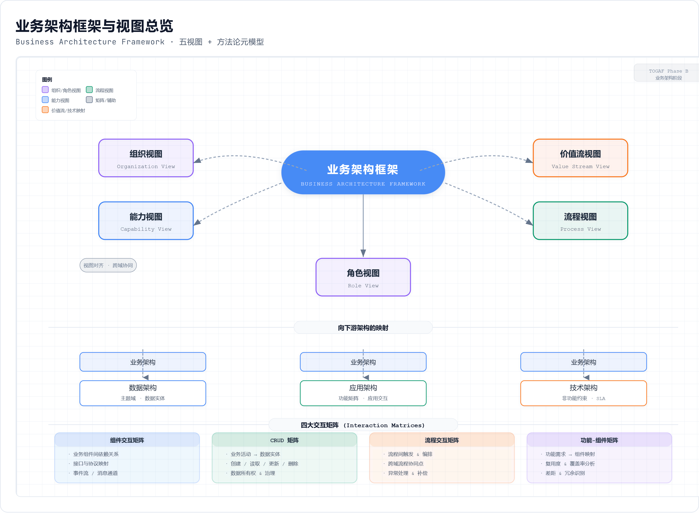

业务架构不是把现有部门和系统重新画一遍，而是回答三个问题：企业为了实现战略价值需要哪些稳定能力；这些能力由哪些业务域和业务组件提供；端到端流程如何调用这些能力并形成客户价值。

### 2.1.1 从战略到业务架构的形成逻辑

本规划采用“顶向下能力识别 + 底向上流程聚合”的双向建模方法。顶向下从战略、商业模式、价值链和关键场景出发，先识别企业需要具备什么能力，此时能力是黑盒，类似业务域对外暴露的 API。底向上从 L2-L4 流程、活动、业务对象和 CRUD 关系出发，识别细粒度业务功能，再按高内聚、低耦合原则聚合为业务组件。

| 建模步骤 | 关键问题 | 主要产出 | 下游用途 |
|---|---|---|---|
| 战略与价值链分析 | 企业靠什么创造价值，核心价值流是什么 | 企业价值流地图、业务域边界 | 约束业务域和能力范围 |
| 业务能力识别 | 每个业务域必须对外提供什么能力 | L2-L4 业务能力架构 | 输入应用功能、服务目录、项目组合 |
| 流程深度展开 | 核心价值流具体如何运行 | L5-L7 流程活动、角色、输入输出 | 输入数据模型、应用集成和流程自动化 |
| 业务组件聚合 | 哪些业务功能应聚合为稳定组件 | 业务组件清单、能力服务清单 | 输入应用边界和中台能力规划 |
| 矩阵校验 | 能力、流程、数据、组件是否闭环 | CRUD矩阵、组件交互矩阵、流程支撑矩阵 | 发现能力遗漏、数据多头和接口断点 |

### 2.1.2 分层原则：全企业到L4，核心链路到L7

第2章的粒度按“全景覆盖”和“重点深描”分层处理。L1-L4 是全企业业务架构，必须覆盖研发、供应链、制造、营销、销售、服务、生态、人力、财务、法务合规、安全、IT、行政等全部业务域；L5-L7 是流程细化层，只对产品研发、供应链、生产制造、市场营销、销售渠道、客户服务等 LTC 相关核心链路展开。

| 层级 | 定义 | 覆盖范围 | 示例 |
|---|---|---|---|
| L1 | 企业核心价值流/经营主线 | 全企业 | 从创意到上市、从线索到回款、从预算到报告 |
| L2 | 业务域 | 全企业 | 供应链管理、人力资源、财务管理、安全管理 |
| L3 | 能力组/业务子域 | 全企业 | 供应链下的寻源与供应商、采购执行、库存与仓储 |
| L4 | 业务组件能力单元 | 全企业 | 框架协议、采购订单、交期确认、库存可视化 |
| L5 | 关键流程 | 核心价值链 | S&OP平衡、订单履约路由、工单执行 |
| L6 | 流程步骤 | 核心价值链 | MRP运算、采购交期确认、拣货复核 |
| L7 | 原子活动/操作 | 核心复杂活动 | SMT上料校验、AOI缺陷标记、IMEI绑定 |

---

## 2.1.4 附：从业务能力到PBC（Package Business Capability）组件【参考文档补充】

> **来源**：参考文档《从微服务到PBC业务能力组件》和《企业架构规划方法论的底层逻辑》。PBC是Gartner提出的概念，将微服务从技术视角提升到业务视角。

### PBC与微服务的关系

PBC（可打包业务能力）是在微服务之上的一层业务抽象。一个PBC组件聚合了多个微服务API能力加上UI呈现，形成业务用户可直接识别和使用的可复用功能单元。与微服务的关键区别：

| 维度 | 微服务 | PBC业务能力组件 |
|------|--------|---------------|
| 抽象层次 | 技术实现单元 | 业务能力单元 |
| 面向角色 | 开发者和架构师 | 业务用户和产品经理 |
| 粒度 | 单一聚合或限界上下文 | 完整业务场景闭环 |
| 组装方式 | API编排（技术面） | 组件组装（业务面，榫卯结构） |
| 示例 | order-command-service | "全渠道订单管理"组件（含下单UI+订单查询+履约跟踪） |

### PBC的榫卯组装思想

PBC借鉴中国传统建筑的榫卯结构思想：**在组件开发之前，先定义组件间的连接标准（榫卯接口），然后各自独立开发，最后按标准组装。** 这与微服务API First原则一脉相承，但更强调"组装"而非"编排"：

- **组装（Composition）**：面向业务用户，使用预定义的榫卯标准将PBC组件组装成业务场景。如将"客户管理"+"订单管理"+"库存查询"三个PBC组装为"门店销售"场景
- **编排（Orchestration）**：面向技术人员，通过BPM/工作流引擎将微服务API、规则和流程串联。如订单审核流程中依次调用价格API→库存API→信用API→合规API

### PBC在手机制造企业架构中的应用

| PBC组件 | 包含的微服务 | 包含的UI | 榫卯接口（对外） |
|---------|------------|---------|---------------|
| 订单管理PBC | order-command/order-query/order-fulfillment | 下单页面/订单列表/订单详情/履约跟踪 | POST /orders, GET /orders/{id}, GET /orders/status |
| 供应商协同PBC | supplier-service/purchase-service | 供应商门户/PO确认/ASN提交/绩效看板 | POST /purchase-orders/{id}/promise, POST /asn |
| 售后服务PBC | service-ticket-service/repair-service | 报修页面/维修跟踪/服务评价 | POST /service-tickets, GET /trace/{imei} |

---

## 2.2 全企业业务域划分

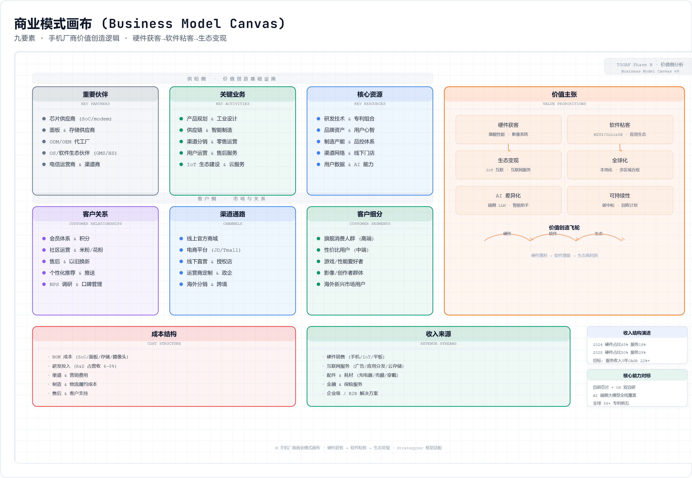

### 2.2.1 业务域总览

本规划将手机厂商划分为 14 个 L2 业务域。划分依据不是当前组织部门，而是企业稳定的业务责任和能力边界。人力资源、财务管理、法务合规、安全管理等均是独立业务域，它们与产品研发、供应链等核心域在业务架构粒度上同级，只是在 L5-L7 深度展开优先级不同。

| 编号 | L2业务域 | 类型 | 核心职责 | 与核心价值流关系 |
|---|---|---|---|---|
| D01 | 战略与经营管理 | 企业方向盘 | 战略规划、经营目标、投资组合、经营分析、架构治理 | 全企业 |
| D02 | 产品研发 | 核心价值域 | 用户洞察、产品规划、IPD研发、BOM/配置、质量改进 | IPD/LTC上游 |
| D03 | 供应链管理 | 核心价值域 | 需求计划、S&OP、寻源、采购、供应商协同、库存 | LTC核心供给 |
| D04 | 生产制造 | 核心价值域 | 工艺、排产、MES执行、质量、设备、追溯 | LTC核心履约 |
| D05 | 市场营销 | 核心价值域 | 品牌、Campaign、内容、线索、用户洞察、营销ROI | LTC需求生成 |
| D06 | 销售与渠道 | 核心价值域 | 渠道、门店、电商、价格、订单、履约、回款 | LTC交易主干 |
| D07 | 客户服务 | 核心价值域 | 客服、工单、维修、备件、以旧换新、NPS、质量反馈 | LTC售后闭环 |
| D08 | 生态与互联网服务 | 价值延伸域 | 账号、会员、内容、应用商店、IoT、开发者、结算 | 生态变现 |
| D09 | 人力资源 | 企业运营域 | 组织、岗位、招聘、绩效、薪酬、培训、人才发展 | 全企业使能 |
| D10 | 财务管理 | 企业运营域 | 预算、核算、成本、资金、税务、应收应付、经营分析 | 全企业管控 |
| D11 | 法务与合规 | 企业运营域 | 合同法务、知识产权、隐私合规、贸易合规、审计 | 全球经营底线 |
| D12 | 安全管理 | 企业运营域 | 信息安全、供应链安全、生产安全、EHS、应急连续性 | 全企业底线 |
| D13 | IT与数字化 | 企业运营域 | EA治理、项目组合、应用服务、数据服务、运维、数字化交付 | 数字化底座 |
| D14 | 行政与设施 | 企业运营域 | 园区、办公、固定资产、非生产采购、差旅、后勤 | 运营保障 |

### 2.2.2 核心域与企业运营域的关系

核心价值域直接参与用户价值创造和 LTC 端到端闭环，企业运营域提供资源、资金、人才、合规、安全和数字化交付保障。两类业务域不是主次关系，而是价值流中的不同角色：例如销售订单能否履约，不仅依赖订单、库存和物流，也依赖财务信用额度、合规限制、信息安全控制和组织绩效机制。

| 关系类型 | 说明 | 典型例子 |
|---|---|---|
| 直接承载 | 业务域直接完成客户价值交付 | 销售与渠道创建订单，生产制造完成产品生产 |
| 能力供给 | 业务域提供被核心流程调用的能力 | 财务提供信用检查和应收结算，人力提供岗位和绩效支撑 |
| 规则约束 | 业务域制定必须遵守的政策和控制 | 法务合规制定隐私授权、出口管制、合同审查规则 |
| 风险兜底 | 业务域保障安全、连续性和异常处理 | 安全管理处理数据泄露、生产安全和业务连续性事件 |

---

## 2.3 企业L4业务能力架构

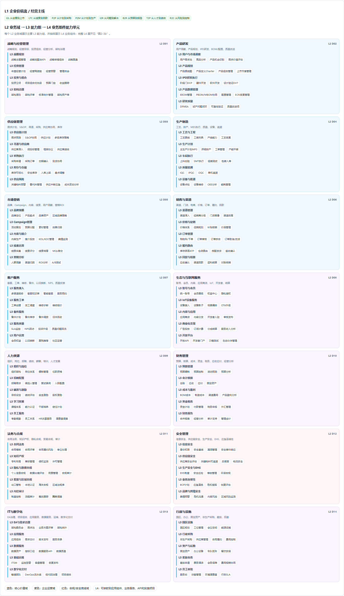

### 2.3.1 能力架构图说明

业务能力架构图按 L1-L4 分层表达：L1 是企业价值流和经营主线；L2 是业务域；L3 是能力组；L4 是可作为业务组件、业务服务或应用模块边界的能力单元。L4 不是最细操作步骤，而是可以被稳定管理、复用、评估和建设的业务能力颗粒度。

能力架构图的阅读方式如下：以供应链为例，L1 属于“从线索到回款/LTC”和“从计划到采购/P2P”的价值流支撑；L2 是供应链管理；L3 包括供应链计划、寻源与供应商、采购执行、库存与仓储、供应风险；L4 则落到需求预测、S&OP协同、招投标管理、框架协议、采购订单、交期确认、库存可视化等业务组件能力单元。

### 2.3.2 分业务域L4能力分解

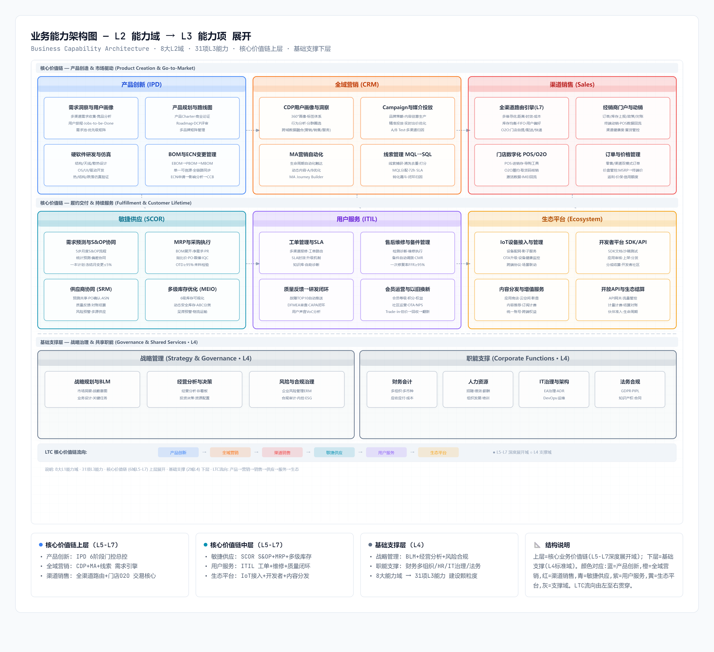

#### D01 战略与经营管理

| L1价值流/经营主线 | L2业务域 | L3能力组 | L4业务组件能力单元 |
|---|---|---|---|
| 规划到绩效 S2P | 战略与经营管理 | 战略规划 | 战略主题管理、战略地图与KPI、战略举措组合、战略复盘 |
| 规划到绩效 S2P | 战略与经营管理 | 经营管理 | 年度经营计划、经营驾驶舱、经营预警、管理例会 |
| 规划到绩效 S2P | 战略与经营管理 | 投资与组合 | 投资立项、项目组合优先级、预算门控、收益跟踪 |
| 规划到绩效 S2P | 战略与经营管理 | 架构治理 | 架构原则、架构评审、标准例外管理、架构资产库 |

战略与经营管理域的 L4 能力说明如下。每个 L4 能力均按业务组件能力单元理解，可在后续应用架构中映射为应用模块、共享服务、流程节点或数据责任边界。

##### 战略主题管理

**战略主题管理** 将企业愿景和战略目标转化为可跟踪的战略主题组合。

- **关键输入**: 企业愿景声明、董事会战略方向、市场环境分析报告
- **关键输出**: 战略主题清单（含优先级、目标值、时间窗）、战略主题与Kaplan-Norton战略地图四层面的映射关系
- **业务规则**: 战略主题数量控制在5-8个，避免资源分散；每个主题必须包含至少一个可量化领先指标和一个滞后指标；主题之间如有冲突，由战略委员会在季度战略审视会上裁决
- **与LTC关系**: 高端突破主题直接驱动LTC中高端产品线的销售目标和渠道策略

##### 战略地图与KPI

**战略地图与KPI** 建立财务-客户-流程-学习成长四层因果链路，将战略主题转化为可量化指标体系。

- **关键输入**: 战略主题清单、历史KPI基线数据、行业基准数据
- **关键输出**: 企业战略地图（四层因果链路图）、公司级KPI（约15-20个）、KPI定义卡片（含口径、数据源、采集频率、Owner）
- **业务规则**: KPI目标值设定须参考行业75分位基准；每个流程层KPI必须至少支撑一个客户层KPI；关键KPI变更需经战略委员会审批
- **性能KPI**: 战略地图每季度更新一次；KPI定义卡片变更须走ECN流程

##### 战略举措组合

**战略举措组合** 将战略主题转化为可执行、可投资、可跟踪的战略举措组合。

- **关键输入**: 战略地图与KPI、各业务域能力差距分析、资源与预算约束
- **关键输出**: 战略举措清单（含目标/范围/里程碑/投资/责任人/收益预期）、举措间依赖关系图
- **业务规则**: 单个举措投资>5000万须经董事会审批；举措之间如有硬依赖，须在路线图中明确前后置关系
- **优先级评估维度**: 战略匹配度(30%)、财务收益(25%)、实施可行性(20%)、风险水平(15%)、能力复用(10%)

##### 战略复盘

**战略复盘** 建立季度战略审视机制，跟踪战略举措进展和KPI达成情况。

- **关键输入**: 战略KPI实际值vs目标值、战略举措里程碑达成情况、外部环境变化信号
- **关键输出**: 季度战略复盘报告（含偏差分析/根因/调整建议）、战略举措续/停/转决策
- **业务规则**: KPI偏差>15%触发红牌预警，要求责任域提交专项分析和纠正计划；连续两季度红牌启动战略举措重新评估
- **与架构关系**: 复盘结论直接输入给第6章年度实施规划滚动调整

##### 年度经营计划

**年度经营计划** 将战略目标拆解为年度经营目标和各业务域的行动计划。

- **关键输入**: 战略地图与KPI、上一年经营复盘、市场预测
- **关键输出**: 年度经营计划书（含集团/业务域/区域三层目标）、资源分配方案（预算/人力/产能）
- **业务规则**: 年度经营计划须在Q4完成次年计划编制和审批；计划与战略KPI的偏差须有合理解释和弥补方案
- **计划层级**: 集团目标→业务域目标→部门目标→个人PBC，四级对齐联动

##### 经营驾驶舱

**经营驾驶舱** 为CEO/CFO/业务VP提供实时经营数据可视化和下钻分析能力。

- **关键输入**: 数据中台统一指标（出货/激活/库存/应收/毛利/NPS等）
- **关键输出**: 经营驾驶舱（移动端+大屏）、经营快报（日报/周报/月报自动生成）
- **业务规则**: 核心指标T+0小时级刷新（订单/库存/签收）；财务指标T+1日级刷新（应收/毛利/净利）；指标口径必须与指标中心保持一致
- **性能KPI**: 驾驶舱首页加载<2s；下钻至订单明细<3s

##### 经营预警

**经营预警** 基于指标阈值和趋势模型，自动识别经营异常并推送预警。

- **关键输入**: 实时经营指标数据、历史基线和波动模型、外部市场信号
- **关键输出**: 预警通知（分级：红/黄/蓝）、预警分析报告（异常定位/根因推测/建议行动）
- **业务规则**: 红牌预警（库存>45天或DSO>50天或毛利率下降>3pct）→1小时内推送CFO/业务VP；黄牌预警→当日推送到域负责人；连续三日未响应自动升级
- **技术支撑**: 预警规则引擎+ML异常检测模型（Y2建设）

##### 管理例会

**管理例会** 支撑企业各级管理例会（月度经营会/季度战略会/年度规划会）的议程、材料和决策跟踪。

- **关键输入**: 经营驾驶舱数据、各域月度/季度报告、上次会议决策执行跟踪
- **关键输出**: 会议议程和预读材料、会议纪要（含决议和Action Items）、决策跟踪看板
- **业务规则**: 月度经营会决议事项须在下月会议前闭环（闭环率≥85%）；跨域决策事项须明确单一Owner
- **数字化支撑**: 会议系统与经营驾驶舱数据联动，材料自动生成，决策事项自动进入跟踪系统

##### 投资立项

**投资立项** 管理企业级投资项目（IT建设/工厂扩建/海外市场/研发项目/并购）从建议到批准的全过程。

- **关键输入**: 战略举措组合、业务需求建议书、初步可行性分析
- **关键输出**: 投资立项书（含范围/目标/投资估算/ROI预测/风险评估/架构符合性声明）、立项审批决议
- **业务规则**: 投资>1000万须提交架构符合性评审（确认与4A蓝图一致）；>5000万须董事会审批；所有IT类投资项目须附4A映射表
- **评估维度**: 战略匹配度+财务收益(NPV/IRR)+技术可行性+组织准备度+架构一致性

##### 项目组合优先级

**项目组合优先级** 对全企业项目组合进行优先级排序和资源分配优化。

- **关键输入**: 投资项目清单（含立项审批信息）、资源约束（预算/人力/关键设备）、战略优先级权重
- **关键输出**: 项目组合优先级排序（P0/P1/P2/P3）、资源分配方案、项目间依赖关系图
- **业务规则**: P0项目数量≤全项目数20%（聚焦核心）；优先级每季度重排一次；架构依赖项自动升一级
- **排序模型**: 业务价值(35%)+架构依赖(20%)+风险紧迫(15%)+实施可行性(15%)+复用价值(15%)

##### 预算门控

**预算门控** 在项目组合的关键阶段门设置预算审批闸门，控制投资节奏和风险。

- **关键输入**: 项目阶段门评审结果、已执行预算vs批准预算、下阶段预算申请
- **关键输出**: 预算门控审批决议（继续/暂停/终止/调整预算）、资金拨付指令
- **业务规则**: 阶段门评审未通过→暂停后续预算拨付；预算执行偏差>15%→触发专项审计；项目终止→剩余预算回收至公司资金池
- **门控节奏**: 立项门(批准启动预算20%)→方案门(批准实施预算50%)→上线门(批准尾款30%)→运营门(转运营预算)

##### 收益跟踪

**收益跟踪** 对投资项目上线后的实际收益进行持续跟踪和与立项预期的对比分析。

- **关键输入**: 项目立项时的收益预期（如TTM缩短、库存下降、ROI提升）、上线后实际经营数据
- **关键输出**: 收益跟踪报告（实际vs预期差距/归因分析）、收益未达标的补救建议
- **业务规则**: 上线后3-6个月为价值观察期（月度跟踪）；此后季度跟踪直至收益稳定；收益偏差>30%触发专项复盘
- **归因分类**: 流程未执行/数据质量不足/系统体验差/组织激励不匹配/目标测算过高

##### 架构原则

**架构原则** 定义企业架构的不可妥协准则，作为所有架构决策的最高约束。

- **关键输入**: 企业战略目标、行业最佳实践、监管合规要求
- **关键输出**: 架构原则文档（10条原则：业务4条+技术6条）、原则遵从性评审标准
- **业务架构4原则**: 以用户为中心、端到端闭环、能力可复用、标准化与灵活并存
- **技术架构6原则**: 平台化与中台化、云原生优先、数据同源(Single Source of Truth)、安全内建(Security by Design)、开放API(API First)、自主可控
- **原则治理**: 任何原则例外须经架构委员会审批并设定过期时间

##### 架构评审

**架构评审** 建立架构符合性硬门禁机制，确保所有IT项目遵从4A蓝图。

- **关键输入**: 项目方案（业务架构/数据架构/应用架构/技术架构四个视图）、4A目标蓝图
- **关键输出**: 架构评审意见（通过/有条件通过/否决）、架构决策记录（ADR）、例外审批记录
- **评审阶段**: 立项评审（战略匹配+4A映射）、方案评审（流程/数据/应用/集成/安全）、上线评审（数据准备/接口联调/性能容量）、运营评审（架构符合度/技术债）
- **硬门禁规则**: 方案评审未通过→不得进入开发阶段；上线评审未通过→不得切换生产

##### 标准例外管理

**标准例外管理** 处理因业务特殊性或技术现实导致的架构标准例外情况。

- **关键输入**: 例外申请（说明原因/影响范围/替代方案/退出计划）
- **关键输出**: 例外审批决议（批准/否决+理由）、例外登记册（含过期时间和复审日期）
- **业务规则**: 例外必须设定过期时间（≤18个月）；例外过期前30天自动触发复审；同一类型例外不得重复批准超过两次
- **核心原则**: 例外是临时妥协而非永久许可——每次例外审批必须包含"退出路径"和"何时回归标准"的时间表

##### 架构资产库

**架构资产库** 维护企业的4A架构知识资产，形成可持续更新、可追溯、可复用的架构知识体系。

- **关键输入**: 各架构域的目标架构文档、架构决策记录(ADR)、项目上线后的实际架构状态
- **关键输出**: 架构资产库（业务能力地图/数据模型/应用组合/技术组件/接口目录/架构原则/ADR历史）
- **核心资产**: 4A目标架构+过渡架构+现状架构（三位一体同步更新）、架构决策记录、接口和服务目录、技术选型清单
- **资产治理**: 每个项目上线后30天内必须更新架构资产库；季度架构资产审计；年度全量架构基线刷新

#### D02 产品研发

##### 核心域能力规格 — 产品研发 (D02)

> 产品研发域能力聚焦"从创意到上市(I2L)"端到端闭环,核心约束: TTM≤11月(Y3), BOM准确率≥99.5%, ECN变更30min内同步下游。

| L4能力 | 输入(Input) | 输出(Output) | 业务规则约束 | 性能KPI | 参与场景 |
|--------|------------|-------------|-------------|---------|---------|
| 用户需求池 | 用户反馈/社区/售后/电商评价 | 结构化需求条目(来源/频次/影响度) | 每条需求必须可追溯到来源用户群和数据量;重复需求自动合并去重 | 需求入库<5min/条 | 新品上市(I2L) |
| 竞品分析 | 竞品参数/定价/渠道/用户口碑 | 竞品对比报告/差距雷达图 | 竞品信息按产品线/价格带/区域三维分类;关键竞品信息每周更新 | 竞品数据刷新≤1周 | 新品上市(I2L) |
| 产品机会识别 | 用户需求池TOP N,竞品差距,技术趋势 | 产品机会卡片(目标人群/定价/差异化/市场规模) | 每个机会必须完成技术+供应链+财务三方评估 | 机会识别≤2周 | 新品上市(I2L) |
| 需求价值评估 | 产品机会卡片,历史产品表现数据 | 价值评分(战略/市场/技术/财务/风险) | 权重:战略30%+市场25%+技术20%+财务15%+风险10% | 评估≤1周 | 产品组合管理 |
| 产品路线图 | 需求池优先级,技术平台规划,渠道规划 | 12-24月产品路线图(分品牌/价格带/区域) | 每季度滚动刷新;旗舰提前18月锁定;次旗舰提前12月 | 路线图更新≤1周/季 | 新品上市(I2L),战略规划 |
| 产品定义Charter | 产品路线图,市场洞察,技术可行性 | Product Charter(目标市场/定价/卖点/成本/TTM) | Charter批准后基线化,变更需VP级;目标成本偏差>5%重新评审 | Charter评审≤2周 | 新品上市(I2L) |
| 产品组合管理 | 全线产品Charter,渠道/区域需求 | 产品组合看板(品牌矩阵/价格带覆盖/生命周期) | 任一价格带≥3个SKU触发组合审视;低利润SKU≤30% | 组合分析≤1天 | 产品组合管理 |
| 上市节奏管理 | 产品Charter,渠道窗口,竞品节奏 | 上市节奏表(发布时间/区域/渠道/首销目标) | 旗舰错开竞品旗舰≥3周;在线首发→全渠道铺开 | 节奏调整≤3天 | 新品上市(I2L) |
| 阶段门DCP | 阶段交付件(需求/设计/验证/试产报告) | DCP评审决议(Go/Kill/Redirect) | 六阶段各一DCP,未通过不进下阶段;PDT+IPMT共同决策 | DCP评审≤1天 | 新品上市(I2L) |
| 硬件开发 | 产品定义,ID设计,堆叠方案 | EVT/DVT/PVT硬件原型和测试报告 | 关键器件选型在计划阶段锁定;BOM成本超目标5%→评审 | EVT→PVT≤6月 | 新品上市(I2L) |
| 软件开发 | 硬件基线,UX设计,系统架构 | 系统/应用/影像/性能版本和测试报告 | Android大版本AOSP到内测≤3月;安全补丁月度交付 | 月度安全更新率≥95% | 新品上市(I2L) |
| 设计验证DVT | EVT硬件+软件+结构 | DVT测试报告(可靠性/环境/跌落/信号) | 所有测试通过才可进PVT;安全/射频/结构缺陷必须关闭 | DVT≤6周 | 新品上市(I2L) |
| EBOM管理 | 硬件设计输出(原理图/PCB/结构图) | EBOM(物料编码/用量/替代料/位号) | EBOM是产品数据单一可信源起点;所有下游BOM从EBOM派生 | EBOM发布<1天 | 新品上市(I2L) |
| PBOM/MBOM协同 | EBOM,工艺路线,工厂能力 | PBOM(工艺视图)/MBOM(制造视图) | EBOM→PBOM自动转换≥90%;EBOM→MBOM自动转换≥85% | BOM同步延迟<30min | 新品上市(I2L) |
| 配置管理 | SKU定义,区域需求,认证要求 | 产品配置矩阵(硬件/软件/配件/区域变体) | 全球SKU≤500(含区域变体);新增SKU需产品总监审批 | 配置变更审批≤3天 | 新品上市(I2L),全球上市 |
| ECN变更管理 | 工程变更申请(问题/方案/影响分析) | 变更单(批准/实施/验证闭环) | 影响分析覆盖:BOM/工艺/供应商/库存/成本/认证/售后;紧急变更24h闭环 | ECN闭环≤5天(常规) | 新品上市(I2L),质量改进 |
| DFMEA | 设计FMEA模板,历史故障库,供应链风险 | DFMEA报告(RPN/高优改进项) | 旗舰新项目DFMEA覆盖率100%;RPN>100必须制定改善措施 | DFMEA≤2周(计划阶段) | 新品上市(I2L) |
| 试产问题闭环 | 试产问题清单(PVT/MP爬坡) | 问题闭环报告(根因/对策/验证) | S级(安全/合规)48h闭环;A级(功能)1周;B级(体验)2周 | 试产问题闭环率≥95% | 新品上市(I2L) |
| 可靠性验证 | 可靠性测试计划(环境/寿命/跌落/防水) | 可靠性报告(通过/条件通过/不通过) | 旗舰覆盖所有用户场景;故障需根因分析 | 可靠性测试≤4周 | 新品上市(I2L) |
| 质量改进项 | 售后质量反馈/CAPA/ECN/DFMEA | 质量改进Backlog(优先级/责任人/预期效果) | 高频故障(TOP10)必须进入backlog;每季度回顾闭环率 | 改进项闭环≤30天 | 产品迭代,质量改进 |

#### D03 供应链管理

##### 核心域能力规格 — 供应链管理 (D03)

> 供应链域能力聚焦"从计划到采购(P2P)"闭环,核心约束:库存周转≤32天(Y3),预测准确率MAPE≥75%,关键物料缺料导致新品延期=0。

| L4能力 | 输入(Input) | 输出(Output) | 业务规则约束 | 性能KPI | 参与场景 |
|--------|------------|-------------|-------------|---------|---------|
| 需求预测 | 历史销量/渠道库存/Campaign计划/季节因子 | 预测版本(SKU-区域-周颗粒度,含置信区间) | 预测区分基线+营销增量;版本冻结后变更需计划经理审批 | MAPE≥75%(Y3) | LTC需求,S&OP,新品上市 |
| S&OP协同 | 销售预测/产能/物料/财务约束 | S&OP计划版本(供需平衡+缺口清单) | 月度会议须签字版计划;重大缺口(>10%供应不足)升级 | 计划生成<5min | LTC,新品上市,促销季 |
| 供应计划 | S&OP版本/MPS/BOM/库存策略 | 供应计划(物料净需求/补货/采购建议) | 长周期物料(芯片/屏幕)提前26周;短周期4-8周 | 计划运算<30min | LTC,P2P |
| 多级库存策略 | 需求预测/提前期/服务水准/成本 | 安全库存/补货点/最大库存(按SKU-仓库) | ABC分类:A类安全库存≤1周;C类≤4周 | 库存优化<10min | LTC,P2P,促销备货 |
| 供应商准入 | 供应商申请(资质/财务/质量/合规) | 准入审批(合格/有条件/拒绝) | 须通过质量+安全+社会责任三审;关键物料须现场审核 | 准入审批≤4周 | P2P,新品上市 |
| 招投标管理 | 采购需求/RFQ/供应商短名单 | 定标结果(中标方/价格/份额) | >500万须三家比价;独家供应须VP审批;招标归档≥5年 | 招标周期≤6周 | P2P |
| 框架协议 | 定标结果/商务条款/质量要求 | 框架协议(价格/账期/交付/质量/合规) | 有效期≤3年;含调价机制(原材料指数联动) | 协议评审≤2周 | P2P |
| 供应商绩效 | 交付/质量/成本/响应/合规数据 | 供应商绩效评分(ABCD四级) | A级优先;B/C级限时整改;D级淘汰;月度更新 | 评分≤1天 | P2P,供应商管理 |
| 采购申请 | MRP建议/手工补货/项目需求 | 审批后采购申请(物料/数量/预算/紧急度) | 预算内自动;<100万部门审批;>100万加签CFO | 自动<1min,手工<1天 | P2P,LTC |
| 采购订单 | 采购申请/框架协议/供应商报价 | PO(单号/物料/数量/价格/交期/条款) | PO价格≤框架协议价;PO变更须采购经理审批 | PO创建<5min | P2P,LTC |
| 交期确认 | PO/供应商产能/物料库存 | 交期承诺(确认数量/日期/风险提示) | 供应商48h内确认;延期>3天升级;关键物料梯级告警 | 确认<2天,达成率≥95% | P2P,LTC |
| 到货协同 | ASN/物流轨迹/质检计划 | 到货记录(接收/质检/入库) | ASN提前24h发送;无ASN→异常处理;到货3天完成质检 | ASN提前率≥95% | P2P |
| 库存可视化 | WMS库存/在途ASN/渠道库存/工单在制 | 六级库存视图(VMI→工厂仓→区域仓→门店) | 六级库存水位实时可视化;可用/预占/冻结/在途分钟更新 | 查询<100ms,准确率≥99.5% | LTC,S&OP |
| 安全库存 | 需求波动/提前期/服务水平 | 动态安全库存(按SKU-仓库/季节/促销调整) | 每月自动重算;促销季上浮1.5-2x | 计算<10min | LTC,促销备货 |
| 入库上架 | ASN/质检结果/库位分配 | 入库记录(物料/批次/库位/时间) | FIFO强制;效期物料12月内须出库;危化品单独库区 | 入库确认<2s | P2P,生产物料供应 |
| 盘点调整 | 盘点计划/系统库存/实物盘点 | 盘点差异报告(盈亏/原因/调整) | A类月度盘点;B类季度;C类半年;年度全盘差异<0.5% | 差异<0.5% | 库存管理 |
| 关键物料预警 | 供应商风险/地缘政治/自然灾害/产能 | 风险预警(物料/供应商/等级/建议行动) | 红色(停产)→24h启动替代;黄色→周跟踪;绿色→月审视 | 预警延迟<4h | P2P,供应链韧性 |
| 替代料管理 | BOM替代料关系/供应商资质/验证报告 | 替代料生效清单(主料/替代料/切换条件/验证) | 替代料须完成功能+可靠性+兼容性验证;切换方案三方会签 | 验证≤4周 | P2P,供应链韧性 |
| 供应中断应急 | 风险预警/替代方案/安全库存 | 应急方案(切换供应商/启用替代料/调配库存) | S级(停产)4h启动;A级(减产)24h;B级(延迟)72h | S级响应<4h | BCP |
| 成本波动分析 | 原材料指数/供应商报价/汇率 | 成本波动报告(物料/品类/趋势/建议) | 关键物料月度跟踪;波动>10%专项分析;>20%启动替代或锁价 | 月度分析<1天 | P2P,财务 |

#### D04 生产制造

| L1价值流/经营主线 | L2业务域 | L3能力组 | L4业务组件能力单元 |
|---|---|---|---|
| 从计划到生产 P2M | 生产制造 | 工艺与工程 | 工艺路线、工装夹具、产线能力、工艺变更 |
| 从计划到生产 P2M | 生产制造 | 生产计划 | 主生产计划MPS、详细排产、工单管理、产能平衡 |
| 从计划到生产 P2M | 生产制造 | 车间执行 | 上料校验、SMT执行、组装测试、包装入库 |
| 从计划到生产 P2M | 生产制造 | 质量追溯 | IQC、IPQC、OQC、单机追溯 |
| 从计划到生产 P2M | 生产制造 | 设备与能源 | 设备点检、设备维修、OEE分析、能耗管理 |

生产制造域的制造域能力聚焦"从计划到生产(P2M)"闭环,核心约束:直通率≥95%,IMEI追溯完整率≥99.9%,OEE≥85%。各L4能力规格详见附件[附件2-8 L4业务能力分解表](./附件/附件2-8_L4业务能力分解表.xlsx)。

#### D05 市场营销

##### 核心域能力规格 — 市场营销 (D05)

> 市场营销域能力聚焦"从市场到线索(M2L)"闭环,核心约束:营销ROI提升≥30%(Y3),触达合规率100%,线索响应率持续提升。

| L4能力 | 输入(Input) | 输出(Output) | 业务规则约束 | 性能KPI | 参与场景 |
|--------|------------|-------------|-------------|---------|---------|
| 品牌定位 | 用户洞察/竞品品牌分析/企业愿景 | 品牌定位文档(目标心智/调性/差异化) | 由品牌委员会审批;变更须CEO批准;子品牌定位不交叉 | 定位审批≤1月 | 新品上市,品牌战略 |
| 产品卖点 | 产品Charter/用户痛点/竞品对标 | 产品卖点文档(TOP3+支撑卖点+证据链) | 卖点须可验证(有数据或认证);禁止未证实绝对化用语 | 评审≤1周 | 新品上市 |
| 品牌资产 | 市场调研/品牌健康度/社媒声量 | 品牌资产报告(知名度/美誉度/忠诚度/溢价) | 季度追踪;健康度低于竞品均值→品牌策略审视 | 报告≤3天/季 | 品牌战略 |
| 区域品牌策略 | 全球品牌定位/区域洞察/本地合规 | 区域品牌策略(本地化主张/代言人/社媒平台) | 策略不得偏离全球定位;本地化调整须品牌总监审批 | 策略≤2周/区域 | 全球上市,本地化 |
| 活动策划 | Campaign Brief/目标人群/预算/渠道 | Campaign方案(主题/内容/媒介/节奏/KPI) | >500万须CMO审批;必须设定可量化KPI(ROI/CPL) | 方案≤3天 | 新品上市,促销 |
| 预算分配 | 年度营销预算/Campaign优先级/ROI预期 | 预算分配方案(按产品线/Campaign/渠道/月度) | 预留15%弹性;超预算10%须追批;月度偏差>20%复盘 | 审批≤1周 | 营销规划 |
| 素材管理 | 产品图片/视频/文案/代言人素材 | 素材库(版本/权限/过期/使用记录) | 必须经法务+合规审核;代言人素材过期自动下线 | 审核≤3天 | 新品上市,日常投放 |
| 效果归因 | Campaign执行数据(曝光/点击/转化) | 归因报告(渠道贡献/触点路径/ROI) | 归因窗口:展示7天/点击30天;三种模型对比 | 归因≤1天 | 营销ROI |
| 内容生产 | 内容Brief/品牌调性/渠道格式要求 | 内容资产(图文/短视频/直播/长文) | UGC须标注;KOL/KOC须标注广告;标签体系规范化 | 生产≤1周/条 | 新品上市,社媒运营 |
| 媒介投放 | 媒介计划/受众定向/预算/素材 | 投放执行(曝光/点击/转化/消耗) | RTB出价≤预算上限;频控:每天≤3次;异常流量自动拦截 | 响应<100ms | 新品上市,日常投放 |
| KOL/KOC管理 | 筛选/合作Brief/预算 | KOL合作(内容/发布/效果/结算) | 真实粉丝≥1万;虚假粉>30%拒绝;内容须品牌审核 | 流程≤2周 | 新品上市,口碑营销 |
| 舆情监测 | 社媒/论坛/电商评价/新闻 | 舆情报告(正负面/声量/情感/预警) | 负面舆情30min预警;品牌危机1h启动;日报+周报 | 预警<30min | 品牌安全 |
| 线索采集 | 投放落地页/社媒/门店/运营商触点 | 线索记录(来源/触点/用户ID/隐私授权/时间) | 必须完成隐私授权方可存入;来源可追溯(Campaign+触点编码) | 采集<1s | LTC |
| 线索评分 | 用户画像/行为日志/线索属性 | 评分记录(分数/评级/移交建议) | 评分模型季训练;MQL阈值营销+销售共定;评分>80自动移交 | 评分<500ms | LTC |
| 线索培育 | 线索列表/内容素材/触达策略 | 培育记录(触达/打开/点击/转化) | 冷线索≤90天培育;温线索≤30天;超期→降级或回收 | ≤3次触达/线 | LTC |
| MQL移交 | MQL清单/销售分区/渠道归属 | MQL移交(指派/接受/拒绝/超时) | 移交24h内销售响应;48h未响应→升级;拒绝须注明原因 | 响应SLA:24h | LTC |
| 人群洞察 | 用户行为/设备/消费/位置数据 | 人群画像(标签/分群/偏好/生命周期) | 标签≥50维;分群≥10基础+自定义;T+0实时+T+1批量 | 画像查询<50ms | CDP运营,精准营销 |
| 渠道归因 | 全渠道触点(线上/线下/社媒) | 渠道归因矩阵(ROI/贡献度/转化路径) | 线上线下ID-Mapping打通;跨渠道归因7-30天可配 | 分析≤4h | 营销ROI |
| ROI分析 | 营销费用/订单数据/品牌资产 | ROI报告(Campaign/渠道/产品线/区域多维) | 计算含品牌资产(长期)+销售转化(短期);低于基准→复盘 | T+1 | 营销效果评估 |
| A/B测试 | 测试方案(变量/人群/流量) | 测试报告(置信度/提升度/建议) | ≥1000用户;置信度≥95%决策;Winner自动全量 | 测试3-14天 | 效果优化 |

#### D06 销售与渠道

##### 核心域能力规格 — 销售与渠道 (D06)

> 销售域能力聚焦"从线索到回款(L2C)"交易主干,核心约束:订单接入成功率≥99.9%,ATP准确率100%,超卖率=0,DSO≤38天(Y3)。

| L4能力 | 输入(Input) | 输出(Output) | 业务规则约束 | 性能KPI | 参与场景 |
|--------|------------|-------------|-------------|---------|---------|
| 渠道准入 | 渠道申请(资质/财务/店铺/团队) | 准入审批(合格/有条件/拒绝+渠道编码) | 经销商准入财务+法务+业务三方评审;编码全局唯一 | 审批≤2周 | LTC渠道建设 |
| 经销商分级 | 经销商绩效(销量/回款/门店/SLA) | 分级结果(钻石/金牌/银牌/铜牌) | 季度评估;钻石享优先分货/更低价格/更长账期;末级整改 | 分级≤1天/季 | LTC渠道管理 |
| 门店画像 | 门店基础信息/位置/客流/销售/店员 | 门店360画像(等级/能力/竞品/潜力) | 月活定义:月销≥30台;画像月更新;核心门店月度巡店 | 画像查询<100ms | LTC,O2O |
| 渠道政策 | 渠道分级/产品策略/竞品政策 | 渠道政策(返利/价保/补贴/账期/分货权) | 返利政策按季发布;价保窗口内自动计算补差;政策法务审核 | 政策发布≤1周/季 | LTC渠道 |
| 价格体系 | 产品定位/竞品价格/渠道成本/目标毛利 | 价格体系(MSRP/经销商价/最低零售价/大客户) | 调价须价格委员会审批;MAP自动监控;乱价自动处罚 | 价格计算<50ms | LTC,新品上市 |
| 促销规则 | 促销方案(时间/范围/力度/预算) | 促销规则(满减/折扣/赠品/秒杀/券) | 促销叠加≤3层;促销价≥最低零售价;促销库存独立管理 | 规则校验<5ms | LTC,促销 |
| 补贴核销 | 渠道销售数据/补贴政策/发票 | 补贴核销单(金额/审核/付款) | 按月核算;异常(单店>正常3x)→人工复核;付款≤30天 | 核销准确率≥99% | LTC |
| 价保管理 | SKU调价记录/渠道库存/价保政策 | 价保补差单(金额/有效期/审核) | 价保窗口内自动触发;金额=差额×窗口内库存;付款≤30天 | 价保计算≤1h | LTC |
| 购物车/下单 | 用户/SKU/数量/优惠券/地址 | 待提交订单(预校验:库存/价格/优惠/地址) | 下单前实时查库存;优惠自动计算;地址有效性校验 | 下单<200ms | LTC |
| 订单审核 | 待审核订单(价格/库存/信用/合规) | 审核结果(通过→履约/拒绝+原因/异常队列) | 审核五步串行:价格→促销→库存→信用→合规;任一不通过→异常 | 审核<500ms | LTC |
| 订单拆合 | 大订单/多仓订单/跨品类订单 | 拆合后子订单(拆分规则/合并规则) | 按仓拆;按品类拆(手机/配件);同仓同收货人合并 | 拆合<100ms | LTC |
| 订单取消/改派 | 取消/改派请求(订单号/原因) | 取消/改派确认(库存释放/退款/改派路由) | 未发货取消自动退款;已发货改派→拦截+重新路由 | <30s | LTC |
| 库存承诺ATP | 订单SKU/数量/区域/渠道 | ATP结果(可承诺量/履约节点/预计日期) | 实物库存-预占-冻结+在途-安全库存;ATP=0拒绝下单 | ATP查询<50ms | LTC |
| 仓店路由 | 订单/ATP结果/仓店库存/物流SLA/成本 | 履约路由(仓/店/承运商/时效/成本) | 优先级:时效→成本→体验;O2O门店优先履约 | 路由<100ms | LTC |
| 拣配发货 | 履约任务/拣货单/包装规则 | 出库单(IMEI/物流单号/承运商/发货时间) | PDA拣货防错;IMEI出库绑定;出库确认→库存扣减 | 出库<2s | LTC |
| 签收确认 | 物流轨迹/电子签收/POD | 签收记录(签收人/时间/IMEI/异常标记) | 签收触发售后期起算+应收确认;电子签收(拍照+GPS) | 签收回传<30s | LTC |
| 应收确认 | 签收记录/订单金额/促销补贴/运费 | 应收单(金额/账期/发票要求) | 金额=订单+运费-补贴;价保调整在应收确认前扣减;确认不可逆 | 应收<5min | LTC |
| 渠道回款 | 应收单/银行流水/渠道对账单 | 回款记录(金额/日期/银行/匹配) | 回款自动匹配(金额+参考号);失败→人工队列;核销后信用释放 | 自动匹配率≥85% | LTC |
| 返利结算 | 回款记录/渠道政策/销售数据 | 返利结算单(金额/政策/审批/付款) | 按季结算;政策版本锁定(下单时版本);付款≤45天 | 结算≤2天/季 | LTC |
| 对账核销 | 应收/回款/返利/异常项 | 对账核销记录(账龄/坏账/差异) | 月度强制对账;>90天催收;>180天计提坏账;核销须财法双签 | DSO≤38天(Y3) | LTC |

#### D07 客户服务

##### 核心域能力规格 — 客户服务 (D07)

> 客服域能力聚焦"从问题到解决(I2R)"闭环,核心约束:一次修复率≥85%,服务闭环率≥95%(Y3),NPS≥45(Y3),质量回流CAPA触发<1h。

| L4能力 | 输入(Input) | 输出(Output) | 业务规则约束 | 性能KPI | 参与场景 |
|--------|------------|-------------|-------------|---------|---------|
| 多渠道报修 | 用户报修(热线/App/门店/微信/网页) | 报修受理(单号/IMEI/故障类别/紧急度) | 多渠道统一入口;30s接通率≥90%;首响<30s;7×24 | 受理<3min | LTC,I2R |
| 客服知识库 | 产品FAQ/诊断树/维修SOP/政策 | 知识库(版本/分类/搜索/权限) | 按月更新;新品上市同步;匹配率→AI自动解决≥60% | 搜索<200ms | I2R |
| 智能客服 | 用户问题/知识库/对话历史 | 自动回复/转人工/工单生成 | AI自动解决≥60%;无法解决→转人工(带上下文);愤怒用户优先 | 响应<1s | I2R |
| 服务预约 | 用户/IMEI/问题/门店/时间偏好 | 预约确认(门店/时间/备件预留) | 提前30min提醒;预约门店备件自动调拨;爽约3次限制预约 | 确认<1min | I2R |
| 工单创建 | 报修受理/用户/IMEI/问题描述 | 服务工单(单号/优先级/分类/状态) | 分类:维修/退换/投诉/咨询;优先级:紧急(S)/高(A)/中(B)/低(C) | 创建<500ms | LTC,I2R |
| 派工调度 | 工单(位置/技能/紧急)/工程师状态 | 派工结果(工程师/预计到达/备件) | 按位置+技能+负载自动派;30min接单;VIP优先 | 派工<5min | I2R |
| 维修诊断 | 工单/IMEI履历/故障代码库/检测工具 | 诊断报告(根因/方案/费用/时间) | 须引用标准故障代码;主板级须双人复核;不明→升级专家组 | 诊断<30min | I2R |
| 维修报价 | 诊断/维修费标准/保修/配件价格 | 报价单(费用明细/保修抵扣/用户确认) | 保内免费;保外=人工+配件+物流;>500元须用户确认 | 报价<2min | I2R |
| 备件计划 | 历史维修/新品BOM/预计故障率 | 备件需求计划(品类/数量/提前期/安全库存) | 新品上市前完成;ABC分级(A:主板/屏幕/电池;B:摄像头;C:外壳) | 库存满足率≥95% | I2R,新品上市 |
| 备件库存 | 备件计划/维修消耗/调拨/报废 | 备件库存(仓/品类/数量/批次/效期) | 多级(区域中心仓→门店维修站);A类下沉门店;B类区域仓 | 查询<100ms | I2R |
| 备件调拨 | 维修站请求/库存/紧急度 | 调拨单(来源/目标/品类/数量/运输) | 紧急24h到位;常规72h;成本按使用方归集 | 紧急<24h | I2R |
| 旧件回收 | 维修换下旧件/IMEI/故障记录 | 旧件回收(分类/处置/环保) | 主板/B级以上须回收分析;含PII物理销毁;电池危废处理 | 回收<1周 | I2R |
| SLA监控 | 服务SLA定义(响应/到达/修复/闭环) | SLA看板(达标率/超时/预警) | 响应<30min;到店<1h;返修<48h;超时升级(组长→主管→经理) | 监控实时 | I2R |
| NPS回访 | 维修完成/购机90天/投诉关闭事件 | NPS(评分/反馈/分类) | 购机90天自动触发;维修后7天;9-10推荐/7-8中立/0-6贬损 | 采集<3天 | I2R,LTC |
| 投诉升级 | 投诉(来源/级别/内容/证据) | 投诉处理(升级/方案/关闭/回访) | 普通24h响应/3天关闭;重大(媒体/监管)1h升级高管 | 普通3天闭环 | I2R |
| 质量问题回流 | 维修记录/故障代码/NPS/投诉 | 质量问题单(聚类/影响/严重度→CAPA) | 高频故障(TOP10)自动触发;设计/工艺→PLM;物料→SRM | CAPA触发<1h | I2R,质量闭环 |
| 会员权益 | 会员等级/权益规则/用户行为 | 权益发放(积分/优惠券/延保/专属服务) | 铜/银/金/钻石(消费+活跃);到期30天提醒;使用率跟踪 | 到账<1min | 用户运营 |
| 以旧换新 | 旧机信息/估价规则/新机订单 | 以旧换新单(估价/补贴/回收/发货) | 在线估价(IMEI+型号+外观+功能);48h质检;偏差>20%复核 | 估价<3min | 用户运营,复购 |
| 复购推荐 | 用户画像/设备使用/换机周期/偏好 | 推荐清单(机型/权益/时机/渠道) | 换机≥18月触发;基于画像+历史+老化;过度推荐→投诉保护 | 推荐<200ms | 用户运营 |
| 社区运营 | 用户UGC/官方内容/活动 | 社区互动(帖子/评论/粉丝/活动) | 须合规审核;每周官内容≥3篇;月线下粉丝活动 | 审核<30min | 用户运营,品牌 |

#### D08 生态与互联网服务

| L1价值流/经营主线 | L2业务域 | L3能力组 | L4业务组件能力单元 |
|---|---|---|---|
| 从用户到生态 U2E | 生态与互联网服务 | 账号与会员 | 统一账号、会员等级、权益中心、隐私授权 |
| 从用户到生态 U2E | 生态与互联网服务 | IoT设备服务 | 设备接入、设备影子、场景编排、OTA升级 |
| 从用户到生态 U2E | 生态与互联网服务 | 内容与应用 | 应用商店、内容分发、开发者入驻、审核发布 |
| 从用户到生态 U2E | 生态与互联网服务 | 商业化变现 | 广告投放、订阅计费、分成结算、服务收入分析 |
| 从用户到生态 U2E | 生态与互联网服务 | 开放平台 | 开放API、开发者门户、沙箱测试、生态伙伴管理 |

生态与互联网服务域的 L4 能力说明如下。每个 L4 能力均按业务组件能力单元理解，可在后续应用架构中映射为应用模块、共享服务、流程节点或数据责任边界。

##### 统一账号

**统一账号** 作为生态体系的"户口本"，为手机用户提供跨设备、跨服务的统一身份标识。

- **关键输入**: 手机号/邮箱/第三方账号（微信/Google/Apple ID）、设备信息（IMEI/SN）
- **关键输出**: 用户账号（全局唯一UserID）、账号与设备的绑定关系、账号安全等级
- **业务规则**: 一个手机号仅可注册一个主账号；第三方登录须绑定手机号后才开通完整功能；账号注销后30天冷静期方可物理删除
- **安全要求**: 登录须支持MFA（短信/生物特征）；异常登录（异地/新设备）触发二次验证；密码强度≥8位含数字+字母+符号
- **性能KPI**: 登录认证<200ms；账号查询<50ms；支持亿级用户规模水平扩展

##### 会员等级

**会员等级** 基于用户在生态体系内的消费和行为数据，建立分级会员体系。

- **关键输入**: 用户消费金额、活跃天数、设备数量、社区互动、服务使用频率
- **关键输出**: 会员等级（铜/银/金/钻石四级）、等级权益清单、升降级记录
- **业务规则**: 等级根据过去12个月累计成长值滚动计算；每月1日刷新等级；钻石会员每月考核（连续3月不达标降级）；等级权益不得跨等级叠加
- **与LTC关系**: 金/钻石会员购买新机享受优先发货和专属客服通道

##### 权益中心

**权益中心** 管理会员和非会员在生态体系内可享受的全部权益。

- **关键输入**: 权益规则（由会员/营销/服务/生态各部门定义）、用户等级和状态
- **关键输出**: 权益发放记录、权益核销记录、权益使用率分析
- **权益类型**: 购物权益（优惠券/优先购/价保延期）、服务权益（延保/免费贴膜/碎屏险折扣）、内容权益（云空间扩容/视频会员/主题商店折扣）、生态权益（IoT设备折扣/以旧换新加价）
- **业务规则**: 权益到期前30天/7天两次提醒；过期未使用权益自动失效；权益发放须防刷（单人单日领取≤3张）

##### 隐私授权

**隐私授权** 确保用户个人信息（PII）的采集、使用、共享均获得用户明确同意且可追溯。

- **关键输入**: 用户注册/功能使用场景、隐私政策版本、区域法规要求（GDPR/PIPL/LGPD等）
- **关键输出**: 隐私授权记录（同意/拒绝/撤回/版本/时间戳）、授权状态查询接口
- **业务规则**: 必须采用"主动勾选"方式（非默认勾选）；敏感权限（位置/通讯录/相册）单独授权；用户可随时撤回授权；撤回后30天内完成数据删除
- **合规要求**: 授权记录保留≥用户生命周期+3年；跨境数据传输须在授权中单独说明并取得额外同意；区域数据驻留规则由GRC合规平台统一管控

##### 设备接入

**设备接入** 管理IoT设备（穿戴/音频/平板/家居）接入生态平台的认证和配网过程。

- **关键输入**: 设备型号/SN/MAC、用户账号、WiFi/蓝牙近场信息
- **关键输出**: 设备注册（DeviceID）、设备-用户绑定关系、配网成功/失败记录
- **协议支持**: BLE（近距离配网）、WiFi（局域网直连）、二维码扫码配网、NFC一碰配网
- **业务规则**: 单用户最大绑定设备数100个；设备解绑后24小时内不可重新绑定同一账号（防盗）；配网失败率>5%触发设备型号质量预警
- **安全要求**: 设备认证采用X.509证书+Token双因子；配网过程数据加密传输；未认证设备拒绝接入

##### 设备影子

**设备影子** 在云端维护IoT设备的数字孪生状态，支持设备离线后的状态同步和远程控制。

- **关键输入**: 设备上报的状态数据（在线/离线/电量/固件版本/传感器数值）、云端下发的控制指令
- **关键输出**: 设备影子文档（期望状态+上报状态+差异Delta）、状态同步事件
- **核心机制**: 设备在线时实时同步；设备离线时缓存期望状态，待设备上线后自动推送Delta差异同步
- **业务规则**: 影子文档有效期：设备离线>30天归档，>90天删除（可配置）；控制指令超时30s未确认→标记失败并通知用户
- **性能KPI**: 状态同步延迟<1s；影子查询<50ms；支撑千万级设备并发接入

##### 场景编排

**场景编排** 允许用户定义跨设备的自动化场景联动规则（如"手表检测入睡→手机关闭通知→智慧屏关机"）。

- **关键输入**: 用户定义的场景规则（触发条件+执行动作）、设备能力和状态
- **关键输出**: 场景执行记录、场景推荐（基于用户行为模式的智能推荐）
- **触发类型**: 设备状态触发（手表检测到睡眠）、时间触发（每天22:00关闭通知）、地理位置触发（到公司→手机切换工作模式）、复合条件触发
- **业务规则**: 单用户最多创建50个场景；场景冲突时按优先级执行（用户手动>自动场景）；安全类场景（如SOS求助）优先级最高
- **智能推荐**（Y2 AI能力）: 基于高频操作模式自动推荐场景规则，用户一键采纳

##### OTA升级

**OTA升级** 管理手机和IoT设备的固件/系统/安全补丁的远程推送升级。

- **关键输入**: 新固件包（含版本号/变更内容/兼容性/紧急度）、设备注册信息
- **关键输出**: OTA推送计划、升级进度跟踪、升级成功率统计、回滚记录
- **升级策略**: 灰度发布（1%→5%→20%→100%分阶段放量）；强制升级（安全补丁/基带修复）；可选升级（功能增强/体验优化）
- **业务规则**: 安全补丁从发布到全量推送≤7天；升级失败率>1%→暂停推送并分析根因；升级失败设备支持自动回滚到上一稳定版本
- **用户端要求**: 升级包支持断点续传；升级前检测电量≥30%或连接充电器方可开始

##### 应用商店

**应用商店** 运营手机自带应用分发平台，包含应用审核、上架、分发和开发者管理。

- **关键输入**: 开发者提交的应用安装包、应用元数据（描述/截图/权限声明/隐私政策）
- **关键输出**: 应用审核结果（通过/拒绝+原因）、应用列表和搜索、应用分发下载
- **审核规则**: 应用须通过安全扫描（恶意代码/隐私合规/权限最小化）；首次提交应用的人工审核周期≤3个工作日；更新应用≤1个工作日
- **质量控制**: 应用崩溃率>1%→警告开发者并要求修复；应用被投诉>100次/天→下架审查
- **开发者支持**: 提供SDK/API文档/沙箱测试环境；开发者收益按月结算（分成比例按合同约定）

##### 内容分发

**内容分发** 运营手机自带的内容生态（主题/壁纸/铃声/字体/视频/音乐），支撑内容创作者和消费者之间的撮合。

- **关键输入**: 创作者上传的内容素材、内容元数据（分类/标签/价格）
- **关键输出**: 内容推荐位（首页/分类/搜索）、内容消费记录、创作者收益
- **推荐机制**: 首页推荐=个性化算法（协同过滤+内容画像）+ 编辑精选；搜索=关键词+语义理解+热度排序
- **业务规则**: 付费内容须提供预览（主题预览3屏/音乐试听30秒）；创作者分成按月结算；内容侵权投诉48h内下架并冻结创作者收益
- **版权保护**: 付费内容加数字水印；禁止截屏/录屏传播付费内容的DRM保护

##### 开发者入驻

**开发者入驻** 管理第三方开发者（应用/内容/IoT设备）入驻生态平台的注册和资质审核。

- **关键输入**: 开发者注册信息（企业/个人）、资质证明（营业执照/身份认证）、银行账户
- **关键输出**: 开发者账号（DeveloperID）、资质审核结果、开发者等级（个人/企业/战略伙伴）
- **业务规则**: 企业开发者须通过工商信息核验；个人开发者须通过身份证+人脸识别双因子认证；金融/医疗类应用开发者须额外提交行业资质
- **入驻流程**: 注册→邮箱/手机验证→资质提交→人工审核(≤5工作日)→签约→开通沙箱→正式发布
- **费用**: 个人开发者免费入驻；企业开发者按年费制（与应用收入分成独立计算）

##### 审核发布

**审核发布** 对开发者提交的应用、内容、IoT设备进行合规和技术审核后发布上架。

- **关键输入**: 待审核内容（应用/主题/铃声/IoT设备固件）、开发者信息和资质状态
- **关键输出**: 审核结果（通过上架/拒绝+整改意见）、上架后的内容ID和分发链接
- **审核维度**: 安全审核（恶意行为/隐私合规/权限合理性）、内容审核（违规内容/版权侵权）、技术审核（兼容性/性能/崩溃率）、体验审核（UI规范/交互一致性）
- **业务规则**: 安全审核一票否决；首次提交全量审核，更新提交增量审核；重大版本更新须重新全量审核
- **性能KPI**: 应用审核≤3工作日；内容审核≤1工作日；紧急安全更新≤4小时

##### 广告投放

**广告投放** 运营生态体系内的商业化广告位（应用商店/浏览器/负一屏/内容流）。

- **关键输入**: 广告主投放需求（目标人群/预算/创意素材/投放时段）、用户画像标签
- **关键输出**: 广告投放执行（曝光/点击/转化/消耗）、广告效果报告
- **投放模式**: CPM（千次曝光付费）、CPC（点击付费）、CPA（激活/下单付费）；支持程序化实时竞价（RTB）和保价保量（PDB）
- **业务规则**: 广告频控（单用户每天同一广告≤3次曝光）；广告内容须通过合规审核；禁止投放竞品手机广告
- **用户体验保护**: 广告不得遮挡核心功能；必须提供关闭/跳过按钮；系统级广告（负一屏）优先展示用户常用功能而非广告

##### 订阅计费

**订阅计费** 管理生态服务（云空间/视频会员/音乐会员/主题会员/IoT增值功能）的周期性订阅和自动续费。

- **关键输入**: 用户选择的订阅方案（月度/季度/年度）、支付方式、订阅商品SKU
- **关键输出**: 订阅订单、续费计划、到期提醒、订阅状态
- **计费模型**: 新用户首月免费试用→到期自动续费（可随时取消）；年度订阅比月度优惠20%-30%；家庭共享方案（最多6成员）溢价50%
- **业务规则**: 到期前7天/1天两次续费提醒；连续3次扣款失败→自动取消订阅；订阅取消后已付费用不退，权益保留至到期日
- **合规要求**: 自动续费须在订阅时明确告知用户并取得单独同意；支持一键取消订阅（不得设置障碍）

##### 分成结算

**分成结算** 与开发者/内容创作者/生态合作伙伴按约定比例进行收入分账。

- **关键输入**: 用户消费记录（应用购买/内容付费/订阅/IAP）、分成规则（合同约定比例）、退费/争议记录
- **关键输出**: 分账单（金额/分成明细/扣税）、付款指令、结算报告（开发者可见）
- **分成规则**: 应用内购买（IAP）:开发者70%/平台30%；订阅首年开发者70%/平台30%，次年及以后85%/15%；内容付费:创作者60%/平台40%
- **结算周期**: 月度结算（当月收入次月25日前付款）；最低付款额≥100元（不足累计至下月）；跨境开发者支持多币种结算
- **争议处理**: 用户退费在分账前扣减；已分账退费从下一结算周期抵扣

##### 服务收入分析

**服务收入分析** 对生态互联网服务收入进行多维度分析和趋势预测。

- **关键输入**: 各服务线收入数据（广告/订阅/IAP/内容付费/设备配件）、用户基数数据、ARPU数据
- **关键输出**: 服务收入分析报告（按产品线/服务类型/区域/渠道多维下钻）、收入预测（未来3-6月趋势）
- **核心指标**: 互联网服务收入占比（目标Y3:15%）、ARPU（每用户平均收入）、付费用户渗透率、订阅续费率、广告填充率和eCPM
- **战略意义**: 服务收入是对冲硬件周期波动的关键——苹果服务收入已占总营收22%+毛利率70%+，这是本企业战略目标"生态变现"的核心度量

##### 开放API

**开放API** 面向外部开发者和合作伙伴提供标准化的API接口，支撑生态应用的创新和集成。

- **关键输入**: API需求（来自开发者社区/内部产品团队/合作伙伴）、API设计规范
- **关键输出**: 开放API文档（OpenAPI 3.0规范）、SDK（Java/Kotlin/Swift/JS）、沙箱测试环境、API使用配额
- **API分类**: 账号类（登录/用户信息）、设备类（设备状态/控制）、内容类（主题/壁纸下载）、支付类（IAP/订阅）、数据类（健康数据/运动数据，须用户授权）
- **治理规则**: API版本向后兼容至少3个版本；废弃API提前6个月公告；API调用频率限制（基础:1000次/天，企业认证:10000次/天）
- **安全要求**: 所有开放API须通过OAuth 2.0认证；PII相关API额外加密+审计日志

##### 开发者门户

**开发者门户** 为开发者提供一站式入驻、开发、测试、发布和运营的平台入口。

- **关键输入**: 开发者账号、开发需求
- **关键输出**: 开发者工作台（Dashboard）、开发文档和SDK、沙箱测试环境、应用管理后台、收入报表
- **核心功能**: 应用管理（提交/审核状态/版本/下架）、数据分析（下载量/活跃度/收入/崩溃率/评分）、客服支持（工单系统/SLA保障）
- **自助工具**: 自动截图生成、本地化文案管理、A/B测试配置、灰度发布控制、推送通知配置
- **运营支持**: 推荐位申请、搜索关键词优化建议、官方活动报名、分成结算明细在线查询

##### 沙箱测试

**沙箱测试** 为开发者提供与生产环境隔离的测试环境，支持应用、内容和IoT设备在正式发布前的全面测试。

- **关键输入**: 开发者上传的测试包、测试账号、测试场景配置
- **关键输出**: 测试结果报告（兼容性/性能/安全/用户体验）、测试通过/失败状态
- **测试能力**: 真实设备云测（主流机型50+款自动兼容性测试）、性能测试（启动速度/内存占用/电量消耗）、安全扫描（恶意代码/隐私合规）、UI自动化测试
- **业务规则**: 新应用首次提交必须通过沙箱全量测试（≥5款主力机型兼容性测试通过）；沙箱环境不计费（IAP走沙箱支付mock）
- **与生产隔离**: 沙箱数据不进入用户真实数据体系；沙箱应用不显示在公开应用商店

##### 生态伙伴管理

**生态伙伴管理** 管理战略级生态合作伙伴（大型内容提供商、IoT设备厂商、运营商、零售商）的全生命周期关系。

- **关键输入**: 合作伙伴注册和资质信息、合作协议、合作项目计划
- **关键输出**: 合作伙伴档案（Partner ID/等级/合作范围/合同状态）、合作项目跟踪、合作伙伴绩效评估
- **伙伴等级**: 战略伙伴（如头部视频/音乐平台）→专属BD+技术对接支持+联合营销；认证伙伴→标准对接支持；注册伙伴→自助开发者门户
- **合作范围**: 内容合作（视频/音乐/阅读内容接入）、设备合作（IoT生态接入）、渠道合作（运营商/零售商联合推广）、技术合作（芯片/算法/云服务联合研发）
- **绩效管理**: 季度合作伙伴业务回顾（QBR）；合作目标达成率<70%→启动改进计划；连续两季度不达标→降级或终止合作

#### D09 人力资源

| L1价值流/经营主线 | L2业务域 | L3能力组 | L4业务组件能力单元 |
|---|---|---|---|
| 从人才到绩效 T2P | 人力资源 | 组织与岗位 | 组织架构、岗位体系、编制管理、任职资格 |
| 从人才到绩效 T2P | 人力资源 | 招聘配置 | 招聘需求、候选人管理、面试录用、入职配置 |
| 从人才到绩效 T2P | 人力资源 | 绩效与激励 | 目标设定、绩效评估、奖金激励、股权激励 |
| 从人才到绩效 T2P | 人力资源 | 学习发展 | 课程体系、能力认证、干部培养、继任计划 |
| 从人才到绩效 T2P | 人力资源 | 员工服务 | 考勤假勤、员工关系、HR共享服务、满意度调查 |

人力资源域的 L4 能力说明如下。每个 L4 能力均按业务组件能力单元理解，可在后续应用架构中映射为应用模块、共享服务、流程节点或数据责任边界。

##### 组织架构

**组织架构** 管理企业组织实体的层级结构、汇报关系和生命周期。

- **关键输入**: 企业战略调整需求、业务扩张/收缩计划、组织效能评估
- **关键输出**: 组织架构图（集团→事业部→部门→科室）、组织节点（OrgID/名称/类型/负责人/生效日期）
- **业务规则**: 组织新建/合并/撤销须经HRVP+CFO+CEO三方审批；组织调整须版本化（历史组织状态可按日期回溯）；组织编码全局唯一且与成本中心1:1对应
- **与IT集成**: 组织架构变更后1小时内同步至MDM→分发至IAM（权限）/ERP（成本核算）/OA（审批流）/HR系统

##### 岗位体系

**岗位体系** 定义企业标准化岗位，形成岗位字典和任职资格标准。

- **关键输入**: 组织架构、业务能力需求、行业岗位基准
- **关键输出**: 岗位字典（岗位编码/名称/职族/职级/任职资格）、岗位说明书
- **岗位分类**: 管理族（M序列）、专业族（P序列/T序列）、操作族（O序列）
- **业务规则**: 新增岗位须经HR+业务部门共同评审；岗位须与职级宽带匹配（P6-P8对应高级工程师）；年度岗位体系审视（淘汰冗余岗位，补充新能力岗位）

##### 编制管理

**编制管理** 基于业务规划和人力预算，控制各组织的编制数量和结构。

- **关键输入**: 年度经营计划、各业务域人力需求、财务预算约束
- **关键输出**: 编制计划（按组织/岗位/职级/季度的编制数量）、编制占用率、编制调整记录
- **业务规则**: 编制外招聘须经HRVP+CFO审批；编制利用率>95%触发预警（需评估增编或效率提升）；关键岗位（如AI算法/芯片架构师）可设弹性编制
- **编制结构**: 前中后台比例建议 业务前台60%/能力中台25%/职能后台15%

##### 任职资格

**任职资格** 定义每个岗位所需的能力、知识、经验和认证要求。

- **关键输入**: 岗位体系、行业能力标准、企业战略能力需求（如AI/数据/全球化能力）
- **关键输出**: 任职资格标准（能力模型+等级要求）、资格认证流程、认证记录
- **能力维度**: 专业知识（30%）、专业技能（30%）、通用能力（沟通/协作/领导力 20%）、项目经验（20%）
- **与战略联动**: 第1章识别出的能力差距（如供应链计划、数据治理、AI算法）须同步映射到对应岗位的任职资格更新

##### 招聘需求

**招聘需求** 管理从编制空缺到招聘申请的完整需求流程。

- **关键输入**: 编制空缺、业务部门招聘申请、岗位说明书
- **关键输出**: 审批后的招聘需求（岗位/数量/紧急度/薪资范围/期望到岗日期）
- **业务规则**: 编制内招聘自动审批；编制外招聘HRBP+业务VP审批；关键岗位招聘（P9+/M4+）加签HRVP
- **关键岗位识别**: P0/P1能力建设项对应的岗位（如需求计划员/S&OP分析师/数据治理专员）标记为"优先到岗"，SLA为60天到岗

##### 候选人管理

**候选人管理** 管理从简历收集到录用决策的候选人全流程。

- **关键输入**: 招聘需求、多渠道简历（官网/招聘平台/猎头/内推/校招）
- **关键输出**: 候选人档案、面试评估记录、录用/拒绝结果
- **流程**: 简历筛选→HR初筛→业务面试（2-3轮）→HR面试→背景调查→Offer审批→录用
- **业务规则**: 技术岗位须含编程/设计在线测试环节；管理岗位（M3+）须含360评估或评鉴中心；候选人数据保留期6个月（未录用），隐私合规
- **效率KPI**: 简历初筛→首次面试≤5工作日；全流程≤30天（关键岗位≤21天）

##### 面试录用

**面试录用** 组织面试评估和录用决策，完成从候选人到新员工的转化。

- **关键输入**: 候选人档案、面试评估表、岗位薪资预算
- **关键输出**: 录用审批（Offer/薪资/入职日期）、录用通知书、入职准备工作清单
- **面试官要求**: 技术面试官须具备同岗位P+1以上职级；所有面试官须通过面试技巧培训认证；每场面试须提供结构化评估（技术/行为/文化匹配三维评分+评语）
- **薪资决策**: 薪资在岗位带宽内的由HRBP+业务负责人审批；超出带宽的加签HRVP；关键岗位（P9+/M4+）加签CEO
- **候选人体验**: 每一次面试结束后48h内反馈结果；Offer后5个工作日内给候选人充分的Q&A时间

##### 入职配置

**入职配置** 完成新员工从录用到正式上岗的行政、IT和业务准备工作。

- **关键输入**: 录用信息（个人信息/岗位/组织/入职日期/薪资）、入职checklist
- **关键输出**: 员工号、IT账号和权限、办公设备、入职培训计划
- **自动化联动**: 录用确认→自动触发: IT创建账号（IAM/邮箱/企业微信）、HR创建员工档案、行政准备工位和设备、财务建立薪资档案
- **业务规则**: 入职前须完成背景调查和学历验证（关键岗位额外增加征信/犯罪记录检查）；入职日当天9:00前所有IT系统账号和权限就绪
- **新员工体验**: 入职7天内完成公司级+部门级+岗位级三级培训；入职30天安排新员工座谈会

##### 目标设定

**目标设定** 将企业战略目标逐层分解为组织目标、团队目标和个人绩效目标。

- **关键输入**: 企业年度战略目标和KPI、上级组织目标、岗位职责
- **关键输出**: 个人绩效目标（PBC: Personal Business Commitment）、目标-战略对齐关系
- **设定原则**: SMART原则（Specific/Measurable/Achievable/Relevant/Time-bound）；个人目标3-5个（业务目标60%+能力发展30%+组织贡献10%）；目标须上下对齐（个人目标支撑团队目标→团队目标支撑组织目标→组织目标支撑企业KPI）
- **时间节奏**: Q1前完成全年目标设定；Q2中检（可微调目标）；Q3评估预警；Q4年终评估

##### 绩效评估

**绩效评估** 对员工绩效目标的达成情况进行多维度评估。

- **关键输入**: 个人PBC目标、实际工作成果、360反馈（同事/下级/客户）
- **关键输出**: 绩效评级（卓越/优秀/良好/待改进/不合格）、绩效面谈记录、绩效改进计划（PIP）
- **评级分布**: 卓越≤10%、优秀≤20%、良好~50%、待改进≥15%、不合格≥5%（强制分布）
- **评估流程**: 员工自评→上级评估→隔级校准→HRBP审核→绩效委员会终审（M3+和连续两个周期卓越/不合格须上会）
- **与人才发展联动**: 卓越→进入高潜人才池/干部培养计划；不合格→PIP（3个月改进期，仍不合格则淘汰）

##### 奖金激励

**奖金激励** 基于绩效评估结果，计算和发放年度/季度绩效奖金。

- **关键输入**: 绩效评级、岗位奖金基数、企业业绩系数（营收达成率×利润达成率）
- **关键输出**: 奖金计算明细、奖金审批、发放记录
- **计算公式**: 个人奖金=岗位奖金基数×个人绩效系数（卓越2.0/优秀1.5/良好1.0/待改进0.5/不合格0）×企业业绩系数（0.8-1.5）×组织业绩系数
- **业务规则**: 奖金在绩效评估完成后30天内发放；当年离职员工不参与年度奖金分配（合同另有约定除外）；奖金个税按国家规定代扣代缴

##### 股权激励

**股权激励** 对核心员工和高管授予限制性股票/期权，绑定长期利益。

- **关键输入**: 股权激励计划（由薪酬委员会制定/董事会审批）、入选员工名单和职级
- **关键输出**: 授予协议（授予数量/行权价/归属期/行权期）、股权台账、行权记录
- **覆盖范围**: 高管(M4+/VP+):全覆盖；关键岗位(P8+/核心技术/核心业务):按年度评选覆盖（约全员5-8%）
- **归属规则**: 4年分期归属（满1年25%→之后每月1/48）；离职未归属部分自动失效；IPO/并购等加速归属事件按协议执行
- **合规**: 股权激励方案须经股东大会批准；外籍员工按注册地法规办理

##### 课程体系

**课程体系** 建立覆盖全员的企业课程体系，支撑数字化人才培养和能力提升。

- **关键输入**: 企业能力需求（来自战略规划和架构能力热力图）、岗位任职资格、员工发展需求
- **关键输出**: 课程目录（技术/管理/业务/通用四大类）、课程内容和讲师、培训计划
- **课程分类**: 技术课程（AI/ML/大数据/云原生/安全/敏捷）、管理课程（领导力/项目管理/跨域协作/商业思维）、业务课程（供应链/营销/财务/法务）、通用课程（合规/信息安全/企业文化）
- **与架构联动**: P0能力建设项（如S&OP/数据治理）须配套开发专项培训课程；系统上线前须完成用户培训（UAT测试前）

##### 能力认证

**能力认证** 对关键岗位员工进行专业能力等级的评定和认证。

- **关键输入**: 岗位任职资格标准、员工实际能力表现（考试/项目/360反馈）
- **关键输出**: 能力认证证书（等级/有效期/认证记录）
- **认证方式**: 技术岗:在线考试+编程实战+项目答辩；管理岗:案例分析+360评估+述职答辩；业务岗:业务模拟+知识竞赛+业绩验证
- **激励**: 通过高级认证→纳入高潜人才库、加薪/晋升加速通道；认证未通过→制定能力提升计划、6个月后重考
- **关键岗位强制认证**: 架构师（EA/数据/应用/技术）、安全工程师、数据治理专员、S&OP分析师

##### 干部培养

**干部培养** 建立从高潜识别到高管继任的干部梯队培养体系。

- **关键输入**: 高潜人才库、企业战略对干部能力的要求、现任干部评估
- **关键输出**: 干部培养计划（轮岗/导师制/EMBA/关键项目历练）、干部述职和晋升评审
- **培养路径**: 高潜人才（T0-T2年）→一线管理者→部门管理者→事业部管理者→高管。每个跃迁须通过"准备度评估"（已展现下一层级能力的70%+方可晋升）
- **核心能力**: 战略思维、商业洞察、跨域协同、团队建设、变革领导力
- **继任计划**: 每个关键岗位（M3+）须有至少1名Ready-Now和1名Ready-Future继任候选人

##### 继任计划

**继任计划** 确保每个关键管理岗位和技术岗位有可立即或短期准备后接任的候选人。

- **关键输入**: 关键岗位清单（M3+/P9+/关键稀缺技术岗）、干部评估和培养记录
- **关键输出**: 继任计划图（每个关键岗位的Ready-Now/Ready-Future/Ready-Later候选人）、继任准备度评估
- **Ready标准**: Ready-Now:已具备接任能力，可立即接任；Ready-Future:须1-2年定向培养后可接任；Ready-Later:须3-5年长期培养
- **业务规则**: 关键岗位空缺超60天→自动启动外部招聘（与内部继任并行）；CEO须每半年向董事会汇报关键岗位继任覆盖度

##### 考勤假勤

**考勤假勤** 管理员工出勤、加班、请假和出差记录。

- **关键输入**: 员工刷卡/GPS打卡/App打卡记录、请假申请、加班申请、出差申请
- **关键输出**: 考勤记录（出勤/迟到/早退/缺勤/加班/请假）、考勤异常提醒、月度考勤汇总
- **假种管理**: 年假（按司龄5-15天）、病假、事假、婚假、产假/陪产假、丧假、调休假（加班调休）
- **业务规则**: 连续3天未打卡且无请假→自动预警HRBP；月度加班>36小时→触发合规审查；考勤异常影响薪资计算（迟到/旷工按比例扣减）
- **灵活工作**: 支持固定工时制和弹性工时制（核心工作时间10:00-16:00）；远程办公须经部门负责人审批

##### 员工关系

**员工关系** 处理员工全生命周期中的入转调离和劳动关系管理。

- **关键输入**: 员工异动申请（转岗/调动/晋升/降级/离职）、劳动争议
- **关键输出**: 异动执行记录、离职手续（系统权限回收/资产归还/薪资结算/竞业协议）、离职面谈记录
- **离职分析**: 主动离职率（目标<15%）、关键岗位离职率（目标<10%）、新员工6个月内离职率（目标<8%）；离职面谈须挖掘真实原因→反馈业务leader改进
- **竞业管理**: 关键岗位（P8+/M3+）签署竞业协议；离职后按月支付竞业补偿金；违反竞业协议启动法律程序

##### HR共享服务

**HR共享服务** 为员工提供一站式HR行政服务（证明开具/社保公积金/居住证/入职办理等）。

- **关键输入**: 员工服务请求（通过HR门户/企业微信/热线）
- **关键输出**: 服务办理结果、服务SLA达成率
- **服务模式**: Tier0:AI自助（常见问答/证明自动生成）→Tier1:HR共享服务中心（人工处理）→Tier2:HR专家（复杂问题如劳动争议）
- **SLA**: Tier0自助解决率≥60%；Tier1首次响应<2h/办结<1个工作日；员工满意度≥85%
- **数字化**: 80%常规服务（证明/查询/信息变更）支持在线自助办理；全国社保公积金自动计算和缴纳（对接政府系统）

##### 满意度调查

**满意度调查** 定期开展员工敬业度和满意度调研，并将结果与组织绩效关联分析。

- **关键输入**: 调查问卷（敬业度/满意度/文化契合度/管理效能/NPS）、员工基本信息
- **关键输出**: 满意度调查报告（按组织/层级/司龄/岗位多维分析）、改进行动计划
- **调查频率**: 全员敬业度调查（年）、脉冲调查（季度，短问卷5-8题）、离职面谈、新员工入职30/90天体验调查
- **分析维度**: 工作内容满意度、直属上级管理效能、薪酬福利满意度、职业发展满意度、工作环境满意度、企业文化认同度
- **闭环**: 调查→分析→反馈→改进计划→跟踪→再调查；部门满意度连续两次下降→HRBP介入专项辅导

#### D10 财务管理

| L1价值流/经营主线 | L2业务域 | L3能力组 | L4业务组件能力单元 |
|---|---|---|---|
| 从预算到报告 B2R | 财务管理 | 预算管理 | 预算编制、预算控制、滚动预测、预算分析 |
| 从预算到报告 B2R | 财务管理 | 会计核算 | 总账、应收、应付、固定资产 |
| 从预算到报告 B2R | 财务管理 | 成本与盈利 | BOM成本、制造成本、渠道费用、产品盈利分析 |
| 从预算到报告 B2R | 财务管理 | 资金税务 | 资金计划、付款管理、税务申报、外汇管理 |
| 从预算到报告 B2R | 财务管理 | 财务报告 | 合并报表、经营分析、审计支持、管理会计 |

财务管理域的 L4 能力说明如下。每个 L4 能力均按业务组件能力单元理解，可在后续应用架构中映射为应用模块、共享服务、流程节点或数据责任边界。

##### 预算编制

**预算编制** 基于年度经营计划，组织全企业各部门编制年度预算。

- **关键输入**: 年度经营计划（战略目标/KPI/业务举措）、历史预算执行数据、各部门预算申请
- **关键输出**: 年度预算（按部门/科目/月度/项目的收入-成本-费用-利润预算）、预算审批决议
- **编制流程**: 集团下发预算指引（Q3）→各部门编制（Q4初）→财务汇总初审→预算委员会评审→董事会审批（Q4末）
- **业务规则**: 预算增长幅度不得超过营收增长预期+3pct；战略性投入（如IT建设/海外扩张）可单列预算不受此限
- **精细化要求**: 部门预算须下钻至三级科目；>100万的单笔预算须提供测算依据和ROI估算

##### 预算控制

**预算控制** 在执行过程中实时控制费用开支和采购承诺不超出预算。

- **关键输入**: 预算基线（已批准年度预算）、费用申请/采购申请、已执行实际数
- **关键输出**: 预算预留/占用/实际执行状态、预算超限告警、预算调整记录
- **控制模式**: 事前控制（费用申请时校验预算可用余额，余额不足拒绝提交）、事中预警（执行到80%触发预警通知）、事后分析（月度预算执行偏差分析）
- **业务规则**: 预算内自动审批；超预算10%以内部门负责人审批；超10-30%分管VP+CFO双批；超30%及以上董事会审批
- **弹性管理**: 年度预算预留5-8%弹性空间；战略机遇（如抢占新市场）可启动特别预算申请通道

##### 滚动预测

**滚动预测** 基于实际执行数据和最新业务判断，进行未来3-6个月的滚动财务预测。

- **关键输入**: 预算执行实际数、最新销售预测/产能预测/市场判断、季节性因子
- **关键输出**: 滚动预测报告（收入/成本/费用/利润/现金流预测）、预测vs预算偏差分析
- **预测频率**: 月度滚动预测（未来6个月）；季度详细预测（含部门级下钻）；重大市场变化时触发即时预测更新
- **业务规则**: 预测偏差>15%→触发预警并通知业务域负责人解释原因；连续3月预测偏差>20%→启动预算修订流程
- **与经营联动**: 滚动预测结果直接输入经营驾驶舱和S&OP计划

##### 预算分析

**预算分析** 对预算执行情况进行多维度、多层级的深度分析。

- **关键输入**: 预算vs实际执行数据（收入/成本/费用/利润）、业务KPI实际值
- **关键输出**: 预算分析报告（偏差/趋势/效率/改善建议）、管理会计报告（产品/渠道/区域/项目多维盈利）
- **分析维度**: 时间维度（本月/累计/同比/环比）、组织维度（集团/事业部/部门）、项目维度（P0项目/IT投资/研发项目）、科目维度（人工/差旅/营销/IT/行政）
- **洞察输出**: 费用异常增长点识别（如某部门差旅费同比+50%→深入分析）；预算执行效率分析（投入产出比/人均产出）；成本结构健康度（固定vs变动成本占比）

##### 总账

**总账(GL)** 作为企业财务核算的核心，汇总所有子模块的会计数据，生成试算平衡表和财务报表。

- **关键输入**: 各子模块凭证（应收/应付/资产/成本/费用/薪酬）、手工调整凭证
- **关键输出**: 总账凭证、科目余额表、试算平衡表、单体/合并财务报表
- **关键规则**: 复式记账（每笔记账借贷平衡）；凭证不可删除（只能红冲更正）；会计期间关账后禁止对已关账期间的凭证修改
- **关账节奏**: 月度关账≤3个工作日（从签收/收发货截止到法人报表出具）；年度关账≤5个工作日
- **多账簿支持**: 同一业务交易按不同会计准则（PRC GAAP/IFRS/US GAAP）平行记账

##### 应收

**应收(AR)** 管理从销售订单到回款核销的完整应收债权生命周期。

- **关键输入**: 签收确认（触发应收）、价格政策（影响金额）、促销补贴（扣减项）、渠道合同（账期条款）
- **关键输出**: 应收单、发票（增值税/普通）、应收账龄分析、催收提醒
- **核心规则**: 应收金额=订单金额+运费-促销补贴-价保扣减（以签收日价格版本为准）；应收确认不可逆（红冲须CFO审批）；账期从签收次日起算
- **账龄管理**: <30天（正常）、30-60天（关注）、60-90天（催收）、90-180天（升级法务）、>180天（计提坏账）
- **跨域协同**: 应收数据→经营驾驶舱（DSO指标）、信用管理（客户信用状态更新）

##### 应付

**应付(AP)** 管理从采购到货到付款核销的完整应付债务生命周期。

- **关键输入**: 采购到货验收（触发应付）、采购合同（账期/付款条件）、供应商发票
- **关键输出**: 应付单、付款计划/付款指令、应付账龄分析
- **核心规则**: 应付金额=采购订单金额（以到货验收为准，差异>1%触发异常处理）；三单匹配（采购订单+到货单+供应商发票）一致后方可付款
- **付款策略**: 在不影响供应商关系和信用评级的前提下最大化现金持有（尽量按账期末日付款）；提前付款须有现金折扣条款支持
- **合规**: 大额付款（>100万）须财务经理+业务负责人双签；关联方交易须按上市公司关联交易规则披露

##### 固定资产

**固定资产** 管理企业固定资产（设备/厂房/车辆/IT设备/办公设备）的全生命周期。

- **关键输入**: 资产采购验收（触发资产卡片创建）、资产分类和折旧政策
- **关键输出**: 资产卡片（资产号/分类/原值/残值/折旧方法/使用部门/责任人）、折旧计算、资产盘点、资产处置
- **折旧方法**: 直线法（厂房30-50年/设备5-10年/IT设备3-5年/办公设备5年）；加速折旧（用于税筹优化须税务机关备案）；残值率5-10%
- **实物管理**: 每件资产粘贴RFID/二维码标签实现扫码盘点；年度全盘+季度抽盘（抽盘率≥30%）；盘亏资产须分析原因（正常损耗/管理不善/被盗→不同处理流程）
- **与行政联动**: IT设备资产与行政设施服务的固定资产管理共享资产编码体系

##### BOM成本

**BOM成本** 基于EBOM/MBOM和采购价格/制造成本，计算产品的BOM成本和目标成本偏差。

- **关键输入**: PLM EBOM（物料清单×用量）、ERP最新采购价格/标准成本、制造费用率
- **关键输出**: BOM成本表（按产品/SKU/物料层级展开）、目标成本vs实际成本偏差分析
- **成本构成**: 物料成本（BOM清单物料×采购价格）、制造成本（工时×费率+机时×费率）、间接成本分摊（管理费用/研发费用按销售量或产值分摊）
- **目标成本管理**: Charter阶段设定目标成本；EBOM阶段评估成本达成（偏差>5%重新评审设计方案）；量产阶段持续降本（年降本目标3-5%，通过供应商谈判/替代料/工艺优化实现）

##### 制造成本

**制造成本** 归集和核算工厂生产过程中的制造成本。

- **关键输入**: MES生产数据（工单工时/机时/良率/返工/报废）、人工费率、设备折旧、能源消耗
- **关键输出**: 工单成本（单台制造成本）、制造成本差异分析（标准成本vs实际成本）
- **成本要素**: 直接人工（产线工人工资和福利按工时分配）、制造费用（设备折旧/水电汽/间接人工/维修费用按机时或产量分配）、废品损失（返工和报废计入当期制造费用）
- **差异分析**: 价差（实际费率vs标准费率）、量差（实际用量vs标准用量）、效率差（实际工时vs标准工时）
- **改善机制**: 按月分析制造成本趋势（单台制造成本应随产量增加和学习曲线下降）；OEE提升→单位制造成本下降的量化关联

##### 渠道费用

**渠道费用** 核算和归集销售渠道相关的全部费用，评估渠道盈利能力。

- **关键输入**: 渠道销售数据、返利结算、促销补贴、价保补差、渠道支持费用（人员/物料/活动）
- **关键输出**: 渠道费用明细（按渠道/区域/产品线）、渠道盈利分析（渠道毛利=渠道收入-渠道费用-产品成本）
- **费用构成**: 返利（按政策比例计算）、价保（调价窗口期内差额补差）、促销补贴（联合促销活动费用）、渠道人员费用（驻店导购/渠道经理）、渠道物料（POSM/样机/陈列道具）
- **分析维度**: 线上vs线下渠道费用率对比、自营vs经销商渠道利润率对比、各区域渠道盈利能力排名
- **战略价值**: 渠道费用分析支撑"渠道精细化运营"和"降低渠道成本优化利润结构"的战略目标

##### 产品盈利分析

**产品盈利分析** 按产品/SKU/产品线维度分析全生命周期的盈利能力。

- **关键输入**: 产品售价（实际成交价）、BOM成本、制造成本、渠道费用、研发投入分摊、售后成本
- **关键输出**: 产品损益表（按产品/SKU）、产品生命周期盈利分析、低利润产品清单和改进建议
- **全生命周期成本**: 研发投入（NRE一次性费用+持续研发维护）→BOM成本→制造成本→物流成本→渠道费用→营销费用→售后成本→退换货成本
- **盈利分析**: 毛利=售价-BOM成本-制造成本-物流成本、产品贡献毛利=毛利-渠道费用-营销费用、产品净利润=贡献毛利-研发分摊-售后成本-管理费分摊
- **决策支撑**: 低利润产品线（毛利率<15%持续两个季度）→评估是否提价/降本/精简SKU/退出

##### 资金计划

**资金计划** 制定企业现金流管理策略，确保资金安全、流动性和收益率的平衡。

- **关键输入**: 经营预测（收入/支出/应收/应付）、投融资计划、外汇敞口
- **关键输出**: 资金计划（日/周/月现金流预测）、资金调度指令、资金头寸报告
- **核心目标**: 保证流动性（任何时候都有足够现金支付到期债务）、最小化闲置（多余现金投资于低风险短期理财产品）、外汇风险管理（自然对冲+金融工具对冲汇率风险）
- **管理工具**: 现金池（集团统一归集各子公司的富余资金，提高利用效率）、银企直连（ERP直接与银行系统交互，实时查询余额和交易流水）
- **预警**: 未来30天现金缺口预测>1亿→升级CFO；外汇净敞口>年营收10%→启动对冲策略评估

##### 付款管理

**付款管理** 按合同约定和付款计划执行供应商付款，确保付款准确、合规、及时。

- **关键输入**: 应付单（已审批）、付款计划、银行账户信息、现金流量预测
- **关键输出**: 付款指令（银行转账/支票/承兑汇票）、付款回执、付款失败/异常记录
- **付款审批**: 单笔<10万→自动执行；10-100万→财务经理审批；100-500万→CFO审批；>500万→双签（CFO+CEO或CFO+业务VP）
- **合规要求**: 供应商银行账户变更须经人工验证（电话+邮件双确认防诈骗）；付款三单匹配（应付单+发票+合同）；跨境付款须符合外汇管理局规定
- **付款周期**: 正常情况下每周集中付款2次；紧急付款（标注紧急原因）可随时发起，但须额外审批

##### 税务申报

**税务申报** 管理企业各项税种的合规计算、申报和缴纳。

- **关键输入**: 财务数据（收入/成本/利润/资产）、税务法规（增值税/企业所得税/印花税/关税等）
- **关键输出**: 纳税申报表、完税凭证、税务筹划方案
- **核心税种**: 增值税（13%销项-进项抵扣，月度申报）、企业所得税（25%×应纳税所得额，季度预缴+年度汇算清缴）、个人所得税（7级累进代扣代缴，月度申报）、关税（按HS编码和FTA协定税率，批次申报）
- **税务筹划**: 充分利用研发费用加计扣除、高新技术企业所得税优惠（15%）、软件企业增值税即征即退、区域税收优惠（前海/横琴/海南自贸港等）
- **合规**: 任何税务筹划方案须经税务顾问审阅（不得有偷逃税款风险）；转移定价须准备同期资料文档

##### 外汇管理

**外汇管理** 管理企业的多币种资金和汇率风险。

- **关键输入**: 外汇收支预测（海外营收/采购支出/投资/分红）、外汇市场汇率、外汇管理政策
- **关键输出**: 外汇敞口分析、汇率对冲策略、结汇/购汇交易指令
- **风险来源**: 交易风险（外币应收账款/应付账款的汇率波动）、折算风险（海外子公司的外币报表折算为人民币的账面差异）、经济风险（汇率长期趋势对企业竞争力的影响）
- **对冲工具**: 自然对冲（同一币种收入和支出匹配，减少净敞口）、远期外汇合约（锁定未来汇率）、货币互换
- **业务规则**: 外汇净敞口>5000万美元→必须制定对冲方案；单一金融工具对冲比例≤敞口的70%（分散交易对手风险）
- **与经营联动**: 海外区域收入预测直接影响外汇敞口计算（须与海外区域GM的销售预测保持一致）

##### 合并报表

**合并报表** 将集团内各法律实体的单体财务报表合并为集团口径的合并财务报表。

- **关键输入**: 各子公司/分公司的单体财务报表（PRC GAAP/IFRS）、内部交易明细、股权投资关系
- **关键输出**: 合并资产负债表、合并利润表、合并现金流量表、合并附注
- **合并步骤**: 统一会计政策（将各子公司不同会计政策统一到集团政策）→外币折算→内部交易抵消（内部销售/内部应收应付/内部未实现利润）→长期股权投资抵消→合并计算
- **合并范围**: 纳入合并的实体（持股>50%或实质控制的所有子公司）；权益法核算的实体（持股20-50%的联营/合营公司）；不纳入合并但须披露的实体
- **时效**: 月度合并报表≤5个工作日；年度合并报表（经审计）≤次年3月31日（上市公司披露时限）

##### 经营分析

**经营分析** 基于财务和业务数据，产出面向管理层的经营分析洞察和决策建议。

- **关键输入**: 财务数据（收入/成本/利润/现金流）、业务数据（出货/激活/库存/订单/营销ROI/NPS）
- **关键输出**: 月度经营分析报告、专项分析报告（如新产品盈利分析/海外区域经营分析/渠道健康度分析）、经营改进建议
- **分析框架**: 收入分析（按产品/区域/渠道/品牌多维拆解、同比/环比/预算比三维偏差）、成本分析（BOM成本趋势/制造成本效率/渠道费用率/人效）、利润分析（毛利率/净利率/ROIC/ROE）
- **与业务联动**: 经营分析发现的产品盈利能力下降→回溯到BOM成本→定位到特定物料价格上涨→反馈给供应链采购团队议价/寻找替代料
- **数字化**: 经营分析报告80%由系统自动生成（数据中台取数+BI可视化），20%由财务BP人工分析洞察

##### 审计支持

**审计支持** 支撑内外部审计工作（年度财报审计、IT审计、合规审计、专项审计）。

- **关键输入**: 审计需求（审计范围/期间/重点领域）、审计证据提供清单
- **关键输出**: 审计PBC（Provided by Client）材料、审计调整分录、审计整改项及闭环跟踪
- **审计类型**: 外部审计（年度财务报表审计、IPO审计）、内部审计（运营审计/合规审计/IT审计/经济责任审计）、监管审计（税务稽查/海关稽查/社保稽查）
- **关键控制**: 审计调整>净利润5%须与审计师充分沟通并在审计委员会上汇报；所有审计发现须转化为整改项并进入GRC合规平台跟踪闭环
- **IT与数据支撑**: 核心系统的审计日志须保持≥3年在线+10年归档；数据传输和访问须可追溯（谁在何时访问了什么数据）

##### 管理会计

**管理会计** 提供面向内部管理的多维度、多层级成本核算和经营决策支持。

- **关键输入**: 财务核算数据（GL/AR/AP/AM）、业务运营数据（订单/工单/工时/机时/用量）
- **关键输出**: 管理会计报告（产品/渠道/区域/客户/项目五维损益）、成本中心费用归集和分摊、内部转移定价
- **与财务会计的区别**: 财务会计侧重对外报告（按会计准则/法定实体），管理会计侧重对内管理（按管理维度/任意颗粒度）
- **应用场景**: 产品定价决策（知道产品全成本后定价才有底气）、渠道盈利评估（知道哪些渠道赚钱哪些亏钱后优化渠道策略）、投资项目后评估（对比项目实际ROI vs 立项预测ROI）
- **数字化**: 管理会计数据从ERP+业务系统自动抽取→数据中台建模→BI展示（CEO/CFO自助分析），而非手工Excel加工

#### D11 法务与合规

| L1价值流/经营主线 | L2业务域 | L3能力组 | L4业务组件能力单元 |
|---|---|---|---|
| 从风险到控制 R2C | 法务与合规 | 合同法务 | 合同模板、合同评审、合同履约风险、争议处理 |
| 从风险到控制 R2C | 法务与合规 | 知识产权 | 专利布局、商标管理、侵权监测、许可管理 |
| 从风险到控制 R2C | 法务与合规 | 隐私与数据合规 | 个人信息合规、数据出境评估、同意管理、合规审计 |
| 从风险到控制 R2C | 法务与合规 | 贸易与区域合规 | 出口管制、本地认证、海关合规、区域法规库 |
| 从风险到控制 R2C | 法务与合规 | 内控审计 | 制度控制、流程审计、整改跟踪、舞弊调查 |

#### D12 安全管理

| L1价值流/经营主线 | L2业务域 | L3能力组 | L4业务组件能力单元 |
|---|---|---|---|
| 从威胁到韧性 T2R | 安全管理 | 信息安全 | 身份权限、安全基线、漏洞管理、安全事件响应 |
| 从威胁到韧性 T2R | 安全管理 | 供应链安全 | 供应商安全评估、关键物料可追溯、反假冒、物流安全 |
| 从威胁到韧性 T2R | 安全管理 | 生产安全与EHS | EHS制度、安全巡检、事故管理、环保合规 |
| 从威胁到韧性 T2R | 安全管理 | 业务连续性 | BCP计划、应急演练、危机指挥、恢复评估 |
| 从威胁到韧性 T2R | 安全管理 | 品牌与舆情安全 | 舆情预警、危机沟通、内容风控、区域风险监测 |

#### D13 IT与数字化

| L1价值流/经营主线 | L2业务域 | L3能力组 | L4业务组件能力单元 |
|---|---|---|---|
| 从需求到服务 D2S | IT与数字化 | EA与需求治理 | 架构委员会、需求池、业务方案评审、架构例外 |
| 从需求到服务 D2S | IT与数字化 | 应用服务 | 应用组合、需求交付、版本发布、服务目录 |
| 从需求到服务 D2S | IT与数字化 | 数据服务 | 数据资产、指标口径、数据服务API、数据质量 |
| 从需求到服务 D2S | IT与数字化 | 基础运维 | ITSM、监控告警、容量管理、变更发布 |
| 从需求到服务 D2S | IT与数字化 | 数字化交付 | 敏捷团队、DevOps流水线、低代码治理、项目绩效 |

#### D14 行政与设施

| L1价值流/经营主线 | L2业务域 | L3能力组 | L4业务组件能力单元 |
|---|---|---|---|
| 从资源到服务 R2S | 行政与设施 | 园区设施 | 园区规划、工位管理、会议空间、能源设施 |
| 从资源到服务 R2S | 行政与设施 | 行政采购 | 非生产采购、供应商管理、合同履约、费用控制 |
| 从资源到服务 R2S | 行政与设施 | 资产与后勤 | 固定资产、办公设备、车队班车、餐饮安保 |
| 从资源到服务 R2S | 行政与设施 | 差旅会务 | 差旅申请、票务酒店、会务保障、费用报销协同 |
| 从资源到服务 R2S | 行政与设施 | 员工体验 | 服务台、访客管理、环境满意度、行政SLA |

**附件**：[附件2-8 L4业务能力分解表](./附件/附件2-8_L4业务能力分解表.xlsx)
### 2.3.3 能力热力图与优先级

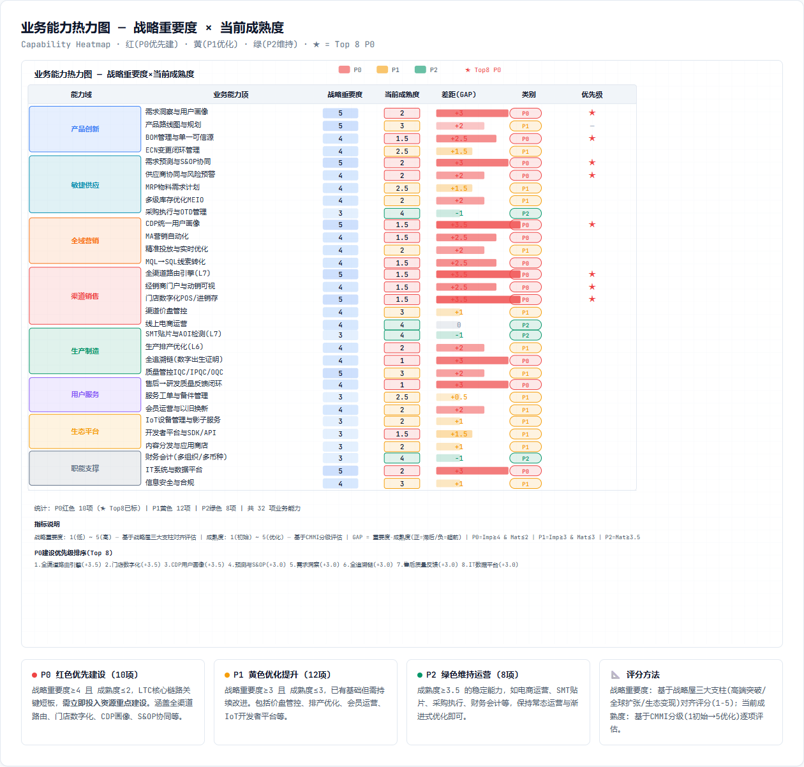

能力热力图在 L4 颗粒度上评估“战略重要度、当前成熟度、建设紧迫度、LTC相关性”。P0 优先建设项集中在需求预测与 S&OP、BOM 单一可信源、全渠道订单路由、库存承诺、供应商协同、质量追溯、统一用户画像、应收结算和合规风控等能力。

| 优先级 | 能力项 | 所属业务域 | 建设原因 |
|---|---|---|---|
| P0 | S&OP协同 | 供应链管理 | 直接影响供需平衡、库存周转和订单准交率 |
| P0 | BOM/配置管理 | 产品研发 | MRP、制造和售后均依赖统一产品数据 |
| P0 | 全渠道订单路由 | 销售与渠道 | 决定线上线下库存共享和用户履约体验 |
| P0 | 库存承诺ATP | 供应链管理 | 避免超卖和无效承诺 |
| P0 | 质量追溯 | 生产制造 | 支撑精准召回、质量闭环和供应商责任界定 |
| P0 | 统一用户画像 | 市场营销 | 支撑精准营销、线索评分和复购运营 |
| P0 | 应收与返利结算 | 财务管理 | 保证LTC现金闭环和渠道政策可控 |
| P0 | 隐私与贸易合规 | 法务与合规 | 支撑全球经营和用户数据合法使用 |

---

## 2.4 企业端到端价值流

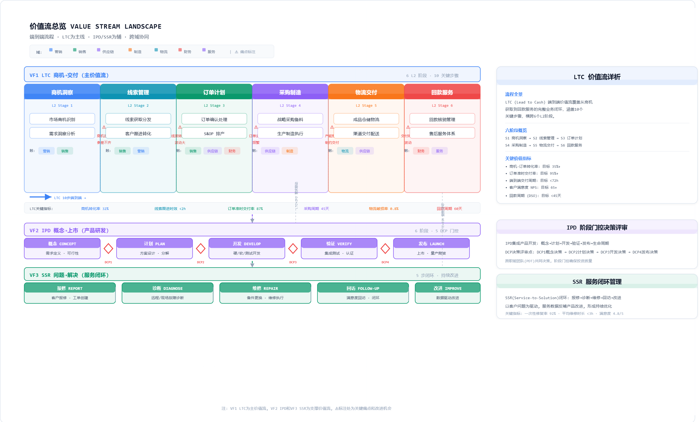

企业级价值流用于说明跨业务域如何共同创造价值。全企业价值流均需识别到 L3/L4 级能力支撑；其中 LTC 是本章 L5-L7 深度展开对象。

| 价值流编号 | 价值流名称 | 覆盖业务域 | 价值产出 | 深度 |
|---|---|---|---|---|
| VF01 | 从创意到上市 I2L | 市场营销、产品研发、供应链、制造、财务、法务 | 可销售、可制造、可盈利的新产品 | L5-L6局部展开 |
| VF02 | 从线索到回款 LTC | 市场营销、销售渠道、供应链、制造、物流、服务、财务、合规 | 客户收到产品并完成企业回款 | L5-L7重点展开 |
| VF03 | 从计划到采购 P2P | 供应链、财务、法务、质量 | 物料和服务按成本、质量、交期到位 | L4-L5展开 |
| VF04 | 从计划到生产 P2M | 供应链、制造、质量、安全 | 产品按计划、高质量、可追溯生产入库 | L5-L7局部展开 |
| VF05 | 从问题到解决 I2R | 客户服务、质量、研发、供应链、财务 | 用户问题解决并反哺产品质量 | L5-L6展开 |
| VF06 | 从预算到报告 B2R | 战略、财务、各业务域 | 预算受控、经营可视、财报合规 | L4展开 |
| VF07 | 从人才到绩效 T2P | 人力资源、各业务域 | 组织能力与业务目标匹配 | L4展开 |
| VF08 | 从风险到控制 R2C | 法务合规、安全、IT、各业务域 | 全球经营风险可识别、可控制、可审计 | L4展开 |

### 2.4.1 价值流逐项说明

#### VF01 从创意到上市 I2L

从创意到上市(I2L)描述手机厂商将市场机会、用户洞察和技术能力转化为可销售产品的全过程。

**价值产出**: 可销售、可制造、可盈利的新产品（含完整的产品数据/BOM/工艺路线/质量目标/售后知识）。

**参与业务域与贡献**:
- 市场营销(D05): 提供用户洞察、竞品分析和目标人群定义
- 产品研发(D02): 主导产品定义、IPD研发、BOM和配置管理
- 供应链(D03): 提前参与关键物料评估、目标成本测算和多源供应方案
- 生产制造(D04): 参与DFM/DFS评审，确保可制造性和可测试性
- 财务管理(D10): 目标成本设定和盈利测算
- 法务合规(D11): 专利布局/认证/区域准入

**核心挑战**: "既要快，又要准，还要可制造"——上市节奏(TTM)和产品定义命中率的平衡。

**关键度量**: TTM≤11月(Y3目标)、BOM准确率≥99.5%、试产问题闭环率≥95%。

**跨域阶段门**: 每个DCP须研发+供应链+制造+质量+财务+营销+合规共同签署，确保产品上市后LTC链路顺畅承接，避免已发布产品缺料、渠道话术不一致、售后知识缺失或目标毛利无法实现。

#### VF02 从线索到回款 LTC

从线索到回款(LTC)是本规划核心主线，描述从市场生成需求到财务完成回款核销的完整闭环。

**价值产出**: 客户收到满意产品并完成回款，形成正向现金流。

**七个阶段端到端闭环**:
1. **市场与商机(M2L)**: 品牌策略→Campaign→线索采集(含隐私授权)→线索评分→MQL移交销售
2. **销售与下单(L2O)**: 价格校验→订单创建→五步审核(价格/促销/库存/信用/合规)→可履约订单
3. **计划与供应(O2D)**: S&OP平衡→MRP运算(依赖BOM)→采购需求→供应商交期确认→来料检验
4. **生产制造(P2M)**: MPS排产→齐套校验→SMT/组装/测试→IMEI绑定→完工入库
5. **物流交付(D2C)**: 履约路由→拣货复核→IMEI出库→运输在途→签收确认
6. **客户服务(I2R)**: 报修受理→保修校验→维修诊断→维修执行→NPS回访→质量回流CAPA
7. **财务回款(F2C)**: 应收确认(签收触发)→渠道对账→回款核销→返利结算→DSO分析

**本质**: 把"客户意向"转化为"可履约承诺"，再转化为"实物交付"和"现金回收"。

**关键度量**: 订单准交率≥96%、库存周转≤32天、DSO≤38天、NPS≥45(Y3目标)。

**架构重点**: 跨域承诺前置到订单生成前(库存ATP/价格/信用/合规在订单创建时实时校验)，而非等订单异常后人工协调；统一状态机保证订单-库存-出库-签收-应收-回款-售后可追踪、可审计。

#### VF03 从计划到采购 P2P

从计划到采购(P2P)负责把需求计划和生产计划转化为稳定、经济、可控的供应能力。

**价值产出**: 物料和服务按成本、质量、交期要求到位，不缺料、不积压、不违规。

**关键流程节点**:
- 销售预测→S&OP共识→MPS→MRP运算→物料净需求识别
- 寻源→招投标→框架协议→采购订单(PO)→交期确认→到货协同→质量检验→应付结算

**手机制造的P2P特殊性**: 关键器件（SoC/屏幕/摄像头/存储/电池）具有长周期、高波动和强技术约束；供应商选择直接影响产品体验、成本结构和上市节奏。因此P2P不能只按"下单买料"理解，而应作为**供应链韧性能力**来建设。

**关键度量**: 预测准确率MAPE≥75%、关键物料缺料导致新品延期=0、供应商交期承诺达成率≥95%。

**关键断点**: 计划-采购-质量-财务之间的协同脱节（计划变更未及时传递供应商、采购只关注价格忽略交期和质量、来料检验结果未进入供应商绩效、应付结算缺少到货和质检依据）。该价值流需以供应商、PO、到货批次和质检记录为核心对象建立闭环。

#### VF04 从计划到生产 P2M

从计划到生产(P2M)描述将供需平衡结果转化为工厂可执行工单，并通过制造过程形成合格成品。

**价值产出**: 产品按计划、高质量、可追溯生产入库。

**关键流程节点**:
- 承接S&OP/MPS/物料齐套/BOM/工艺路线
- 产能平衡→详细排产→工单下达→叫料→SMT贴片→组装测试→包装入库→质量检验→IMEI单机追溯

**手机制造的P2M特点**: 节拍快、工序多、质量追溯要求高——BOM版本/物料批次/程序参数/检测数据任一不一致都可能造成批量质量风险。

**关键度量**: 直通率≥95%、IMEI追溯完整率≥99.9%、OEE≥85%。

**核心价值**: 不是把MES上线，而是把工单/物料/设备/人员/工艺参数/检测结果/IMEI绑定起来，形成可追溯的"数字出生证明"。排产要考虑物料齐套+设备状态+工艺版本+人员技能+质量风险；工单执行要记录关键工序参数+检测结果+异常处理；IMEI/SN是贯穿制造→物流→激活→售后的核心追溯标识，应在出厂前完成绑定。

#### VF05 从问题到解决 I2R

从问题到解决(I2R)覆盖用户购机后遇到问题、寻求帮助、完成维修/退换，并将服务数据反哺产品改进。

**价值产出**: 用户问题解决并形成NPS反馈，高频故障回流研发/制造/供应商质量闭环。

**关键流程节点**:
- 客服接入→智能诊断→服务预约→保修校验→工单派发→检测诊断→维修报价→备件调拨→维修执行→回访评价→NPS采集→质量问题回流→CAPA触发

**核心理念**: 售后服务不是单纯成本中心，而是品牌体验、复购意愿和质量改进的重要入口。一个高频故障如果只在服务系统中关闭，而没有进入研发质量和制造质量闭环，就会在下一批或下一代产品中重复出现。

**关键度量**: 一次修复率≥85%、服务闭环率≥95%(Y3)、NPS≥45(Y3)、CAPA触发<1h。

**关键断点**: "服务关闭"≠"问题解决"——客服工单关闭不代表质量问题关闭，维修完成不代表根因消除。需把服务工单/备件/IMEI履历/故障代码/NPS/CAPA关联起来，形成闭环联动。

#### VF06 从预算到报告 B2R

从预算到报告(B2R)负责将战略目标、经营计划和资源投入转化为预算控制、会计核算、经营分析和管理报告。

**价值产出**: 预算受控、经营可视、财报合规、管理决策有数可依。

**关键流程节点**:
- 年度经营计划→预算编制→预算分解→费用申请→采购/项目预算占用
- 收入成本确认→总账核算→应收/应付/资产→资金税务处理→合并报表→经营分析→管理会计

**手机厂商B2R的特殊性**: 必须支撑多产品线/多区域/多渠道/多业务模式的经营管理，既要看产品盈利(按SKU)，也要看渠道费用/促销补贴/库存跌价/售后成本/互联网服务收入。

**关键度量**: 月度关账≤3天、预算偏差率<15%、DSO≤38天、产品盈利分析覆盖率100%。

**架构难点**: 经营口径统一和业财一体化——销售口径/发货口径/签收口径/收入确认口径/回款口径必须一致。该价值流需要把预算/合同/订单/出库/签收/发票/应收/回款/返利/成本对象串联，形成可穿透的经营视图。

#### VF07 从人才到绩效 T2P

从人才到绩效(T2P)描述企业如何将战略能力需求转化为组织、岗位、人才供给、绩效激励和能力成长。

**价值产出**: 组织能力与业务目标匹配——对的人在对的岗位上用对的能力做对的事。

**关键流程节点**:
- 组织设计→岗位体系→编制规划→招聘配置→入职融入
- 绩效目标设定→绩效评估→薪酬激励(含股权)→学习发展→干部培养→继任计划

**与架构规划的联动**: 第1章业务能力热力图中被识别为P0的能力，必须同步映射到岗位/技能/培训/绩效/激励。如S&OP能力需要需求计划+供应计划+数据分析复合人才；全球合规需要区域法规+流程控制人才。

**关键度量**: 关键岗位到岗率≥90%(从审批到入职60天内)、绩效目标达成率≥85%、培训认证通过率≥80%。

**核心价值**: 让组织能力匹配业务变化——避免流程设计完无人会用、系统上线但角色职责不清。架构落地不仅是IT系统建设，更是组织能力和人才能力的同步建设。

#### VF08 从风险到控制 R2C

从风险到控制(R2C)覆盖企业全球经营中的风险识别、控制设计、流程嵌入、持续审计和应急处置。

**价值产出**: 全球经营风险可识别、可控制、可审计——企业不会因为一个合规漏洞、一次安全事件或一次供应链中断而遭受重大损失。

**手机厂商面临的六类风险**:
- 个人信息保护(PIPL/GDPR/LGPD合规)、数据出境安全评估
- 出口管制与贸易合规(实体清单/制裁名单/禁限售国家)
- 知识产权(专利侵权/商标抢注/商业秘密泄露)
- 供应链中断(地缘政治/自然灾害/单一供应商依赖)
- 信息安全(数据泄露/勒索软件/APT攻击)
- 生产安全与EHS(产线事故/化学品泄露/职业病)

**核心理念**: "控制点内嵌业务流程"而非事后补审批。营销线索采集时嵌入隐私同意；订单审核时嵌入禁限售和制裁名单检查；采购寻源时嵌入供应商合规和安全评估；制造现场嵌入EHS和质量追溯；数据使用时嵌入分级授权和审计留痕。

**关键度量**: 重大合规事件=0、安全事件MTTR<4h、审计整改闭环率≥95%、BCP演练达标率100%。

**附件**：[附件2-2 端到端价值流清单](./附件/附件2-2_端到端价值流清单.xlsx)
---
## 2.5 LTC核心价值流L5-L7展开

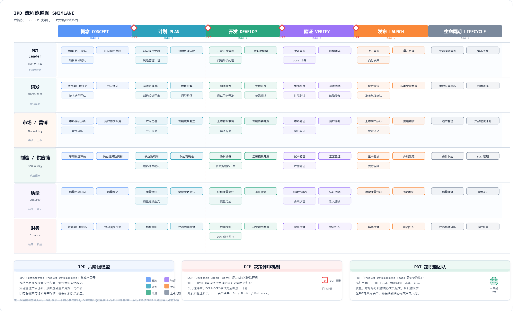

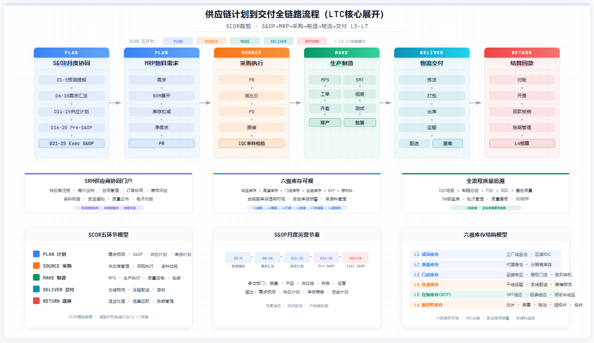

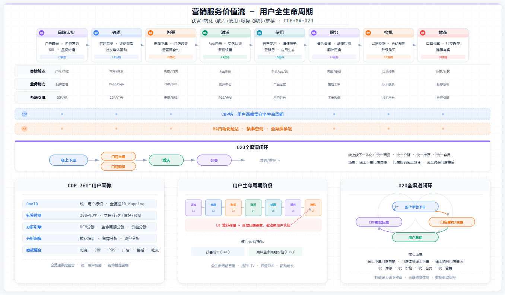

LTC 是手机厂商最核心的端到端价值流，贯穿“市场生成需求→销售形成订单→供应链保障供给→制造生产→物流交付→售后服务→财务回款”。本节只对核心活动展开到 L5-L7，企业运营域通过能力和规则参与支撑，不在此处展开所有内部管理流程。

### 2.5.1 LTC阶段总览

| 阶段 | L4流程域 | 关键业务问题 | 主要参与业务域 |
|---|---|---|---|
| 市场与商机 | 品牌/Campaign/线索 | 如何把产品卖点转化为可跟进需求 | 市场营销、产品研发、法务合规 |
| 销售与下单 | 报价/订单/信用/库存 | 如何把商机转化为有效订单 | 销售与渠道、财务、供应链、合规 |
| 计划与供应 | S&OP/MRP/采购 | 如何保证订单背后的物料与产能 | 供应链、产品研发、财务、供应商 |
| 生产制造 | 排产/工单/质量 | 如何按质量、成本、交期生产 | 生产制造、质量、安全、供应链 |
| 物流交付 | 路由/仓储/运输/签收 | 如何把产品高效交给客户或渠道 | 供应链、销售渠道、物流伙伴 |
| 客户服务 | 报修/维修/反馈 | 如何解决问题并反哺质量 | 客户服务、质量、研发、备件 |
| 财务回款 | 应收/对账/核销/返利 | 如何完成现金闭环和渠道结算 | 财务管理、销售渠道 |

### 2.5.2 LTC关键活动明细

| 编号 | 阶段 | 关键活动 | 层级 | 活动内容 | 主责角色 | 输入 | 输出 | 支撑能力 |
|---|---|---|---|---|---|---|---|---|
| M2L-01 | 市场与商机 | 品牌策略与目标人群定义 | L5 | 基于年度产品节奏和区域策略，明确目标用户、卖点、价格带和传播主张。 | 品牌经理 | 产品卖点、区域策略 | Campaign Brief | 品牌策略、产品卖点管理 |
| M2L-02 | 市场与商机 | Campaign策划与预算分配 | L5 | 拆解传播主题、渠道组合、预算、素材节奏和投放KPI，形成可执行活动方案。 | Campaign经理 | Campaign Brief | 活动计划、预算包 | Campaign管理、预算分配 |
| M2L-03 | 市场与商机 | 线索采集与用户授权 | L6 | 通过官网、电商、门店、社媒、运营商等触点采集用户线索，并完成隐私授权与来源标记。 | 营销运营 | 活动落地页、门店活动 | 线索记录 | 线索采集、同意管理 |
| M2L-04 | 市场与商机 | 线索评分与MQL移交 | L6 | 按人群画像、互动行为、购买意向、渠道价值进行评分，达到阈值后移交销售/渠道。 | 营销运营 | 线索记录、行为数据 | MQL清单 | 线索评分、营销自动化 |
| L2O-01 | 销售与下单 | 渠道价格与促销校验 | L5 | 校验SKU、区域、渠道、价格政策、促销资格和补贴规则，避免串货和价盘冲突。 | 渠道经理 | MQL/订单意向 | 有效报价/促销资格 | 价格体系、促销规则 |
| L2O-02 | 销售与下单 | 订单创建与客户确认 | L6 | 用户或渠道提交订单，完成客户、SKU、数量、地址、支付方式、发票等核心信息确认。 | 电商运营/渠道销售 | 购买意向、报价 | 销售订单 | 订单创建、客户/渠道管理 |
| L2O-03 | 销售与下单 | 信用/库存/合规检查 | L6 | 对渠道信用额度、可承诺库存、区域合规和风险名单进行自动检查。 | 订单专员 | 销售订单 | 可履约订单/异常单 | 信用检查、ATP、合规校验 |
| O2D-01 | 计划与供应 | 需求汇总与S&OP平衡 | L5 | 汇总销售预测、渠道库存、Campaign计划和产能约束，形成供需平衡方案。 | 需求计划员 | 销售预测、库存、产能 | S&OP计划 | 需求预测、S&OP协同 |
| O2D-02 | 计划与供应 | MRP运算与采购需求生成 | L6 | 基于MPS、BOM、库存、在途和安全库存生成物料净需求和采购申请。 | 物料计划员 | MPS、BOM、库存 | 采购申请 | MRP、BOM、库存策略 |
| O2D-03 | 计划与供应 | 供应商交期确认与风险预警 | L6 | 供应商确认交期、数量和价格，对长周期/受限物料触发风险预警和替代方案。 | 采购工程师 | 采购申请/预测 | 交期承诺、风险清单 | 采购订单、供应商协同 |
| MFG-01 | 生产制造 | 主生产计划与详细排产 | L5 | 将供需平衡结果转换为工厂、产线、班次和工单级排产计划。 | 生产计划员 | S&OP/MPS | 工单排程 | MPS、详细排产、工单管理 |
| MFG-02 | 生产制造 | 工单开工与物料齐套 | L6 | MES校验BOM、工艺、设备、人员和物料齐套，生成产线开工条件。 | 产线主管 | 工单、MBOM | 开工许可 | 工单管理、上料校验 |
| MFG-03 | 生产制造 | SMT/组装/测试执行 | L7 | 按工艺路线执行贴片、组装、功能测试、老化测试和包装，并记录工序质量数据。 | 产线操作员 | 开工许可 | 半成品/成品、质量记录 | 车间执行、质量追溯 |
| MFG-04 | 生产制造 | 质量异常与CAPA闭环 | L6 | 对AOI/功能测试/售后回流的问题进行原因分析、纠正预防和研发/供应商责任分派。 | 质量工程师 | 质量异常 | CAPA单、改进项 | IPQC/OQC、CAPA |
| D2C-01 | 物流交付 | 订单履约路由 | L5 | 根据库存、距离、渠道承诺、成本和SLA，在中心仓、区域仓、门店之间选择履约节点。 | 履约计划员 | 可履约订单、库存 | 履约路由结果 | ATP、仓店路由 |
| D2C-02 | 物流交付 | 拣货复核与出库 | L6 | WMS生成波次任务，完成拣货、复核、IMEI绑定、打包、出库交接。 | 仓储主管 | 履约任务 | 出库单、物流面单 | 仓储执行、IMEI绑定 |
| D2C-03 | 物流交付 | 运输在途与签收确认 | L6 | 跟踪物流轨迹、异常拦截、电子签收和签收回传，触发收入确认或售后期开始。 | 物流专员 | 出库单 | 签收回执 | 运输管理、签收确认 |
| C2S-01 | 售后服务 | 报修受理与保修校验 | L5 | 用户通过App/门店/热线报修，系统校验IMEI、保修、延保和服务政策。 | 客服专员 | 用户请求、IMEI | 服务工单 | 报修受理、保修校验 |
| C2S-02 | 售后服务 | 检测诊断与维修执行 | L6 | 维修工程师诊断故障、确认报价、领用备件并完成维修/换机/退机。 | 维修工程师 | 服务工单、备件 | 维修记录 | 维修诊断、备件服务 |
| C2S-03 | 售后服务 | 服务回访与质量回流 | L6 | 完成NPS回访和故障代码沉淀，将高频质量问题回流研发和制造。 | 服务质量经理 | 维修记录、NPS | 质量改进需求 | NPS、质量反馈回流 |
| F2C-01 | 财务回款 | 应收确认与对账 | L5 | 基于订单、出库、签收和渠道政策生成应收，完成平台/渠道/经销商对账。 | 财务BP | 订单、签收、价格政策 | 应收单、对账单 | 应收管理、渠道对账 |
| F2C-02 | 财务回款 | 回款核销与返利结算 | L6 | 匹配回款流水、核销应收，并按政策计算渠道返利、补贴和费用。 | 财务结算 | 银行流水、对账单 | 核销记录、返利单 | 回款核销、返利结算 |

**附件**：[附件2-7 LTC关键活动L5-L7明细](./附件/附件2-7_LTC关键活动L5-L7明细.xlsx)
### 2.5.3 关键活动设计要点

- **订单不是单系统动作，而是跨域承诺**：一个有效订单至少需要客户/渠道有效、价格政策有效、库存可承诺、信用额度可用、合规规则通过。
- **计划不是供应链内部动作，而是需求-供应-财务的平衡**：S&OP 必须同时接收销售预测、渠道库存、Campaign计划、产能、物料和现金约束。
- **制造不是黑盒生产，而是质量数据资产形成过程**：SMT、组装、测试、包装每一步都应沉淀工序、设备、人员、物料批次和质量记录。
- **售后不是成本中心，而是产品质量闭环入口**：故障代码、维修记录、NPS 和退换货原因必须回流研发和制造，形成 DFMEA、工艺改进和供应商质量整改输入。

---

## 2.6 业务组件如何支撑LTC端到端流程

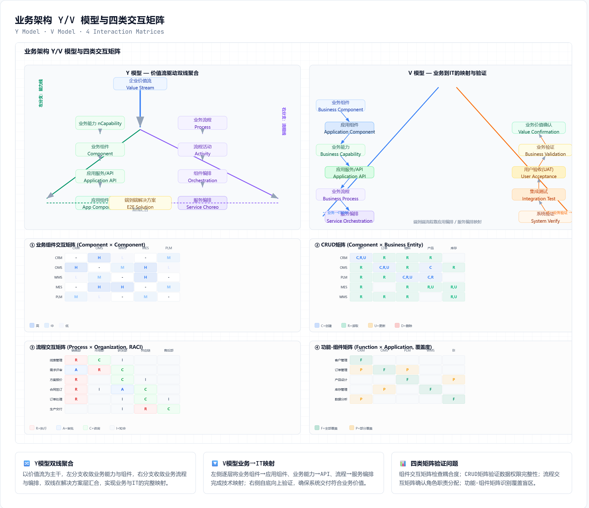

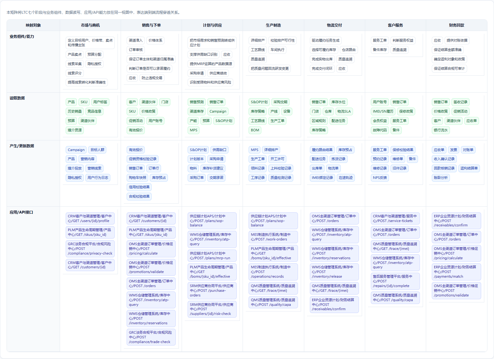

本节按 2.4 中的 LTC 端到端价值流重新组织映射方式。映射不再从“组件清单”出发，而是从 LTC 阶段和活动出发：先识别该阶段要完成的业务活动，再判断活动需要调用哪些业务组件，最后说明这些组件提供哪些能力来支撑该活动。这样可以清楚回答“流程为什么需要这些组件”，也能为第4章应用架构推导系统边界和服务接口提供依据。

### 2.6.1 映射规则

| 映射层 | 说明 | 例子 |
|---|---|---|
| LTC阶段/活动 | 先从端到端流程拆出阶段和关键活动 | 销售与下单-信用/库存/合规检查 |
| 支撑业务组件 | 判断该活动依赖哪些稳定业务组件 | 订单组件、库存承诺组件、应收结算组件、合规风控组件 |
| 组件支撑能力 | 说明组件具体提供哪些能力或业务服务 | ATP查询、信用额度校验、风险名单检查 |
| 支撑价值 | 说明该能力如何保障活动完成 | 避免超卖、坏账和违规交易 |

### 2.6.2 市场与商机阶段组件支撑映射

| LTC活动 | 支撑业务组件 | 需要组件提供的能力 | 支撑说明 |
|---|---|---|---|
| 品牌策略与目标人群定义 | 用户洞察组件 | 用户画像、分群、需求洞察、目标人群识别 | 定义目标用户、价格带、卖点和传播主张 |
| 品牌策略与目标人群定义 | BOM与配置组件 | 产品卖点、SKU配置、上市版本信息 | 保证传播卖点与真实产品配置一致 |
| Campaign策划与预算分配 | Campaign组件 | 活动计划、预算分配、素材管理、投放节奏 | 把市场策略转化为可执行Campaign |
| 线索采集与用户授权 | 线索组件 | 线索采集、来源标记、触点归因 | 沉淀可跟进线索 |
| 线索采集与用户授权 | 合规风控组件 | 隐私授权、同意记录、数据使用规则 | 保证用户数据采集合法合规 |
| 线索评分与MQL移交 | 线索组件 | 线索评分、培育、MQL移交 | 筛选高意向线索并移交销售 |
| 线索评分与MQL移交 | 用户洞察组件 | 行为画像、兴趣标签、购买倾向 | 提高线索转化判断准确性 |

### 2.6.3 销售与下单阶段组件支撑映射

| LTC活动 | 支撑业务组件 | 需要组件提供的能力 | 支撑说明 |
|---|---|---|---|
| 渠道价格与促销校验 | 渠道组件 | 渠道准入、门店画像、经销商分级、渠道政策 | 确认订单来源和渠道资格 |
| 渠道价格与促销校验 | 价格促销组件 | 价格体系、促销规则、补贴核销、价保 | 形成有效报价并控制价盘 |
| 订单创建与客户确认 | 订单组件 | 订单创建、订单审核、状态管理、订单拆合 | 形成LTC主交易对象 |
| 订单创建与客户确认 | 渠道组件 | 客户/渠道资料、收货地址、渠道归属 | 保证订单主体和渠道归属准确 |
| 信用/库存/合规检查 | 库存承诺组件 | ATP查询、库存预占、库存释放 | 判断订单是否可以承诺履约 |
| 信用/库存/合规检查 | 应收结算组件 | 信用额度、账期政策、历史应收 | 控制渠道信用风险 |
| 信用/库存/合规检查 | 合规风控组件 | 区域合规、禁限售、风险名单 | 防止违规交易 |

### 2.6.4 计划与供应阶段组件支撑映射

| LTC活动 | 支撑业务组件 | 需要组件提供的能力 | 支撑说明 |
|---|---|---|---|
| 需求汇总与S&OP平衡 | S&OP组件 | 预测汇总、供需平衡、计划版本管理 | 把市场需求和销售预测转成供应计划 |
| 需求汇总与S&OP平衡 | 库存承诺组件 | 渠道库存、在途库存、可用库存 | 支撑供需缺口识别 |
| 需求汇总与S&OP平衡 | 应收结算组件 | 预算约束、现金占用、库存资金 | 约束供应计划的财务可行性 |
| MRP运算与采购需求生成 | BOM与配置组件 | EBOM/PBOM/MBOM、替代料、ECN | 提供MRP运算的产品数据源 |
| MRP运算与采购需求生成 | 采购协同组件 | 采购申请、采购订单、供应商分配 | 生成可执行采购需求 |
| 供应商交期确认与风险预警 | 采购协同组件 | 交期确认、供应风险、供应商绩效 | 保障关键物料供应 |
| 供应商交期确认与风险预警 | 合规风控组件 | 供应商合规、贸易限制、区域法规 | 识别受限物料和供应商风险 |

### 2.6.5 生产制造阶段组件支撑映射

| LTC活动 | 支撑业务组件 | 需要组件提供的能力 | 支撑说明 |
|---|---|---|---|
| 主生产计划与详细排产 | 排产组件 | MPS、详细排产、工单、产能平衡 | 把供需计划转成工厂工单 |
| 主生产计划与详细排产 | 库存承诺组件 | 物料齐套、半成品库存、成品库存 | 校验排产可行性 |
| 工单开工与物料齐套 | BOM与配置组件 | MBOM、工艺路线、配置规则 | 保证工单使用正确BOM和工艺 |
| 工单开工与物料齐套 | 车间执行组件 | 工单开工、上料校验、人员设备校验 | 形成开工许可 |
| SMT/组装/测试执行 | 车间执行组件 | 工序采集、设备参数、完工入库 | 执行生产并采集过程数据 |
| SMT/组装/测试执行 | 质量追溯组件 | SN/IMEI追溯、AOI/测试记录、批次关联 | 形成单机数字履历 |
| 质量异常与CAPA闭环 | 质量追溯组件 | 异常定位、CAPA、责任分派 | 闭环质量问题 |
| 质量异常与CAPA闭环 | BOM与配置组件 | ECN变更、设计问题关联 | 把质量问题回流研发变更 |

### 2.6.6 物流交付阶段组件支撑映射

| LTC活动 | 支撑业务组件 | 需要组件提供的能力 | 支撑说明 |
|---|---|---|---|
| 订单履约路由 | 订单组件 | 订单状态、交付承诺、拆合单规则 | 驱动履约任务生成 |
| 订单履约路由 | 库存承诺组件 | ATP、仓店库存、库存预占 | 选择可履约库存 |
| 订单履约路由 | 仓储物流组件 | 仓店路由、物流成本、SLA | 确定履约节点和配送方式 |
| 拣货复核与出库 | 仓储物流组件 | 波次拣货、复核、出库、运输交接 | 完成实物出库 |
| 拣货复核与出库 | 质量追溯组件 | IMEI/SN绑定、渠道码、出库质量检查 | 保证出库产品可追溯 |
| 运输在途与签收确认 | 仓储物流组件 | 在途跟踪、异常拦截、签收回传 | 完成交付闭环 |
| 运输在途与签收确认 | 应收结算组件 | 签收确认、收入确认条件 | 触发财务应收和收入确认 |

### 2.6.7 客户服务阶段组件支撑映射

| LTC活动 | 支撑业务组件 | 需要组件提供的能力 | 支撑说明 |
|---|---|---|---|
| 报修受理与保修校验 | 服务工单组件 | 报修受理、工单创建、保修校验 | 形成服务请求入口 |
| 报修受理与保修校验 | 订单组件 | 购买记录、激活信息、保修起点 | 判断服务权益 |
| 检测诊断与维修执行 | 服务工单组件 | 派工、诊断、维修报价、维修记录 | 完成维修过程管理 |
| 检测诊断与维修执行 | 备件组件 | 备件库存、调拨、旧件回收 | 保障维修资源 |
| 检测诊断与维修执行 | 质量追溯组件 | IMEI履历、故障代码、维修记录 | 定位问题来源 |
| 服务回访与质量回流 | 服务工单组件 | 回访、投诉升级、SLA监控 | 完成服务体验闭环 |
| 服务回访与质量回流 | 质量追溯组件 | 故障聚类、CAPA、研发制造回流 | 把售后问题转为质量改进 |

### 2.6.8 财务回款阶段组件支撑映射

| LTC活动 | 支撑业务组件 | 需要组件提供的能力 | 支撑说明 |
|---|---|---|---|
| 应收确认与对账 | 应收结算组件 | 应收确认、渠道对账、收入确认 | 形成财务债权和经营结果 |
| 应收确认与对账 | 订单组件 | 订单金额、退换货状态、签收状态 | 提供对账依据 |
| 应收确认与对账 | 价格促销组件 | 返利政策、促销补贴、价保规则 | 保证结算金额准确 |
| 回款核销与返利结算 | 应收结算组件 | 回款核销、返利计算、账龄分析 | 完成现金闭环 |
| 回款核销与返利结算 | 渠道组件 | 经销商主体、渠道等级、政策适用 | 确定返利对象和政策 |
| 回款核销与返利结算 | 合规风控组件 | 审计证据、异常交易、合同约束 | 保证结算合规可审计 |

### 2.6.9 组件支撑关系对下游架构的约束

上述映射表的价值在于把 LTC 流程、业务组件、能力服务三者绑定起来。第3章数据架构应据此识别订单、客户、库存、BOM、工单、IMEI、服务工单、应收等核心业务对象的 Owner 和 CRUD 关系；第4章应用架构应据此识别 OMS、CRM、SCM、APS、SRM、PLM、MES、WMS、TMS、QMS、售后系统、ERP/GRC 等应用之间的边界与服务契约；第5章技术架构则应根据库存承诺、订单审核、履约路由、车间执行、签收确认等关键服务的时效和可用性要求推导非功能指标。

**附件**：[附件2-9 业务组件支撑LTC映射](./附件/附件2-9_业务组件支撑LTC映射.xlsx)
---
## 2.7 组织、角色与治理

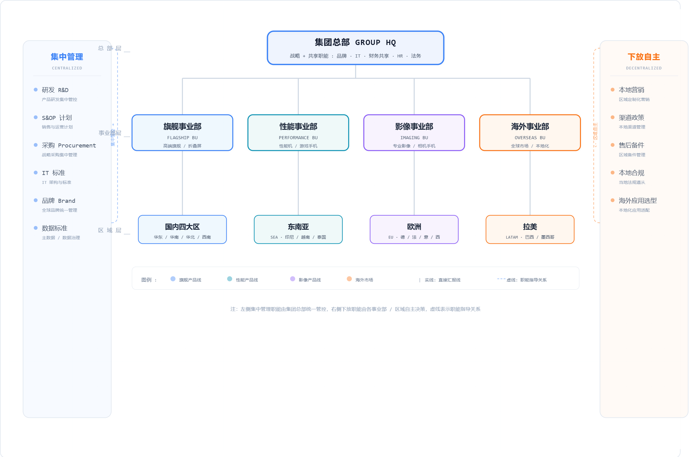

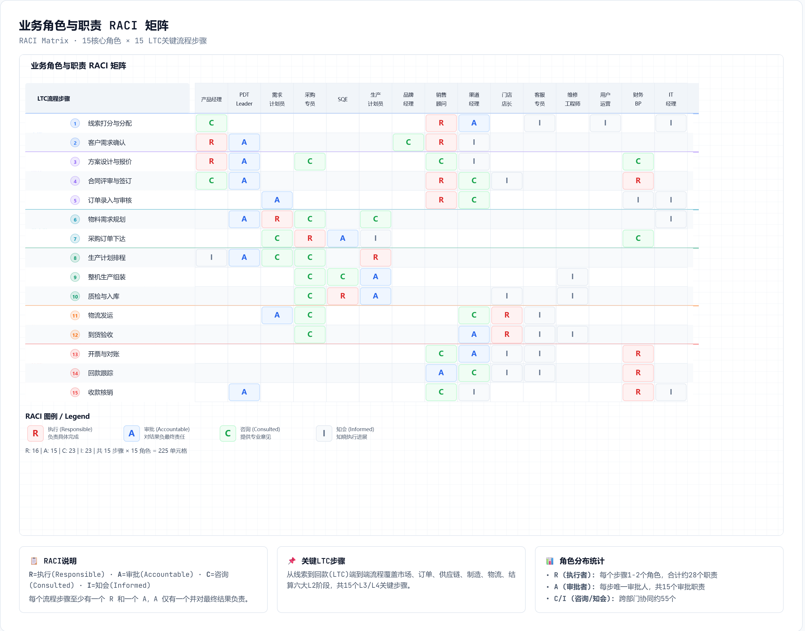

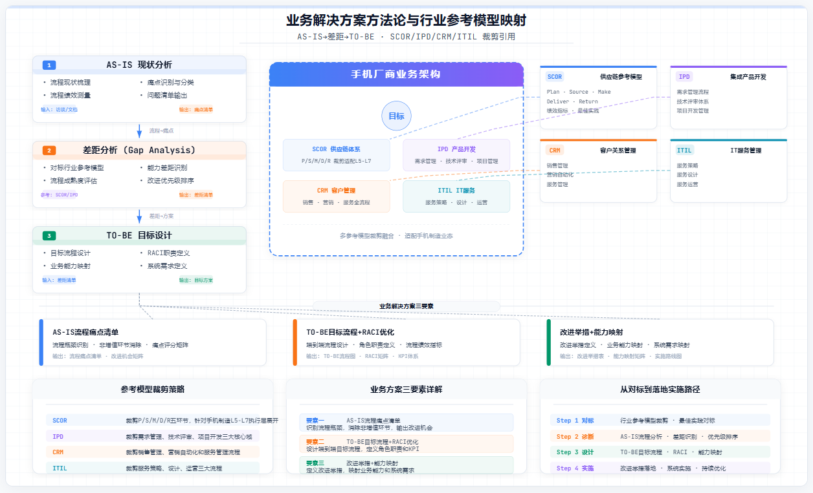

业务域不等于组织部门，但每个业务域必须有清晰 Owner。核心价值链建议建立跨域流程 Owner 机制，例如 LTC Owner、IPD Owner、P2P Owner，并通过流程委员会协调跨部门目标冲突。

| 治理对象 | Owner建议 | 主要职责 |
|---|---|---|
| 业务域 | 各业务域负责人 | 定义能力路线图、业务规则和能力成熟度目标 |
| 端到端价值流 | 跨域流程Owner | 对端到端效率、体验、成本和风险负责 |
| 业务组件 | 组件Owner/产品负责人 | 维护能力边界、服务目录、业务对象和需求优先级 |
| 数据对象 | 数据Owner | 明确数据口径、质量规则和授权策略 |
| 流程活动 | RACI角色 | 保证关键活动有人执行、有人批准、有人协同 |

**附件**：[附件2-5 业务角色与技能矩阵](./附件/附件2-5_业务角色与技能矩阵.xlsx)
---

---

## 2.9 业务能力依赖关系模型【新增P2-1】

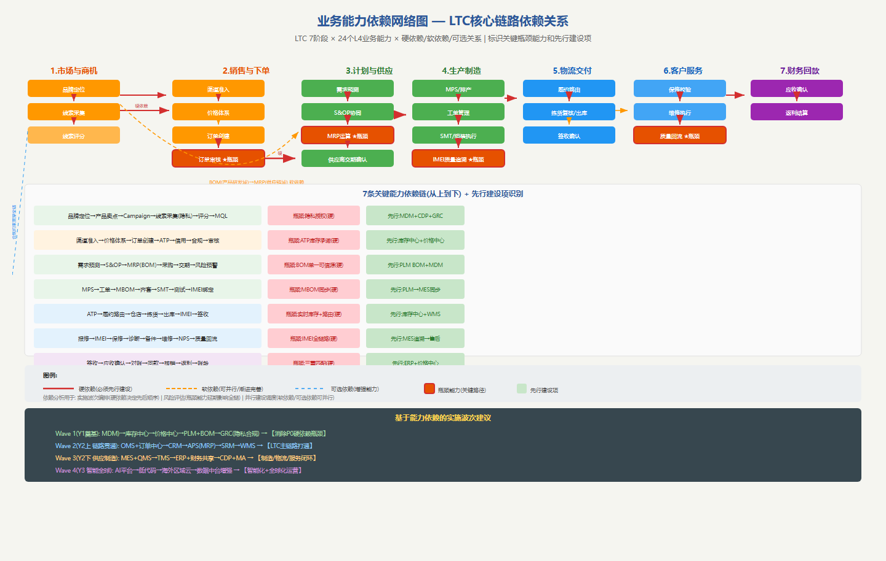

> **新增说明**：本节为P2-1优化项新增内容。在L4业务能力清单基础上，建立能力间的依赖关系模型，支撑实施波次编排、风险评估和影响分析。

### 2.9.1 依赖关系类型定义

| 依赖类型 | 标识 | 含义 | 对实施的约束 |
|---------|------|------|------------|
| 硬依赖 | ● | 目标能力必须在源能力建设完成后才能上线 | 决定实施先后顺序(Wave编排依据) |
| 软依赖 | ◐ | 目标能力可先行上线但效果受限,可渐进完善 | 可并行建设,留出渐进优化窗口 |
| 可选依赖 | ○ | 目标能力可独立运行,依赖关系用于增强 | 完全可并行,按能力热力图优先级排序 |

### 2.9.2 LTC关键能力依赖链分析

LTC七阶段每条关键能力依赖链如下（详细数据见附件2-10）：

- **市场与商机链**: 品牌定位→产品卖点→Campaign→线索采集(隐私授权●)→线索评分→MQL。硬依赖瓶颈:隐私授权(合规门禁,必须先行)。
- **销售与下单链**: 渠道准入→价格体系→订单创建→ATP库存承诺(●)→信用校验→合规检查→订单审核。硬依赖瓶颈:ATP库存承诺(库存中心先于OMS上线1-2个月)。
- **计划与供应链**: 需求预测→S&OP→MRP运算(BOM●)→采购申请→PO→交期确认→风险预警。硬依赖瓶颈:BOM单一可信源(PLM BOM治理是所有MRP正确性的前提)。
- **生产制造链**: MPS→工单→MBOM同步(●)→齐套校验→SMT→测试→IMEI绑定。硬依赖瓶颈:PLM→MES MBOM同步(工艺变更需即时传递)。
- **物流交付链**: ATP→履约路由(●)→仓店选择→拣货→出库→IMEI绑定→签收。硬依赖瓶颈:实时库存+仓店路由(超卖防护核心)。
- **客户服务链**: 报修→IMEI全链路追溯(●)→保修校验→维修→NPS→质量回流→CAPA。硬依赖瓶颈:制造质量数据→售后开放度。
- **财务回款链**: 签收→应收确认(●)→对账→回款→核销→返利结算→账龄。硬依赖瓶颈:签收-应收-回款三重匹配。

### 2.9.3 实施波次建议

基于上述依赖关系分析,实施波次按以下顺序编排:

| 波次 | 时间窗 | 先行建设项(消除硬依赖瓶颈) | 核心建设内容 |
|------|--------|--------------------------|-------------|
| Wave 1 | Y1 | MDM、库存中心、价格中心、PLM+BOM、GRC(隐私合规) | 数据和底座能力 |
| Wave 2 | Y2上 | OMS+订单中心、CRM、APS(MRP)、SRM、WMS | LTC主链路贯通 |
| Wave 3 | Y2下 | MES+QMS、TMS、ERP+财务共享、CDP+MA | 制造/物流/服务闭环 |
| Wave 4 | Y3 | AI平台、低代码、海外区域云、数据中台增强 | 智能化+全球化 |

**配图**：图-业务能力依赖网络图（见 [html/图-业务能力依赖网络图.html](./html/图-业务能力依赖网络图.html)）
**附件**：[附件2-10 业务能力依赖关系矩阵](./附件/附件2-10_业务能力依赖关系矩阵.xlsx)

---

---

## 2.10 业务场景建模验证 — 旗舰新品上市(I2L→LTC)【新增-建议4】

> **新增说明**：采用TOGAF业务场景(Business Scenario)技术,以"旗舰X系列新品从概念到首销"为端到端场景,验证业务架构的完整性和组件协同一致性。

### 2.10.1 场景定义

| 场景属性 | 内容 |
|---------|------|
| 场景名称 | 旗舰X系列新品从概念到首销(I2L→LTC端到端衔接) |
| 业务目标 | 18个月内完成从产品定义到首批10万台交付,首销首月≥50万台 |
| 涉及价值流 | VF01(I2L)+VF02(LTC)+VF03(P2P)+VF04(P2M) |
| 涉及业务域 | 产品研发/市场营销/供应链/制造/销售渠道/客服/财务/法务 |
| 场景跨度 | T-18月(概念)→T-0(首销)→T+3月(售后闭环) |
| 关键假设 | 长周期物料提前26周下单;Campaign提前8周预热;首批备料30万台 |

### 2.10.2 六阶段流程与组件调用矩阵

| 阶段 | 时间窗 | 关键活动 | 调用核心组件(L4能力) | 关键交付物 | 验证点 |
|------|--------|---------|---------------------|-----------|--------|
| 1.产品定义 | T-18~T-14月 | Charter/目标成本/卖点/路线图 | 用户需求池→产品路线图→产品Charter→目标成本 | Product Charter(价格带/卖点/成本/SoC选型) | Charter目标成本与BOM成本一致 |
| 2.研发验证 | T-14~T-6月 | ID/硬件/软件/DVT/EVT | IPD阶段门→EBOM→硬件开发→软件开发→DFMEA | EVT/DVT样机+BOM锁定 | BOM版本与DCP记录一致;DFMEA覆盖率100% |
| 3.供应准备 | T-6~T-2月 | S&OP/采购/交期/试产 | 需求预测→S&OP→MRP→PO→交期确认→来料检验 | 物料齐套≥95%;试产问题闭环 | 关键物料交期达成率;试产ECN数量 |
| 4.营销预热 | T-2~T-0月 | Campaign/预热/预约/渠道备货 | Campaign策划→媒介投放→线索采集→渠道铺货→库存预建 | 预约量≥100万;渠道铺货≥80% | Campaign ROI与铺货进度匹配 |
| 5.首销交付 | T-0~T+1月 | 首销下单/峰值/路由/交付 | 订单创建→审核→ATP→路由→拣配→出库→签收 | 首日≥20万单;48h发货≥90% | 大促弹性3x;超卖率=0 |
| 6.售后闭环 | T+0~T+3月 | 激活/NPS/售后/质量回流 | 激活→NPS回访→服务工单→诊断→质量回流→CAPA | NPS≥40;故障率≤2%;TOP3质量问题闭环 | CAPA闭环时效;售后知识库覆盖率 |

### 2.10.3 场景验证结论与改进建议

基于以上场景演练,对业务架构提出5条改进建议:

1. **I2L→LTC衔接**: Charter阶段须同步供应链做供应可行性评估;"产品Charter"和"S&OP协同"间软依赖→升为硬依赖
2. **BOM全域一致**: EBOM→MBOM→PBOM三态同步是新品最大数据风险;ECN变更影响分析应扩展到供应链库存影响
3. **营销-供应链联动**: Campaign策划需提前获取"可承诺产能"数据,建议通过计划中心API实现在线化(当前为离线Excel)
4. **峰值容量验证**: 首销峰值(3x)超当前基线,需为OMS/库存/支付链单独设新品首销弹性目标(5x),参见附件4-8
5. **售后准备前置**: 新品售后知识库/备件计划/客服培训应在上市前4周完成

---

## 2.11 业务架构制品与附件

本章输出以下业务架构制品：全企业业务域划分、企业端到端价值流清单、L4业务能力架构、LTC L5-L7关键活动明细、业务组件支撑LTC映射、业务角色与RACI、业务交互矩阵与行业参考模型。这些制品共同构成第3章数据架构、第4章应用架构和第6章实施规划的直接输入。

### 2.11.1 配图清单

| 编号 | 配图名称 | 出现小节 | 配图说明 | 文件链接 |
|---|---|---|---|------|
| 图2-1 | 业务架构框架与视图总览 | 2.1 | 展示战略、价值流、能力、流程、组件和下游架构之间的关系 | [html/图2-1_业务架构框架总览.html](./html/图2-1_业务架构框架总览.html) |
| 图2-2 | 商业模式画布 | 2.2 | 展示硬件获客、软件粘客、生态变现的商业模式 | [html/图2-2_商业模式画布.html](./html/图2-2_商业模式画布.html) |
| 图2-3 | L4业务能力架构图 | 2.3 | 按L1价值流、L2业务域、L3能力组、L4能力单元展示全企业能力 | [html/图2-3_业务能力地图.html](./html/图2-3_业务能力地图.html) |
| 图2-3b | 业务能力地图L2-L3-L4完整展开 | 2.3.2 | 按14个业务域逐层展示L3能力组和全部L4业务组件能力单元 | [html/图2-3b_业务能力地图L2L3.html](./html/图2-3b_业务能力地图L2L3.html) |
| 图2-4 | 组织架构图 | 2.3/2.7 | 展示业务域组织承接关系、治理角色和跨域协同边界 | [html/图2-4_组织架构图.html](./html/图2-4_组织架构图.html) |
| 图2-5 | 端到端价值流地图 | 2.4 | 展示企业主要价值流及LTC主线 | [html/图2-5_价值流地图.html](./html/图2-5_价值流地图.html) |
| 图2-6 | IPD流程泳道图 | 2.5 | 展示产品研发IPD流程中市场、研发、供应链、制造、质量等角色协同 | [html/图2-6_IPD流程泳道图.html](./html/图2-6_IPD流程泳道图.html) |
| 图2-7 | LTC核心流程展开图 | 2.5 | 展示市场、销售、供应、制造、物流、服务、财务回款的LTC链路 | [html/图2-7_供应链流程.html](./html/图2-7_供应链流程.html) |
| 图2-8 | 营销服务价值流 | 2.5 | 展示市场营销、销售转化、客户服务与体验闭环的价值流关系 | [html/图2-8_营销服务价值流.html](./html/图2-8_营销服务价值流.html) |
| 图2-9 | 业务能力热力图 | 2.3/2.7 | 展示L4能力现状成熟度、目标成熟度、差距和实施优先级 | [html/图2-9_业务能力热力图.html](./html/图2-9_业务能力热力图.html) |
| 图2-10 | RACI矩阵 | 2.7 | 展示LTC关键活动与业务角色之间的负责、审批、咨询、知会关系 | [html/图2-10_RACI矩阵.html](./html/图2-10_RACI矩阵.html) |
| 图2-11 | 业务组件支撑LTC映射图 | 2.6 | 展示业务组件、业务服务和LTC流程活动之间的支撑关系 | [html/图2-11_YV模型与交互矩阵.html](./html/图2-11_YV模型与交互矩阵.html) |
| 图2-12 | 业务解决方案与参考模型 | 2.7 | 展示业务架构制品与行业参考模型、解决方案蓝图之间的映射关系 | [html/图2-12_业务解决方案与参考模型.html](./html/图2-12_业务解决方案与参考模型.html) |
| 图2-13 | LTC阶段-业务组件-数据-API支撑矩阵 | 2.6 | 按LTC七阶段展示业务组件、读写数据、应用系统和API能力的综合映射 | [html/图2-13_LTC流程业务组件数据API支撑矩阵.html](./html/图2-13_LTC流程业务组件数据API支撑矩阵.html) |
| 图-能力依赖 | 业务能力依赖网络图【新增P2-1】 | 2.9 | 展示7条LTC关键能力依赖链、瓶颈能力识别和实施波次编排依据 | [html/图-业务能力依赖网络图.html](./html/图-业务能力依赖网络图.html) |

### 2.11.2 附件索引

| 编号 | 附件名称 | 文件地址 | 说明 |
|---|---|---|------|
| 附件2-1 | 业务域与职责明细表 | [./附件/附件2-1_业务域与职责明细表.xlsx](./附件/附件2-1_业务域与职责明细表.xlsx) | 14个L2业务域、职责、Owner和价值流关系 |
| 附件2-2 | 端到端价值流清单 | [./附件/附件2-2_端到端价值流清单.xlsx](./附件/附件2-2_端到端价值流清单.xlsx) | 企业价值流与LTC阶段 |
| 附件2-3 | 业务流程清单与RACI | [./附件/附件2-3_业务流程清单与RACI.xlsx](./附件/附件2-3_业务流程清单与RACI.xlsx) | LTC关键流程、角色和RACI |
| 附件2-4 | 业务能力热力图数据 | [./附件/附件2-4_业务能力热力图数据.xlsx](./附件/附件2-4_业务能力热力图数据.xlsx) | L4能力评分和优先级 |
| 附件2-5 | 业务角色与技能矩阵 | [./附件/附件2-5_业务角色与技能矩阵.xlsx](./附件/附件2-5_业务角色与技能矩阵.xlsx) | 业务角色、技能和KPI |
| 附件2-6 | 业务交互矩阵与行业参考模型 | [./附件/附件2-6_业务交互矩阵与行业参考模型.xlsx](./附件/附件2-6_业务交互矩阵与行业参考模型.xlsx) | 组件交互、CRUD和参考模型 |
| 附件2-7 | LTC关键活动L5-L7明细 | [./附件/附件2-7_LTC关键活动L5-L7明细.xlsx](./附件/附件2-7_LTC关键活动L5-L7明细.xlsx) | 核心LTC活动的输入、输出、角色、支撑能力 |
| 附件2-8 | L4业务能力分解表 | [./附件/附件2-8_L4业务能力分解表.xlsx](./附件/附件2-8_L4业务能力分解表.xlsx) | 每个L2业务域的L3/L4能力分解 |
| 附件2-9 | 业务组件支撑LTC映射 | [./附件/附件2-9_业务组件支撑LTC映射.xlsx](./附件/附件2-9_业务组件支撑LTC映射.xlsx) | 业务组件提供能力服务支撑LTC流程的映射 |
| 附件2-10 | 业务能力依赖关系矩阵【新增P2-1】 | [./附件/附件2-10_业务能力依赖关系矩阵.xlsx](./附件/附件2-10_业务能力依赖关系矩阵.xlsx) | L4能力依赖关系和关键依赖链分析 |

---

## 2.12 本章小结

本章将业务架构从原来的”核心链路为主”调整为”全企业业务架构全景 + LTC核心链路深描 + 组件交互模式 + 场景验证”的完整结构。全企业层面，14个L2业务域覆盖核心价值域和企业运营域。核心域(D02-D07)120个L4能力补充了差异化规格：输入/输出、业务规则约束和性能KPI要求,从统一模板升级为可度量、可验证的架构基线。能力层面，按L1价值流、L2业务域、L3能力组、L4业务组件能力单元形成完整能力架构(184+个L4能力)。流程层面，LTC被展开到L5-L7，并明确每个关键活动的输入、输出、角色和支撑能力。

核心闭环是”业务组件支撑LTC”视图。在此基础上，新增三个关键优化：(1)业务能力依赖关系模型(2.8节/附件2-10)识别了7条关键能力依赖链及其硬依赖瓶颈,明确了Wave1-4实施波次的能力层面依赖依据；(2)业务组件交互模式目录(2.9节)按TOGAF”Contract/Service/Operation”三层描述建立了订单/库存/价格/计划等核心组件的标准化服务接口,每个接口定义了输入/输出/前置条件/后置条件/业务异常,并给出了订单审核同步链的完整交互示例；(3)旗舰新品上市业务场景(2.10节)采用TOGAF Business Scenario技术,覆盖T-18月到T+3月的6阶段端到端流程,验证了I2L→LTC衔接点、BOM全域一致性、营销-供应链联动等5个关键验证点,并提出了具体的架构改进建议。

该视图将直接传递给第3章数据架构和第4章应用架构，作为数据Owner、应用边界、API服务和集成事件识别的依据。

> 下一章（第3章 数据架构）应承接本章的L4业务组件(含差异化规格)、核心业务对象、组件交互服务契约(Contract/Service/Operation)和CRUD关系,进一步固化数据主题域、主数据、数据Owner和数据质量规则。
