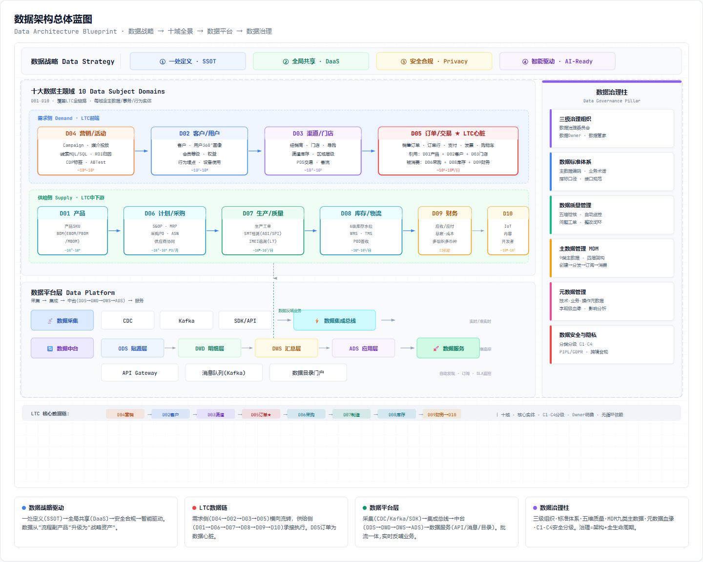
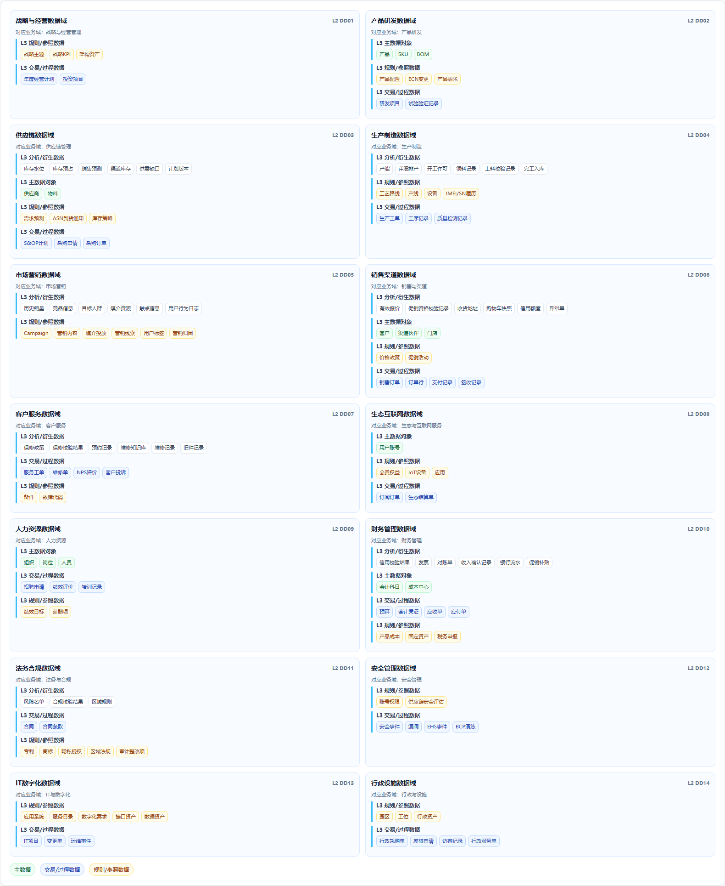
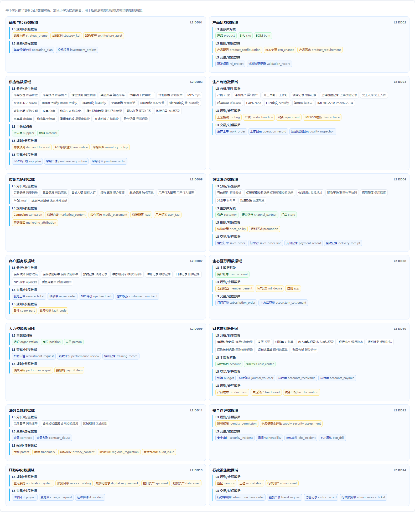
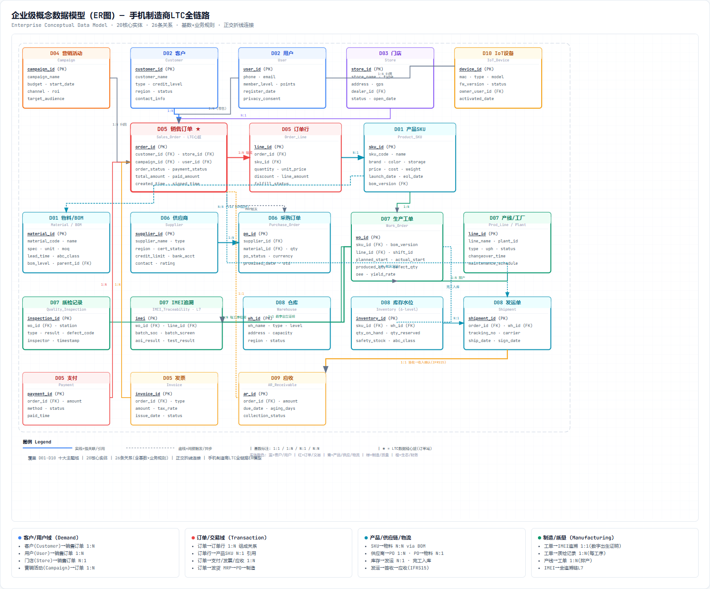
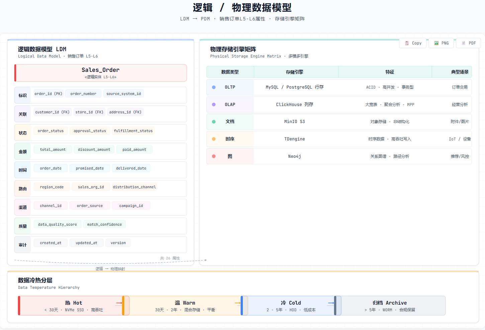
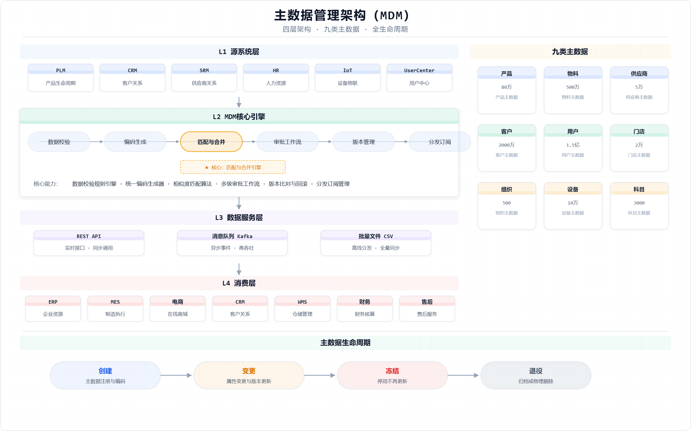
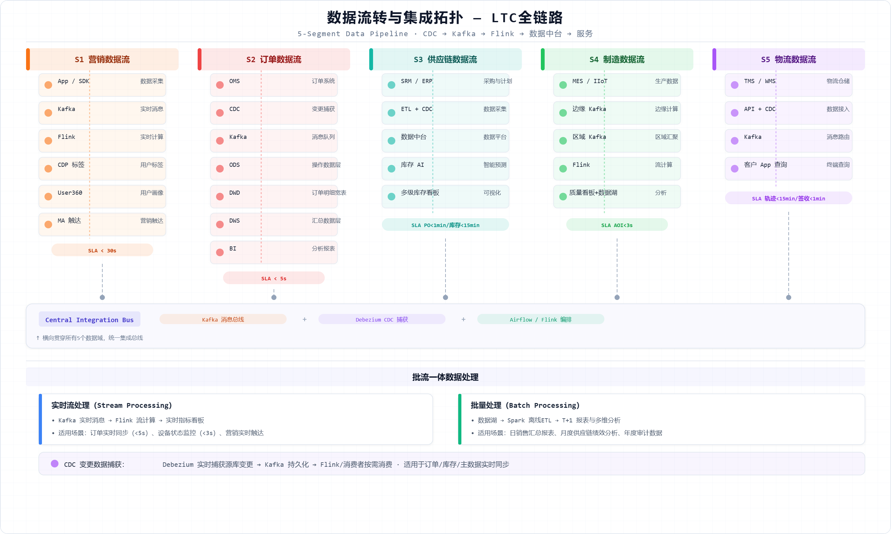
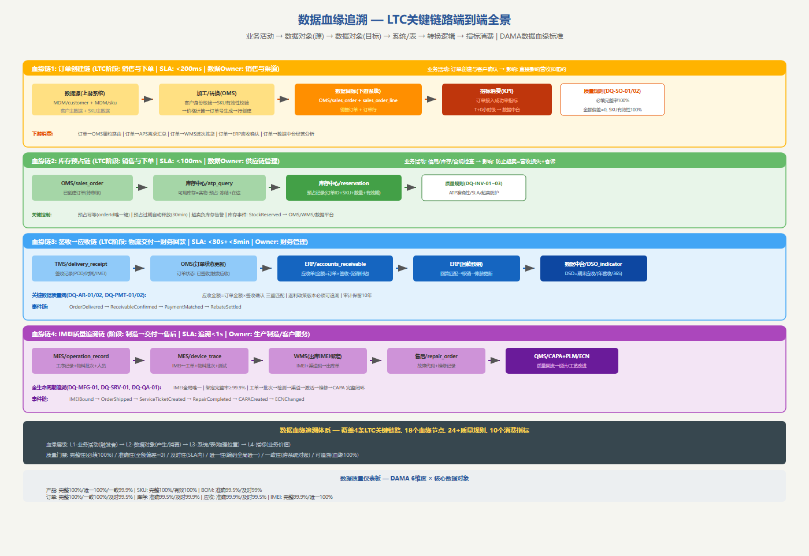
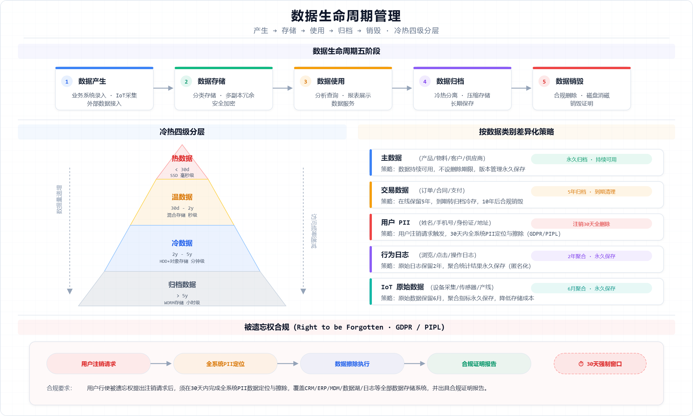

# 第3章 数据架构（Phase C：信息系统架构 — 数据部分）

> **文档归属**：《手机厂商企业架构总体规划》第 3 章
> **对应 TOGAF ADM 阶段**：C 阶段（信息系统架构）之数据架构（Data Architecture）
> **章节目标**：承接第2章全企业业务域、L4业务能力、端到端价值流和LTC流程活动,建立覆盖全域的数据域、数据对象、概念模型、逻辑模型、物理模型、主数据、治理与集成架构。本章明确了从业务对象→数据对象→CDM→LDM→PDM的完整建模路径,融合DCMM/DAMA治理标准,建立OLTP/OLAP双模数据架构,并完善了数据血缘、数据能力中心服务目录、数据质量度量框架和AI/ML数据需求。
> **方法论主线**：业务对象→数据对象→五分类(主数据/事务数据/行为数据/规则数据/指标数据)→概念建模→逻辑建模→物理建模。OLTP支撑核心交易(ms级),OLAP支撑分析决策(s级),CDC实时同步贯通双模。
> **核心展开原则**：数据域规划与第2章业务域保持一致,L1-L4覆盖全企业;逻辑模型列出全域核心数据对象;物理模型提供方法论;LTC每阶段说明依赖和产生数据;数据治理融合DCMM 8能力域和DAMA 11知识领域。
> **配套附件**：[附件3-1~3-10共10个Excel附件,详见章末附件索引]

---

## 3.1 数据架构方法论：从业务对象到数据资产

> **参考文档融合**：本节吸收《企业架构的底层逻辑系列课03-数据架构的承上启下逻辑》和《数字化转型底层方法论》的核心观点：数据架构是业务架构和应用架构之间的关键桥梁，数据域=业务域，CRUD分析是识别主数据和数据Owner的核心工具。

<p align="center"></p>

### 3.1.0 数据架构的承上启下定位【参考文档核心观点】

数据架构在企业架构中处于"腰"的位置——向上承接业务架构的业务对象和业务规则，向下传递数据模型和数据服务给应用架构和技术架构。这种承上启下体现在两个维度：

**维度一：纵向建模链（业务→数据→IT）**
- **概念建模（承上）**：从业务架构的业务对象出发，识别核心实体和实体关系（CDM）。这个阶段的数据架构"讲业务语言"，业务人员可以参与评审。
- **逻辑建模（居中）**：细化实体属性、主键、外键、状态和业务规则（LDM）。这个阶段的数据架构同时讲"业务语言"和"技术语言"，是业务和IT的翻译层。
- **物理建模（启下）**：增加数据库实现细节（PDM）——分库分表、索引、分区、安全、存储引擎选择。这个阶段的数据架构"讲技术语言"，直接指导应用开发。

**维度二：横向分布链（数据Owner识别）**
- 通过CRUD矩阵分析，回答每个数据对象"谁创建（C）、谁读取（R）、谁更新（U）、谁删除（D）"
- 识别跨多个业务组件共享的数据对象→这些都是**主数据候选**，需要MDM统一管理
- 识别仅被单个业务组件使用的数据对象→这些可以作为该组件私有数据，由组件所属微服务独立管理

**CRUD分析在数据架构中的两个阶段应用：**

| 阶段 | 目的 | 输入 | 输出 |
|------|------|------|------|
| 业务架构阶段 | 识别主数据对象、验证业务组件划分是否高内聚 | L4业务能力×业务对象 | 业务对象CRUD矩阵、主数据候选清单 |
| 数据架构阶段 | 确定数据Owner、识别数据共享边界 | 业务对象CRUD矩阵+数据对象目录 | 数据Owner分配、共享数据库vs私有数据库划分 |

### 3.1.1 业务架构与数据架构的映射关系

<p align="center"></p>

数据架构是业务架构和应用架构之间的关键桥梁。本章的方法论核心是回答一个根本问题：**业务活动产生了哪些业务对象，这些业务对象如何转化为可以管理、建模、治理和消费的数据资产？**

### 3.1.1 业务架构与数据架构的映射关系

第2章业务架构定义了企业的业务域、业务能力、端到端价值流和LTC流程活动。数据架构从这些业务输入出发，按照"业务对象→数据对象→数据模型→数据资产"的路径逐层转化：

| 业务架构输入（第2章） | 数据架构转化 | 输出物 | 关键判断 |
|---|---|---|---|
| 14个L2业务域 | 对齐为14个L2数据域，每个数据域有明确的Data Owner | 数据域划分与Owner边界 | 数据域与业务域1:1对齐,消除"核心域"和"支撑域"在数据管理上的断层 |
| L3能力组/L4业务组件 | 识别每个业务组件拥有和消费的业务对象,转换为数据对象 | L4数据对象目录(100+对象) | 区分主数据/事务数据/行为数据/规则数据/指标数据五类 |
| 8条端到端价值流 | 识别跨域数据流和关键数据依赖 | 价值流数据链路图 | 每条价值流中数据如何在系统间流转和转换 |
| LTC L5-L7流程活动 | 每个活动明确"依赖哪些已有数据"和"产生哪些新数据" | 流程-数据映射矩阵(3.7节) | 数据的读/写/更新/删除(CRUD)归属 |
| 业务组件支撑LTC映射 | 推导每个组件的CRUD矩阵和数据Owner | 数据Owner分配+接口数据契约 | 跨域共享数据的权威来源(Single Source of Truth) |

### 3.1.2 从业务对象到数据模型的六步建模路径

数据架构建模遵循从业务出发、逐层形式化的六步路径。每一步都有明确的输入、输出和关键决策：

| 步骤 | 核心工作 | 输入及示例 | 输出物 | 关键决策 |
|---|---|---|---|---|
| 1.流程分析 | 从LTC/I2L/P2P/P2M等价值流拆解活动 | LTC"订单创建"活动 | 活动-输入-输出清单 | 活动需要什么信息输入？执行后产生什么业务结果？ |
| 2.业务对象识别 | 从活动名词、单据、角色中识别业务对象 | "订单"、"客户"、"SKU"、"价格政策" | 业务对象清单 | 该对象是否被多个活动复用？是否具有独立生命周期？ |
| 3.数据对象分类 | 将业务对象分类为主数据/事务数据/行为数据/规则数据/指标数据 | 订单→事务数据,客户→主数据,价格政策→规则数据 | 数据对象目录 | 治理重点不同:主数据管编码和分发,事务数据管状态和一致性 |
| 4.概念建模(CDM) | 建立高层实体及实体关系 | 客户-订单-SKU-库存 四大实体及其1:N关系 | CDM概念模型ER图(3.3节) | 实体间关系基数(1:1/1:N/N:M)决定后续表结构设计 |
| 5.逻辑建模(LDM) | 细化实体属性、主键、外键、状态、业务规则 | 销售订单:order_id/customer_id/sku_id/status/amount | LDM逻辑模型(3.4节) | 是否支撑业务口径？是否需要版本和生效期？ |
| 6.物理建模(PDM) | 增加数据库实现细节 | 分库分表策略/索引设计/分区/加密 | PDM设计方法论(3.5节) | OLTP还是OLAP？数据驻留要求？性能目标？ |

### 3.1.3 数据对象五分类与治理重点

所有数据对象按五个类型分类,每类的治理重点和建模方法不同：

| 数据对象类型 | 定义 | 手机厂商示例 | 治理重点 | 建模方法 |
|---|---|---|---|---|
| 主数据 | 跨流程、跨系统共享的核心参照对象 | 产品/SKU/物料/BOM/客户/供应商/人员/组织/会计科目 | 唯一编码、权威来源、变更审批、分发订阅 | MDM主数据平台统一管理,消费方通过订阅获取 |
| 事务数据 | 业务活动执行时产生的交易和单据 | 销售订单/采购订单/生产工单/维修单/应收单 | 状态机管理、完整性校验、跨系统一致性、审计追溯 | OLTP数据库,状态机驱动,事件溯源支持完整审计 |
| 行为/日志数据 | 用户/设备/系统产生的明细记录 | 用户行为日志/IoT设备日志/AOI检测日志/接口调用日志 | 时效性、容量规划、隐私合规、冷热分层 | 流处理(Flink)+数据湖(对象存储)+OLAP(ClickHouse) |
| 规则数据 | 业务判断和控制所依据的规则 | 价格政策/促销规则/信用规则/合规规则/库存策略 | 版本管理、生效期控制、优先级排序、审批流程 | 规则引擎+版本化存储,生效期和优先级支持动态组合 |
| 指标数据 | 按统一口径计算的经营和运营指标 | 出货量/激活量/库存周转/NPS/毛利/准交率 | 口径统一、血缘可追溯、维度标准化、刷新频率SLA | 指标中心统一口径,从数据中台自动计算,血缘追溯到源表 |

### 3.1.4 OLTP与OLAP双模数据架构

手机制造企业的数据架构面临着典型的"双模"需求——既要实时支撑核心交易(OLTP),又要支撑大规模数据分析(OLAP)。本章从数据域规划到物理模型设计,始终贯穿这两条主线：

| 维度 | OLTP(在线交易处理) | OLAP(在线分析处理) |
|---|---|---|
| 典型场景 | 订单创建/库存预占/ATP查询/支付/应收确认 | 经营驾驶舱/用户画像/需求预测/质量分析/营销归因 |
| 数据特征 | 高频写入、低延迟(ms级)、小数据量单次、强一致性 | 批量写入、复杂查询(s级)、大数据量聚合、最终一致性 |
| 核心系统 | OMS/ERP/MES/WMS(MySQL/PG/TDSQL) | 数据中台/BI/用户画像(ClickHouse/Flink/Hadoop) |
| 数据同步方式 | 自身即为权威源,实时写入 | 通过CDC/ETL从OLTP系统增量同步 |
| SLA要求 | 可用性99.99%,延迟P99<50ms | 可用性99.9%,查询P99<5s |
| 数据建模 | 范式化(3NF,减少冗余,保证一致性) | 维度建模(星型/雪花,允许冗余,优化查询) |
| 本章对应 | 3.2-3.5数据域/概念/逻辑/物理模型设计 | 3.10数据能力中心/3.13指标体系和OLAP架构 |

**手机行业OLTP核心数据流(LTC链路示例)**:
```
用户下单(OMS) → 库存预占(库存中心) → 支付(支付网关) →
订单审核(OMS) → 履约发货(WMS/TMS) → 签收确认(TMS) →
应收确认(ERP) → 回款核销(ERP)
```
这条链路中每个节点都是OLTP事务,要求ACID特性和ms级响应,数据在OLTP系统中产生后通过CDC实时同步到OLAP平台供分析消费。

**手机行业OLAP核心分析场景**:
- CEO经营驾驶舱: 实时出货量/激活量/库存/应收/KPI (T+0/T+1混合)
- 用户画像与精准营销: 百亿级行为日志聚合为千万级用户标签
- 供应链分析: 需求预测MAPE、库存周转、供应商绩效多维度分析
- 质量分析: 百万级IMEI追溯+故障聚类+CAPA闭环分析

### 3.1.5 数据架构与DCMM/DAMA标准的融合

本章数据架构的设计参考了DCMM(数据管理能力成熟度模型)的8个能力域和DAMA(数据管理协会)的11个知识领域,将标准理论转化为手机制造企业的具体实践:

| DCMM能力域 | DAMA知识领域 | 本章对应内容 | 企业具体实践 |
|---|---|---|---|
| 数据战略 | 数据治理 | 3.1方法论/3.8治理体系 | 数据域Owner制度、数据治理委员会、架构评审中的Data评审节点 |
| 数据治理 | 数据架构/数据建模 | 3.2数据域/3.3-3.5建模 | 14域对齐业务域、CDM→LDM→PDM建模路径 |
| 数据架构 | 数据建模与设计 | 3.3概念模型/3.4逻辑模型/3.5物理模型 | 全企业100+数据对象标准化建模 |
| 数据标准 | 数据质量 | 3.8治理标准/3.11质量框架 | 编码标准/命名标准/指标口径/DAMA 6维度质量度量 |
| 数据质量 | 数据质量 | 3.11数据质量度量框架 | 完整性/唯一性/一致性/准确性/及时性/可追溯六维度 |
| 数据安全 | 数据安全 | 第5章安全架构,本章数据分级 | PII加密/行列级权限/审计日志/数据分级分类 |
| 数据应用 | 数据仓库与BI/数据集成 | 3.10数据能力中心/3.13 OLAP架构 | 指标中心/标签中心/数据服务API/自助BI |
| 数据生存周期 | 数据生命周期 | 3.14数据集成与生命周期 | 热-温-冷分层/归档/销毁策略/合规保存期 |

## 3.2 全域数据域规划（L1-L4）

<p align="center"></p>

数据域规划采用与第 2 章业务域一致的分组模式。L1 是价值流或经营主线，L2 是数据域，L3 是数据主题，L4 是具体数据对象或候选数据库表。

### 3.2.1 数据域总览

| L2数据域编号 | L2数据域 | 对齐业务域 | L1价值流/经营主线 | 关键数据对象范围 |
|---|---|---|---|---|
| DD01 | 战略与经营数据域 | 战略与经营管理 | 规划到绩效 S2P | 战略主题、KPI、经营计划、投资项目、架构资产 |
| DD02 | 产品研发数据域 | 产品研发 | 从创意到上市 I2L | 产品、SKU、BOM、配置、ECN、需求、研发项目、试验记录 |
| DD03 | 供应链数据域 | 供应链管理 | 从计划到采购 P2P | 供应商、物料、预测、S&OP、采购申请、采购订单、ASN、库存策略 |
| DD04 | 生产制造数据域 | 生产制造 | 从计划到生产 P2M | 工艺、工单、产线、设备、工序、质量检测、IMEI/SN追溯 |
| DD05 | 市场营销数据域 | 市场营销 | 从市场到线索 M2L | 品牌、Campaign、内容、媒介、线索、标签、营销归因 |
| DD06 | 销售渠道数据域 | 销售与渠道 | 从线索到回款 L2C | 客户、渠道、门店、价格、促销、销售订单、支付、签收 |
| DD07 | 客户服务数据域 | 客户服务 | 从问题到解决 I2R | 服务工单、维修单、备件、故障代码、NPS、投诉、质量回流 |
| DD08 | 生态互联网数据域 | 生态与互联网服务 | 从用户到生态 U2E | 账号、会员、IoT设备、应用、内容、订阅、生态结算 |
| DD09 | 人力资源数据域 | 人力资源 | 从人才到绩效 T2P | 组织、岗位、人员、招聘、绩效、薪酬、培训、任职资格 |
| DD10 | 财务管理数据域 | 财务管理 | 从预算到报告 B2R | 会计科目、预算、凭证、应收、应付、成本、资金、资产、税务 |
| DD11 | 法务合规数据域 | 法务与合规 | 从风险到控制 R2C | 合同、条款、专利、商标、隐私授权、区域法规、审计整改 |
| DD12 | 安全管理数据域 | 安全管理 | 从威胁到韧性 T2R | 账号权限、安全事件、漏洞、EHS事件、供应链安全、BCP演练 |
| DD13 | IT数字化数据域 | IT与数字化 | 从需求到服务 D2S | 应用、服务、需求、项目、变更、接口、数据资产、运维事件 |
| DD14 | 行政设施数据域 | 行政与设施 | 从资源到服务 R2S | 园区、工位、固定资产、行政采购、差旅、访客、行政服务单 |

### 3.2.2 分数据域L4数据对象分解

<p align="center"></p>

#### DD01 战略与经营数据域

| L1价值流/经营主线 | L2数据域 | L3数据主题 | L4数据对象/候选表 | 英文对象名 |
|---|---|---|---|---|
| 规划到绩效 S2P | 战略与经营数据域 | 战略规划 | 战略主题 | `strategy_theme` |
| 规划到绩效 S2P | 战略与经营数据域 | 战略规划 | 战略KPI | `strategy_kpi` |
| 规划到绩效 S2P | 战略与经营数据域 | 经营管理 | 年度经营计划 | `operating_plan` |
| 规划到绩效 S2P | 战略与经营数据域 | 投资组合 | 投资项目 | `investment_project` |
| 规划到绩效 S2P | 战略与经营数据域 | 架构治理 | 架构资产 | `architecture_asset` |

#### DD02 产品研发数据域

| L1价值流/经营主线 | L2数据域 | L3数据主题 | L4数据对象/候选表 | 英文对象名 |
|---|---|---|---|---|
| 从创意到上市 I2L | 产品研发数据域 | 产品主数据 | 产品 | `product` |
| 从创意到上市 I2L | 产品研发数据域 | 产品主数据 | SKU | `sku` |
| 从创意到上市 I2L | 产品研发数据域 | 产品数据管理 | BOM | `bom` |
| 从创意到上市 I2L | 产品研发数据域 | 产品数据管理 | 产品配置 | `product_configuration` |
| 从创意到上市 I2L | 产品研发数据域 | 变更管理 | ECN变更 | `ecn_change` |
| 从创意到上市 I2L | 产品研发数据域 | 需求管理 | 产品需求 | `product_requirement` |
| 从创意到上市 I2L | 产品研发数据域 | 研发项目 | 研发项目 | `rd_project` |
| 从创意到上市 I2L | 产品研发数据域 | 研发质量 | 试验验证记录 | `validation_record` |

#### DD03 供应链数据域

| L1价值流/经营主线 | L2数据域 | L3数据主题 | L4数据对象/候选表 | 英文对象名 |
|---|---|---|---|---|
| 从计划到采购 P2P | 供应链数据域 | 供应商管理 | 供应商 | `supplier` |
| 从计划到采购 P2P | 供应链数据域 | 物料管理 | 物料 | `material` |
| 从计划到采购 P2P | 供应链数据域 | 供应链计划 | 需求预测 | `demand_forecast` |
| 从计划到采购 P2P | 供应链数据域 | 供应链计划 | S&OP计划 | `sop_plan` |
| 从计划到采购 P2P | 供应链数据域 | 采购执行 | 采购申请 | `purchase_requisition` |
| 从计划到采购 P2P | 供应链数据域 | 采购执行 | 采购订单 | `purchase_order` |
| 从计划到采购 P2P | 供应链数据域 | 供应协同 | ASN到货通知 | `asn_notice` |
| 从计划到采购 P2P | 供应链数据域 | 库存策略 | 库存策略 | `inventory_policy` |

#### DD04 生产制造数据域

| L1价值流/经营主线 | L2数据域 | L3数据主题 | L4数据对象/候选表 | 英文对象名 |
|---|---|---|---|---|
| 从计划到生产 P2M | 生产制造数据域 | 工艺工程 | 工艺路线 | `routing` |
| 从计划到生产 P2M | 生产制造数据域 | 生产计划 | 生产工单 | `work_order` |
| 从计划到生产 P2M | 生产制造数据域 | 生产资源 | 产线 | `production_line` |
| 从计划到生产 P2M | 生产制造数据域 | 生产资源 | 设备 | `equipment` |
| 从计划到生产 P2M | 生产制造数据域 | 车间执行 | 工序记录 | `operation_record` |
| 从计划到生产 P2M | 生产制造数据域 | 质量追溯 | 质量检测记录 | `quality_inspection` |
| 从计划到生产 P2M | 生产制造数据域 | 单机追溯 | IMEI/SN履历 | `device_trace` |

#### DD05 市场营销数据域

| L1价值流/经营主线 | L2数据域 | L3数据主题 | L4数据对象/候选表 | 英文对象名 |
|---|---|---|---|---|
| 从市场到线索 M2L | 市场营销数据域 | 品牌活动 | Campaign | `campaign` |
| 从市场到线索 M2L | 市场营销数据域 | 内容媒介 | 营销内容 | `marketing_content` |
| 从市场到线索 M2L | 市场营销数据域 | 内容媒介 | 媒介投放 | `media_placement` |
| 从市场到线索 M2L | 市场营销数据域 | 线索运营 | 营销线索 | `lead` |
| 从市场到线索 M2L | 市场营销数据域 | 用户洞察 | 用户标签 | `user_tag` |
| 从市场到线索 M2L | 市场营销数据域 | 营销分析 | 营销归因 | `marketing_attribution` |

#### DD06 销售渠道数据域

| L1价值流/经营主线 | L2数据域 | L3数据主题 | L4数据对象/候选表 | 英文对象名 |
|---|---|---|---|---|
| 从线索到回款 L2C | 销售渠道数据域 | 客户渠道 | 客户 | `customer` |
| 从线索到回款 L2C | 销售渠道数据域 | 客户渠道 | 渠道伙伴 | `channel_partner` |
| 从线索到回款 L2C | 销售渠道数据域 | 客户渠道 | 门店 | `store` |
| 从线索到回款 L2C | 销售渠道数据域 | 价格促销 | 价格政策 | `price_policy` |
| 从线索到回款 L2C | 销售渠道数据域 | 价格促销 | 促销活动 | `promotion` |
| 从线索到回款 L2C | 销售渠道数据域 | 订单交易 | 销售订单 | `sales_order` |
| 从线索到回款 L2C | 销售渠道数据域 | 订单交易 | 订单行 | `sales_order_line` |
| 从线索到回款 L2C | 销售渠道数据域 | 订单交易 | 支付记录 | `payment_record` |
| 从线索到回款 L2C | 销售渠道数据域 | 履约签收 | 签收记录 | `delivery_receipt` |

#### DD07 客户服务数据域

| L1价值流/经营主线 | L2数据域 | L3数据主题 | L4数据对象/候选表 | 英文对象名 |
|---|---|---|---|---|
| 从问题到解决 I2R | 客户服务数据域 | 服务接入 | 服务工单 | `service_ticket` |
| 从问题到解决 I2R | 客户服务数据域 | 维修执行 | 维修单 | `repair_order` |
| 从问题到解决 I2R | 客户服务数据域 | 备件服务 | 备件 | `spare_part` |
| 从问题到解决 I2R | 客户服务数据域 | 质量反馈 | 故障代码 | `fault_code` |
| 从问题到解决 I2R | 客户服务数据域 | 服务质量 | NPS评价 | `nps_feedback` |
| 从问题到解决 I2R | 客户服务数据域 | 投诉管理 | 客户投诉 | `customer_complaint` |

#### DD08 生态互联网数据域

| L1价值流/经营主线 | L2数据域 | L3数据主题 | L4数据对象/候选表 | 英文对象名 |
|---|---|---|---|---|
| 从用户到生态 U2E | 生态互联网数据域 | 账号会员 | 用户账号 | `user_account` |
| 从用户到生态 U2E | 生态互联网数据域 | 账号会员 | 会员权益 | `member_benefit` |
| 从用户到生态 U2E | 生态互联网数据域 | 设备服务 | IoT设备 | `iot_device` |
| 从用户到生态 U2E | 生态互联网数据域 | 内容应用 | 应用 | `app` |
| 从用户到生态 U2E | 生态互联网数据域 | 商业化 | 订阅订单 | `subscription_order` |
| 从用户到生态 U2E | 生态互联网数据域 | 生态结算 | 生态结算单 | `ecosystem_settlement` |

#### DD09 人力资源数据域

| L1价值流/经营主线 | L2数据域 | L3数据主题 | L4数据对象/候选表 | 英文对象名 |
|---|---|---|---|---|
| 从人才到绩效 T2P | 人力资源数据域 | 组织岗位 | 组织 | `organization` |
| 从人才到绩效 T2P | 人力资源数据域 | 组织岗位 | 岗位 | `position` |
| 从人才到绩效 T2P | 人力资源数据域 | 人员主数据 | 人员 | `person` |
| 从人才到绩效 T2P | 人力资源数据域 | 招聘配置 | 招聘申请 | `recruitment_request` |
| 从人才到绩效 T2P | 人力资源数据域 | 绩效激励 | 绩效目标 | `performance_goal` |
| 从人才到绩效 T2P | 人力资源数据域 | 绩效激励 | 绩效评价 | `performance_review` |
| 从人才到绩效 T2P | 人力资源数据域 | 薪酬福利 | 薪酬项 | `payroll_item` |
| 从人才到绩效 T2P | 人力资源数据域 | 学习发展 | 培训记录 | `training_record` |

#### DD10 财务管理数据域

| L1价值流/经营主线 | L2数据域 | L3数据主题 | L4数据对象/候选表 | 英文对象名 |
|---|---|---|---|---|
| 从预算到报告 B2R | 财务管理数据域 | 财务主数据 | 会计科目 | `account` |
| 从预算到报告 B2R | 财务管理数据域 | 财务主数据 | 成本中心 | `cost_center` |
| 从预算到报告 B2R | 财务管理数据域 | 预算管理 | 预算 | `budget` |
| 从预算到报告 B2R | 财务管理数据域 | 会计核算 | 会计凭证 | `journal_voucher` |
| 从预算到报告 B2R | 财务管理数据域 | 应收管理 | 应收单 | `accounts_receivable` |
| 从预算到报告 B2R | 财务管理数据域 | 应付管理 | 应付单 | `accounts_payable` |
| 从预算到报告 B2R | 财务管理数据域 | 成本核算 | 产品成本 | `product_cost` |
| 从预算到报告 B2R | 财务管理数据域 | 资产管理 | 固定资产 | `fixed_asset` |
| 从预算到报告 B2R | 财务管理数据域 | 税务管理 | 税务申报 | `tax_declaration` |

#### DD11 法务合规数据域

| L1价值流/经营主线 | L2数据域 | L3数据主题 | L4数据对象/候选表 | 英文对象名 |
|---|---|---|---|---|
| 从风险到控制 R2C | 法务合规数据域 | 合同法务 | 合同 | `contract` |
| 从风险到控制 R2C | 法务合规数据域 | 合同法务 | 合同条款 | `contract_clause` |
| 从风险到控制 R2C | 法务合规数据域 | 知识产权 | 专利 | `patent` |
| 从风险到控制 R2C | 法务合规数据域 | 知识产权 | 商标 | `trademark` |
| 从风险到控制 R2C | 法务合规数据域 | 隐私合规 | 隐私授权 | `privacy_consent` |
| 从风险到控制 R2C | 法务合规数据域 | 区域合规 | 区域法规 | `regional_regulation` |
| 从风险到控制 R2C | 法务合规数据域 | 内控审计 | 审计整改项 | `audit_issue` |

#### DD12 安全管理数据域

| L1价值流/经营主线 | L2数据域 | L3数据主题 | L4数据对象/候选表 | 英文对象名 |
|---|---|---|---|---|
| 从威胁到韧性 T2R | 安全管理数据域 | 身份安全 | 账号权限 | `identity_permission` |
| 从威胁到韧性 T2R | 安全管理数据域 | 信息安全 | 安全事件 | `security_incident` |
| 从威胁到韧性 T2R | 安全管理数据域 | 信息安全 | 漏洞 | `vulnerability` |
| 从威胁到韧性 T2R | 安全管理数据域 | 生产安全EHS | EHS事件 | `ehs_incident` |
| 从威胁到韧性 T2R | 安全管理数据域 | 供应链安全 | 供应链安全评估 | `supply_security_assessment` |
| 从威胁到韧性 T2R | 安全管理数据域 | 业务连续性 | BCP演练 | `bcp_drill` |

#### DD13 IT数字化数据域

| L1价值流/经营主线 | L2数据域 | L3数据主题 | L4数据对象/候选表 | 英文对象名 |
|---|---|---|---|---|
| 从需求到服务 D2S | IT数字化数据域 | 应用服务 | 应用系统 | `application_system` |
| 从需求到服务 D2S | IT数字化数据域 | 服务治理 | 服务目录 | `service_catalog` |
| 从需求到服务 D2S | IT数字化数据域 | 需求交付 | 数字化需求 | `digital_requirement` |
| 从需求到服务 D2S | IT数字化数据域 | 项目管理 | IT项目 | `it_project` |
| 从需求到服务 D2S | IT数字化数据域 | 变更运维 | 变更单 | `change_request` |
| 从需求到服务 D2S | IT数字化数据域 | 接口管理 | 接口资产 | `api_asset` |
| 从需求到服务 D2S | IT数字化数据域 | 数据治理 | 数据资产 | `data_asset` |
| 从需求到服务 D2S | IT数字化数据域 | 运维管理 | 运维事件 | `it_incident` |

#### DD14 行政设施数据域

| L1价值流/经营主线 | L2数据域 | L3数据主题 | L4数据对象/候选表 | 英文对象名 |
|---|---|---|---|---|
| 从资源到服务 R2S | 行政设施数据域 | 园区设施 | 园区 | `campus` |
| 从资源到服务 R2S | 行政设施数据域 | 园区设施 | 工位 | `workstation` |
| 从资源到服务 R2S | 行政设施数据域 | 资产后勤 | 行政资产 | `admin_asset` |
| 从资源到服务 R2S | 行政设施数据域 | 行政采购 | 行政采购单 | `admin_purchase_order` |
| 从资源到服务 R2S | 行政设施数据域 | 差旅会务 | 差旅申请 | `travel_request` |
| 从资源到服务 R2S | 行政设施数据域 | 访客管理 | 访客记录 | `visitor_record` |
| 从资源到服务 R2S | 行政设施数据域 | 行政服务 | 行政服务单 | `admin_service_ticket` |

**附件**：[附件3-1 数据域与对象目录](./附件/附件3-1_数据主题域与实体目录.xlsx)
---

## 3.3 概念数据模型（CDM）

<p align="center"></p>

概念模型关注业务对象之间的高层关系，不讨论字段类型、索引和数据库实现。它的目标是让业务、数据、应用团队对企业到底有哪些核心对象、对象之间如何关联形成共同语言。

### 3.3.1 概念建模方法

概念建模从业务对象出发，而不是从系统表出发。建模时先识别实体，再识别关系和基数，最后补充关系的业务语义。例如客户创建销售订单、销售订单包含订单行、订单行引用SKU、SKU引用产品和BOM、生产工单产出IMEI/SN履历、服务工单引用IMEI/SN履历，这些关系共同构成 LTC 数据链。

### 3.3.2 核心实体关系

| 源实体 | 目标实体 | 基数 | 业务语义 |
|---|---|---|---|
| 产品 | SKU | 1:N | 一个产品可有多个区域/颜色/存储SKU |
| 产品 | BOM | 1:N | 产品/SKU通过不同类型和版本BOM支持研发、采购、制造 |
| BOM | 物料 | N:M | BOM由多个物料构成，物料可被多个BOM复用 |
| 供应商 | 采购订单 | 1:N | 供应商承接采购订单和交期承诺 |
| 客户 | 销售订单 | 1:N | 客户或用户创建多个销售订单 |
| 渠道伙伴 | 门店 | 1:N | 渠道伙伴拥有或管理多个门店 |
| 销售订单 | 订单行 | 1:N | 订单行定义具体SKU、数量和价格 |
| 销售订单 | 签收记录 | 1:N | 订单可以拆分履约并形成一个或多个签收记录 |
| 销售订单 | 应收单 | 1:N | 订单签收和结算规则生成应收 |
| S&OP计划 | 采购申请 | 1:N | 计划缺口触发采购需求 |
| S&OP计划 | 生产工单 | 1:N | 计划结果下达到制造工单 |
| 生产工单 | 工序记录 | 1:N | 工单执行产生多个工序记录 |
| 生产工单 | IMEI/SN履历 | 1:N | 工单产出多台设备并形成单机履历 |
| IMEI/SN履历 | 服务工单 | 1:N | 单机售后服务关联追溯履历 |
| 服务工单 | 维修单 | 1:N | 服务工单可包含一次或多次维修处理 |
| 人员 | 组织 | N:1 | 人员归属组织 |
| 人员 | 岗位 | N:1 | 人员任职岗位 |
| 组织 | 成本中心 | 1:N | 组织通过成本中心承接预算和费用 |
| 会计科目 | 会计凭证 | 1:N | 凭证明细引用标准会计科目 |
| 合同 | 采购订单 | 1:N | 框架合同约束采购订单 |
| 隐私授权 | 用户账号 | N:1 | 用户账号产生多个授权版本 |
| 应用系统 | 接口资产 | 1:N | 应用系统发布和消费接口资产 |
| 固定资产 | 资产类别 | N:1 | 固定资产按资产类别折旧和管理 |

概念模型需要特别处理三类跨域关系：产品/BOM/物料贯穿研发、采购、制造、库存和服务；客户/用户/渠道贯穿营销、销售、履约、服务和财务；人员/组织/成本中心贯穿人力、财务、权限、项目和责任归属。

**附件**：[附件3-3 概念逻辑数据模型表](./附件/附件3-3_概念逻辑数据模型表.xlsx)
---

## 3.4 逻辑数据模型（LDM）

逻辑模型在概念模型基础上补充核心字段、主键、外键、状态和业务规则。本章给出全域核心数据对象的逻辑属性级清单，覆盖核心业务域和企业运营域。

### 3.4.1 全域核心数据对象逻辑属性

| 数据域 | L3数据主题 | 数据对象 | 英文对象名 | 数据类型 | 核心字段/属性 | 数据Owner |
|---|---|---|---|---|---|---|
| 战略与经营数据域 | 战略规划 | 战略主题 | `strategy_theme` | 规则/参照数据 | strategy_theme_id, strategy_theme_code, strategy_theme_name, status, owner_id, created_time, updated_time | 战略与经营管理 |
| 战略与经营数据域 | 战略规划 | 战略KPI | `strategy_kpi` | 规则/参照数据 | strategy_kpi_id, strategy_kpi_code, strategy_kpi_name, status, owner_id, created_time, updated_time | 战略与经营管理 |
| 战略与经营数据域 | 经营管理 | 年度经营计划 | `operating_plan` | 事务/过程数据 | operating_plan_id, operating_plan_code, operating_plan_name, status, owner_id, created_time, updated_time | 战略与经营管理 |
| 战略与经营数据域 | 投资组合 | 投资项目 | `investment_project` | 事务/过程数据 | investment_project_id, investment_project_code, investment_project_name, status, owner_id, created_time, updated_time | 战略与经营管理 |
| 战略与经营数据域 | 架构治理 | 架构资产 | `architecture_asset` | 规则/参照数据 | architecture_asset_id, architecture_asset_code, architecture_asset_name, status, owner_id, created_time, updated_time | 战略与经营管理 |
| 产品研发数据域 | 产品主数据 | 产品 | `product` | 主数据 | product_id, product_code, product_name, brand_id, product_line, lifecycle_status, launch_date | 产品研发 |
| 产品研发数据域 | 产品主数据 | SKU | `sku` | 主数据 | sku_id, sku_code, product_id, color, storage_capacity, region_code, price_band, lifecycle_status | 产品研发 |
| 产品研发数据域 | 产品数据管理 | BOM | `bom` | 主数据 | bom_id, bom_code, product_id, sku_id, bom_type, version_no, effective_date, status | 产品研发 |
| 产品研发数据域 | 产品数据管理 | 产品配置 | `product_configuration` | 规则/参照数据 | product_configuration_id, product_configuration_code, product_configuration_name, status, owner_id, created_time, updated_time | 产品研发 |
| 产品研发数据域 | 变更管理 | ECN变更 | `ecn_change` | 规则/参照数据 | ecn_change_id, ecn_change_code, ecn_change_name, status, owner_id, created_time, updated_time | 产品研发 |
| 产品研发数据域 | 需求管理 | 产品需求 | `product_requirement` | 规则/参照数据 | product_requirement_id, product_requirement_code, product_requirement_name, status, owner_id, created_time, updated_time | 产品研发 |
| 产品研发数据域 | 研发项目 | 研发项目 | `rd_project` | 事务/过程数据 | rd_project_id, rd_project_code, rd_project_name, status, owner_id, created_time, updated_time | 产品研发 |
| 产品研发数据域 | 研发质量 | 试验验证记录 | `validation_record` | 事务/过程数据 | validation_record_id, validation_record_code, validation_record_name, status, owner_id, created_time, updated_time | 产品研发 |
| 供应链数据域 | 供应商管理 | 供应商 | `supplier` | 主数据 | supplier_id, supplier_code, supplier_name, supplier_type, region_code, risk_level, status | 供应链管理 |
| 供应链数据域 | 物料管理 | 物料 | `material` | 主数据 | material_id, material_code, material_name, category_id, unit_id, lifecycle_status, critical_flag | 供应链管理 |
| 供应链数据域 | 供应链计划 | 需求预测 | `demand_forecast` | 规则/参照数据 | demand_forecast_id, demand_forecast_code, demand_forecast_name, status, owner_id, created_time, updated_time | 供应链管理 |
| 供应链数据域 | 供应链计划 | S&OP计划 | `sop_plan` | 事务/过程数据 | sop_plan_id, sop_plan_code, sop_plan_name, status, owner_id, created_time, updated_time | 供应链管理 |
| 供应链数据域 | 采购执行 | 采购申请 | `purchase_requisition` | 事务/过程数据 | purchase_requisition_id, purchase_requisition_code, purchase_requisition_name, status, owner_id, created_time, updated_time | 供应链管理 |
| 供应链数据域 | 采购执行 | 采购订单 | `purchase_order` | 事务/过程数据 | po_id, po_no, supplier_id, material_id, order_qty, price, promise_date, status | 供应链管理 |
| 供应链数据域 | 供应协同 | ASN到货通知 | `asn_notice` | 规则/参照数据 | asn_notice_id, asn_notice_code, asn_notice_name, status, owner_id, created_time, updated_time | 供应链管理 |
| 供应链数据域 | 库存策略 | 库存策略 | `inventory_policy` | 规则/参照数据 | inventory_policy_id, inventory_policy_code, inventory_policy_name, status, owner_id, created_time, updated_time | 供应链管理 |
| 生产制造数据域 | 工艺工程 | 工艺路线 | `routing` | 规则/参照数据 | routing_id, routing_code, routing_name, status, owner_id, created_time, updated_time | 生产制造 |
| 生产制造数据域 | 生产计划 | 生产工单 | `work_order` | 事务/过程数据 | work_order_id, work_order_no, sku_id, bom_id, routing_id, plan_qty, start_time, status | 生产制造 |
| 生产制造数据域 | 生产资源 | 产线 | `production_line` | 规则/参照数据 | production_line_id, production_line_code, production_line_name, status, owner_id, created_time, updated_time | 生产制造 |
| 生产制造数据域 | 生产资源 | 设备 | `equipment` | 规则/参照数据 | equipment_id, equipment_code, equipment_name, status, owner_id, created_time, updated_time | 生产制造 |
| 生产制造数据域 | 车间执行 | 工序记录 | `operation_record` | 事务/过程数据 | operation_record_id, operation_record_code, operation_record_name, status, owner_id, created_time, updated_time | 生产制造 |
| 生产制造数据域 | 质量追溯 | 质量检测记录 | `quality_inspection` | 事务/过程数据 | quality_inspection_id, quality_inspection_code, quality_inspection_name, status, owner_id, created_time, updated_time | 生产制造 |
| 生产制造数据域 | 单机追溯 | IMEI/SN履历 | `device_trace` | 规则/参照数据 | trace_id, imei, sn, sku_id, work_order_id, material_batch_id, test_result, ship_date | 生产制造 |
| 市场营销数据域 | 品牌活动 | Campaign | `campaign` | 规则/参照数据 | campaign_id, campaign_code, campaign_name, status, owner_id, created_time, updated_time | 市场营销 |
| 市场营销数据域 | 内容媒介 | 营销内容 | `marketing_content` | 规则/参照数据 | marketing_content_id, marketing_content_code, marketing_content_name, status, owner_id, created_time, updated_time | 市场营销 |
| 市场营销数据域 | 内容媒介 | 媒介投放 | `media_placement` | 规则/参照数据 | media_placement_id, media_placement_code, media_placement_name, status, owner_id, created_time, updated_time | 市场营销 |
| 市场营销数据域 | 线索运营 | 营销线索 | `lead` | 规则/参照数据 | lead_id, lead_source, user_id, customer_id, campaign_id, score, status, created_time | 市场营销 |
| 市场营销数据域 | 用户洞察 | 用户标签 | `user_tag` | 规则/参照数据 | user_tag_id, user_tag_code, user_tag_name, status, owner_id, created_time, updated_time | 市场营销 |
| 市场营销数据域 | 营销分析 | 营销归因 | `marketing_attribution` | 规则/参照数据 | marketing_attribution_id, marketing_attribution_code, marketing_attribution_name, status, owner_id, created_time, updated_time | 市场营销 |
| 销售渠道数据域 | 客户渠道 | 客户 | `customer` | 主数据 | customer_id, customer_code, customer_name, customer_type, region_code, status, created_time | 销售与渠道 |
| 销售渠道数据域 | 客户渠道 | 渠道伙伴 | `channel_partner` | 主数据 | channel_partner_id, channel_partner_code, channel_partner_name, status, owner_id, created_time, updated_time | 销售与渠道 |
| 销售渠道数据域 | 客户渠道 | 门店 | `store` | 主数据 | store_id, store_code, store_name, status, owner_id, created_time, updated_time | 销售与渠道 |
| 销售渠道数据域 | 价格促销 | 价格政策 | `price_policy` | 规则/参照数据 | price_policy_id, price_policy_code, price_policy_name, status, owner_id, created_time, updated_time | 销售与渠道 |
| 销售渠道数据域 | 价格促销 | 促销活动 | `promotion` | 规则/参照数据 | promotion_id, promotion_code, promotion_name, status, owner_id, created_time, updated_time | 销售与渠道 |
| 销售渠道数据域 | 订单交易 | 销售订单 | `sales_order` | 事务/过程数据 | order_id, order_no, customer_id, channel_id, store_id, order_status, order_amount, created_time | 销售与渠道 |
| 销售渠道数据域 | 订单交易 | 订单行 | `sales_order_line` | 事务/过程数据 | order_line_id, order_id, sku_id, quantity, unit_price, discount_amount, line_amount | 销售与渠道 |
| 销售渠道数据域 | 订单交易 | 支付记录 | `payment_record` | 事务/过程数据 | payment_record_id, payment_record_code, payment_record_name, status, owner_id, created_time, updated_time | 销售与渠道 |
| 销售渠道数据域 | 履约签收 | 签收记录 | `delivery_receipt` | 事务/过程数据 | delivery_receipt_id, delivery_receipt_code, delivery_receipt_name, status, owner_id, created_time, updated_time | 销售与渠道 |
| 客户服务数据域 | 服务接入 | 服务工单 | `service_ticket` | 事务/过程数据 | ticket_id, ticket_no, user_id, imei, service_type, priority, status, created_time | 客户服务 |
| 客户服务数据域 | 维修执行 | 维修单 | `repair_order` | 事务/过程数据 | repair_order_id, repair_order_code, repair_order_name, status, owner_id, created_time, updated_time | 客户服务 |
| 客户服务数据域 | 备件服务 | 备件 | `spare_part` | 规则/参照数据 | spare_part_id, spare_part_code, spare_part_name, status, owner_id, created_time, updated_time | 客户服务 |
| 客户服务数据域 | 质量反馈 | 故障代码 | `fault_code` | 规则/参照数据 | fault_code_id, fault_code_code, fault_code_name, status, owner_id, created_time, updated_time | 客户服务 |
| 客户服务数据域 | 服务质量 | NPS评价 | `nps_feedback` | 事务/过程数据 | nps_feedback_id, nps_feedback_code, nps_feedback_name, status, owner_id, created_time, updated_time | 客户服务 |
| 客户服务数据域 | 投诉管理 | 客户投诉 | `customer_complaint` | 事务/过程数据 | customer_complaint_id, customer_complaint_code, customer_complaint_name, status, owner_id, created_time, updated_time | 客户服务 |
| 生态互联网数据域 | 账号会员 | 用户账号 | `user_account` | 主数据 | user_account_id, user_account_code, user_account_name, status, owner_id, created_time, updated_time | 生态与互联网服务 |
| 生态互联网数据域 | 账号会员 | 会员权益 | `member_benefit` | 规则/参照数据 | member_benefit_id, member_benefit_code, member_benefit_name, status, owner_id, created_time, updated_time | 生态与互联网服务 |
| 生态互联网数据域 | 设备服务 | IoT设备 | `iot_device` | 规则/参照数据 | iot_device_id, iot_device_code, iot_device_name, status, owner_id, created_time, updated_time | 生态与互联网服务 |
| 生态互联网数据域 | 内容应用 | 应用 | `app` | 规则/参照数据 | app_id, app_code, app_name, status, owner_id, created_time, updated_time | 生态与互联网服务 |
| 生态互联网数据域 | 商业化 | 订阅订单 | `subscription_order` | 事务/过程数据 | subscription_order_id, subscription_order_code, subscription_order_name, status, owner_id, created_time, updated_time | 生态与互联网服务 |
| 生态互联网数据域 | 生态结算 | 生态结算单 | `ecosystem_settlement` | 事务/过程数据 | ecosystem_settlement_id, ecosystem_settlement_code, ecosystem_settlement_name, status, owner_id, created_time, updated_time | 生态与互联网服务 |
| 人力资源数据域 | 组织岗位 | 组织 | `organization` | 主数据 | org_id, org_code, org_name, parent_org_id, org_type, effective_date, status | 人力资源 |
| 人力资源数据域 | 组织岗位 | 岗位 | `position` | 主数据 | position_id, position_code, position_name, org_id, job_family, grade, status | 人力资源 |
| 人力资源数据域 | 人员主数据 | 人员 | `person` | 主数据 | person_id, employee_no, person_name, org_id, position_id, employment_type, hire_date, status | 人力资源 |
| 人力资源数据域 | 招聘配置 | 招聘申请 | `recruitment_request` | 事务/过程数据 | recruitment_request_id, recruitment_request_code, recruitment_request_name, status, owner_id, created_time, updated_time | 人力资源 |
| 人力资源数据域 | 绩效激励 | 绩效目标 | `performance_goal` | 规则/参照数据 | performance_goal_id, performance_goal_code, performance_goal_name, status, owner_id, created_time, updated_time | 人力资源 |
| 人力资源数据域 | 绩效激励 | 绩效评价 | `performance_review` | 事务/过程数据 | performance_review_id, performance_review_code, performance_review_name, status, owner_id, created_time, updated_time | 人力资源 |
| 人力资源数据域 | 薪酬福利 | 薪酬项 | `payroll_item` | 规则/参照数据 | payroll_item_id, payroll_item_code, payroll_item_name, status, owner_id, created_time, updated_time | 人力资源 |
| 人力资源数据域 | 学习发展 | 培训记录 | `training_record` | 事务/过程数据 | training_record_id, training_record_code, training_record_name, status, owner_id, created_time, updated_time | 人力资源 |
| 财务管理数据域 | 财务主数据 | 会计科目 | `account` | 主数据 | account_id, account_code, account_name, account_type, parent_account_id, status | 财务管理 |
| 财务管理数据域 | 财务主数据 | 成本中心 | `cost_center` | 主数据 | cost_center_id, cost_center_code, cost_center_name, org_id, owner_person_id, status | 财务管理 |
| 财务管理数据域 | 预算管理 | 预算 | `budget` | 事务/过程数据 | budget_id, budget_code, budget_name, status, owner_id, created_time, updated_time | 财务管理 |
| 财务管理数据域 | 会计核算 | 会计凭证 | `journal_voucher` | 事务/过程数据 | journal_voucher_id, journal_voucher_code, journal_voucher_name, status, owner_id, created_time, updated_time | 财务管理 |
| 财务管理数据域 | 应收管理 | 应收单 | `accounts_receivable` | 事务/过程数据 | ar_id, order_id, customer_id, invoice_no, ar_amount, due_date, ar_status | 财务管理 |
| 财务管理数据域 | 应付管理 | 应付单 | `accounts_payable` | 事务/过程数据 | ap_id, po_id, supplier_id, invoice_no, ap_amount, due_date, ap_status | 财务管理 |
| 财务管理数据域 | 成本核算 | 产品成本 | `product_cost` | 规则/参照数据 | product_cost_id, product_cost_code, product_cost_name, status, owner_id, created_time, updated_time | 财务管理 |
| 财务管理数据域 | 资产管理 | 固定资产 | `fixed_asset` | 规则/参照数据 | asset_id, asset_code, asset_name, asset_category_id, cost_center_id, original_value, status | 财务管理 |
| 财务管理数据域 | 税务管理 | 税务申报 | `tax_declaration` | 规则/参照数据 | tax_declaration_id, tax_declaration_code, tax_declaration_name, status, owner_id, created_time, updated_time | 财务管理 |
| 法务合规数据域 | 合同法务 | 合同 | `contract` | 事务/过程数据 | contract_id, contract_no, contract_type, counterparty_id, owner_org_id, effective_date, status | 法务与合规 |
| 法务合规数据域 | 合同法务 | 合同条款 | `contract_clause` | 事务/过程数据 | contract_clause_id, contract_clause_code, contract_clause_name, status, owner_id, created_time, updated_time | 法务与合规 |
| 法务合规数据域 | 知识产权 | 专利 | `patent` | 规则/参照数据 | patent_id, patent_code, patent_name, status, owner_id, created_time, updated_time | 法务与合规 |
| 法务合规数据域 | 知识产权 | 商标 | `trademark` | 规则/参照数据 | trademark_id, trademark_code, trademark_name, status, owner_id, created_time, updated_time | 法务与合规 |
| 法务合规数据域 | 隐私合规 | 隐私授权 | `privacy_consent` | 规则/参照数据 | consent_id, user_id, consent_type, consent_version, granted_flag, granted_time, revoked_time | 法务与合规 |
| 法务合规数据域 | 区域合规 | 区域法规 | `regional_regulation` | 规则/参照数据 | regional_regulation_id, regional_regulation_code, regional_regulation_name, status, owner_id, created_time, updated_time | 法务与合规 |
| 法务合规数据域 | 内控审计 | 审计整改项 | `audit_issue` | 规则/参照数据 | audit_issue_id, audit_issue_code, audit_issue_name, status, owner_id, created_time, updated_time | 法务与合规 |
| 安全管理数据域 | 身份安全 | 账号权限 | `identity_permission` | 规则/参照数据 | permission_id, account_id, role_id, resource_id, permission_type, granted_time, status | 安全管理 |
| 安全管理数据域 | 信息安全 | 安全事件 | `security_incident` | 事务/过程数据 | security_incident_id, security_incident_code, security_incident_name, status, owner_id, created_time, updated_time | 安全管理 |
| 安全管理数据域 | 信息安全 | 漏洞 | `vulnerability` | 事务/过程数据 | vulnerability_id, vulnerability_code, vulnerability_name, status, owner_id, created_time, updated_time | 安全管理 |
| 安全管理数据域 | 生产安全EHS | EHS事件 | `ehs_incident` | 事务/过程数据 | ehs_incident_id, ehs_incident_code, ehs_incident_name, status, owner_id, created_time, updated_time | 安全管理 |
| 安全管理数据域 | 供应链安全 | 供应链安全评估 | `supply_security_assessment` | 规则/参照数据 | supply_security_assessment_id, supply_security_assessment_code, supply_security_assessment_name, status, owner_id, created_time, updated_time | 安全管理 |
| 安全管理数据域 | 业务连续性 | BCP演练 | `bcp_drill` | 事务/过程数据 | bcp_drill_id, bcp_drill_code, bcp_drill_name, status, owner_id, created_time, updated_time | 安全管理 |
| IT数字化数据域 | 应用服务 | 应用系统 | `application_system` | 规则/参照数据 | system_id, system_code, system_name, owner_org_id, lifecycle_status, critical_level | IT与数字化 |
| IT数字化数据域 | 服务治理 | 服务目录 | `service_catalog` | 规则/参照数据 | service_catalog_id, service_catalog_code, service_catalog_name, status, owner_id, created_time, updated_time | IT与数字化 |
| IT数字化数据域 | 需求交付 | 数字化需求 | `digital_requirement` | 规则/参照数据 | digital_requirement_id, digital_requirement_code, digital_requirement_name, status, owner_id, created_time, updated_time | IT与数字化 |
| IT数字化数据域 | 项目管理 | IT项目 | `it_project` | 事务/过程数据 | it_project_id, it_project_code, it_project_name, status, owner_id, created_time, updated_time | IT与数字化 |
| IT数字化数据域 | 变更运维 | 变更单 | `change_request` | 事务/过程数据 | change_request_id, change_request_code, change_request_name, status, owner_id, created_time, updated_time | IT与数字化 |
| IT数字化数据域 | 接口管理 | 接口资产 | `api_asset` | 规则/参照数据 | api_id, api_code, api_name, provider_system_id, consumer_count, version, status | IT与数字化 |
| IT数字化数据域 | 数据治理 | 数据资产 | `data_asset` | 规则/参照数据 | data_asset_id, data_asset_code, data_asset_name, status, owner_id, created_time, updated_time | IT与数字化 |
| IT数字化数据域 | 运维管理 | 运维事件 | `it_incident` | 事务/过程数据 | it_incident_id, it_incident_code, it_incident_name, status, owner_id, created_time, updated_time | IT与数字化 |
| 行政设施数据域 | 园区设施 | 园区 | `campus` | 规则/参照数据 | campus_id, campus_code, campus_name, status, owner_id, created_time, updated_time | 行政与设施 |
| 行政设施数据域 | 园区设施 | 工位 | `workstation` | 规则/参照数据 | workstation_id, workstation_code, workstation_name, status, owner_id, created_time, updated_time | 行政与设施 |
| 行政设施数据域 | 资产后勤 | 行政资产 | `admin_asset` | 规则/参照数据 | admin_asset_id, admin_asset_code, admin_asset_name, status, owner_id, created_time, updated_time | 行政与设施 |
| 行政设施数据域 | 行政采购 | 行政采购单 | `admin_purchase_order` | 事务/过程数据 | admin_purchase_order_id, admin_purchase_order_code, admin_purchase_order_name, status, owner_id, created_time, updated_time | 行政与设施 |
| 行政设施数据域 | 差旅会务 | 差旅申请 | `travel_request` | 事务/过程数据 | travel_request_id, travel_request_code, travel_request_name, status, owner_id, created_time, updated_time | 行政与设施 |
| 行政设施数据域 | 访客管理 | 访客记录 | `visitor_record` | 事务/过程数据 | visitor_record_id, visitor_record_code, visitor_record_name, status, owner_id, created_time, updated_time | 行政与设施 |
| 行政设施数据域 | 行政服务 | 行政服务单 | `admin_service_ticket` | 事务/过程数据 | admin_service_ticket_id, admin_service_ticket_code, admin_service_ticket_name, status, owner_id, created_time, updated_time | 行政与设施 |

### 3.4.2 逻辑模型设计规则

- **统一标识**：所有核心对象必须有稳定主键和业务编码。主键用于系统内部关联，业务编码用于跨系统识别和业务沟通。
- **状态可追踪**：订单、采购、工单、服务、财务、合规等事务对象必须有明确状态字段和状态流转规则。
- **版本可回溯**：BOM、价格、促销、合规规则、组织和岗位等对象必须支持版本和生效期，避免历史交易口径被当前版本覆盖。
- **Owner可落地**：每个对象必须归属一个数据Owner域，跨域共用对象由权威Owner定义，其他域通过订阅或引用消费。
- **隐私与安全内建**：人员、用户、访客、投诉、权限、安全事件等对象需要在逻辑模型阶段标记敏感等级和访问控制要求。

**附件**：[附件3-3 概念逻辑数据模型表](./附件/附件3-3_概念逻辑数据模型表.xlsx)

---

## 3.5 物理数据模型（PDM）方法论

<p align="center"></p>

本规划不在企业架构阶段展开详细物理模型和DDL。物理模型属于应用/系统设计阶段，需要结合具体数据库、性能、部署、分区、存储和安全要求细化。本章仅定义从逻辑模型进入物理模型时必须增加的关键内容和设计原则。

### 3.5.1 物理模型在逻辑模型基础上增加的内容

| 增加内容 | 说明 | 示例 |
|---|---|---|
| 数据类型与精度 | 将逻辑属性转换为具体数据库字段类型 | amount decimal(18,2), created_time timestamp with timezone |
| 主键/外键/唯一约束 | 明确物理约束和引用完整性策略 | order_no unique, order_line.order_id foreign key |
| 索引设计 | 根据查询模式设计普通索引、联合索引、全文索引 | sales_order(customer_id, created_time) |
| 分区与分片 | 根据数据量、时间、区域、租户进行分区 | order 按月份和region_code分区 |
| 存储引擎与介质 | 根据事务、分析、日志、对象存储选择技术 | OLTP用MySQL/PostgreSQL，日志入湖，文件进对象存储 |
| 安全控制 | 增加加密、脱敏、行列级权限、审计字段 | mobile_hash, email_hash, access_audit |
| 审计字段 | 增加创建人、创建时间、更新人、更新时间、版本号 | created_by, updated_by, version_no |
| 生命周期策略 | 定义热温冷分层、归档和销毁 | 订单明细热数据2年，归档保留10年 |

### 3.5.2 物理模型设计原则

物理模型不能破坏逻辑模型中的数据Owner、业务语义和主数据引用关系。为了性能可以做冗余、宽表、汇总表、搜索索引和缓存，但必须保留从冗余数据回溯到权威数据源的血缘。对于全球化经营，物理模型还必须考虑数据驻留：用户PII、支付、位置、隐私授权等数据按区域本地化存储，产品、物料、BOM、公开内容等非敏感主数据可以全球共享。

---

## 3.6 主数据管理

<p align="center"></p>

主数据是跨流程、跨系统共享且长期稳定的核心参照数据。主数据识别必须比旧版更完整，不能只识别产品、客户、供应商等核心业务对象，也必须覆盖人员、组织、会计科目、资产类别、单位、区域、币种等企业运营对象。

### 3.6.1 主数据对象清单

| 主数据对象 | 英文对象名 | 所属数据域 | 权威来源 | 核心属性 | 主要消费方 | 治理规则 |
|---|---|---|---|---|---|---|
| 人员 | `person` | 人力资源数据域 | HR系统/MDM | 人员工号、姓名、组织、岗位、雇佣状态 | 组织、岗位、绩效、权限、项目 | 员工入职创建，离职冻结，隐私字段按最小权限开放 |
| 组织 | `organization` | 人力资源数据域 | HR系统/MDM | 组织编码、组织名称、父组织、组织类型、状态 | 人员、成本中心、预算、权限 | 组织调整需版本化，历史报表按生效日期追溯 |
| 岗位 | `position` | 人力资源数据域 | HR系统/MDM | 岗位编码、岗位名称、职族、职级、任职资格 | 人员、招聘、绩效 | 岗位是能力和职责映射基础 |
| 供应商 | `supplier` | 供应链数据域 | SRM/MDM | 供应商编码、名称、类型、区域、风险等级、状态 | 采购订单、合同、应付、质量 | 准入审批后创建，风险状态影响采购分配 |
| 客户 | `customer` | 销售渠道数据域 | CRM/MDM | 客户编码、名称、类型、区域、状态 | 订单、应收、服务 | 区分B端渠道客户与C端用户账号 |
| 用户账号 | `user_account` | 生态互联网数据域 | 账号中心/MDM | 用户ID、手机号哈希、邮箱哈希、区域、注册时间、状态 | 线索、会员、服务、IoT设备 | PII字段需加密/脱敏和同意管理 |
| 渠道伙伴 | `channel_partner` | 销售渠道数据域 | DMS/MDM | 伙伴编码、名称、类型、区域、信用额度、状态 | 门店、订单、返利、应收 | 渠道层级和政策适用的重要主数据 |
| 门店 | `store` | 销售渠道数据域 | DMS/MDM | 门店编码、名称、伙伴、区域、门店类型、状态 | 库存、订单、导购、O2O履约 | 门店状态影响库存承诺和履约路由 |
| 产品 | `product` | 产品研发数据域 | PLM/MDM | 产品编码、名称、品牌、产品线、生命周期状态 | SKU、BOM、订单、服务 | 定义卖什么，是LTC源头对象 |
| SKU | `sku` | 产品研发数据域 | PLM/MDM | SKU编码、产品、颜色、存储、区域、价格带、状态 | 订单、库存、价格、预测 | 销售和库存承诺的最小产品颗粒度 |
| 物料 | `material` | 供应链数据域 | ERP/MDM | 物料编码、名称、分类、单位、生命周期、关键标识 | BOM、采购、库存、工单 | 采购和制造的基础对象 |
| BOM | `bom` | 产品研发数据域 | PLM/MDM | BOM编码、产品/SKU、类型、版本、生效日期、状态 | MRP、工单、成本、追溯 | EBOM/PBOM/MBOM需版本贯通 |
| 会计科目 | `account` | 财务管理数据域 | 财务系统/MDM | 科目编码、名称、类型、父级、状态 | 凭证、预算、报表 | 统一财务核算口径 |
| 成本中心 | `cost_center` | 财务管理数据域 | 财务系统/MDM | 成本中心编码、名称、组织、负责人、状态 | 预算、费用、资产、项目 | 连接组织责任和财务核算 |
| 资产类别 | `asset_category` | 财务管理数据域 | 财务系统/MDM | 类别编码、名称、折旧规则、使用年限、状态 | 固定资产、行政资产 | 统一资产入账、折旧和盘点规则 |
| 计量单位 | `unit` | 供应链数据域 | ERP/MDM | 单位编码、名称、换算关系、精度、状态 | 物料、订单、库存、成本 | 跨系统数量口径统一基础 |
| 区域 | `region` | 法务合规数据域 | GRC/MDM | 区域编码、国家/地区、法规体系、币种、时区、状态 | 价格、合规、税务、数据驻留 | 全球化经营和数据驻留基础 |
| 币种 | `currency` | 财务管理数据域 | 财务系统/MDM | 币种编码、名称、精度、汇率类型、状态 | 价格、订单、应收应付、报表 | 跨区域交易和财务折算基础 |

### 3.6.2 主数据治理要求

主数据治理采用权威源创建、MDM统一编码、审批后分发、消费方订阅、变更可追溯的模式。任何消费系统不得绕过MDM自行创建企业级主数据。对于BOM、组织、价格、区域法规等具有强版本属性的主数据，必须保留历史版本和生效期，确保历史订单、成本、报表和质量追溯可以按当时版本还原。

**附件**：[附件3-5 主数据清单](./附件/附件3-5_主数据清单.xlsx)
---

## 3.7 LTC流程与数据映射

<p align="center"></p>

本节补齐第 2 章 LTC 端到端流程与数据架构之间的关键映射。每个 LTC 阶段都说明该活动依赖哪些已有数据、执行后产生哪些新数据对象或状态变化。这个映射是后续 CRUD 矩阵、接口设计、数据质量规则和数据集成管道的直接依据。

### 3.7.1 市场与商机阶段数据映射

| LTC活动 | 依赖/读取的数据对象 | 产生/更新的数据对象 | 数据说明 |
|---|---|---|---|
| 品牌策略与目标人群定义 | 产品、SKU、用户标签、历史销量、竞品信息 | Campaign、目标人群、产品卖点口径 | 目标人群与卖点必须引用标准产品/SKU和用户标签 |
| Campaign策划与预算分配 | 产品、SKU、预算、渠道、媒介资源 | Campaign、营销内容、媒介投放计划 | 活动预算和素材审批形成后续投放和归因数据 |
| 线索采集与用户授权 | Campaign、营销内容、隐私授权模板、触点信息 | 营销线索、隐私授权、用户行为日志 | 线索必须绑定来源和授权版本，支撑合规使用 |
| 线索评分与MQL移交 | 营销线索、用户标签、行为日志、客户/用户账号 | MQL、线索评分记录、营销归因 | 评分结果作为销售跟进和转化分析依据 |

### 3.7.2 销售与下单阶段数据映射

| LTC活动 | 依赖/读取的数据对象 | 产生/更新的数据对象 | 数据说明 |
|---|---|---|---|
| 渠道价格与促销校验 | 客户、渠道伙伴、门店、SKU、价格政策、促销活动 | 有效报价、促销资格校验记录 | 价格与促销校验结果进入订单金额和财务结算 |
| 订单创建与客户确认 | 客户、用户账号、门店、SKU、有效报价、收货地址 | 销售订单、订单行、购物车快照 | 订单是LTC主交易对象，必须关联客户、渠道和SKU |
| 信用/库存/合规检查 | 销售订单、库存水位、信用额度、区域法规、风险名单 | 库存预占、信用校验结果、合规校验结果、异常单 | 决定订单是否可履约、可交易、可出货 |

### 3.7.3 计划与供应阶段数据映射

| LTC活动 | 依赖/读取的数据对象 | 产生/更新的数据对象 | 数据说明 |
|---|---|---|---|
| 需求汇总与S&OP平衡 | 销售预测、销售订单、渠道库存、Campaign计划、产能、预算 | S&OP计划、供需缺口、计划版本 | 计划版本需要保留以支持复盘和责任追溯 |
| MRP运算与采购需求生成 | S&OP计划、MPS、BOM、物料、库存、在途ASN | 采购申请、物料净需求、库存补货建议 | MRP输出必须可追溯到计划版本和BOM版本 |
| 供应商交期确认与风险预警 | 采购申请、供应商、框架协议、采购订单、供应商风险 | 采购订单、交期承诺、风险预警、替代料建议 | 交期承诺影响生产排产和订单准交 |

### 3.7.4 生产制造阶段数据映射

| LTC活动 | 依赖/读取的数据对象 | 产生/更新的数据对象 | 数据说明 |
|---|---|---|---|
| 主生产计划与详细排产 | S&OP计划、采购交期、库存、产线、设备、工艺路线 | MPS、详细排产、生产工单 | 排产结果必须绑定产线、班次、BOM和工艺版本 |
| 工单开工与物料齐套 | 生产工单、BOM、物料库存、设备状态、人员资质 | 开工许可、领料记录、上料校验记录 | 齐套校验防止错料、缺料和错误工艺执行 |
| SMT/组装/测试执行 | 生产工单、工艺路线、设备参数、物料批次、人员 | 工序记录、质量检测记录、IMEI/SN履历、完工入库 | 制造过程产生单机追溯和质量数据资产 |
| 质量异常与CAPA闭环 | 质量检测记录、IMEI/SN履历、故障代码、BOM、工艺 | 质量异常、CAPA、ECN建议、供应商质量问题 | 质量数据回流研发、制造和供应商整改 |

### 3.7.5 物流交付阶段数据映射

| LTC活动 | 依赖/读取的数据对象 | 产生/更新的数据对象 | 数据说明 |
|---|---|---|---|
| 订单履约路由 | 销售订单、库存水位、门店/仓库、物流SLA、区域规则 | 履约路由结果、库存预占、配送任务 | 路由结果决定从哪里发货、怎么发货 |
| 拣货复核与出库 | 配送任务、库存、SKU、IMEI/SN、渠道码 | 拣货记录、出库单、物流单、IMEI绑定记录 | 出库时完成实物与订单、渠道、IMEI绑定 |
| 运输在途与签收确认 | 出库单、物流单、承运商轨迹、客户信息 | 在途轨迹、签收记录、异常记录 | 签收数据触发应收确认和售后期起算 |

### 3.7.6 客户服务阶段数据映射

| LTC活动 | 依赖/读取的数据对象 | 产生/更新的数据对象 | 数据说明 |
|---|---|---|---|
| 报修受理与保修校验 | 用户账号、销售订单、IMEI/SN履历、保修政策、会员权益 | 服务工单、保修校验结果、预约记录 | 服务入口必须识别产品、用户和权益 |
| 检测诊断与维修执行 | 服务工单、IMEI/SN履历、故障代码、备件库存、维修知识库 | 维修单、备件领用、维修记录、旧件记录 | 维修数据是质量回流的重要来源 |
| 服务回访与质量回流 | 维修记录、NPS评价、故障代码、客户投诉、质量检测记录 | NPS反馈、质量问题单、CAPA触发、产品改进需求 | 售后数据进入研发和制造质量闭环 |

### 3.7.7 财务回款阶段数据映射

| LTC活动 | 依赖/读取的数据对象 | 产生/更新的数据对象 | 数据说明 |
|---|---|---|---|
| 应收确认与对账 | 销售订单、签收记录、价格政策、促销活动、客户/渠道 | 应收单、发票、对账单、收入确认记录 | 签收和价格数据共同决定应收金额 |
| 回款核销与返利结算 | 应收单、银行流水、渠道政策、促销补贴、合同 | 回款核销记录、返利结算单、账龄分析 | 完成LTC现金闭环并支撑渠道健康分析 |

**附件**：[附件3-8 LTC流程数据映射](./附件/附件3-8_LTC流程数据映射.xlsx)
---

## 3.8 数据治理体系：融合DCMM与DAMA标准

数据治理以数据架构为核心载体,是确保数据资产持续可信、可用、合规的管理体系。本章的数据治理体系参考DCMM的8个能力域和DAMA的11个知识领域,结合手机制造企业的实际治理需求进行适配和落地。

### 3.8.1 数据治理组织架构(DAMA框架)

采用DAMA推荐的三级治理组织模式,明确从决策到执行的完整责任链:

| 治理角色 | 职责范围 | 典型负责人 | 会议/决策频率 |
|---|---|---|---|
| 数据治理委员会 | 审批数据战略/标准/跨域争议/重大投资 | CIO/CDO/业务域VP/CFO/法务负责人 | 季度 |
| 数据Owner(按数据域) | 对本域数据定义/质量/授权/生命周期负全责 | 各业务域负责人(如供应链VP对DD03负责) | 月度Review |
| 数据管家(Data Steward) | 维护数据目录/质量规则/问题整改/元数据管理 | 各域数据专员/业务分析师 | 日常运维 |
| 数据平台团队 | 提供MDM/数据目录/质量/血缘/集成/服务技术能力 | IT与数字化数据团队 | 持续交付 |
| 数据安全官 | 数据分类分级/隐私合规/跨境数据管理 | 安全/法务负责人 | 季度审计 |

### 3.8.2 数据标准体系(DCMM数据标准域)

| 标准类别 | 适用对象 | 标准内容示例 | 治理机制 |
|---|---|---|---|
| 编码标准 | 主数据(产品/SKU/物料/供应商/客户/组织/会计科目) | 统一编码规则:产品=P+9位数字,物料=M+12位数字,供应商=S+8位数字 | MDM强制执行,编码规则变更须委员会审批 |
| 命名标准 | 数据库表/字段/接口/指标 | 英文对象名snake_case,金额字段decimal(18,2),时间字段timestamp with timezone | 数据模型评审强制检查 |
| 指标口径标准 | 经营指标(出货/激活/库存周转/NPS/DSO/毛利率) | 统一业务术语表+计算逻辑+数据源表+刷新频率 | 指标中心统一管理,口径变更须委员会审批 |
| 数据模型标准 | CDM/LDM/PDM模型 | 实体关系基数规范、主键/外键命名规范、状态字段枚举值规范 | 架构评审中的数据模型评审节点 |
| 接口标准 | API/CDC/ETL接口 | API遵循OpenAPI 3.0规范;CDC使用标准Schema;ETL命名和注释规范 | API网关治理+ETL代码Review |
| 安全分级标准 | 全域数据对象 | PII(个人敏感)/CBI(商业敏感)/PUBLIC(公开)三级 | 数据安全官审定,与IAM和DLP联动 |

### 3.8.3 数据治理双态模型

采用"稳态标准治理+敏态项目治理"的双态模型,兼顾数据标准的长期稳定性和项目交付的短期灵活性:

- **稳态治理(标准驱动)**: 主数据编码规则/数据模型标准/指标口径标准/安全分级标准——这些是数据治理的"宪法",变更须经数据治理委员会审批,全企业强制执行
- **敏态治理(项目驱动)**: 应用项目在数据上线前,必须完成数据Owner确认/数据模型评审/数据质量规则配置/数据安全分级——这些是项目上线的"签证",由数据架构师在方案评审阶段检查

### 3.8.4 数据治理与架构评审联动

数据治理不是独立的管理活动,而是嵌入到第6章实施的架构评审流程中:

- **立项评审**: 项目须声明涉及的数据域/数据对象/数据Owner,并确认与现有数据架构的一致性
- **方案评审**: 须提交数据模型(逻辑级)、数据质量规则、数据安全分级方案,由数据架构师评审通过
- **上线评审**: 主数据编码已接入MDM、数据质量规则已配置并测试通过、数据安全审计已执行
- **运营评审**: 数据质量KPI达标、指标口径一致、数据血缘可追溯

**附件**: [附件3-4 数据标准与质量规则](./附件/附件3-4_数据标准与质量规则.xlsx)、[附件3-7 数据治理双态模型](./附件/附件3-7_数据治理双态模型.xlsx)

## 3.9 端到端数据血缘追溯

<p align="center"></p>

数据血缘是数据治理的核心基础设施——当报表中的一个数字出现异常时,必须能沿着血缘链路快速追溯到是哪个系统、哪张表、哪个ETL任务的哪个环节出了问题。本节以LTC核心链路"订单创建→签收→应收→回款"为主线,建立四级血缘追溯体系。

### 3.13.1 四级血缘层级定义

| 血缘层级 | 含义 | 示例 | 追溯方法 |
|---|---|---|---|
| L1-业务活动 | 触发数据产生的业务活动 | "订单创建与客户确认" | 从LTC流程活动追溯 |
| L2-数据对象 | 活动消费/产生的数据实体 | 源:客户主数据→目标:销售订单 | 从数据对象目录和CRUD矩阵追溯 |
| L3-系统/表 | 数据对象物理存储位置 | MDM.customer → OMS.sales_order | 从系统资产库和应用架构图追溯 |
| L4-指标消费 | 基于数据对象计算的关键业务指标 | OMS.sales_order → 数据中台.DSO_indicator | 从指标中心的指标血缘追溯 |

### 3.13.2 LTC关键链路血缘详表

以"订单创建→签收→应收→回款"为完整链路,详细数据血缘见[附件3-9 数据血缘追溯](./附件/附件3-9_数据血缘追溯.xlsx)。四条关键链路概要:

**链路1: 订单创建链** (SLA: <200ms)
- L1: 订单创建与客户确认 → L2: customer→sales_order → L3: MDM.customer→OMS.sales_order → L4: 订单接入成功率指标
- 质量门禁: 必填完整率100%、金额偏差=0、SKU有效性100%

**链路2: 库存预占链** (SLA: <100ms)
- L1: 信用/库存/合规检查 → L2: 销售订单→ATP查询→预占记录 → L3: OMS→库存中心→WMS → L4: 超卖率指标
- 质量门禁: ATP准确率100%、预占幂等(orderId唯一键)、超卖防护=0

**链路3: 签收→应收链** (SLA: <30s签收 + <5min应收)
- L1: 签收确认→应收确认 → L2: 出库单→签收记录→应收单 → L3: TMS→OMS→ERP → L4: DSO指标
- 质量门禁: 三方匹配(订单+签收+价格)、应收金额=订单金额+运费-促销补贴

**链路4: IMEI质量追溯链** (追溯SLA: <1s)
- L1: SMT→测试→包装→出库→维修 → L2: 工序记录→IMEI履历→维修单 → L3: MES→QMS→WMS→售后平台 → L4: 产品返修率/NPS
- 质量门禁: IMEI全局唯一、绑定完整率≥99.9%

**附件**: [附件3-9 数据血缘追溯](./附件/附件3-9_数据血缘追溯.xlsx)

---

## 3.10 数据能力中心服务目录

数据能力中心是第4章应用架构中平台+应用模式的数据层载体,为上层应用和业务能力中心提供标准化的数据服务。本节定义六大类数据能力中心的具体服务目录。

### 3.10.1 数据能力中心总览

| 数据能力中心 | 定位 | 核心服务 | 服务对象 | SLA要求 |
|---|---|---|---|---|
| 主数据服务(MDM) | 企业核心主数据的权威源和分发枢纽 | 主数据查询/校验/创建/变更/订阅/分发 | PLM/ERP/MES/CRM/OMS/WMS/HR/财务等全部应用系统 | 查询<100ms,分发<30s,可用性99.99% |
| 数据目录服务 | 企业数据资产的"黄页",提供数据发现和元数据管理 | 资产搜索/详情查看/血缘展示/Owner查询/敏感等级查询 | 数据治理/报表开发/接口评审/架构设计 | 查询<500ms,可用性99.9% |
| 指标中心 | 企业经营指标的统一定义、计算和消费平台 | 指标口径定义/指标API/指标血缘/指标预警 | 经营驾驶舱/BI报表/财务分析/管理例会 | 查询<2s, T+0/T+1按指标配置,可用性99.9% |
| 标签中心 | 面向用户/门店/产品/供应商的多维标签体系 | 标签定义/标签计算/标签查询/标签分群/标签API | CDP/MA/CRM/推荐引擎/风控系统 | 查询<50ms,实时标签<5s,可用性99.9% |
| 数据服务API | 面向应用的标准数据查询和订阅接口 | 订单数据服务/库存数据服务/用户数据服务/质量数据服务 | OMS/WMS/TMS/客服/售后/MES | 查询<100ms,可用性99.99% |
| AI特征平台 | 面向ML模型的离线/实时特征工程平台 | 特征定义/特征计算/特征查询/特征回溯/特征监控 | 推荐模型/预测模型/质检模型/风控模型 | 实时特征<50ms,离线特征T+1,可用性99.9% |

### 3.10.2 主数据服务(MDM)服务目录

| API接口 | 方法 | 输入 | 输出 | SLA | 消费方举例 |
|---|---|---|---|---|---|
| /mdm/v1/products/{id} | GET | 产品编码 | 产品主数据(名称/品牌/产品线/生命周期/规格) | <50ms | OMS/CRM/WMS/售后 |
| /mdm/v1/skus/{id} | GET | SKU编码 | SKU主数据(产品/颜色/存储/区域/价格带/状态) | <50ms | OMS/APS/库存中心/CRM |
| /mdm/v1/customers/{id} | GET | 客户编码 | 客户主数据(名称/类型/区域/渠道/信用等级) | <50ms | OMS/CRM/ERP/售后 |
| /mdm/v1/suppliers/{id} | GET | 供应商编码 | 供应商主数据(名称/类型/区域/风险等级/状态) | <50ms | SRM/ERP/QMS/APS |
| /mdm/v1/boms/{skuId}/effective | GET | SKU+日期+工厂 | 生效BOM版本(物料清单/用量/替代料) | <100ms | APS/MES/ERP/成本核算 |
| /mdm/v1/materials/{id} | GET | 物料编码 | 物料主数据(名称/分类/单位/生命周期/关键标识) | <50ms | PLM/APS/ERP/WMS |
| /mdm/v1/subscribe | POST | 主数据类型+回调URL | 订阅确认+变更通知推送 | 变更<30s通知 | 所有消费系统 |
| /mdm/v1/validate | POST | 主数据类型+编码 | 校验结果(有效/无效+原因) | <50ms | OMS/SRM/MES(数据写入前校验) |

### 3.10.3 指标中心服务目录

| 指标编码 | 指标名称 | 口径说明 | 数据源 | 刷新频率 | 维度 |
|---|---|---|---|---|---|
| KPI-001 | 出货量 | 实际发货至渠道/终端客户的设备台数(不含渠道退货) | OMS.sales_order+WMS.delivery_receipt | T+0小时 | 产品/区域/渠道/时间 |
| KPI-002 | 激活量 | 用户首次联网激活的设备台数 | 终端激活日志(IMEI级) | T+0小时 | 产品/区域/运营商/时间 |
| KPI-003 | 库存周转天数 | 移动加权平均库存/日均销售成本×365 | ERP.inventory+ERP.cost_of_sales | T+1日 | 产品/仓库/区域 |
| KPI-004 | DSO(应收周转) | 期末应收账款/(年度营收/365) | ERP.accounts_receivable+ERP.revenue | T+1日 | 渠道/区域/客户 |
| KPI-005 | NPS(净推荐值) | Promoter%-Detractor% | 售后平台.nps_feedback | T+1日 | 产品/区域/触点(购机90天/维修后7天) |
| KPI-006 | MAPE(预测准确率) | 1-|实际-预测|/实际 的月加权平均 | APS.demand_forecast+实际销量 | T+1月 | SKU/区域/产品线 |
| KPI-007 | 订单准时交付率 | 按承诺交期准时签收的订单数/总订单数 | OMS+WMS+TMS | T+0小时 | 渠道/区域/产品 |

### 3.10.4 标签中心服务目录

| 标签分类 | 标签示例 | 计算逻辑 | 更新频率 | 消费场景 |
|---|---|---|---|---|
| 用户基础标签 | 性别/年龄段/城市等级/设备型号 | MDM+注册信息+设备信息 | T+1日 | 用户画像/分群 |
| 用户行为标签 | 游戏偏好/摄影偏好/视频偏好/购物偏好 | App使用行为+浏览/购买/搜索日志 | T+0实时 | MA/推荐/广告定向 |
| 用户价值标签 | 高价值/中价值/低价值/流失风险 | RFM模型(消费金额×频次×最近购买时间) | T+1日 | CRM/会员运营 |
| 用户生命周期标签 | 新机激活/活跃使用/换机窗口/流失预警 | 激活时间+使用频率+设备老化+竞品信号 | T+0实时 | CRM/MA/以旧换新推荐 |
| 门店标签 | 高流量/高转化/高客单/社区型/商圈型 | 门店销售+客流+位置+周边竞品 | T+1周 | 渠道管理/O2O路由 |
| 产品标签 | 爆款/利润款/长尾/清仓 | 销量排名+毛利率+库存周转+生命周期 | T+1日 | 渠道铺货/促销策略 |

## 3.11 数据质量度量框架：DAMA六维度体系

本节基于DAMA数据质量管理框架,建立手机制造企业核心数据对象的六维度质量度量体系。详细数据见[附件3-10 数据质量度量框架](./附件/附件3-10_数据质量度量框架.xlsx)。

### 3.11.1 DAMA六维度定义与企业落地

| 质量维度 | DAMA定义 | 手机制造企业落地规则(示例) |
|---|---|---|
| 完整性(Completeness) | 必需的数据项都已记录 | 销售订单必须有客户/渠道/SKU/数量/金额/状态,任一缺失拒绝创建 |
| 唯一性(Uniqueness) | 无重复记录 | SKU编码/供应商编码/IMEI全局唯一;客户编码跨系统去重 |
| 及时性(Timeliness) | 数据在需要的时刻可用 | 订单创建后30秒内进入数据平台;签收回传<30s;库存变动1秒内反映 |
| 有效性(Validity) | 数据符合定义的格式和范围 | SKU引用有效的产品ID;价格在合理范围(不低于BOM成本);渠道归属正确 |
| 准确性(Accuracy) | 数据正确反映真实业务 | 系统库存=实物库存(盘点差异<0.5%);应收金额=订单×签收-促销补贴(偏差=0) |
| 一致性(Consistency) | 跨系统的同一数据一致 | PLM-ERP-MES三系统间BOM版本一致;所有报表中的同一指标口径统一 |

### 3.11.2 核心数据对象质量度量矩阵(节选)

| 数据对象 | 完整性 | 唯一性 | 及时性 | 准确性 | 责任人 | 当前基线→Y3目标 |
|---|---|---|---|---|---|---|
| 产品(product) | 必填完整率100% | 重复率=0 | - | 与PLM源一致率≥99.9% | 产品研发 | 95%→100% |
| SKU | 必填完整率100% | 重复率=0 | - | 外键有效100% | 产品研发 | 93%→100% |
| BOM | - | 版本唯一 | ECN 30min内同步≥99% | 物料用量准确率≥99.5% | 产品研发 | 85%→99.5% |
| 销售订单 | 必填完整率100% | 订单号唯一 | 创建后30s入湖≥99.5% | 金额偏差=0 | 销售与渠道 | 97%→100% |
| 库存水位 | - | - | 变动1s内反映≥99.9% | 盘点差异<0.5% | 供应链管理 | 97%→99.5% |
| 应收单 | - | 应收单号唯一 | 签收后5min内≥99.5% | 金额准确率≥99.9% | 财务管理 | 96%→99.9% |
| IMEI/SN | 绑定完整率≥99.9% | 全局唯一 | 实时绑定 | - | 生产制造 | 92%→99.9% |
| 经营指标 | - | - | 按指标配置SLA | 口径一致率100% | 数据治理委员会 | 70%→100% |

### 3.11.3 数据质量KPI仪表板(7个核心指标)

| 质量KPI | 计算口径 | 当前基线 | Y1 | Y2 | Y3 |
|---|---|---|---|---|---|
| 主数据完整率 | 必填完整的核心主数据对象/总数 | ~88% | ≥95% | ≥98% | ≥99% |
| 主数据唯一率 | 无重复编码的核心主数据对象/总数 | ~92% | ≥98% | ≥99.5% | 100% |
| 交易数据准确率 | 金额/数量/状态准确的记录/抽样总数 | ~95% | ≥99% | ≥99.5% | ≥99.9% |
| 数据时效达标率 | SLA内到达数据平台的记录/总数 | ~88% | ≥95% | ≥98% | ≥99.5% |
| 数据口径一致率 | 统一口径的指标数/核心指标总数 | ~70% | ≥90% | ≥95% | 100% |
| 指标血缘覆盖率 | 可追溯源表的指标数/核心指标总数 | ~30% | ≥80% | ≥95% | 100% |
| 质量问题闭环率 | 按时完成整改的问题/总问题数 | ~50% | ≥85% | ≥95% | ≥98% |

**附件**: [附件3-10 数据质量度量框架](./附件/附件3-10_数据质量度量框架.xlsx)

---

## 3.12 AI/ML数据需求：从数据到智能的数据架构支撑

第1章1.5.6节已明确AI不是第5个A,而是4A的能力增强。本节从数据架构角度回答:AI/ML模型需要什么样的数据？数据架构如何支撑这些数据需求？

### 3.12.1 AI/ML对数据架构的六类数据需求

| 数据需求类型 | 说明 | 手机制造AI场景示例 | 数据架构支撑方式 | SLA要求 |
|---|---|---|---|---|
| 训练数据 | 用于模型训练的标注或历史数据 | 需求预测:过去36个月销量数据(按SKU/区域/周) | 数据湖存储全量历史数据,支持大规模批处理读取 | 离线批处理,数据集准备<4h |
| 特征数据 | 模型的输入变量,需实时/离线计算 | 用户画像特征(标签/行为/消费)| 特征平台统一管理,支撑离线特征(T+1)和实时特征(<50ms) | 实时特征P99<50ms |
| 标注数据 | 人工或自动标注的训练数据 | 质量检测AOI图片标注(OK/NG/缺陷类型) | 标注系统+数据版本管理+标注质量审核 | 标注一致性≥95% |
| 模型监控数据 | 模型上线后的性能指标和漂移检测 | 需求预测模型MAPE月度跟踪 | 模型监控平台从数据中台获取预测值vs实际值 | T+1日级 |
| 向量/嵌入数据 | 非结构化数据转结构化向量 | 用户评论语义分析/客服问题相似度匹配 | 向量数据库(Milvus等)+嵌入模型服务 | 查询<50ms |
| 推理结果数据 | 模型推理产出,反哺业务系统 | 需求预测结果→S&OP计划输入 | 推理结果通过API或消息写回OLTP系统 | 批处理<1h |

### 3.12.2 特征平台数据架构

特征平台是连接数据中台和ML模型的"数据高速公路",管理从原始数据到模型就绪特征的全流程:

- **特征定义**: 基于原始数据对象定义特征计算逻辑(如"用户过去30天下单次数"=COUNT(sales_order WHERE created_time>now()-30d GROUP BY customer_id))
- **特征存储**: 离线特征存储在数据湖(Parquet格式),实时特征存储在Redis/Feature Store
- **特征回溯**: 支持按时间点回溯特征值,支撑模型训练时的特征一致性(训练/推理特征计算逻辑一致)
- **特征血缘**: 特征→原始数据对象的血缘关系,当源表变更时自动通知下游模型Owner

### 3.12.3 手机制造企业核心AI场景数据需求

| AI场景 | 业务价值 | 核心数据对象 | 训练数据量级 | 特征维度 | 数据架构要求 |
|---|---|---|---|---|---|
| 需求预测 | 提升MAPE至75% | sales_order/demand_forecast/channel_inventory/campaign | 36个月×1000SKU×50区域=180万条 | 季节/趋势/促销/价格/竞品 | 全量历史数据+时序特征工程 |
| 精准营销CTR预估 | 提升广告ROI 30%+ | user_tag/behavior_log/campaign/lead | 100亿条用户行为日志 | 100+维用户标签+上下文特征 | 实时特征<50ms,超大规模稀疏特征 |
| AOI质量检测 | 替代人工目检,降低漏检率 | quality_inspection(AOI图像)/fault_code | 1000万+张标注图片 | 图像特征(CNN embedding) | GPU训练集群+标注数据版本管理 |
| 客服智能问答 | 客服自动解决率≥60% | service_ticket/repair_order/knowledge_base | 100万+历史工单和知识库文档 | 文本嵌入+语义匹配 | 向量数据库+RAG检索增强生成 |
| 库存优化(MEIO) | 库存周转32天 | inventory/demand_forecast/supplier_lead_time | 24个月×六级库存×1000SKU | 提前期/需求波动/服务水平/成本 | 时序预测+运筹优化求解 |
| 用户流失预警 | 换机流失率下降 | user_account/activation_log/app_usage/service_ticket | 1000万+用户×24个月 | 活跃度/满意度/设备老化/竞品信号 | 实时特征+模型在线推理<100ms |

---

## 3.13 数据集成与生命周期

<p align="center"></p>

数据集成负责把业务系统、设备、渠道、平台和外部伙伴的数据汇聚为可治理、可服务、可分析的数据资产。集成方式应根据数据对象类型和时效要求选择，而不是所有接口都点对点同步。

### 3.13.1 集成模式

| 集成模式 | 适用对象 | 示例 | 时效要求 |
|---|---|---|---|
| API同步服务 | 需要实时查询和校验的主数据/规则 | ATP库存查询、价格政策校验、信用额度校验 | 毫秒到秒级 |
| 事件/消息 | 状态变化驱动后续流程 | 订单已支付、库存已预占、工单已完工、订单已签收 | 秒级到分钟级 |
| CDC增量同步 | OLTP交易数据入湖/入仓 | 订单、采购、应收、库存流水 | 秒级到分钟级 |
| 批量ETL | 大批量历史和分析数据 | 财务凭证、预算、历史销售、HR薪酬 | 小时级到天级 |
| 文件/EDI | 外部伙伴协同 | 承运商轨迹、供应商ASN、银行回单 | 分钟级到天级 |
| IoT/边缘采集 | 设备和产线数据 | AOI检测、设备状态、能耗、测试结果 | 秒级 |

### 3.13.2 生命周期策略

生命周期策略按数据价值、访问频率、合规要求和成本确定。交易数据、财务数据、合同数据、质量追溯数据需要长期保存并可审计；用户PII、人员敏感信息、访客记录等数据需要满足最小够用和到期销毁；设备日志、埋点日志、接口日志等高容量数据需要冷热分层和压缩归档。归档和销毁必须保留审批记录和执行证明，确保监管审查和内部审计可追溯。

**附件**：[附件3-2 数据资产盘点表](./附件/附件3-2_数据资产盘点表.xlsx)、[附件3-6 数据集成接口清单](./附件/附件3-6_数据集成接口清单.xlsx)

---

## 3.14 本章小结

本草将数据架构从旧版”LTC核心数据链”为主，调整为与第2章业务架构一致的全域数据架构。数据域按14个业务域对齐到L4，覆盖核心价值域和企业运营域；建模方法明确了从流程活动识别业务对象、业务对象转换为数据对象、再进入概念模型、逻辑模型和物理模型的完整路径；逻辑模型补齐了人力资源、财务管理、法务合规、安全管理、IT与数字化、行政设施等关键数据对象；主数据清单补齐人员、组织、供应商、客户、物料、BOM、产品、会计科目、资产类别、单位等企业核心主数据；LTC流程数据映射明确每个阶段依赖哪些数据、产生哪些数据，为后续应用架构、接口设计和数据治理提供直接依据。

新增内容方面：数据血缘追溯体系(附件3-9)沿LTC四条关键链路(订单创建链、库存预占链、签收应收链、IMEI追溯链)绘制了从业务活动→数据对象→系统/表→指标的端到端血缘，每条链路包含质量门禁点和SLA要求；数据质量度量框架(附件3-10)按DAMA标准建立了”数据对象×6质量维度×度量规则×阈值×责任人”的完整矩阵，覆盖23个核心数据对象和7个质量KPI仪表板指标，为数据治理从”运动式”转为”常态化”提供了可落地的度量体系。

> 下一章（第4章 应用架构）应承接本章的数据对象、主数据、流程数据映射和数据Owner，推导应用边界、数据服务、API接口和系统集成关系。

---

## 第3章配图索引

| 编号 | 配图名称 | 出现小节 | 配图说明 | 文件链接 |
|---|---|---|---|------|
| 图3-1 | 数据架构总体蓝图 | 3.1 | 展示业务架构输入、数据域、数据模型、治理和集成关系 | [html/图3-1_数据架构蓝图.html](./html/图3-1_数据架构蓝图.html) |
| 图3-2 | 全域数据域模型 | 3.2 | 按14个业务域对齐展示数据域和L4数据对象 | [html/图3-2_数据主题域模型.html](./html/图3-2_数据主题域模型.html) |
| 图3-11 | 数据域L2-L3-L4完整分解图 | 3.2.2 | 展示14个数据域、数据对象组和L4数据对象/候选表的完整展开 | [html/图3-11_数据域L2L3L4分解图.html](./html/图3-11_数据域L2L3L4分解图.html) |
| 图-数据血缘 | LTC关键链路数据血缘追溯图【新增P1-3】 | 3.7 | 展示订单创建/库存预占/签收应收/IMEI追溯四条关键链路的端到端血缘 | [html/图-数据血缘追溯LTC关键链路.html](./html/图-数据血缘追溯LTC关键链路.html) |
| 图3-3 | 企业级概念数据模型 | 3.3 | 展示核心实体及跨域关系 | [html/图3-3_概念数据模型.html](./html/图3-3_概念数据模型.html) |
| 图3-4 | 逻辑/物理模型方法示意 | 3.4/3.5 | 展示逻辑属性到物理实现的转换关系 | [html/图3-4_逻辑物理模型.html](./html/图3-4_逻辑物理模型.html) |
| 图3-5 | 主数据管理架构 | 3.6 | 展示MDM权威源、审批、分发和订阅机制 | [html/图3-6_MDM架构.html](./html/图3-6_MDM架构.html) |
| 图3-6 | LTC流程数据映射 | 3.7 | 展示LTC活动依赖数据和产生数据 | [html/图3-7_数据流转拓扑.html](./html/图3-7_数据流转拓扑.html) |
| 图3-7 | 数据治理组织与流程 | 3.8 | 展示治理委员会、Owner、管家和平台团队职责 | [html/图3-5_数据治理组织.html](./html/图3-5_数据治理组织.html) |
| 图3-8 | 数据生命周期管理 | 3.9 | 展示产生、存储、使用、归档、销毁策略 | [html/图3-8_数据生命周期.html](./html/图3-8_数据生命周期.html) |
| 图3-9 | 数据驱动双义 | 3.1/3.8 | 展示数据从业务记录到经营洞察、从治理约束到智能决策的双重价值 | [html/图3-9_数据驱动双义.html](./html/图3-9_数据驱动双义.html) |
| 图3-10 | 数据治理双态模型 | 3.8 | 展示静态数据标准治理与动态数据生命周期治理的双态协同 | [html/图3-10_治理双态模型.html](./html/图3-10_治理双态模型.html) |

## 第3章附件索引

| 编号 | 附件名称 | 文件地址 | 说明 |
|---|---|---|------|
| 附件3-1 | 数据域与对象目录 | [./附件/附件3-1_数据主题域与实体目录.xlsx](./附件/附件3-1_数据主题域与实体目录.xlsx) | 14个数据域、L3数据主题、L4数据对象 |
| 附件3-2 | 数据资产盘点表 | [./附件/附件3-2_数据资产盘点表.xlsx](./附件/附件3-2_数据资产盘点表.xlsx) | 核心数据资产、Owner、分级和来源系统 |
| 附件3-3 | 概念逻辑数据模型表 | [./附件/附件3-3_概念逻辑数据模型表.xlsx](./附件/附件3-3_概念逻辑数据模型表.xlsx) | 概念实体关系和逻辑属性 |
| 附件3-4 | 数据标准与质量规则 | [./附件/附件3-4_数据标准与质量规则.xlsx](./附件/附件3-4_数据标准与质量规则.xlsx) | 编码、命名、质量和指标口径规则 |
| 附件3-5 | 主数据清单 | [./附件/附件3-5_主数据清单.xlsx](./附件/附件3-5_主数据清单.xlsx) | 企业核心主数据对象和治理规则 |
| 附件3-6 | 数据集成接口清单 | [./附件/附件3-6_数据集成接口清单.xlsx](./附件/附件3-6_数据集成接口清单.xlsx) | 数据集成接口、模式和SLA |
| 附件3-7 | 数据治理双态模型 | [./附件/附件3-7_数据治理双态模型.xlsx](./附件/附件3-7_数据治理双态模型.xlsx) | 静态架构标准和动态生命周期治理 |
| 附件3-8 | LTC流程数据映射 | [./附件/附件3-8_LTC流程数据映射.xlsx](./附件/附件3-8_LTC流程数据映射.xlsx) | LTC各阶段活动依赖数据和产生数据 |
| 附件3-9 | 数据血缘追溯【新增P1-3】 | [./附件/附件3-9_数据血缘追溯.xlsx](./附件/附件3-9_数据血缘追溯.xlsx) | LTC4条关键链路端到端数据血缘 |
| 附件3-10 | 数据质量度量框架【新增P2-4】 | [./附件/附件3-10_数据质量度量框架.xlsx](./附件/附件3-10_数据质量度量框架.xlsx) | DAMA 6维度×23核心对象的质量度量矩阵 |
