# 第4章 应用架构（Phase C：信息系统架构 — 应用部分）

> **文档归属**：《手机厂商企业架构总体规划》第 4 章
> **对应 TOGAF ADM 阶段**：C 阶段（信息系统架构）之应用架构（Application Architecture）
> **章节目标**：承接第2章业务域/L4能力和第3章数据域/数据对象,引入DDD领域驱动设计方法论进行微服务拆分,建立平台+应用的分层架构体系。对PLM、MES和供应链系统(APS+SRM+WMS)进行三级功能菜单详细规划,为所有核心应用补充NFR基线,并完善应用集成架构设计。
> **方法论主线**：DDD战略设计(领域划分→限界上下文→上下文映射)→DDD战术设计(聚合/领域事件/仓储)→微服务拆分→能力中心化。上层应用聚焦场景编排,中台能力中心沉淀共享服务,数据能力中心提供数据服务。
> **核心展开原则**：应用架构=平台+应用分层+微服务DDD拆分+能力中心+三级功能架构(PLM/MES/供应链)+NFR基线+集成架构。详见4.1.3 DDD方法论和4.1.4 L4应用功能架构图。
> **配套附件**：[附件4-1 应用系统清单](./附件/附件4-1_应用系统清单.xlsx)、[附件4-2 应用功能矩阵](./附件/附件4-2_应用功能矩阵.xlsx)、[附件4-3 核心应用系统需求规格索引](./附件/附件4-3_核心应用系统需求规格索引.xlsx)、[附件4-4 应用接口与集成清单](./附件/附件4-4_应用接口与集成清单.xlsx)、[附件4-5 应用成熟度评估表](./附件/附件4-5_应用成熟度评估表.xlsx)、[附件4-6 中台与微服务拆分设计](./附件/附件4-6_中台与微服务拆分设计.xlsx)、[附件4-7 LTC流程应用数据API映射](./附件/附件4-7_LTC流程应用数据API映射.xlsx)、[附件4-8 核心应用NFR需求表](./附件/附件4-8_核心应用NFR需求表.xlsx)【新增P1-4】、[附件4-9 LTC事件目录](./附件/附件4-9_LTC事件目录.xlsx)【新增P2-2】

---

## 4.1 平台+应用构建思路

<p align="center">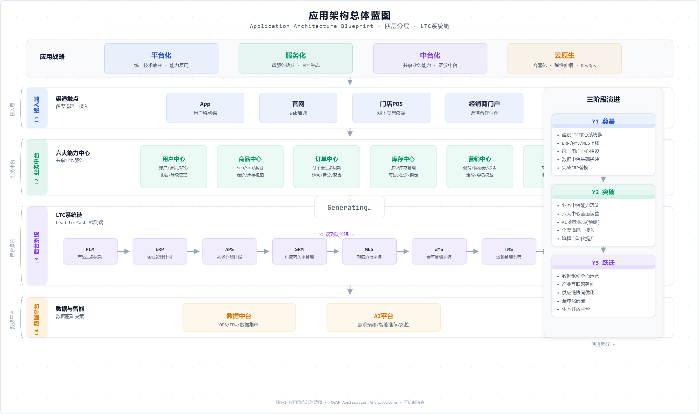</p>

<p align="center">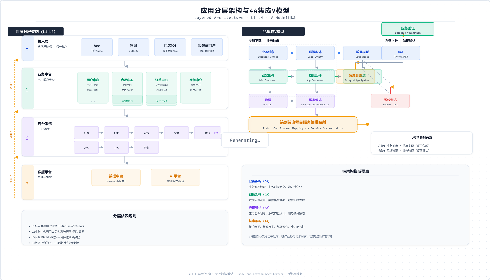</p>

应用架构不是系统清单堆叠，而是业务架构的落地实现。第2章定义了企业需要哪些业务能力，第3章定义了这些能力背后的数据对象和数据Owner，第4章要回答这些能力由哪些应用承载、哪些能力应下沉为共享中心、应用之间通过哪些API和事件集成。

### 4.1.1 平台+应用分层

| 层级 | 定位 | 典型内容 | 设计原则 |
|---|---|---|---|
| 前台应用层 | 面向用户、渠道、员工和伙伴的场景入口 | App、官网、电商、门店POS、经销商门户、供应商门户、员工门户 | 轻量、体验优先、快速编排中台能力 |
| 业务应用层 | 承载各业务域L3能力组的核心业务系统 | PLM、APS、SRM、ERP、MES、CRM、OMS、WMS、TMS、售后、HR、GRC | 对齐业务域能力，保证流程闭环 |
| 业务能力中心层 | 围绕共享业务对象沉淀可复用能力 | 客户中心、产品中心、订单中心、库存中心、计划中心、供应商中心、质量追溯中心、财务结算中心 | 能力服务化，API First，数据Owner清晰 |
| 数据能力中心层 | 提供主数据、数据服务、指标、标签和AI特征 | MDM、数据目录、指标中心、标签中心、数据服务API、特征平台 | 数据同源、可发现、可追溯、可授权 |
| 技术平台层 | 提供运行、集成、安全和工程能力 | API网关、消息总线、BPM、IAM、DevOps、容器云、可观测平台 | 平台化、云原生、统一治理 |

### 4.1.2 应用功能架构与集成架构分离

应用功能架构回答“每个业务能力由哪些IT应用承载、应用内部有哪些一级功能”；应用集成架构回答“端到端流程跨应用时如何调用API、发布事件、同步数据、保障一致性”。两者必须分开规划：功能架构如果没有集成架构，会形成新的系统烟囱；集成架构如果没有功能架构，会变成无业务语义的接口连线。

### 4.1.3 微服务拆分双维度方法论【参考文档补充】

> **来源**：参考文档《微服务拆分实践-基于业务流程驱动和数据共享驱动的双维度拆分思考》。传统单体拆分为微服务时，最大的风险是"拆完后耦合度反而更高了"。双维度拆分方法将拆分分为数据层和应用层两个独立维度，从根本上解决此问题。

#### 维度一：数据层拆分——形成共享数据能力中心

第一个维度从数据架构分析出发，识别哪些数据被多个业务活动共享：

1. **执行CRUD矩阵分析**：对第2章识别的所有业务对象×第2章的业务组件，建立CRUD矩阵。找出被3个以上业务组件共享的数据对象。
2. **识别共享数据**：被多个业务组件频繁读取（R）的数据对象，是共享数据能力中心的候选；被单一业务组件独占创建（C）和更新（U）的数据对象，可作为该组件私有数据。
3. **形成数据能力中心**：客户/产品/供应商/物料/BOM等高频共享主数据→独立数据能力中心（MDM管理）；订单/库存/工单/应收等共享事务数据→独立数据能力中心（OLTP+OLAP双模）；用户行为日志/设备IoT日志→数据湖存储（仅分析消费）。
4. **数据库私有vs共享共存模型**：数据能力中心=共享数据库（多个微服务通过API消费）；微服务私有数据=私有数据库（仅该微服务可写，外部只读通过API）。私有DB与共享DB共存，而非一刀切的"每服务一库"。

| 数据类型 | 数据库归属 | 访问规则 | 示例 |
|---------|-----------|---------|------|
| 共享主数据 | 共享DB（MDM管理） | 唯一权威源写入，所有系统通过API或订阅读取 | 产品/SKU/物料/客户/供应商/会计科目 |
| 共享事务数据 | 共享DB（能力中心管理） | 唯一权威源写入，消费方通过API或CDC同步读取 | 订单/库存/应收/工单/IMEI |
| 私有数据 | 私有DB（微服务独占） | 仅该微服务读写，外部不可直接访问 | 购物车临时数据/用户浏览历史/本地配置 |

#### 维度二：应用层拆分——基于业务流程和领域分析

第二个维度从业务流程和DDD领域分析出发，确定应用模块的边界：

1. **端到端流程分析**：以LTC端到端流程为主线，识别每个流程步骤的输入、输出和负责的业务组件。流程步骤之间的数据传递点就是微服务之间的API接口点。
2. **DDD限界上下文识别**：基于业务能力边界和领域知识，划分限界上下文（Bounded Context）。每个限界上下文内部高内聚，上下文之间通过定义良好的API（开放主机服务）或事件（领域事件）松耦合通信。
3. **上下文映射关系**：识别上下文间的协作关系——共享内核（Shared Kernel）、客户-供应商（Customer-Supplier）、防腐层（Anti-Corruption Layer）、开放主机服务（Open Host Service）。手机制造示例：
   - 订单上下文→库存上下文：客户-供应商关系（订单依赖库存的ATP查询）
   - 订单上下文→财务上下文：客户-供应商关系（签收触发应收确认）
   - PLM→ERP/MES：开放主机服务（PLM发布BOM变更事件，下游订阅）

#### 双维度拆分的协同

两个维度不是先后执行，而是并行分析、相互校验：
- 数据层拆分的共享数据候选→反馈给应用层拆分，确认是否应该独立为数据能力中心
- 应用层拆分的限界上下文→反馈给数据层拆分，确认每个上下文应该拥有哪些私有数据
- 两个维度最终收敛为统一的微服务架构：数据能力中心提供数据服务，业务微服务提供业务逻辑，上层应用负责场景编排

### 4.1.4 微服务架构方法论：DDD领域驱动设计

应用架构采用DDD(Domain-Driven Design)领域驱动设计方法论进行微服务拆分。核心原则: **限界上下文(Bounded Context)作为微服务边界,聚合(Aggregate)作为事务一致性单元,领域事件(Domain Event)作为跨服务协同机制。**

**DDD战略设计三步法:**

| 步骤 | 核心工作 | 输入 | 输出 | 手机制造示例 |
|---|---|---|---|---|
| 1.领域划分 | 识别核心域/支撑域/通用域 | 第2章14个业务域 | 领域分类矩阵 | 核心域:产品研发/供应链/制造/营销/销售/服务;支撑域:人力/财务/法务;通用域:IT/行政 |
| 2.限界上下文 | 按业务能力边界划分限界上下文 | 第2章L3能力组+L4能力 | 限界上下文清单(即微服务候选边界) | "订单管理"上下文→OMS微服务集群;"库存管理"上下文→库存中心微服务 |
| 3.上下文映射 | 定义上下文间的协作关系 | 第2章业务组件交互关系 | 上下文映射图(共享内核/客户-供应商/防腐层/开放主机) | 订单上下文→库存上下文:客户-供应商关系;PLM→ERP:开放主机服务+发布语言 |

**DDD战术设计核心要素:**

| 要素 | 定义 | 手机制造示例 | 设计约束 |
|---|---|---|---|
| 聚合(Aggregate) | 事务一致性边界,一个聚合内保证强一致性 | 订单聚合(Order Aggregate):订单头+订单行+订单状态 | 一个微服务可含多个聚合;跨聚合操作通过领域事件实现最终一致性 |
| 聚合根(Aggregate Root) | 聚合的唯一入口,外部只能通过聚合根访问聚合内实体 | 订单聚合的聚合根=Order;订单行的增删改都通过Order操作 | 聚合根ID全局唯一,其他聚合只能持有聚合根ID引用而非对象引用 |
| 领域事件(Domain Event) | 聚合状态变化时发布的事件 | OrderCreated/StockReserved/PaymentConfirmed | 事件是跨聚合/跨限界上下文的唯一合法通信方式(与第4.8节事件目录对接) |
| 领域服务(Domain Service) | 不属于任何单一聚合的无状态业务操作 | 价格计算服务(跨越价格政策和促销规则两个聚合) | 避免过度使用领域服务替代聚合自身的业务逻辑 |
| 仓储(Repository) | 聚合的持久化抽象,隔离领域层与基础设施层 | OrderRepository:save(Order)/findById(OrderId) | 仓储接口定义在领域层,实现在基础设施层(依赖反转) |

**基于DDD的微服务拆分示例:从限界上下文到微服务集群**

```
业务域:销售与渠道(D06)
  └── 限界上下文:订单管理
       ├── 微服务:order-command (订单创建/审核/取消)
       ├── 微服务:order-query (订单查询/状态跟踪)
       └── 微服务:order-fulfillment (履约路由/拆合单)
  └── 限界上下文:渠道管理
       ├── 微服务:channel-mgmt (渠道准入/分级/画像)
       └── 微服务:channel-policy (渠道政策/返利/价保)
  └── 限界上下文:价格促销
       ├── 微服务:pricing-engine (价格计算/策略)
       └── 微服务:promotion-engine (促销规则/资格校验)
```

**核心域微服务拆分清单（基于DDD限界上下文）:**

| 业务域 | 限界上下文 | 微服务集群 | 核心聚合 | 数据Owner |
|---|---|---|---|---|
| 产品研发 | 产品管理 | product-service | 产品/配置 | 产品研发 |
| 产品研发 | BOM管理 | bom-service | BOM/ECN | 产品研发 |
| 产品研发 | IPD项目管理 | ipd-project-service | 研发项目/阶段门 | 产品研发 |
| 供应链管理 | 需求计划 | demand-forecast-service | 需求预测/S&OP计划 | 供应链管理 |
| 供应链管理 | 采购协同 | purchase-service | 采购申请/采购订单 | 供应链管理 |
| 供应链管理 | 供应商管理 | supplier-service | 供应商/框架协议 | 供应链管理 |
| 供应链管理 | 库存管理 | inventory-service | 库存/预占/库位 | 供应链管理 |
| 生产制造 | 工单执行 | workorder-service | 生产工单/工序记录 | 生产制造 |
| 生产制造 | 质量追溯 | quality-trace-service | 质量检测/IMEI/SN履历 | 生产制造 |
| 生产制造 | 设备管理 | equipment-service | 设备/点检/OEE | 生产制造 |
| 销售与渠道 | 订单管理 | order-service cluster | 销售订单/订单行/订单状态 | 销售与渠道 |
| 销售与渠道 | 渠道管理 | channel-service | 客户/渠道伙伴/门店 | 销售与渠道 |
| 销售与渠道 | 价格促销 | pricing-service cluster | 价格政策/促销规则 | 销售与渠道 |
| 客户服务 | 服务工单 | service-ticket-service | 服务工单/维修单 | 客户服务 |

注:以上每个微服务集群内部可按CQRS模式进一步拆分为命令(Command)和查询(Query)两个独立服务。

---

### 4.1.4 L4应用功能架构图(基于DDD限界上下文)

基于上述DDD拆分,形成覆盖全企业的L4应用功能架构。每个限界上下文对应一组微服务,每个微服务内部按聚合划分功能模块。以下对PLM、MES和供应链系统(APS+SRM+WMS)三个核心系统进行详细的三级功能展开。

<p align="center"></p>

### 4.1.4 微服务架构方法论：DDD领域驱动设计

应用架构采用DDD(Domain-Driven Design)领域驱动设计方法论进行微服务拆分。核心原则: **限界上下文(Bounded Context)作为微服务边界,聚合(Aggregate)作为事务一致性单元,领域事件(Domain Event)作为跨服务协同机制。**

**DDD战略设计三步法:**

| 步骤 | 核心工作 | 输入 | 输出 | 手机制造示例 |
|---|---|---|---|---|
| 1.领域划分 | 识别核心域/支撑域/通用域 | 第2章14个业务域 | 领域分类矩阵 | 核心域:产品研发/供应链/制造/营销/销售/服务;支撑域:人力/财务/法务;通用域:IT/行政 |
| 2.限界上下文 | 按业务能力边界划分限界上下文 | 第2章L3能力组+L4能力 | 限界上下文清单(即微服务候选边界) | "订单管理"上下文→OMS微服务集群;"库存管理"上下文→库存中心微服务 |
| 3.上下文映射 | 定义上下文间的协作关系 | 第2章业务组件交互关系 | 上下文映射图(共享内核/客户-供应商/防腐层/开放主机) | 订单上下文→库存上下文:客户-供应商关系;PLM→ERP:开放主机服务+发布语言 |

**DDD战术设计核心要素:**

| 要素 | 定义 | 手机制造示例 | 设计约束 |
|---|---|---|---|
| 聚合(Aggregate) | 事务一致性边界,一个聚合内保证强一致性 | 订单聚合(Order Aggregate):订单头+订单行+订单状态 | 一个微服务可含多个聚合;跨聚合操作通过领域事件实现最终一致性 |
| 聚合根(Aggregate Root) | 聚合的唯一入口,外部只能通过聚合根访问聚合内实体 | 订单聚合的聚合根=Order;订单行的增删改都通过Order操作 | 聚合根ID全局唯一,其他聚合只能持有聚合根ID引用而非对象引用 |
| 领域事件(Domain Event) | 聚合状态变化时发布的事件 | OrderCreated/StockReserved/PaymentConfirmed | 事件是跨聚合/跨限界上下文的唯一合法通信方式(与第4.8节事件目录对接) |
| 领域服务(Domain Service) | 不属于任何单一聚合的无状态业务操作 | 价格计算服务(跨越价格政策和促销规则两个聚合) | 避免过度使用领域服务替代聚合自身的业务逻辑 |
| 仓储(Repository) | 聚合的持久化抽象,隔离领域层与基础设施层 | OrderRepository:save(Order)/findById(OrderId) | 仓储接口定义在领域层,实现在基础设施层(依赖反转) |

**基于DDD的微服务拆分示例:从限界上下文到微服务集群**

```
业务域:销售与渠道(D06)
  └── 限界上下文:订单管理
       ├── 微服务:order-command (订单创建/审核/取消)
       ├── 微服务:order-query (订单查询/状态跟踪)
       └── 微服务:order-fulfillment (履约路由/拆合单)
  └── 限界上下文:渠道管理
       ├── 微服务:channel-mgmt (渠道准入/分级/画像)
       └── 微服务:channel-policy (渠道政策/返利/价保)
  └── 限界上下文:价格促销
       ├── 微服务:pricing-engine (价格计算/策略)
       └── 微服务:promotion-engine (促销规则/资格校验)
```

**核心域微服务拆分清单（基于DDD限界上下文）:**

| 业务域 | 限界上下文 | 微服务集群 | 核心聚合 | 数据Owner |
|---|---|---|---|---|
| 产品研发 | 产品管理 | product-service | 产品/配置 | 产品研发 |
| 产品研发 | BOM管理 | bom-service | BOM/ECN | 产品研发 |
| 产品研发 | IPD项目管理 | ipd-project-service | 研发项目/阶段门 | 产品研发 |
| 供应链管理 | 需求计划 | demand-forecast-service | 需求预测/S&OP计划 | 供应链管理 |
| 供应链管理 | 采购协同 | purchase-service | 采购申请/采购订单 | 供应链管理 |
| 供应链管理 | 供应商管理 | supplier-service | 供应商/框架协议 | 供应链管理 |
| 供应链管理 | 库存管理 | inventory-service | 库存/预占/库位 | 供应链管理 |
| 生产制造 | 工单执行 | workorder-service | 生产工单/工序记录 | 生产制造 |
| 生产制造 | 质量追溯 | quality-trace-service | 质量检测/IMEI/SN履历 | 生产制造 |
| 生产制造 | 设备管理 | equipment-service | 设备/点检/OEE | 生产制造 |
| 销售与渠道 | 订单管理 | order-service cluster | 销售订单/订单行/订单状态 | 销售与渠道 |
| 销售与渠道 | 渠道管理 | channel-service | 客户/渠道伙伴/门店 | 销售与渠道 |
| 销售与渠道 | 价格促销 | pricing-service cluster | 价格政策/促销规则 | 销售与渠道 |
| 客户服务 | 服务工单 | service-ticket-service | 服务工单/维修单 | 客户服务 |

注:以上每个微服务集群内部可按CQRS模式进一步拆分为命令(Command)和查询(Query)两个独立服务。

---

### 4.1.4 L4应用功能架构图(基于DDD限界上下文)

基于上述DDD拆分,形成覆盖全企业的L4应用功能架构。每个限界上下文对应一组微服务,每个微服务内部按聚合划分功能模块。以下对PLM、MES和供应链系统(APS+SRM+WMS)三个核心系统进行详细的三级功能展开。

<p align="center"></p>

---

## 4.2 应用功能架构规划## 4.2 应用功能架构规划

<p align="center">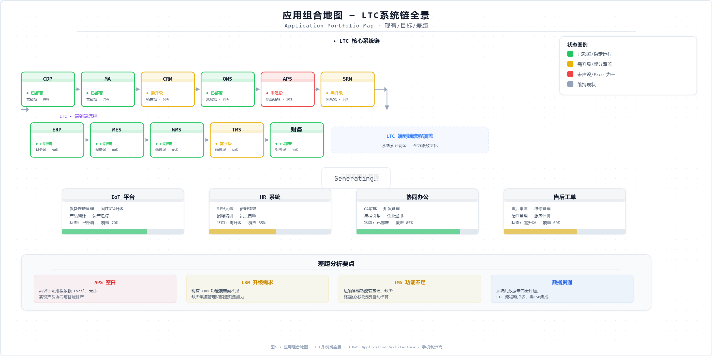</p>

<p align="center">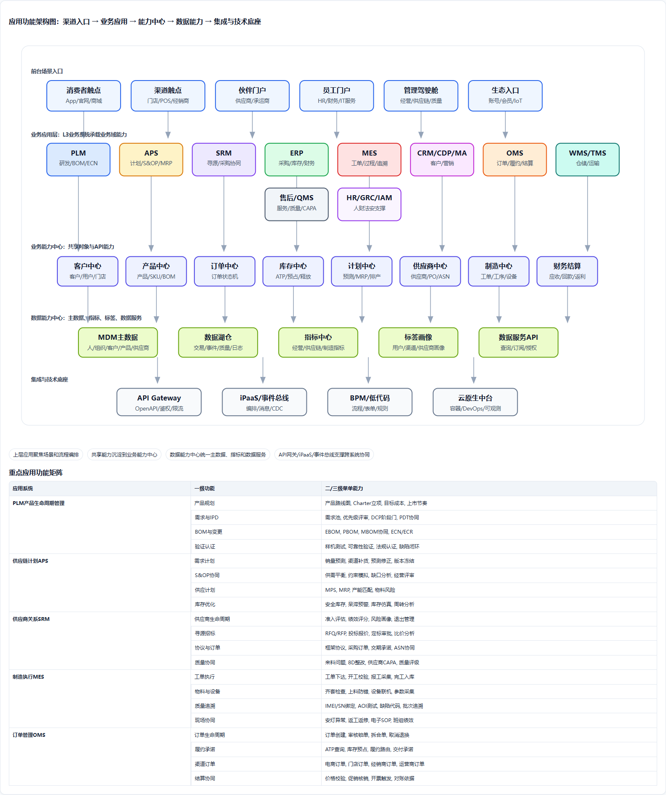</p>

<p align="center">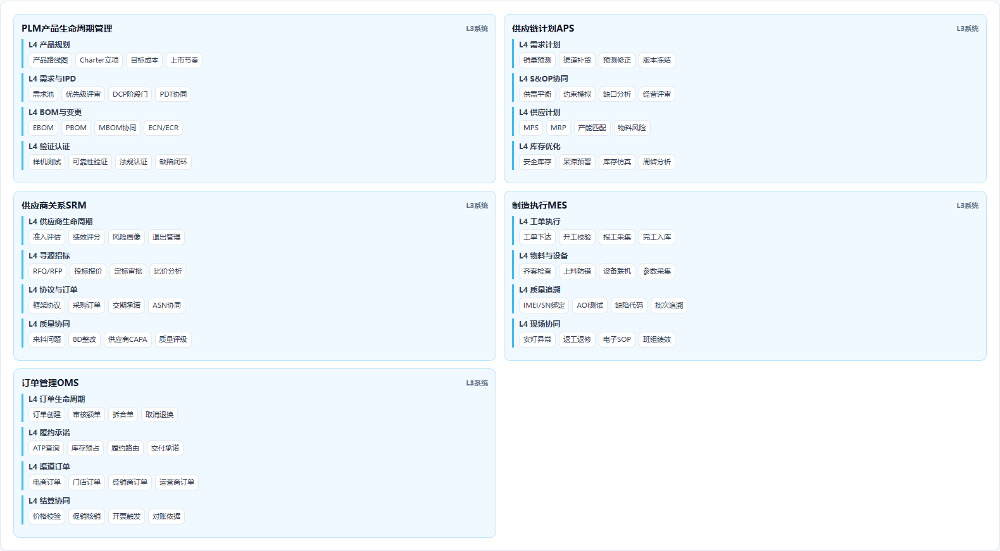</p>

<p align="center">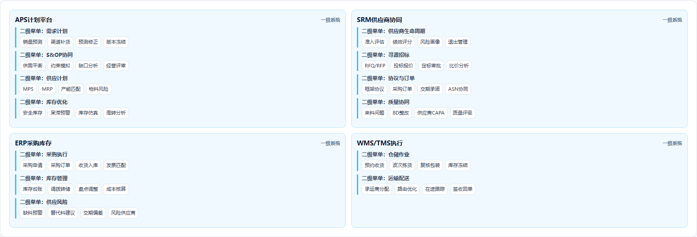</p>

<p align="center">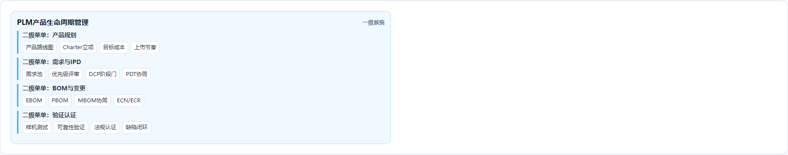</p>

<p align="center">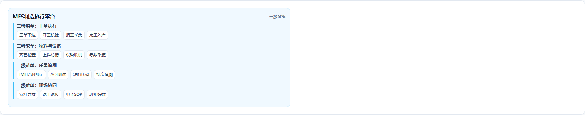</p>

应用功能规划以第2章L3业务能力组为输入。通常一个L3能力组可由一个业务系统承载，也可以由一个系统中的一级功能模块承载；跨域共享且高复用的能力不直接固化在单个上层应用中，而是下沉到业务能力中心或数据能力中心。

### 4.2.1 应用组合总览

| 应用编号 | IT应用/系统 | 对齐业务域 | 覆盖L3能力组 | 主要用户 | 规划策略 |
|---|---|---|---|---|---|
| APP01 | 战略经营管理平台 | 战略与经营管理 | 战略规划、经营计划、KPI、项目组合、架构治理 | 经营管理层、PMO、EA团队 | 建设 |
| APP02 | PLM产品生命周期管理 | 产品研发 | 产品规划、需求、IPD项目、BOM、ECN、验证、认证 | 研发、供应链、制造、质量 | 升级 |
| APP03 | 供应链计划APS | 供应链管理 | 需求预测、S&OP、供应计划、详细排产、库存优化 | 计划、供应链、制造 | 建设 |
| APP04 | SRM供应商协同平台 | 供应链管理 | 供应商准入、寻源、招投标、框架协议、采购协同、ASN | 采购、SQE、供应商 | 建设 |
| APP05 | ERP企业资源计划 | 财务管理/供应链/销售 | 采购、库存、财务、成本、应收应付、多组织核算 | 财务、供应链、销售 | 升级 |
| APP06 | MES制造执行系统 | 生产制造 | 工单、齐套、工序执行、质量、设备、追溯、完工入库 | 工厂、质量、设备 | 推广 |
| APP07 | QMS质量管理系统 | 生产制造/客户服务 | 来料、过程、出货、售后质量、CAPA、供应商质量 | 质量、研发、制造、服务 | 建设 |
| APP08 | CDP客户数据平台 | 市场营销/数据能力中心 | 用户画像、标签、分群、ID-Mapping、行为分析 | 营销、销售、服务 | 建设 |
| APP09 | MA营销自动化平台 | 市场营销 | Campaign、内容、触达、线索培育、归因、ROI | 市场营销 | 建设 |
| APP10 | CRM客户与渠道管理 | 销售与渠道/客户服务 | 客户、商机、报价、渠道、门店、服务线索 | 销售、渠道、服务 | 统一 |
| APP11 | OMS全渠道订单管理 | 销售与渠道 | 订单接入、订单状态机、拆合单、库存承诺、履约路由、异常处理 | 电商、渠道、履约 | 重点自研 |
| APP12 | WMS仓储管理系统 | 供应链管理 | 入库、上架、波次、拣货、复核、库存、盘点、IMEI绑定 | 仓储、物流 | 统一 |
| APP13 | TMS运输管理系统 | 供应链管理 | 承运商、运输计划、轨迹、签收、异常、运费结算 | 物流、客服、财务 | 建设 |
| APP14 | 售后服务管理平台 | 客户服务 | 服务工单、保修、维修、备件、回访、质量回流 | 客服、维修、质量 | 升级 |
| APP15 | 生态运营平台 | 生态与互联网服务 | 账号、会员、IoT设备、应用商店、订阅、生态结算 | 生态、互联网服务 | 建设 |
| APP16 | HR数字化平台 | 人力资源 | 组织、岗位、人员、招聘、绩效、薪酬、培训、员工服务 | HR、全员 | SaaS/采购 |
| APP17 | 财务共享与费控平台 | 财务管理 | 预算、费用、应收应付、资金、税务、报表、经营分析 | 财务、业务BP | 建设 |
| APP18 | GRC法务合规平台 | 法务与合规 | 合同、知识产权、隐私授权、贸易合规、审计整改 | 法务、合规、审计 | 建设 |
| APP19 | 安全运营与IAM平台 | 安全管理 | 身份权限、零信任、安全事件、漏洞、EHS、BCP | 安全、IT、工厂 | 建设 |
| APP20 | ITSM/DevOps/EA平台 | IT与数字化 | 需求、项目、应用组合、服务目录、变更、运维、DevOps、架构资产 | IT、EA、交付团队 | 建设 |
| APP21 | 行政设施服务平台 | 行政与设施 | 园区、工位、资产、行政采购、差旅、访客、行政服务 | 行政、全员 | SaaS/采购 |

### 4.2.2 核心应用一级功能说明

#### PLM产品生命周期管理

PLM 是产品研发和产品数据的主干系统，承载从产品规划、需求、IPD项目、BOM、配置、ECN到验证认证的闭环，是产品中心和下游供应链、制造、服务系统的产品数据源头。

| 一级功能 | 功能说明 | 关联核心数据对象 |
|---|---|---|
| 产品规划 | 维护产品路线图、Charter、目标市场、目标成本和上市节奏 | 产品、SKU、产品需求 |
| 需求管理 | 汇集用户洞察、竞品、服务质量和区域需求，形成需求池和优先级 | 产品需求 |
| IPD项目管理 | 支撑阶段门DCP、PDT协同、WBS、风险和评审记录 | 研发项目 |
| BOM与配置管理 | 管理EBOM/PBOM/MBOM、SKU配置、版本和生效关系 | BOM、SKU |
| ECN变更管理 | 完成变更申请、影响分析、审批、执行和验证闭环 | ECN变更 |

#### 供应链计划APS

APS 是供应链计划的大脑，负责把销售预测、渠道库存、Campaign、产能、物料和财务约束转化为S&OP、MRP、排产和库存优化结果。

| 一级功能 | 功能说明 | 关联核心数据对象 |
|---|---|---|
| 需求预测 | 融合销售预测、Campaign、历史销量和渠道库存生成预测版本 | 需求预测 |
| S&OP协同 | 组织需求、供应、财务和制造平衡，形成计划版本 | S&OP计划 |
| 供应计划/MRP | 基于BOM、库存、在途和安全库存生成净需求 | 采购申请 |
| 生产排程 | 根据产能、工艺、设备和物料齐套生成排产计划 | 生产工单 |
| 库存优化 | 计算安全库存、补货点和多级库存策略 | 库存策略 |

#### SRM供应商协同平台

SRM 负责供应商全生命周期和采购协同，支撑从寻源、招投标、框架协议、采购订单到交期确认和ASN协同的P2P链路。

| 一级功能 | 功能说明 | 关联核心数据对象 |
|---|---|---|
| 供应商准入 | 管理供应商注册、资质、风险和审批 | 供应商 |
| 寻源招投标 | 支持RFQ、比价、招标、定标和寻源归档 | 合同、供应商 |
| 框架协议 | 维护价格、账期、交付、质量和合规条款 | 合同 |
| 采购协同 | 支撑采购订单、交期确认、ASN和异常协同 | 采购订单、ASN |
| 供应商绩效 | 评估质量、交付、成本、响应和风险 | 供应商绩效 |

#### MES制造执行系统

MES 是制造执行现场系统，负责把排产计划转化为工单和工序执行，并沉淀质量、设备、人员、物料批次和单机追溯数据。

| 一级功能 | 功能说明 | 关联核心数据对象 |
|---|---|---|
| 工单管理 | 接收排产计划，拆分工单并校验BOM、工艺和齐套 | 生产工单 |
| 车间执行 | 支持上料校验、SMT、组装、测试、包装和完工入库 | 工序记录 |
| 质量采集 | 采集IQC/IPQC/OQC、AOI、功能测试和SPC数据 | 质量检测记录 |
| 设备管理 | 维护设备状态、点检、维修、OEE和能耗 | 设备 |
| 单机追溯 | 绑定IMEI/SN、工单、物料批次、工序和检测结果 | IMEI/SN履历 |

#### CDP客户数据平台

CDP 是用户和行为数据能力平台，负责ID-Mapping、画像、标签、分群和数据服务，为营销、销售、服务和推荐提供数据能力。

| 一级功能 | 功能说明 | 关联核心数据对象 |
|---|---|---|
| ID-Mapping | 整合账号、设备、手机号哈希、门店触点和电商行为 | 用户账号 |
| 用户画像 | 生成标签、分群、偏好、生命周期和价值分层 | 用户标签 |
| 行为分析 | 分析浏览、点击、购买、服务和设备使用行为 | 行为日志 |
| 数据服务 | 向MA、CRM、OMS和推荐模型提供画像API | 用户画像API |
| 隐私控制 | 引用隐私授权状态控制数据使用范围 | 隐私授权 |

#### MA营销自动化平台

MA 是营销自动化系统，负责Campaign、内容、触达、线索培育和归因，把营销策略转化为可执行的自动化运营。

| 一级功能 | 功能说明 | 关联核心数据对象 |
|---|---|---|
| Campaign管理 | 管理活动计划、预算、目标人群、素材和排期 | Campaign |
| 内容管理 | 管理营销内容、审批、发布和复用 | 营销内容 |
| 自动化触达 | 按事件、标签和生命周期触发短信、Push、邮件和站内消息 | 触达任务 |
| 线索培育 | 线索评分、培育、MQL移交和转化跟踪 | 营销线索 |
| 归因分析 | 分析触点、渠道、活动对订单和收入的贡献 | 营销归因 |

#### CRM客户与渠道管理

CRM 统一管理客户、渠道、门店、商机和销售协同，并为服务和营销提供客户360视图。

| 一级功能 | 功能说明 | 关联核心数据对象 |
|---|---|---|
| 客户管理 | 管理客户、联系人、渠道伙伴、门店和客户层级 | 客户、渠道伙伴、门店 |
| 商机报价 | 支持线索转商机、报价、折扣申请和审批 | 商机、报价 |
| 渠道管理 | 管理经销商准入、门店画像、渠道政策和返利资格 | 渠道伙伴、门店 |
| 服务视图 | 聚合客户订单、服务、投诉和NPS，形成客户360视图 | 客户、服务工单 |
| 销售协同 | 支持区域销售、渠道经理、导购和客服协作 | 销售任务 |

#### OMS全渠道订单管理

OMS 是LTC交易主干，负责全渠道订单接入、订单状态机、审核、履约路由和异常处理，是订单中心的主要承载。

| 一级功能 | 功能说明 | 关联核心数据对象 |
|---|---|---|
| 订单接入 | 统一接入电商、门店、经销商、运营商和App订单 | 销售订单 |
| 订单状态机 | 管理创建、支付、审核、履约、出库、签收、完成、取消和退换 | 销售订单 |
| 订单审核 | 执行价格、促销、信用、库存和合规校验 | 订单审核记录 |
| 履约路由 | 调用库存、仓店、物流和SLA能力选择履约节点 | 履约路由结果 |
| 异常处理 | 处理缺货、超卖、地址异常、支付异常、拆合单和改派 | 异常单 |

#### WMS仓储管理系统

WMS 负责仓储执行、库存状态、拣配复核和IMEI绑定，是库存中心和履约执行的核心承载。

| 一级功能 | 功能说明 | 关联核心数据对象 |
|---|---|---|
| 入库上架 | 支持采购到货、生产入库、退货入库和库位上架 | 库存流水 |
| 库存管理 | 维护仓库、库位、批次、IMEI/SN和库存状态 | 库存水位 |
| 波次拣货 | 根据订单和路由生成波次、拣货和复核任务 | 拣货记录 |
| 出库交接 | 完成打包、称重、面单、出库和承运商交接 | 出库单 |
| 盘点调整 | 支持循环盘点、差异处理、冻结和解冻 | 盘点记录 |

#### TMS运输管理系统

TMS 负责运输计划、轨迹、签收和运费结算，连接仓储履约、客户体验和财务确认。

| 一级功能 | 功能说明 | 关联核心数据对象 |
|---|---|---|
| 运输计划 | 生成运输任务、承运商选择和运费预估 | 运输单 |
| 轨迹跟踪 | 接收承运商轨迹、异常和预计到达时间 | 物流轨迹 |
| 签收管理 | 管理POD签收、拒收、丢损和签收回传 | 签收记录 |
| 异常处理 | 处理延误、破损、丢失、改派和拦截 | 物流异常 |
| 运费结算 | 按合同、重量、区域和服务等级计算运费 | 运费结算单 |

#### 售后服务管理平台

售后服务管理平台负责报修、保修、维修、备件、回访和质量回流，是I2R价值流的主干系统。

| 一级功能 | 功能说明 | 关联核心数据对象 |
|---|---|---|
| 服务接入 | 支持热线、App、门店和官网报修 | 服务工单 |
| 保修校验 | 基于订单、激活、IMEI和保修政策判断权益 | 保修校验结果 |
| 维修执行 | 支持检测诊断、报价、维修、换退和旧件回收 | 维修单 |
| 备件管理 | 查询备件库存、调拨、领用和回收 | 备件 |
| 质量回流 | 把故障代码、维修记录和NPS回流研发制造 | 质量问题单 |

#### HR数字化平台

HR数字化平台承载组织、岗位、人员、招聘、绩效、薪酬和培训，是人力资源域能力落地系统。

| 一级功能 | 功能说明 | 关联核心数据对象 |
|---|---|---|
| 组织岗位 | 管理组织、岗位、编制和任职资格 | 组织、岗位 |
| 招聘入职 | 管理招聘申请、候选人、面试、录用和入职 | 招聘申请、人员 |
| 绩效激励 | 管理目标、考核、评级、奖金和激励 | 绩效目标、绩效评价 |
| 薪酬福利 | 管理薪酬项、社保、福利和发薪接口 | 薪酬项 |
| 学习发展 | 管理课程、认证、干部培养和继任计划 | 培训记录 |

#### 财务共享与费控平台

财务共享与费控平台承载预算、核算、应收、应付、成本和经营分析，是B2R和LTC现金闭环的关键系统。

| 一级功能 | 功能说明 | 关联核心数据对象 |
|---|---|---|
| 预算控制 | 管理预算编制、控制、调整和滚动预测 | 预算 |
| 会计核算 | 处理总账、应收、应付、资产、税务和凭证 | 会计凭证 |
| 应收回款 | 管理应收确认、开票、对账、回款和核销 | 应收单 |
| 成本核算 | 计算BOM成本、制造成本、渠道费用和产品盈利 | 产品成本 |
| 经营分析 | 提供区域、渠道、产品、项目和费用经营分析 | 经营指标 |

#### GRC法务合规平台

GRC法务合规平台承载合同、知识产权、隐私合规、贸易合规和内控审计，将合规规则嵌入业务流程。

| 一级功能 | 功能说明 | 关联核心数据对象 |
|---|---|---|
| 合同管理 | 管理合同模板、评审、审批、履约和风险条款 | 合同 |
| 知识产权 | 管理专利、商标、许可和侵权监测 | 专利、商标 |
| 隐私合规 | 管理同意、撤回、数据出境和合规审计 | 隐私授权 |
| 贸易合规 | 管理区域法规、禁限售、出口管制和认证要求 | 区域法规 |
| 内控审计 | 管理审计发现、整改、证据和关闭 | 审计整改项 |

#### 安全运营与IAM平台

安全运营与IAM平台承载身份权限、安全事件、漏洞、EHS和BCP，支撑全企业安全和连续性治理。

| 一级功能 | 功能说明 | 关联核心数据对象 |
|---|---|---|
| 身份权限 | 管理账号、角色、权限、最小授权和审计 | 账号权限 |
| 安全事件 | 采集、分析、响应和复盘安全事件 | 安全事件 |
| 漏洞管理 | 管理漏洞发现、评级、修复和验证 | 漏洞 |
| EHS管理 | 管理生产安全、环保、事故和整改 | EHS事件 |
| BCP管理 | 管理业务连续性方案、演练和恢复评估 | BCP演练 |

**附件**：[附件4-1 应用系统清单](./附件/附件4-1_应用系统清单.xlsx)、[附件4-3 核心应用系统需求规格索引](./附件/附件4-3_核心应用系统需求规格索引.xlsx)

---

## 4.3 业务能力中心与数据能力中心

<p align="center">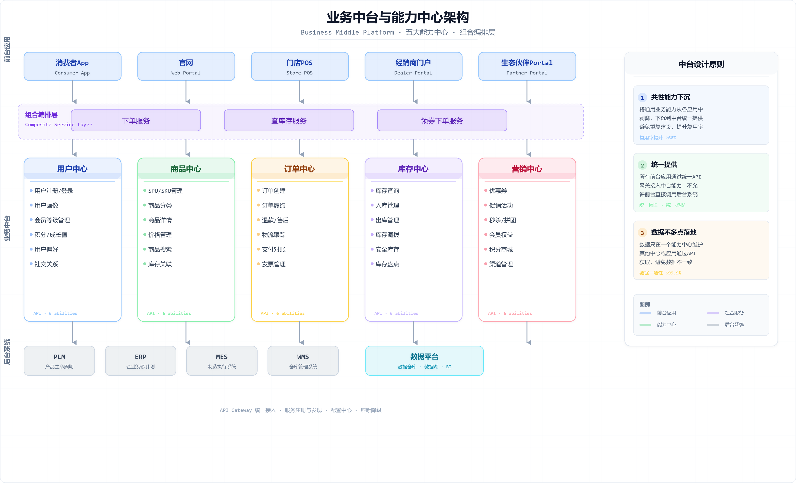</p>

<p align="center">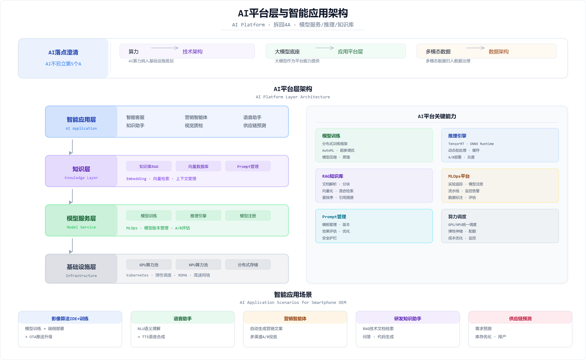</p>

<p align="center">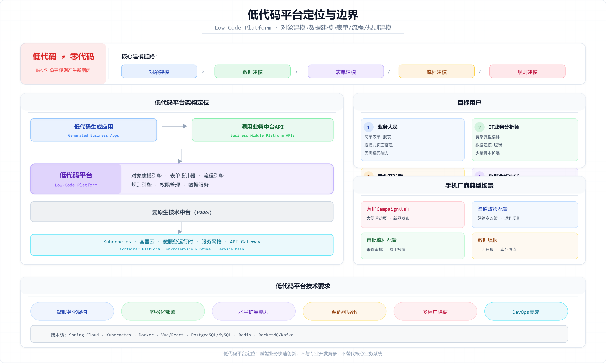</p>

业务能力中心围绕核心共享业务对象拆分，不按现有系统厂商划分。每个能力中心必须同时定义业务对象、能力边界、API接口、数据Owner和服务SLA。数据能力中心则提供主数据、标签、指标、数据服务和AI特征，使上层应用不再各自建设数据孤岛。

### 4.3.1 业务能力中心规划

| 能力中心编号 | 能力中心 | 核心共享业务对象 | 主要能力 | 典型承载系统 |
|---|---|---|---|---|
| BC01 | 客户中心 | 客户、用户、渠道伙伴、门店 | 客户档案、用户账号、客户360、渠道档案、门店档案、身份映射 | CRM/CDP/MDM |
| BC02 | 产品中心 | 产品、SKU、BOM、配置、物料 | 产品发布、SKU配置、BOM版本、物料引用、生命周期状态 | PLM/MDM |
| BC03 | 订单中心 | 销售订单、订单行、订单状态 | 订单创建、订单审核、订单状态机、拆合单、异常处理 | OMS |
| BC04 | 库存中心 | 库存、仓库、库位、IMEI/SN、预占 | ATP查询、库存预占、库存释放、库存水位、IMEI绑定 | WMS/SCM |
| BC05 | 价格促销中心 | 价格政策、促销、优惠、返利 | 价格计算、促销资格、优惠核销、价保、返利规则 | OMS/CRM/ERP |
| BC06 | 计划中心 | 预测、S&OP、MPS、MRP、库存策略 | 预测版本、供需平衡、MRP运算、补货建议、计划发布 | APS |
| BC07 | 供应商中心 | 供应商、寻源、合同、采购订单、ASN | 供应商准入、招投标、采购订单、交期确认、ASN协同 | SRM/ERP |
| BC08 | 制造中心 | 工单、工艺、产线、设备、工序 | 工单下达、开工校验、工序采集、设备状态、完工入库 | MES |
| BC09 | 质量追溯中心 | 质量检测、故障、CAPA、IMEI/SN履历 | 检测记录、单机追溯、异常定位、CAPA、质量回流 | QMS/MES/售后 |
| BC10 | 服务中心 | 服务工单、维修单、备件、NPS | 报修受理、保修校验、维修执行、备件调拨、回访 | 售后平台 |
| BC11 | 财务结算中心 | 应收、应付、回款、成本、发票 | 应收确认、对账、回款核销、返利结算、成本查询 | ERP/财务共享 |
| BC12 | 合规风险中心 | 隐私授权、区域法规、风险名单、合同规则 | 隐私校验、禁限售检查、合同规则、审计证据、风险预警 | GRC/IAM |
| BC13 | 项目中心 | 研发项目、IT项目、投资项目、里程碑 | 项目立项、计划、阶段门、预算占用、收益跟踪 | PLM/ITSM/经营平台 |

### 4.3.2 能力中心API接口清单

| 能力中心 | API接口 | 接口能力说明 | 输入 | 输出 | 主要消费方 |
|---|---|---|---|---|---|
| 客户中心 | `GET /customers/{id}` | 查询客户档案 | 客户ID | 客户主数据、渠道关系、状态 | CRM/OMS/服务 |
| 客户中心 | `GET /users/{id}/profile` | 查询用户画像 | 用户ID | 标签、偏好、生命周期、权益 | MA/CRM/OMS |
| 客户中心 | `GET /stores/{id}` | 查询门店档案 | 门店ID | 门店状态、区域、渠道伙伴、服务能力 | OMS/WMS |
| 产品中心 | `GET /skus/{sku_id}` | 查询SKU信息 | SKU ID | 产品、颜色、存储、区域、生命周期 | OMS/WMS/服务 |
| 产品中心 | `GET /boms/{sku_id}/effective` | 查询生效BOM | SKU、日期、工厂 | BOM版本、物料清单、替代料 | APS/MES/成本 |
| 订单中心 | `POST /orders` | 创建销售订单 | 客户、渠道、SKU、数量、价格 | 订单号、状态、订单行 | 电商/POS/CRM |
| 订单中心 | `POST /orders/{id}/approve` | 订单审核 | 订单ID、审核上下文 | 审核结果、异常原因 | OMS/ERP |
| 订单中心 | `GET /orders/{id}/status` | 查询订单状态 | 订单ID | 状态、履约节点、签收、异常 | App/客服/CRM |
| 库存中心 | `POST /inventory/atp-query` | 查询可承诺库存 | SKU、区域、渠道、数量 | 可承诺数量、履约节点 | OMS |
| 库存中心 | `POST /inventory/reservations` | 库存预占 | 订单ID、SKU、数量、节点 | 预占号、有效期 | OMS/WMS |
| 库存中心 | `POST /inventory/release` | 库存释放 | 预占号、释放原因 | 释放结果 | OMS/WMS |
| 价格促销中心 | `POST /pricing/calculate` | 价格计算 | 客户、渠道、SKU、数量、促销上下文 | 成交价、折扣、补贴 | OMS/CRM |
| 价格促销中心 | `POST /promotions/validate` | 促销资格校验 | 用户/客户、SKU、活动 | 是否可用、优惠明细 | OMS/MA |
| 计划中心 | `POST /plans/sop-balance` | 提交S&OP平衡 | 预测、库存、产能、预算 | S&OP版本、供需缺口 | APS/经营平台 |
| 计划中心 | `POST /plans/mrp-run` | MRP运算 | MPS、BOM、库存、在途 | 采购建议、生产建议 | APS/ERP |
| 供应商中心 | `POST /suppliers/{id}/risk-check` | 供应商风险校验 | 供应商ID、物料、区域 | 风险等级、限制项 | SRM/采购 |
| 供应商中心 | `POST /purchase-orders` | 创建采购订单 | 供应商、物料、数量、价格 | PO号、状态 | ERP/SRM |
| 供应商中心 | `POST /purchase-orders/{id}/promise` | 供应商交期确认 | PO、承诺数量、日期 | 交期承诺、风险提示 | SRM/APS |
| 制造中心 | `POST /work-orders` | 创建生产工单 | SKU、BOM、工艺、数量、产线 | 工单号、状态 | APS/MES |
| 制造中心 | `POST /work-orders/{id}/start-check` | 开工校验 | 工单、物料、设备、人员 | 开工许可、异常项 | MES |
| 制造中心 | `POST /operations/records` | 采集工序记录 | 工单、工序、设备、人员、数量 | 工序记录ID | MES/QMS |
| 质量追溯中心 | `GET /trace/{imei}` | 查询单机追溯 | IMEI/SN | 工单、物料批次、检测、出货、维修 | 客服/QMS/研发 |
| 质量追溯中心 | `POST /quality/capa` | 创建CAPA | 质量异常、责任域、证据 | CAPA单号、状态 | QMS/PLM/SRM |
| 服务中心 | `POST /service-tickets` | 创建服务工单 | 用户、IMEI、问题、渠道 | 工单号、优先级 | App/客服/门店 |
| 服务中心 | `POST /repairs/{id}/complete` | 维修完成 | 维修单、备件、故障代码 | 维修记录、质量回流事件 | 售后/QMS |
| 财务结算中心 | `POST /receivables/confirm` | 应收确认 | 订单、签收、价格政策 | 应收单、发票依据 | ERP/OMS |
| 财务结算中心 | `POST /payments/match` | 回款核销 | 应收、银行流水 | 核销记录、账龄更新 | ERP/财务共享 |
| 合规风险中心 | `POST /compliance/privacy-check` | 隐私授权校验 | 用户、用途、区域 | 是否允许、授权版本 | CDP/MA/数据平台 |
| 合规风险中心 | `POST /compliance/trade-check` | 贸易合规校验 | 客户、SKU、区域、供应商 | 准入结果、限制原因 | OMS/SRM |
| 项目中心 | `POST /projects/stage-gate` | 项目阶段门评审 | 项目、阶段、交付件 | 评审结果、整改项 | PLM/ITSM |

### 4.3.3 数据能力中心

| 数据能力 | 对外能力 | 支撑对象 | 典型消费场景 |
|---|---|---|---|
| 主数据服务 | 主数据查询、校验、分发、订阅 | 人员、组织、产品、SKU、物料、供应商、客户、会计科目、单位 | PLM、ERP、MES、OMS、HR、财务 |
| 数据目录服务 | 数据资产发现、血缘、Owner、敏感等级 | 全域数据资产 | 数据治理、报表开发、接口评审 |
| 指标中心 | 统一指标口径、指标API、指标血缘 | 出货量、库存周转、毛利、NPS、准交率 | 经营驾驶舱、财务分析、业务复盘 |
| 标签中心 | 用户标签、渠道标签、产品标签、供应商标签 | 用户、门店、SKU、供应商 | 营销触达、风险识别、推荐 |
| 数据服务API | 面向应用的数据查询与订阅 | 订单、库存、质量、签收、应收、服务 | OMS路由、质量预警、客服视图 |
| AI特征平台 | 实时/离线特征、模型输入、特征回溯 | 用户行为、订单、质量、供应链 | 推荐、预测、质检、风控 |

**附件**：[附件4-6 中台与微服务拆分设计](./附件/附件4-6_中台与微服务拆分设计.xlsx)
---

## 4.4 上层应用功能对能力中心的引用

上层IT应用不是孤立实现业务功能，而是通过调用业务能力中心和数据能力中心完成流程编排。下面按一级应用功能说明其依赖的能力中心和具体能力。

| 上层IT应用 | 一级功能 | 引用的能力中心 | 引用能力/API | 说明 |
|---|---|---|---|---|
| PLM产品生命周期管理 | 产品规划 | 产品中心 | 产品发布、SKU配置、BOM版本 | 保证产品、SKU、BOM成为下游统一源 |
| PLM产品生命周期管理 | IPD项目管理 | 项目中心 | 项目阶段门、里程碑、预算占用 | 支撑DCP和跨域项目治理 |
| APS供应链计划 | 需求预测 | 计划中心 | 预测版本、S&OP平衡 | 形成统一计划版本 |
| APS供应链计划 | 供应计划/MRP | 产品中心、库存中心、供应商中心 | 生效BOM、库存水位、采购建议 | 把计划结果转成采购和生产需求 |
| SRM供应商协同平台 | 采购协同 | 供应商中心、合规风险中心 | 采购订单、交期确认、供应商风险 | 支撑P2P协同和风险控制 |
| MES制造执行系统 | 工单管理 | 制造中心、产品中心、库存中心 | 工单创建、生效BOM、齐套校验 | 保证正确物料和工艺执行 |
| MES制造执行系统 | 质量采集 | 质量追溯中心 | 检测记录、单机追溯、CAPA | 沉淀制造质量数据 |
| MA营销自动化平台 | 线索培育 | 客户中心、合规风险中心 | 用户画像、隐私授权校验 | 保证触达精准且合规 |
| OMS全渠道订单管理 | 订单审核 | 订单中心、库存中心、价格促销中心、财务结算中心、合规风险中心 | 订单审核、ATP、价格、信用、合规 | 生成可履约有效订单 |
| OMS全渠道订单管理 | 履约路由 | 订单中心、库存中心、客户中心 | 订单状态、库存预占、门店能力 | 决定履约节点 |
| WMS仓储管理系统 | 出库交接 | 库存中心、质量追溯中心 | 库存扣减、IMEI绑定 | 完成实物和订单绑定 |
| 售后服务管理平台 | 维修执行 | 服务中心、质量追溯中心、库存中心 | 保修校验、单机履历、备件库存 | 支撑维修和质量回流 |
| 财务共享与费控平台 | 应收回款 | 财务结算中心、订单中心、价格促销中心 | 应收确认、订单金额、返利规则 | 完成LTC现金闭环 |

**附件**：[附件4-2 应用功能矩阵](./附件/附件4-2_应用功能矩阵.xlsx)
---

## 4.5 应用集成架构规划

<p align="center">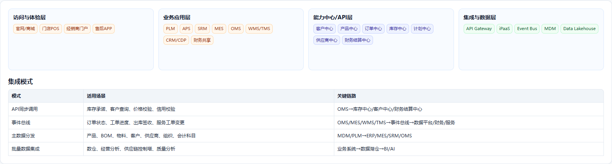</p>

<p align="center"></p>

<p align="center">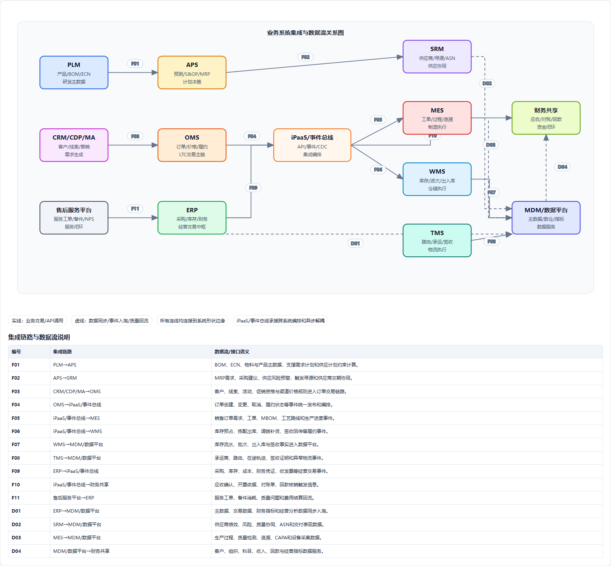</p>

应用集成架构独立于应用功能架构规划，重点解决跨系统、跨能力中心、跨数据域的协同。对于手机厂商，PLM、ERP、MES、OMS、WMS、TMS、CRM、售后、财务、GRC之间的集成决定了LTC是否能真正端到端闭环。

### 4.5.1 集成模式

| 集成模式 | 适用场景 | 技术建议 | 示例 |
|---|---|---|---|
| 同步API | 实时查询、校验和轻量交易 | API网关+REST/OpenAPI | ATP查询、价格计算、隐私授权校验 |
| 领域事件 | 状态变化驱动后续动作 | Kafka/事件总线 | 订单已支付、库存已预占、工单已完工、订单已签收 |
| 流程编排 | 跨系统长流程和审批 | BPM/流程引擎+异步回调 | 供应商准入、合同评审、ECN审批 |
| 数据同步 | 主数据和交易数据分发 | MDM订阅、CDC、ETL | 产品/SKU分发、订单CDC、人员组织同步 |
| 外部伙伴集成 | 供应商、承运商、经销商、开发者 | 开放API、EDI、文件、门户 | ASN、物流轨迹、渠道库存、生态结算 |
| 设备/边缘集成 | 产线设备和手机云端设备 | MQTT/OPC-UA/边缘网关 | AOI检测、设备状态、OTA、激活 |

### 4.5.2 关键集成链路

| 集成链路 | 交互内容 | 推荐方式 | 关键控制点 |
|---|---|---|---|
| PLM → MDM/ERP/MES | 产品、SKU、BOM、ECN、工艺路线 | 事件+API+对账 | BOM版本、生效日期、变更影响分析 |
| CRM/MA/CDP → OMS | 客户、线索、画像、促销资格 | API+事件 | 隐私授权、客户身份映射 |
| OMS ↔ 库存中心/WMS | ATP、预占、释放、履约路由 | 同步API+事件 | 库存一致性、预占有效期 |
| OMS → ERP/财务 | 订单、签收、应收、发票依据 | 事件+CDC | 收入确认、价格口径、返利规则 |
| APS → SRM/ERP/MES | MRP、采购建议、生产计划、排产 | API+批量计划版本 | 计划版本、供应承诺、物料齐套 |
| MES/QMS → 数据平台/PLM/SRM | 质量检测、IMEI履历、CAPA、供应商质量 | 事件+数据入湖 | 单机追溯、质量责任归属 |
| WMS/TMS → OMS/ERP/客服 | 出库、物流轨迹、签收、异常 | API+事件 | 签收时点、异常闭环 |
| 售后 → QMS/PLM/MES | 故障代码、维修记录、NPS、质量问题 | 事件+质量问题单 | 质量回流和CAPA闭环 |

**附件**：[附件4-4 应用接口与集成清单](./附件/附件4-4_应用接口与集成清单.xlsx)
---

## 4.6 LTC流程的应用、数据与API映射

<p align="center">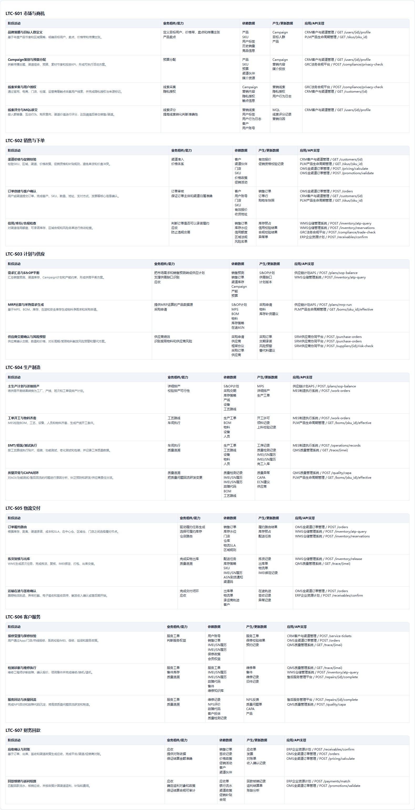</p>

本节在第2章LTC流程组件映射和第3章LTC流程数据映射基础上，增加应用和API维度。每个活动同时说明读/写数据对象，并用“读/产”标记区分，同时列出需要依赖的API能力接口。

### 4.6.1 市场与商机阶段应用数据API映射

| LTC活动 | 数据对象（读/产标记） | 依赖API能力接口 | 主要承载应用 |
|---|---|---|---|
| 品牌策略与目标人群定义 | 读：产品、SKU、用户标签、历史销量；产：Campaign Brief、目标人群 | 客户中心.GET /users/{id}/profile；产品中心.GET /skus/{sku_id} | CDP、MA、PLM |
| Campaign策划与预算分配 | 读：产品、预算、渠道、媒介资源；产：Campaign、营销内容、媒介投放计划 | 客户中心.GET /users/{id}/profile；合规风险中心.POST /compliance/privacy-check | MA、CDP、GRC |
| 线索采集与用户授权 | 读：Campaign、触点、授权模板；产：营销线索、隐私授权、行为日志 | 合规风险中心.POST /compliance/privacy-check；客户中心.GET /customers/{id} | MA、CDP、GRC |
| 线索评分与MQL移交 | 读：线索、用户画像、行为日志；产：MQL、线索评分、归因 | 客户中心.GET /users/{id}/profile | CDP、MA、CRM |

### 4.6.2 销售与下单阶段应用数据API映射

| LTC活动 | 数据对象（读/产标记） | 依赖API能力接口 | 主要承载应用 |
|---|---|---|---|
| 渠道价格与促销校验 | 读：客户、渠道、门店、SKU、价格政策、促销；产：有效报价、促销资格记录 | 客户中心.GET /customers/{id}；产品中心.GET /skus/{sku_id}；价格促销中心.POST /pricing/calculate；价格促销中心.POST /promotions/validate | CRM、OMS |
| 订单创建与客户确认 | 读：客户、用户、门店、SKU、报价、地址；产：销售订单、订单行、购物车快照 | 订单中心.POST /orders；客户中心.GET /customers/{id}；产品中心.GET /skus/{sku_id} | OMS、CRM |
| 信用/库存/合规检查 | 读：订单、库存、信用额度、区域法规、风险名单；产：库存预占、信用校验、合规校验、异常单 | 库存中心.POST /inventory/atp-query；库存中心.POST /inventory/reservations；合规风险中心.POST /compliance/trade-check；财务结算中心.POST /receivables/confirm | OMS、WMS、ERP、GRC |

### 4.6.3 计划与供应阶段应用数据API映射

| LTC活动 | 数据对象（读/产标记） | 依赖API能力接口 | 主要承载应用 |
|---|---|---|---|
| 需求汇总与S&OP平衡 | 读：销售预测、订单、渠道库存、Campaign、产能、预算；产：S&OP计划、供需缺口 | 计划中心.POST /plans/sop-balance；库存中心.POST /inventory/atp-query | APS、OMS、WMS |
| MRP运算与采购需求生成 | 读：S&OP、MPS、BOM、物料、库存、在途；产：采购申请、净需求、补货建议 | 计划中心.POST /plans/mrp-run；产品中心.GET /boms/{sku_id}/effective | APS、ERP、PLM |
| 供应商交期确认与风险预警 | 读：采购申请、供应商、合同、PO、风险；产：PO、交期承诺、风险预警 | 供应商中心.POST /purchase-orders；供应商中心.POST /purchase-orders/{id}/promise；供应商中心.POST /suppliers/{id}/risk-check | SRM、ERP、GRC |

### 4.6.4 生产制造阶段应用数据API映射

| LTC活动 | 数据对象（读/产标记） | 依赖API能力接口 | 主要承载应用 |
|---|---|---|---|
| 主生产计划与详细排产 | 读：S&OP、采购交期、库存、产线、设备、工艺；产：MPS、排产、工单 | 计划中心.POST /plans/sop-balance；制造中心.POST /work-orders | APS、MES |
| 工单开工与物料齐套 | 读：工单、BOM、库存、设备、人员资质；产：开工许可、领料、上料校验 | 制造中心.POST /work-orders/{id}/start-check；产品中心.GET /boms/{sku_id}/effective | MES、WMS、PLM |
| SMT/组装/测试执行 | 读：工单、工艺、设备参数、物料批次；产：工序记录、检测记录、IMEI/SN履历 | 制造中心.POST /operations/records；质量追溯中心.GET /trace/{imei} | MES、QMS |
| 质量异常与CAPA闭环 | 读：检测记录、IMEI履历、故障代码、BOM；产：质量异常、CAPA、ECN建议 | 质量追溯中心.POST /quality/capa；产品中心.GET /boms/{sku_id}/effective | QMS、PLM、SRM |

### 4.6.5 物流交付阶段应用数据API映射

| LTC活动 | 数据对象（读/产标记） | 依赖API能力接口 | 主要承载应用 |
|---|---|---|---|
| 订单履约路由 | 读：订单、库存、仓店、物流SLA、区域规则；产：路由结果、库存预占、配送任务 | 订单中心.GET /orders/{id}/status；库存中心.POST /inventory/atp-query；库存中心.POST /inventory/reservations | OMS、WMS、TMS |
| 拣货复核与出库 | 读：配送任务、库存、SKU、IMEI、渠道码；产：拣货记录、出库单、物流单、IMEI绑定 | 库存中心.POST /inventory/release；质量追溯中心.GET /trace/{imei} | WMS、TMS |
| 运输在途与签收确认 | 读：出库单、物流单、轨迹、客户；产：在途轨迹、签收记录、异常记录 | 订单中心.GET /orders/{id}/status；财务结算中心.POST /receivables/confirm | TMS、OMS、ERP |

### 4.6.6 客户服务阶段应用数据API映射

| LTC活动 | 数据对象（读/产标记） | 依赖API能力接口 | 主要承载应用 |
|---|---|---|---|
| 报修受理与保修校验 | 读：用户、订单、IMEI履历、保修政策；产：服务工单、保修校验、预约 | 服务中心.POST /service-tickets；订单中心.GET /orders/{id}/status；质量追溯中心.GET /trace/{imei} | 售后平台、CRM |
| 检测诊断与维修执行 | 读：服务工单、IMEI履历、故障代码、备件库存；产：维修单、备件领用、维修记录 | 质量追溯中心.GET /trace/{imei}；库存中心.POST /inventory/atp-query；服务中心.POST /repairs/{id}/complete | 售后平台、QMS、WMS |
| 服务回访与质量回流 | 读：维修记录、NPS、故障代码、投诉；产：NPS反馈、质量问题单、CAPA触发 | 服务中心.POST /repairs/{id}/complete；质量追溯中心.POST /quality/capa | 售后平台、QMS、PLM |

### 4.6.7 财务回款阶段应用数据API映射

| LTC活动 | 数据对象（读/产标记） | 依赖API能力接口 | 主要承载应用 |
|---|---|---|---|
| 应收确认与对账 | 读：订单、签收、价格政策、促销、客户；产：应收单、发票、对账单、收入确认 | 财务结算中心.POST /receivables/confirm；订单中心.GET /orders/{id}/status；价格促销中心.POST /pricing/calculate | ERP、OMS |
| 回款核销与返利结算 | 读：应收、银行流水、渠道政策、补贴、合同；产：核销记录、返利结算、账龄分析 | 财务结算中心.POST /payments/match；价格促销中心.POST /promotions/validate | ERP、财务共享、CRM |

**附件**：[附件4-7 LTC流程应用数据API映射](./附件/附件4-7_LTC流程应用数据API映射.xlsx)
---

## 4.7 核心应用非功能需求(NFR)基线【新增P1-4】

<p align="center">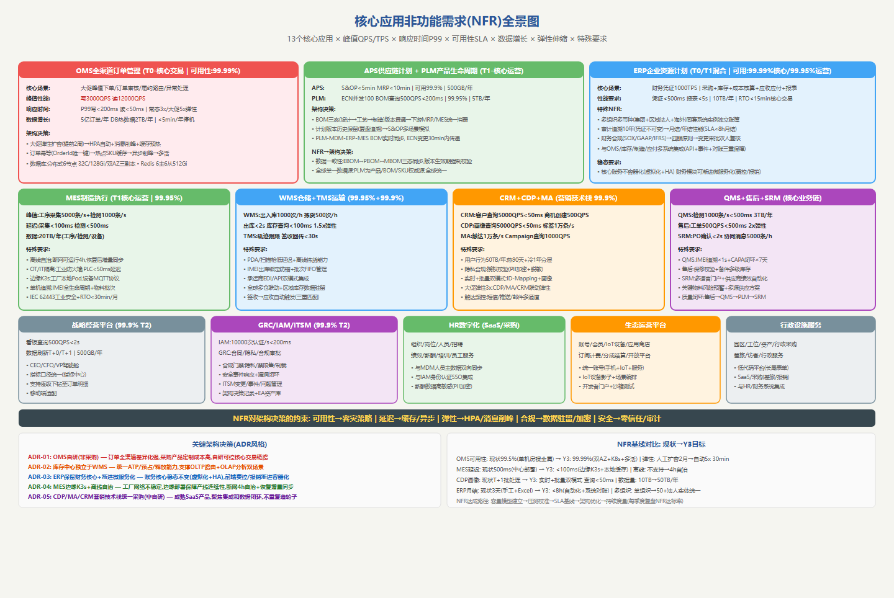</p>

> **新增说明**：本节为P1-4优化项新增内容。为13个核心应用系统定义NFR基线，覆盖峰值QPS/TPS、响应时间P99、可用性SLA、数据增长、弹性伸缩和特殊架构要求，并提炼关键架构决策(ADR格式)。

### 4.7.1 NFR总览

核心应用按业务关键性分三级：

| NFR等级 | 应用 | 峰值QPS/TPS | P99延迟 | 可用性 | 弹性 |
|---------|------|-----------|---------|--------|------|
| T0-核心交易 | OMS | 写3000/读12000QPS | 写&lt;200ms/读&lt;50ms | 99.99% | 5x大促 |
| T0-核心交易 | ERP(财务核心) | 凭证1000TPS | &lt;500ms | 99.99% | N/A(稳态) |
| T1-核心运营 | MES | 工序采集5000条/s | &lt;100ms | 99.95% | 离线自治 |
| T1-核心运营 | WMS | 出入库1000次/h | &lt;2s | 99.95% | 1.5x |
| T1-核心运营 | CRM | 查询5000QPS | &lt;50ms | 99.95% | 2x |
| T2-重要 | CDP/MA | 查询5000QPS | &lt;50ms | 99.9% | 3x |
| T2-重要 | 售后/SRM | 500~1000QPS | &lt;500ms | 99.9%/99.95% | 1.5x~2x |

### 4.7.2 关键架构决策(ADR)

基于NFR分析，提炼5个关键架构决策：

1. **ADR-01**: OMS全渠道订单管理自研(非采购)—全渠道差异化强,采购产品定制成本高,自研可控核心交易链路
2. **ADR-02**: 库存中心独立于WMS—统一ATP/预占/释放能力,支撑OLTP路由+OLAP分析双场景
3. **ADR-03**: ERP保留财务核心+渐进微服务化—账务核心稳态不变,前端费控/报销渐进容器化
4. **ADR-04**: MES边缘K3s+离线自治—工厂网络不稳定,边缘部署保障产线连续性,断网4h自治
5. **ADR-05**: CDP/MA/CRM营销技术栈统一采购—成熟SaaS产品,聚焦集成和数据闭环

**附件**：[附件4-8 核心应用NFR需求表](./附件/附件4-8_核心应用NFR需求表.xlsx)
### 4.7.3 全核心应用NFR基线表

| 应用 | 峰值QPS/TPS | P99延迟 | 可用性 | 数据增长/年 | 弹性 | 特殊要求 |
|---|---|---|---|---|---|---|
| OMS | 写3000/读12000 QPS | 写<200ms/读<50ms | 99.99% | 5亿订单/2TB | 5x | 大促弹性+幂等+异步削峰 |
| PLM | ECN并发100/BOM查询500QPS | BOM查询<200ms/ECN<2s | 99.95% | 设计文件5TB | N/A | EBOM→MBOM三态同步+单一产品数据源 |
| APS | MRP批处理 | S&OP<5min/MRP<10min | 99.9% | 预测计划500GB | N/A | 计划版本历史保留+BOM版本追溯 |
| SRM | PO 1000QPS/协同消息5000条/h | PO确认<2s/ASN<5s | 99.9% | 供应商/PO/ASN 1TB | 1.5x | 多语言门户+EDI/API双模式 |
| ERP | 凭证1000TPS/报表查询500QPS | 凭证<500ms/报表<5s | 99.99%(财务)/99.95%(运营) | 财务凭证+采购 10TB | N/A | 多组织多币种+审计追溯10年+月结<8h |
| MES | 工序采集5000条/s/检测1000条/s | 采集<100ms/检测<500ms | 99.95% | 工序/检测/设备 20TB | N/A | 离线自治4h+OT/IT隔离+边缘K3s |
| QMS | 检测记录1000条/s/CAPA查询200QPS | 检测<500ms/追溯<1s | 99.9% | 检测/CAPA 3TB | N/A | IMEI全链路追溯+CAPA闭环<7天 |
| WMS | 出入库1000次/h/拣货500次/h | 出库<2s/库存查询<100ms | 99.95% | 库存流水2TB | 1.5x | PDA防错+离线拣货+IMEI出库绑定 |
| TMS | 签收回传500QPS/轨迹查询1000QPS | 签收<30s/轨迹<2s | 99.9% | 轨迹/运单 2TB | N/A | 多承运商EDI+GPS轨迹实时推送 |
| CRM | 客户查询5000QPS/商机创建500QPS | 查询<50ms/创建<200ms | 99.95% | 客户/渠道/商机500GB | 2x | 客户360视图聚合+GDPR数据隔离 |
| CDP | 画像查询5000QPS/标签写入10000条/s | 查询<50ms/标签<5s | 99.9% | 行为日志50TB | 3x | 实时+批量双模式+隐私授权校验 |
| MA | 触达10000条/s/Campaign查询1000QPS | 触达<5s/查询<200ms | 99.9% | 触达/Campaign 2TB | 2x | 多通道(短信/推送/邮件)+频控防骚扰 |
| 售后平台 | 工单500QPS/查询2000QPS | 工单<500ms/查询<100ms | 99.95% | 工单/维修/备件1TB | 2x | IMEI保修校验+备件多级库存 |
| 生态平台 | 账号认证5000QPS/内容查询2000QPS | 认证<200ms/查询<100ms | 99.9% | 用户/内容/设备5TB | 2x | 亿级用户规模+IoT设备影子+OTA升级 |

---

## 4.8 LTC事件目录与事件驱动集成【新增P2-2】

<p align="center">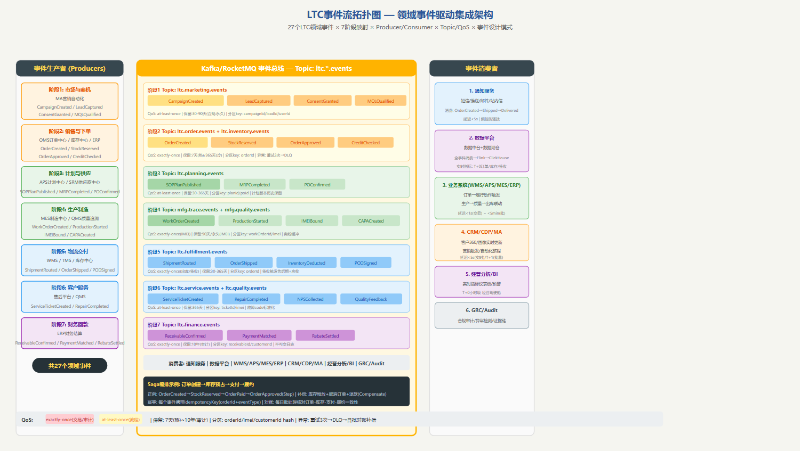</p>

> **新增说明**：本节为P2-2优化项新增内容。建立LTC全链路27个领域事件的完整目录，定义事件schema、生产者/消费者、Topic/QoS要求和异常处理策略。

### 4.8.1 事件分类与QoS

| QoS级别 | 事件数量 | 典型事件 | 延迟要求 | 保留策略 |
|---------|---------|---------|---------|---------|
| exactly-once | 10个 | OrderCreated/StockReserved/ReceivableConfirmed/IMEIBound | &lt;500ms | 交易7天/审计10年 |
| at-least-once | 17个 | CampaignCreated/MQL/CAPA/NPS/质量反馈 | &lt;5s | 30天~365天 |

### 4.8.2 关键事件链

LTC核心事件链：OrderCreated→StockReserved→OrderApproved→(SOPPlanPublished→MRPCompleted)→WorkOrderCreated→IMEIBound→OrderShipped→PODSigned→ReceivableConfirmed→PaymentMatched→RebateSettled

### 4.8.3 Saga编排

跨服务长事务采用Saga模式：
- **正向**: OrderCreated→StockReserved→OrderPaid→OrderApproved(Step)
- **补偿**: 库存释放+取消订单+退款(Compensate)
- **幂等**: 每个事件携带idempotencyKey(orderId+eventType)

**附件**：[附件4-9 LTC事件目录](./附件/附件4-9_LTC事件目录.xlsx)

---

## 4.9 应用治理与演进

<p align="center">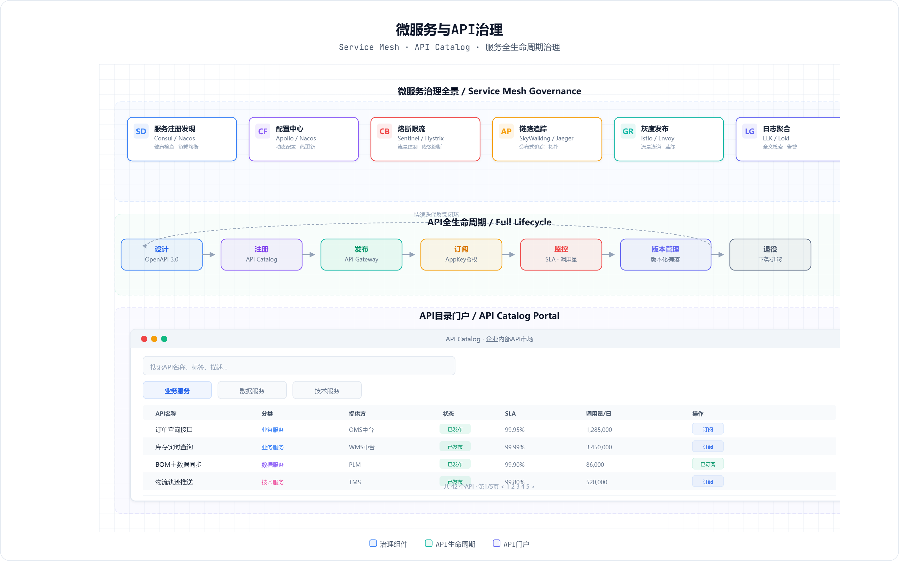</p>

<p align="center">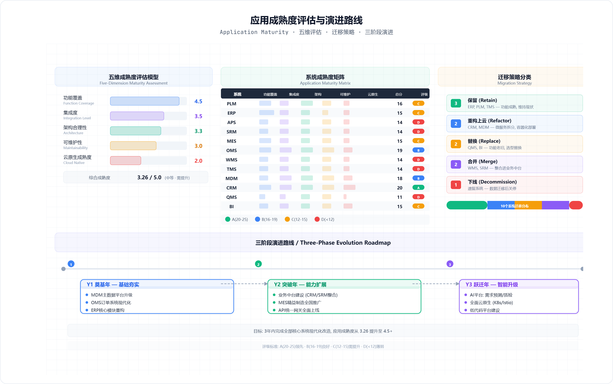</p>

<p align="center">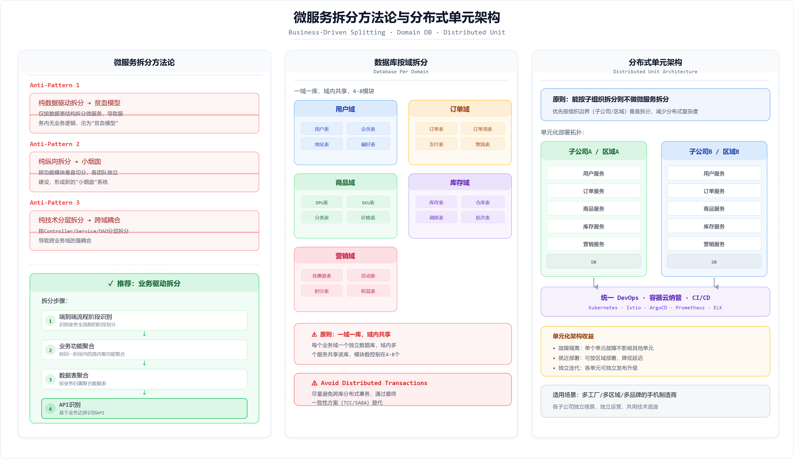</p>

| 治理主题 | 规划要求 | 关键机制 |
|---|---|---|
| 应用组合治理 | 应用必须有业务Owner、技术Owner、生命周期状态和能力覆盖关系 | 应用组合台账、年度评审、重复能力清理 |
| API治理 | 接口先于开发设计，统一命名、版本、鉴权、SLA和监控 | API网关、OpenAPI规范、服务目录 |
| 数据Owner治理 | 应用不得绕过权威Owner自建主数据 | MDM订阅、数据模型评审、CRUD矩阵 |
| 中台能力治理 | 能力中心按共享对象和API运营，避免变成新烟囱 | 能力中心Owner、服务SLA、消费统计 |
| 云原生演进 | 面向消费者和中台服务优先云原生，ERP/MES等稳态系统渐进改造 | 容器化、DevOps、可观测、灰度发布 |
| 低代码治理 | 低代码用于流程、表单、填报和轻量应用，不承载复杂核心交易规则 | 对象建模、权限、数据标准、源码和接口可控 |

**附件**：[附件4-5 应用成熟度评估表](./附件/附件4-5_应用成熟度评估表.xlsx)
---

## 4.10 本章小结

本章将应用架构调整为业务架构和数据架构的落地实现：先说明平台+应用构建模式，再分开规划应用功能架构和应用集成架构。应用功能规划对齐第2章L3业务能力组，形成覆盖研发、供应链、制造、营销、销售、服务、生态、人力、财务、合规、安全、IT、行政的应用组合；业务能力中心围绕客户、商品、订单、库存、价格促销、计划、供应商、制造、质量追溯、服务、财务结算、合规风控、项目等共享对象拆分，并给出API清单；上层IT应用一级功能明确引用哪些能力中心能力；LTC流程进一步补齐数据读/产标记和API依赖，为应用集成、服务目录和实施路线图提供直接依据。

新增内容方面：核心应用NFR需求表(附件4-8)为OMS/APS/PLM/MES/WMS/CRM/CDP/MA/ERP/售后/SRM等13个核心应用定义了峰值QPS、响应时间P99、可用性SLA、数据增长、弹性伸缩倍数和特殊NFR要求，并提炼5个关键架构决策(ADR风格)；LTC事件目录(附件4-9)定义了覆盖LTC 7阶段的27个领域事件(EventID/Schema/Producer/Consumer/QoS/保留策略/异常处理)，并补充了事件流拓扑(Kafka Topic/分区策略/消费模式/SLA端到端延迟)，为事件驱动集成架构的落地提供了完整的事件规格基线。

> 下一章（第5章 技术架构）应承接本章的API网关、事件总线、数据集成、云原生运行和可观测要求，规划支撑平台+应用模式的技术底座。

---

## 第4章配图索引

| 编号 | 配图名称 | 文件链接 |
|---|---|------|
| 图4-1 | 平台+应用总体架构 | [html/图4-1_应用架构蓝图.html](./html/图4-1_应用架构蓝图.html) |
| 图4-2 | 应用组合地图 | [html/图4-2_应用组合地图.html](./html/图4-2_应用组合地图.html) |
| 图4-3 | 应用功能覆盖矩阵 | [html/图4-3_应用功能矩阵.html](./html/图4-3_应用功能矩阵.html) |
| 图4-13 | 应用功能L2-L3-L4分解图 | [html/图4-13_应用功能L2L3L4分解图.html](./html/图4-13_应用功能L2L3L4分解图.html) |
| 图4-4 | 应用分层架构 | [html/图4-4_应用分层架构.html](./html/图4-4_应用分层架构.html) |
| 图4-9 | 业务能力中心架构 | [html/图4-9_业务中台架构.html](./html/图4-9_业务中台架构.html) |
| 图4-5 | 应用集成架构 | [html/图4-6_集成架构.html](./html/图4-6_集成架构.html) |
| 图4-6 | 核心业务系统交互与数据流图 | [html/图4-5_核心系统交互.html](./html/图4-5_核心系统交互.html) |
| 图4-7 | 微服务治理 | [html/图4-7_微服务治理.html](./html/图4-7_微服务治理.html) |
| 图4-8 | 应用成熟度 | [html/图4-8_应用成熟度.html](./html/图4-8_应用成熟度.html) |
| 图4-10 | 微服务拆分 | [html/图4-10_微服务拆分.html](./html/图4-10_微服务拆分.html) |
| 图4-11 | AI平台层 | [html/图4-11_AI平台层.html](./html/图4-11_AI平台层.html) |
| 图4-12 | 低代码平台 | [html/图4-12_低代码平台.html](./html/图4-12_低代码平台.html) |
| 图4-14 | LTC阶段活动-应用-数据-API明细矩阵 | [html/图4-14_LTC阶段活动应用数据API明细矩阵.html](./html/图4-14_LTC阶段活动应用数据API明细矩阵.html) |
| 图4-15 | 业务系统集成与数据流关系图 | [html/图4-15_业务系统集成与数据流关系图.html](./html/图4-15_业务系统集成与数据流关系图.html) |
| 图4-16 | 供应链应用三级功能架构图 | [html/图4-16_供应链应用三级功能架构图.html](./html/图4-16_供应链应用三级功能架构图.html) |
| 图4-17 | PLM三级功能架构图 | [html/图4-17_PLM三级功能架构图.html](./html/图4-17_PLM三级功能架构图.html) |
| 图4-18 | MES三级功能架构图 | [html/图4-18_MES三级功能架构图.html](./html/图4-18_MES三级功能架构图.html) |
| 图-核心应用NFR | 核心应用NFR全景图【新增P1-4】 | [html/图-核心应用NFR全景图.html](./html/图-核心应用NFR全景图.html) |
| 图-LTC事件流 | LTC事件流拓扑图【新增P2-2】 | [html/图-LTC事件流拓扑图.html](./html/图-LTC事件流拓扑图.html) |

## 第4章附件索引

| 编号 | 附件名称 | 文件地址 | 说明 |
|---|---|---|------|
| 附件4-1 | 应用系统清单 | [./附件/附件4-1_应用系统清单.xlsx](./附件/附件4-1_应用系统清单.xlsx) | 应用组合、业务域和规划策略 |
| 附件4-2 | 应用功能矩阵 | [./附件/附件4-2_应用功能矩阵.xlsx](./附件/附件4-2_应用功能矩阵.xlsx) | 应用一级功能与能力中心引用关系 |
| 附件4-3 | 核心应用系统需求规格索引 | [./附件/附件4-3_核心应用系统需求规格索引.xlsx](./附件/附件4-3_核心应用系统需求规格索引.xlsx) | 核心应用一级功能说明 |
| 附件4-4 | 应用接口与集成清单 | [./附件/附件4-4_应用接口与集成清单.xlsx](./附件/附件4-4_应用接口与集成清单.xlsx) | 能力中心API和关键集成链路 |
| 附件4-5 | 应用成熟度评估表 | [./附件/附件4-5_应用成熟度评估表.xlsx](./附件/附件4-5_应用成熟度评估表.xlsx) | 应用治理和演进评估 |
| 附件4-6 | 中台与微服务拆分设计 | [./附件/附件4-6_中台与微服务拆分设计.xlsx](./附件/附件4-6_中台与微服务拆分设计.xlsx) | 业务能力中心和数据能力中心规划 |
| 附件4-7 | LTC流程应用数据API映射 | [./附件/附件4-7_LTC流程应用数据API映射.xlsx](./附件/附件4-7_LTC流程应用数据API映射.xlsx) | LTC阶段活动、读/产数据、API和承载应用 |
| 附件4-8 | 核心应用NFR需求表【新增P1-4】 | [./附件/附件4-8_核心应用NFR需求表.xlsx](./附件/附件4-8_核心应用NFR需求表.xlsx) | 13个核心应用NFR基线和架构决策 |
| 附件4-9 | LTC事件目录【新增P2-2】 | [./附件/附件4-9_LTC事件目录.xlsx](./附件/附件4-9_LTC事件目录.xlsx) | LTC 27个领域事件规格和拓扑 |
