# 第5章 技术架构（Phase D：技术架构）

> **文档归属**：《手机厂商企业架构总体规划》第 5 章
> **对应 TOGAF ADM 阶段**：D 阶段（技术架构，Technology Architecture）
> **章节目标**：承接第4章平台+应用、业务能力中心、API、应用集成和LTC流程应用数据API映射，规划支撑这些应用落地的技术中台、微服务开发框架、IT基础设施、私有云数据中心、企业网络、安全容灾和资源测算模型。
> **参考文档融合**：本章吸收参考文档中“技术架构不应停留在IaaS基础设施，还必须纳入PaaS技术中台”“技术中台按开发平台、执行平台、运维监控平台和DevOps划分”“微服务治理覆盖设计期和运行期”“低代码平台必须具备对象建模、API开放、云原生部署和DevOps集成”等观点，并结合手机制造企业应用架构落地。
> **核心展开原则**：技术架构=IT基础设施架构+云原生技术中台+微服务开发框架+集成与运维平台+安全容灾体系。所有技术规划都必须能支撑第4章的PLM、APS、SRM、ERP、MES、CDP、MA、CRM、OMS、WMS、TMS、售后、HR、财务、GRC和能力中心API。
> **配套附件**：[附件5-1 基础设施资产清单](./附件/附件5-1_基础设施资产清单.xlsx)、[附件5-2 云平台资源规划表](./附件/附件5-2_云平台资源规划表.xlsx)、[附件5-3 安全合规检查清单](./附件/附件5-3_安全合规检查清单.xlsx)、[附件5-4 容灾备份策略表](./附件/附件5-4_容灾备份策略表.xlsx)、[附件5-5 技术选型标准清单](./附件/附件5-5_技术选型标准清单.xlsx)、[附件5-6 云原生技术中台规划](./附件/附件5-6_云原生技术中台规划.xlsx)、[附件5-7 基础设施资源测算模型](./附件/附件5-7_基础设施资源测算模型.xlsx)、[附件5-8 微服务开发框架与组件选型](./附件/附件5-8_微服务开发框架与组件选型.xlsx)、[附件5-9 技术中台SLA定义](./附件/附件5-9_技术中台SLA定义.xlsx)【新增P2-3】

---

## 5.1 技术架构定位

<p align="center">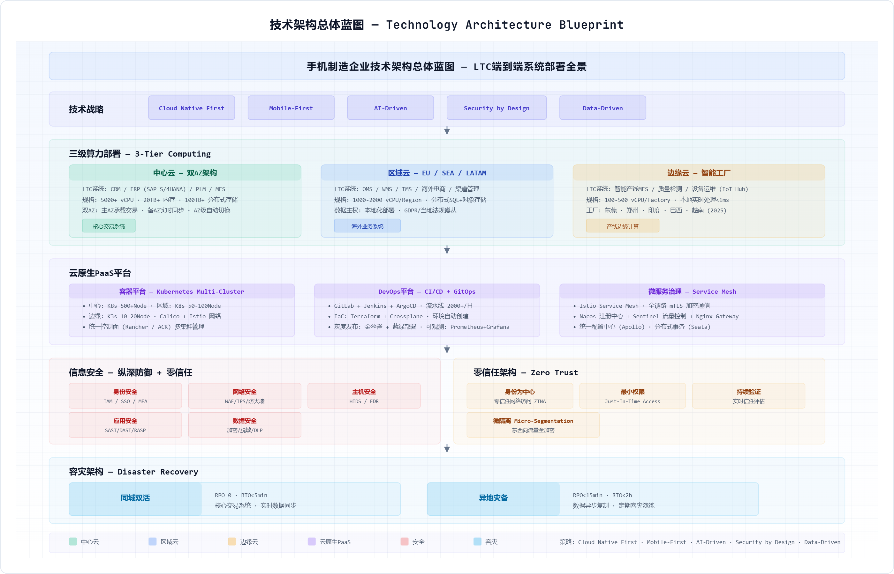</p>

<p align="center">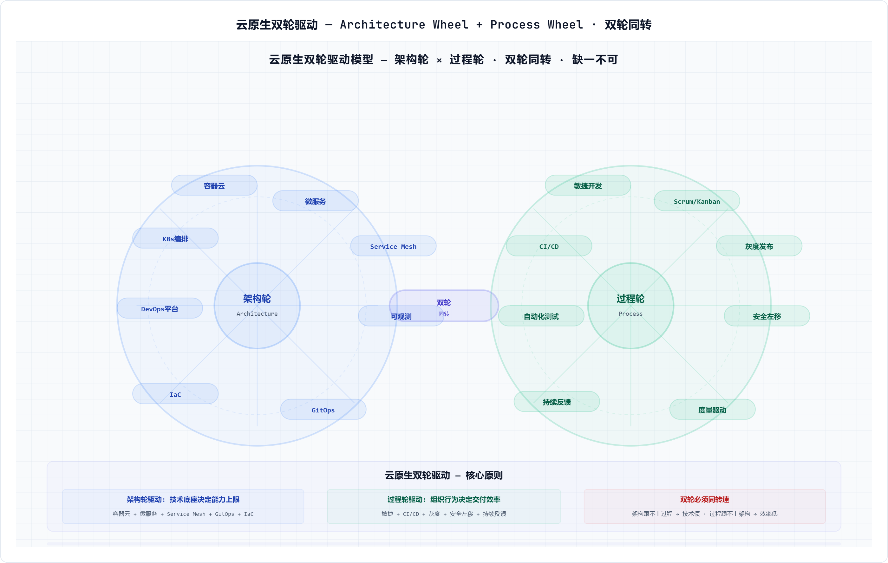</p>

传统技术架构容易只关注服务器、存储、网络、数据库和中间件部署，这只能解决“应用跑在哪里”的问题。按照当前项目的应用架构，企业还需要业务能力中心、数据能力中心、API网关、事件总线、低代码平台、DevOps、微服务治理和可观测能力，因此技术架构必须从IaaS基础设施上升到PaaS技术中台。

### 5.1.1 与应用架构的匹配关系

| 第4章应用架构诉求 | 第5章技术架构承接 | 技术能力 |
|---|---|---|
| 业务能力中心API | API网关、服务目录、微服务治理 | 鉴权、限流、熔断、版本、SLA、链路追踪 |
| 数据能力中心 | 数据技术底座和数据服务平台 | MDM、数据湖仓、Flink、ClickHouse、数据服务API |
| 平台+应用模式 | 云原生技术中台 | 开发平台、执行平台、运维平台、DevOps |
| OMS/WMS/TMS大促弹性 | 容器云和弹性伸缩 | K8s、HPA、弹性扩容、缓存、消息削峰 |
| MES/工厂边缘执行 | 边缘计算和工业网络 | K3s、边缘网关、工业防火墙、OT/IT隔离 |
| PLM/ERP/财务稳态核心 | 私有云双AZ和高可用数据库 | 虚拟化/容器混合、数据库集群、容灾备份 |
| GRC/IAM/安全要求 | 零信任和DevSecOps | 身份、最小权限、安全扫描、审计、DLP |
| 低代码和敏捷交付 | 低代码平台+DevOps流水线 | 对象建模、流程建模、源码导出、容器部署 |

### 5.1.2 技术架构设计原则

- **平台能力下沉**：消息、缓存、网关、认证、日志、监控、流程、规则、文件、搜索等共性技术能力不再由每个应用重复建设，而是由技术中台统一提供。
- **一次构建，多处运行**：应用交付物以镜像和Helm Chart为核心，从测试到生产使用同一制品，通过环境参数和声明式配置区分环境。
- **不可变基础设施**：容器实例上线后不做手工修改，变更通过新镜像、新配置和自动化发布完成，降低环境漂移风险。
- **API First和事件驱动**：同步查询走API，状态变化走事件，避免微服务之间形成不可控的网状同步调用。
- **技术和管理双轮驱动**：容器云、微服务和服务网格只是技术实践，必须同时建设敏捷、DevOps、变更、度量和运维治理流程。

### 5.1.2A 云原生设计关键原则【参考文档补充】

> **来源**：参考文档《云原生技术实践关键要素和原则》。以下原则从云原生实践出发，补充传统技术架构设计中容易忽略的关键约束。

#### CQRS命令查询职责分离

在高并发场景下，命令（写操作）和查询（读操作）的流量模式、延迟要求和扩展策略完全不同。CQRS将读写分离为独立服务：

| 维度 | 命令服务（Command） | 查询服务（Query） |
|------|-------------------|------------------|
| 典型场景 | 订单创建/库存预占/支付/应收确认 | 订单查询/订单列表/订单状态跟踪 |
| 性能要求 | 写<200ms，强一致性 | 读<50ms，最终一致性 |
| 扩展策略 | 垂直扩展（更快的CPU）+ 水平扩展（分片） | 水平扩展（Redis缓存+多副本） |
| 数据库 | OLTP（MySQL/PG）单一权威源 | Redis缓存+OLTP从库+OLAP（ClickHouse） |
| 手机制造示例 | OMS order-command-service | OMS order-query-service |

**CQRS对数据架构的影响**：查询服务的数据可以来自多个数据源的聚合视图（如订单详情=订单数据+客户数据+SKU数据+物流数据的聚合），查询库与命令库通过CDC异步同步，允许秒级延迟。

#### Service Mesh服务网格：开发与治理分离

微服务治理的复杂性（服务发现、负载均衡、熔断限流、灰度发布、mTLS、链路追踪）应从业务代码中剥离，下沉到Sidecar代理（如Istio/Envoy）中统一处理：

- **业务开发者**：只需关注业务逻辑，调用本地Sidecar（localhost:15000），无需在代码中集成治理SDK
- **平台运维者**：通过Istio控制面统一配置流量管理、安全策略和可观测规则
- **手机制造场景**：OMS大促弹性时，通过Istio配置流量拆分（v1.0 95% + v1.1灰度5%），业务代码零改动

#### 从资源依赖到服务依赖

后端资源（数据库、消息队列、缓存）应通过服务API抽象访问，而非应用直连：

- 数据库：应用不直连数据库IP:Port，而是通过数据服务API（如库存中心API /inventory/atp-query）访问
- 消息队列：应用不直连Kafka Broker，而是通过事件总线服务发布/订阅事件
- 缓存：应用不直连Redis，而是通过缓存服务接口访问

这种抽象的价值在于：当后端资源需要升级（如MySQL→TDSQL）、迁移（如自建Redis→云Redis服务）时，上游应用无需任何改动。

#### 可运维设计（Design for Operability）

每个微服务在交付时必须满足以下可运维基线，否则不得上线生产：

| 可运维维度 | 具体要求 | 工具/平台 |
|-----------|---------|----------|
| 健康检查 | 提供/health和/ready端点，K8s liveness/readiness探针 | Spring Boot Actuator |
| 指标暴露 | 暴露Prometheus metrics（QPS/延迟/错误率/JVM指标） | Prometheus + Grafana |
| 链路追踪 | 自动注入Trace ID，跨服务调用链路完整 | SkyWalking/Jaeger |
| 日志规范 | JSON格式，含traceId/spanId/application/level/timestamp | ELK/Loki |
| 依赖可视化 | 注册到服务目录，展示上下游依赖关系 | 服务目录+拓扑图 |
| 变更影响分析 | 变更前可评估影响的下游消费方 | ADR+架构资产库+变更影响矩阵 |

## 5.2 云原生技术中台总体架构

<p align="center">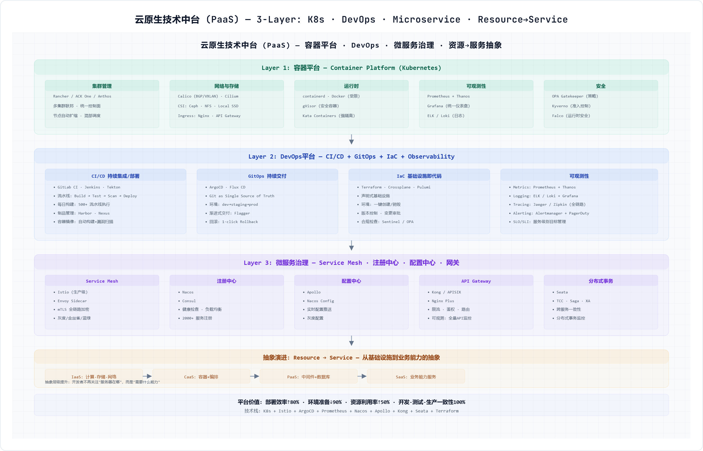</p>

云原生技术中台是第4章平台+应用模式的技术底座。它不是单一Kubernetes集群，而是覆盖开发态、运行态、运维态和安全态的PaaS能力集合。

### 5.2.1 技术中台子系统规划

| 平台层 | 子系统 | 技术选型/能力 | 核心职责 | 支撑应用场景 |
|---|---|---|---|---|
| 开发平台 | 微服务开发框架 | Spring Boot/Spring Cloud Alibaba、Go Kit、Node.js BFF | 统一脚手架、编码规范、依赖管理、接口契约、领域模板 | OMS、订单中心、库存中心、财务结算中心等自研服务 |
| 开发平台 | 企业级低代码平台 | 对象建模、数据建模、表单建模、流程建模、规则建模、API编排 | 面向流程、表单、填报和轻量应用；支持源码/部署包导出；接入DevOps和容器云 | 行政服务、费用申请、质量问题跟踪、渠道政策配置 |
| 开发平台 | API设计与服务目录 | OpenAPI、Swagger、API资产库、服务契约评审 | 接口先行、版本管理、Mock、契约测试、消费方管理 | 第4章能力中心API |
| 集成平台 | iPaaS集成平台 | API网关、ESB适配、连接器、ETL/CDC、BPM/流程编排 | 统一连接ERP/PLM/MES/OMS/WMS/外部伙伴，支持协议转换和流程编排 | PLM-BOM同步、订单到财务、供应商ASN、物流轨迹 |
| 执行平台 | 容器云平台 | Kubernetes、容器镜像仓库、Helm、CNI/CSI、多集群管理 | 支撑微服务、低代码应用、数据服务和AI服务统一部署运行 | OMS、CDP、MA、能力中心服务 |
| 执行平台 | 微服务治理平台 | 注册发现、配置中心、服务网格、熔断限流、灰度、mTLS、链路追踪 | 覆盖设计期服务契约和运行期服务治理，防止微服务网状失控 | 业务能力中心、上层应用微服务 |
| 执行平台 | 中间件服务平台 | Kafka/RocketMQ、Redis、Nacos、Search、文件、通知、规则引擎 | 以PaaS托管服务提供，多租户隔离、配额和SLA管理 | 事件总线、缓存、搜索、通知、规则计算 |
| 数据平台 | 数据技术底座 | MDM、数据湖仓、Flink、ClickHouse、数据服务API、特征平台 | 承接第3章数据架构，为应用提供数据服务、指标、标签和AI特征 | LTC数据映射、质量追溯、经营分析 |
| 运维平台 | DevOps平台 | GitLab/Jenkins、Maven/NPM、SonarQube、Harbor、ArgoCD、IaC | 一次构建多处运行，流水线自动完成构建、测试、镜像、部署、回滚 | 自研微服务和低代码应用 |
| 运维平台 | 可观测平台 | Prometheus、Grafana、ELK/Loki、Jaeger/SkyWalking、APM、告警 | 覆盖资源、容器、应用、接口、服务链和业务指标 | OMS路由、MES工序、API网关、数据库 |
| 安全平台 | DevSecOps与零信任 | SAST/DAST、镜像扫描、IAM、SSO/MFA、WAF、DLP、堡垒机 | 安全左移、最小权限、持续校验、东西向微隔离 | 用户PII、订单、财务、人力和生产控制 |

### 5.2.2 低代码平台纳入技术中台

企业级低代码平台不能被视为一个孤立工具。它必须具备对象建模、数据建模、权限建模、流程建模、规则建模和API编排能力，开发出的应用应支持前后端分离、容器化部署、源码或部署包导出，并纳入DevOps、API网关、IAM和可观测体系。低代码适合行政服务、费用申请、渠道政策配置、质量问题跟踪等变化快但规则可控的场景，不适合承载OMS核心交易、库存承诺、财务核算等复杂强一致核心逻辑。

### 5.2.3 iPaaS集成平台

iPaaS用于统一承接第4章应用集成架构，包括API网关、ESB适配、连接器、BPM流程编排、ETL/CDC和事件总线。对外部伙伴和轻量服务优先使用API网关；对ERP、PLM、MES、银行、承运商、税务等异构系统，保留ESB/iPaaS适配能力；对订单状态、库存预占、签收、质量异常等业务事件，采用Kafka/RocketMQ事件总线解耦。

**附件**：[附件5-6 云原生技术中台规划](./附件/附件5-6_云原生技术中台规划.xlsx)
---

## 5.3 微服务开发框架与技术组件选型

<p align="center">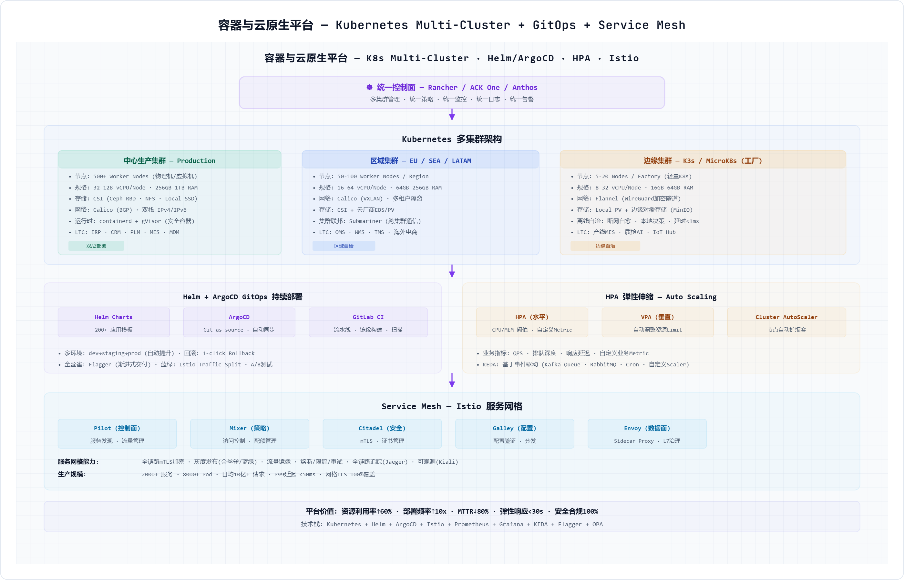</p>

微服务开发框架不仅是Spring Cloud或K8s运行环境，而是一套覆盖设计、开发、测试、发布、运行和治理的工程体系。参考文档强调微服务治理不能只理解为API治理，还包括微服务模块本身和微服务API接口两个对象的全生命周期管理。

### 5.3.1 微服务开发框架选型

| 技术领域 | 推荐选型 | 适用场景 | 选型理由 |
|---|---|---|---|
| 开发语言与框架 | Java/Spring Boot/Spring Cloud Alibaba | 企业核心交易、订单、库存、财务、供应链服务 | 生态成熟、团队储备足、适合复杂事务 |
| 开发语言与框架 | Go + Gin/Go Kit | 高并发网关、边缘代理、轻量服务 | 启动快、资源占用低、适合基础平台和高并发服务 |
| 前端框架 | Vue3/React + TypeScript | 前台应用、运营后台、低代码组件 | 前后端分离、组件化、类型安全 |
| BFF/API聚合 | Node.js/NestJS 或 Java BFF | App、门店POS、经销商门户聚合接口 | 隔离前端体验变化与后端稳定能力 |
| 服务注册配置 | Nacos/Consul + GitOps配置 | 微服务注册、配置、灰度参数 | 统一配置、动态刷新、环境隔离 |
| API网关 | APISIX/Kong/Spring Cloud Gateway | 南北向API、能力中心API、开放平台 | 鉴权、限流、路由、审计、版本治理 |
| 服务通信 | REST/gRPC + Async Event | 同步查询、内部高性能调用、异步事件 | 按场景选择，避免所有调用都同步化 |
| 消息事件 | Kafka/RocketMQ | 订单事件、库存事件、签收事件、质量事件 | 削峰填谷、解耦、事件驱动 |
| 事务一致性 | 本地事务+最终一致性+Saga/TCC | 订单-库存-支付-履约跨服务场景 | 优先避免分布式事务，必要时引入Saga |
| 缓存与限流 | Redis Cluster + Sentinel/Proxy | 热点商品、库存承诺、会话、幂等令牌 | 低延迟、高并发、保护后端 |
| 数据库 | MySQL/PostgreSQL/TDSQL/OceanBase | 核心OLTP交易、财务、订单、库存 | 按敏感度和可用性选择单机、主从或分布式 |
| 搜索与日志 | Elasticsearch/OpenSearch | 订单搜索、日志检索、服务知识库 | 全文检索和运维排障 |
| 可观测 | Prometheus/Grafana + SkyWalking/Jaeger + ELK/Loki | 指标、日志、链路、告警 | 支撑微服务运行期治理 |
| 容器与部署 | Kubernetes + Helm + ArgoCD | 微服务、低代码应用、数据服务部署 | 声明式部署、灰度、回滚、弹性 |

### 5.3.2 微服务设计与开发规范

- **服务边界来自业务组件和数据Owner**：第4章能力中心是微服务候选边界，服务拥有自己的核心数据对象，其他服务通过API或事件消费。
- **粗粒度优先，避免过度拆分**：传统单体优先拆为4-8个高内聚服务模块，避免一开始拆成几十个小服务导致分布式事务和运维灾难。
- **接口契约先行**：服务开发前必须定义OpenAPI、事件Schema、错误码、幂等键、版本策略和SLA。
- **数据库不共享写权限**：服务外部不得直接写入其他服务数据库，跨服务数据通过API、事件或数据服务同步。
- **前后端分离**：后端提供稳定业务能力，前端和BFF按场景组合能力，支持App、门店、经销商门户、运营后台差异化体验。
- **运行期治理闭环**：通过指标、日志、链路、告警、限流、熔断、降级和容量水位形成服务健康度度量。

**附件**：[附件5-8 微服务开发框架与组件选型](./附件/附件5-8_微服务开发框架与组件选型.xlsx)
---

## 5.4 IT基础设施需求测算模型

基础设施规划不能从“买多少服务器”开始，而要从第4章应用非功能需求开始：业务峰值、接口QPS、响应时间、数据增长、留存期、可用性、容灾等级和安全等级共同决定计算、存储、网络和数据库资源。

### 5.4.1 测算方法

| 步骤 | 测算内容 | OMS示例 |
|---|---|---|
| 1. 业务规模输入 | 峰值订单量、日订单量、在线用户、接口调用量、数据留存期 | 大促峰值订单100万/小时，订单创建峰值QPS=3000 |
| 2. 交易链路拆解 | 将业务请求拆为API、服务、数据库、缓存、消息、外部调用 | 下单=价格计算+库存ATP+订单创建+库存预占+支付回调 |
| 3. 单请求资源画像 | 通过压测或基准估计每次请求CPU毫核、内存、DB读写、消息条数 | 订单创建服务单请求约15ms CPU、5次DB写、2条事件 |
| 4. 峰值并发计算 | QPS × 平均响应时间 = 并发；再叠加安全系数 | 3000QPS×0.2s=600并发，按2倍冗余=1200并发 |
| 5. 应用Pod测算 | 单Pod可承载QPS、CPU/内存限制、目标水位 | 单Pod 100QPS，峰值3000QPS需30Pod，按N+1和灰度预留取40Pod |
| 6. 数据库测算 | TPS、连接数、数据增长、索引、读写比例、HA副本 | 订单库峰值写TPS 3000，3副本，热数据2年 |
| 7. 存储测算 | 业务数据+索引+日志+备份+副本+增长率 | 订单明细1KB/行，年5亿行约500GB，含索引备份副本按4倍=2TB |
| 8. 网络测算 | 入口流量、东西向调用、跨AZ复制、备份流量 | API入口500Mbps，服务东西向按入口3倍预留 |
| 9. 高可用冗余 | AZ级容灾、N+1、峰值弹性和容量水位 | 生产按双AZ部署，每AZ可独立承载60%峰值 |

### 5.4.2 OMS系统资源测算样例

| 测算项 | 假设/算法 | 资源建议 |
|---|---|---|
| 业务假设 | 日常订单20万/日，大促订单300万/日；峰值订单创建3000QPS，订单查询12000QPS；平均订单保留热数据2年 | 用于确定计算、数据库、缓存和存储基线 |
| 应用服务 | 订单创建、订单审核、订单状态、履约路由、异常处理5类核心服务；单Pod目标承载100QPS写或300QPS读 | 写服务约40Pod，读服务约50Pod，合计预留120Pod含灰度和冗余 |
| CPU内存 | 每Pod request 1C/2Gi，limit 2C/4Gi；目标CPU水位60% | 应用层约120C request、240Gi request，峰值limit约240C/480Gi |
| 数据库 | 订单写TPS 3000，订单查询读TPS 12000；订单、订单行、状态流水、异常单拆库分表 | 分布式数据库6节点起步，每节点32C/128Gi，双AZ三副本 |
| 缓存 | 热点订单状态、库存预占幂等、会话和限流令牌 | Redis Cluster 6主6从，内存按热Key和峰值会话估算512Gi起步 |
| 消息 | 订单已创建、已支付、已预占、已出库、已签收等事件 | Kafka 3-5 Broker，按峰值事件2万条/秒和7天保留测算 |
| 存储 | 订单与订单行2年热数据、状态流水、审计日志、接口日志 | 结构化热数据约5-8TB，日志按30天热存+1年冷存约20TB |
| 网络 | 入口API、服务间调用、跨AZ同步、数据同步 | 入口带宽1Gbps起步，东西向和跨AZ按3-5Gbps预留 |

该测算只是企业架构阶段的容量基线，实施阶段必须通过压测校准。建议建立“业务指标-技术指标-资源指标”的容量模型：业务侧输入订单量、并发用户、峰值倍率；应用侧输出服务QPS、响应时间和错误率；基础设施侧输出CPU、内存、数据库TPS、存储、网络和Pod数量。

**附件**：[附件5-7 基础设施资源测算模型](./附件/附件5-7_基础设施资源测算模型.xlsx)
---

## 5.5 IT基础设施与私有云数据中心部署架构

<p align="center">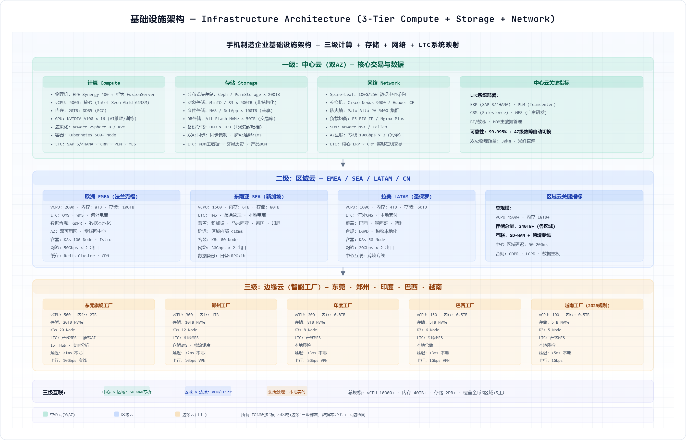</p>

<p align="center">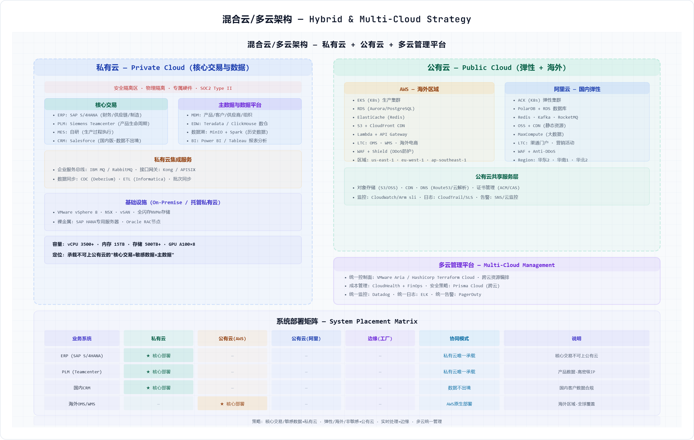</p>

基础设施架构仍然是技术架构的重要组成部分，但它不再孤立存在，而是承载云原生技术中台、核心业务系统、数据平台和安全运维体系。

### 5.5.1 企业内部基础设施网络规划

| 网络/区域 | 部署范围 | 承载对象 | 规划说明 |
|---|---|---|---|
| 园区办公网 | 总部/研发园区/区域办公室 | 办公终端、OA、研发访问、会议协作 | 核心-汇聚-接入三层，Wi-Fi6/7，NAC准入，办公网与生产网隔离 |
| 研发测试网 | 研发中心/测试实验室 | 代码仓库、测试环境、仿真、CI构建 | 与办公网逻辑隔离，接入DevOps和制品库，敏感代码访问审计 |
| 生产制造网 | 工厂/产线/设备区 | MES、设备、AOI、PLC、工业网关 | OT/IT分区，工业防火墙，边缘K3s，产线低延迟和离线自治 |
| 数据中心核心网 | 总部双数据中心 | 私有云、数据库、存储、K8s、ERP、OMS、MES中心服务 | Spine-Leaf，25/100G，东西向高带宽，微隔离 |
| DMZ与开放区 | 互联网出口/伙伴接入区 | 官网、电商、API开放、供应商/经销商门户 | WAF、DDoS、API网关、反向代理、零信任访问 |
| 广域互联 | 总部-工厂-区域-海外 | SD-WAN、专线、VPN、公有云互联 | 多链路冗余，QoS，区域数据驻留，云专线 |
| 安全管理网 | 运维堡垒/SOC/备份区 | 堡垒机、日志审计、SOC、备份、灾备 | 独立管理平面，最小权限，运维全审计 |

### 5.5.2 私有云数据中心分区部署

| 数据中心区域 | 核心组件 | 承载系统/能力 | 安全与部署要求 |
|---|---|---|---|
| 互联网接入区 | CDN、WAF、DDoS、防刷、公网SLB | 官网、电商、App API、开放平台入口 | 只暴露必要端口，所有请求进入API网关 |
| DMZ/API开放区 | API网关、伙伴网关、反向代理、BFF | 供应商、经销商、承运商、开发者接口 | 与核心区隔离，访问需鉴权、限流和审计 |
| 应用服务区 | K8s业务集群、微服务、低代码运行环境 | OMS、CRM、MA、售后、能力中心服务 | 按业务域命名空间隔离，服务间mTLS |
| 企业核心系统区 | ERP、PLM、MES中心、财务、HR、GRC | 稳态核心系统和商业套件 | 高可靠、严格变更、数据库独立保护 |
| 数据平台区 | MDM、数据湖仓、Flink、ClickHouse、标签、指标 | 第3章数据能力中心 | 数据分级、血缘、访问审批 |
| 中间件服务区 | Kafka、Redis、Nacos、Search、文件、通知 | 共享PaaS中间件服务 | 多租户隔离、配额、监控和备份 |
| 数据库区 | OLTP数据库、分布式数据库、备份库 | 订单、库存、财务、人力、主数据 | 东西向访问白名单，透明加密和审计 |
| 运维管理区 | 堡垒机、监控、日志、制品库、DevOps、SOC | 运维和安全管理平面 | 独立账号体系，操作全审计 |
| 备份灾备区 | 备份服务器、对象存储、WORM、异地复制 | 备份、归档、灾备演练 | 3-2-1备份，不可变备份 |

### 5.5.3 中心云、区域云和边缘云

| 算力层级 | 部署位置 | 承载应用 | 技术要求 |
|---|---|---|---|
| 中心私有云 | 总部双数据中心/双AZ | ERP、PLM、OMS核心、数据平台、能力中心、财务 | 高可用、统一PaaS、同城双活、数据安全 |
| 区域云 | 海外区域/大区节点 | 区域OMS、CRM、WMS、内容服务、数据驻留服务 | 低延迟、合规驻留、中心联邦治理 |
| 工厂边缘云 | 工厂机房/产线边缘节点 | MES边缘、IIoT、AOI、设备采集、边缘质量分析 | 离线自治、低延迟、工业网络隔离 |
| 门店边缘节点 | 大型门店/体验店 | POS、O2O自提、轻量库存、门店服务 | 断网可售、数据回传、轻量容器或本地缓存 |

**附件**：[附件5-1 基础设施资产清单](./附件/附件5-1_基础设施资产清单.xlsx)、[附件5-2 云平台资源规划表](./附件/附件5-2_云平台资源规划表.xlsx)

---

## 5.6 安全、容灾与运行治理

<p align="center">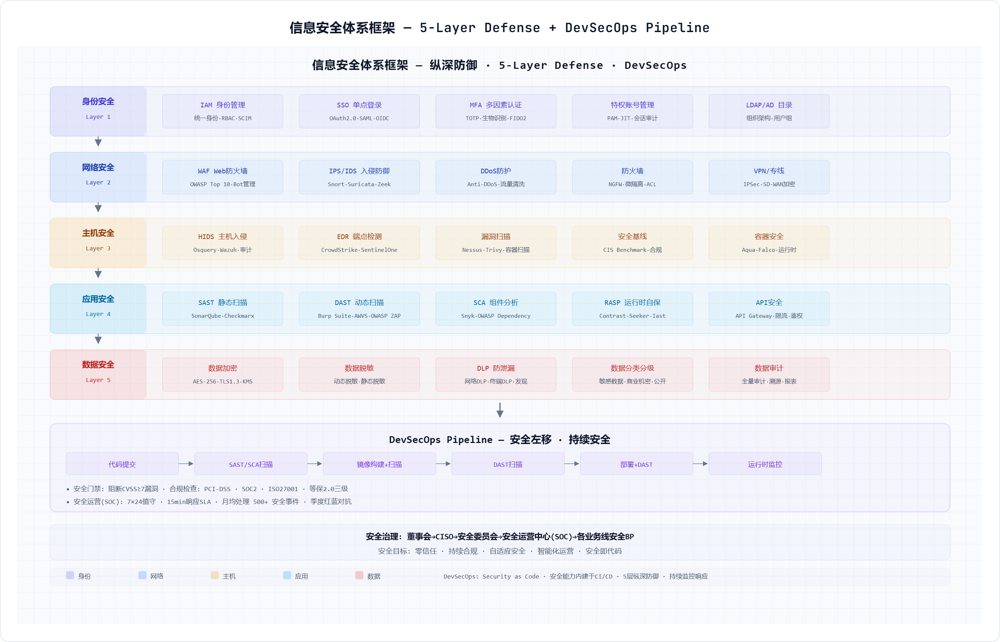</p>

<p align="center">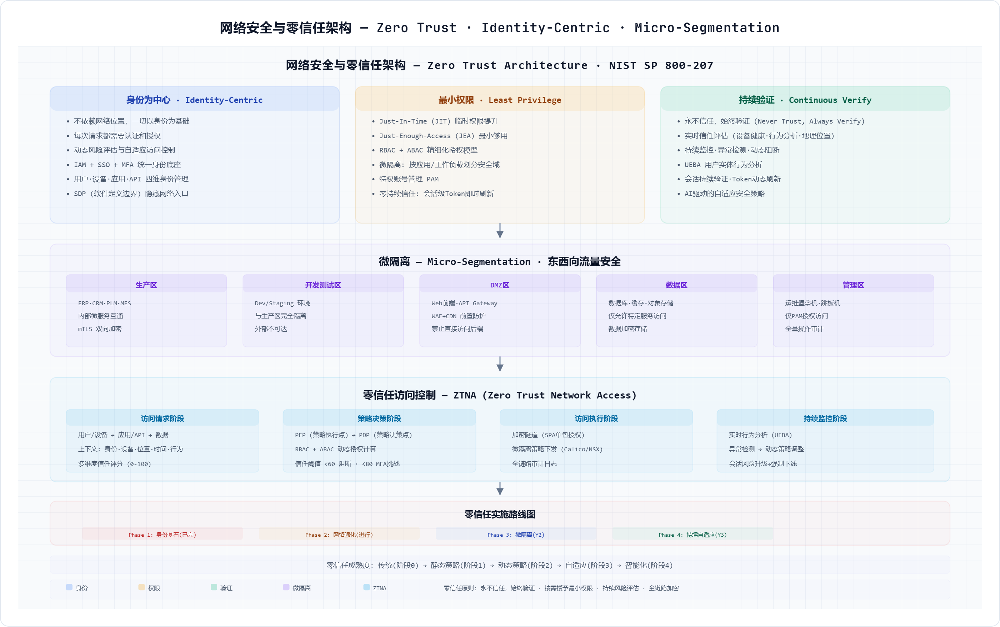</p>

<p align="center">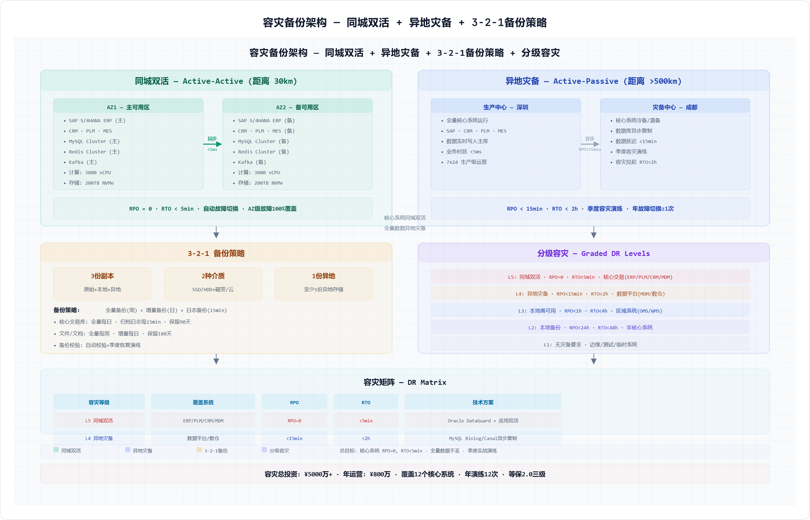</p>

### 5.6.1 安全架构

| 安全层 | 能力 | 关键措施 |
|---|---|---|
| 身份安全 | 统一身份、SSO、MFA、最小权限 | IAM、RBAC/ABAC、定期权限复核、离职自动回收 |
| 网络安全 | 南北向和东西向防护 | WAF、DDoS、微隔离、零信任访问、工业防火墙 |
| 应用安全 | 安全左移和运行保护 | SAST、DAST、依赖扫描、镜像扫描、RASP/API防刷 |
| 数据安全 | 分类分级、加密、脱敏、审计 | PII加密、行列级权限、DLP、数据访问审计 |
| 运维安全 | 堡垒、审计、变更和密钥管理 | 堡垒机、Secrets管理、操作审计、双人复核 |
| 安全运营 | 监控、响应和持续改进 | SOC、SIEM、EDR、漏洞闭环、演练复盘 |

### 5.6.2 容灾备份

| 系统等级 | 典型系统 | RTO/RPO目标 | 容灾策略 |
|---|---|---|---|
| T0核心交易 | OMS、库存中心、支付/应收、API网关 | RTO<15min, RPO≈0 | 同城双活+异地灾备+全链路演练 |
| T1核心运营 | ERP、PLM、MES中心、WMS、财务 | RTO<1h, RPO<15min | 主备/双AZ+异地复制 |
| T2重要管理 | HR、GRC、ITSM、低代码平台 | RTO<4h, RPO<4h | 异地备份+冷/温备 |
| T3一般应用 | 行政、报表、测试环境 | RTO<24h, RPO<24h | 定期备份和按需恢复 |

**附件**：[附件5-3 安全合规检查清单](./附件/附件5-3_安全合规检查清单.xlsx)、[附件5-4 容灾备份策略表](./附件/附件5-4_容灾备份策略表.xlsx)

---

## 5.7 技术中台SLA定义矩阵【新增P2-3】

<p align="center">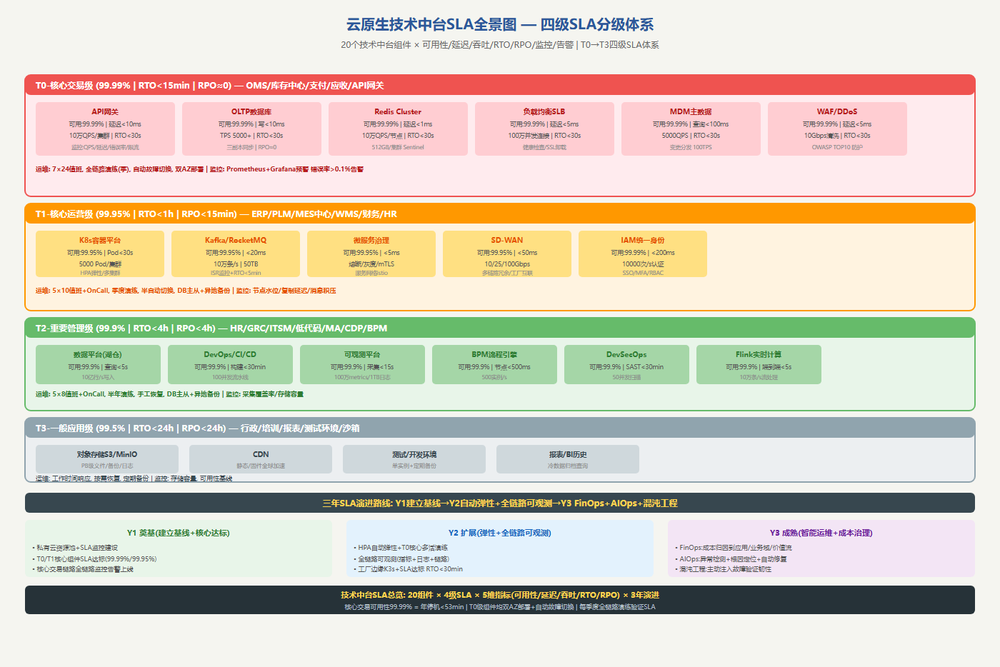</p>

> **新增说明**：本节为P2-3优化项新增内容。为云原生技术中台20个核心组件建立四级SLA矩阵(T0核心交易99.99%→T3一般应用99.5%)，每组件覆盖可用性/延迟/吞吐/RTO/RPO/监控/告警七维指标。

### 5.7.1 SLA四级分级体系

| SLA等级 | 可用性 | RTO | RPO | 典型组件 | 适用系统 |
|---------|--------|-----|-----|---------|---------|
| T0-核心交易 | 99.99% | &lt;15min | ≈0 | API网关/Redis/OLTP/负载均衡/MDM/WAF | OMS/库存中心/支付/应收 |
| T1-核心运营 | 99.95% | &lt;1h | &lt;15min | K8s/Kafka/微服务治理/SD-WAN/IAM | ERP/PLM/MES/WMS/HR |
| T2-重要管理 | 99.9% | &lt;4h | &lt;4h | 数据平台/DevOps/可观测/BPM/DevSecOps/Flink | CDP/MA/GRC/ITSM |
| T3-一般应用 | 99.5% | &lt;24h | &lt;24h | 对象存储/CDN/测试环境 | 行政/报表/沙箱 |

### 5.7.2 关键组件SLA指标(示例)

| 组件 | 可用性 | 延迟P99 | 吞吐上限 | RTO | RPO |
|------|--------|---------|---------|-----|-----|
| API网关 | 99.99% | &lt;10ms | 10万QPS | &lt;30s | N/A |
| Redis Cluster | 99.99% | &lt;1ms | 10万QPS/节点 | &lt;30s | N/A(缓存) |
| OLTP数据库 | 99.99% | 写&lt;10ms/读&lt;5ms | TPS 5000+ | &lt;30s | ≈0(三副本) |
| Kafka/RocketMQ | 99.95% | &lt;20ms | 10万条/s | &lt;5min | &lt;1min |
| K8s容器平台 | 99.95% | Pod启动&lt;30s | 5000Pod/集群 | &lt;10min | N/A |

### 5.7.3 三年SLA演进

| 阶段 | SLA建设重点 | 验收标准 |
|------|------------|---------|
| Y1 奠基 | T0/T1核心组件SLA基线达标(99.99%/99.95%) | 全链路监控告警上线,自动故障切换 |
| Y2 扩展 | HPA自动弹性+全链路可观测+T0多活演练 | 核心LTC链路全链路可观测并自动弹性 |
| Y3 成熟 | FinOps成本归因+AIOps异常检测+混沌工程 | 容量成本可度量,故障自动恢复率&gt;80% |

**附件**：[附件5-9 技术中台SLA定义](./附件/附件5-9_技术中台SLA定义.xlsx)

---

## 5.8 OT/IT工业网络融合架构【新增-工厂场景】

手机制造工厂的MES-设备-PLC-SCADA之间的OT(运营技术)网络与IT(信息技术)网络融合是技术架构的关键难点。本节补充工业网络拓扑、安全分区、数据流向和边缘计算架构。

### 5.8.1 ISA-95 Purdue模型安全分区

采用国际标准ISA-95 Purdue模型将工厂网络分为五个层级,在OT和IT之间建立结构化安全边界:

| Purdue层级 | 名称 | 典型系统/设备 | 网络要求 | 安全控制 |
|---|---|---|---|---|
| Level 0 | 现场设备层 | 传感器/执行器/视觉相机/PLC/机器人 | 实时性<1ms,确定性通信 | 物理隔离,无直接网络接入 |
| Level 1 | 控制层 | PLC/DCS/CNC/SCADA RTU | 实时性<10ms,工业协议(Profinet/EtherCAT/Modbus) | 工业防火墙,仅允许预定义I/O信号 |
| Level 2 | 监控层 | SCADA/HMI/OPC-UA Server | 实时性<100ms,以太网 | 工业DMZ,OPC-UA网关协议转换 |
| Level 3 | 制造运营层 | MES/WMS/QMS/EMS/IIoT平台 | 准实时<1s,标准以太网 | 工业防火墙+微隔离,南北向API白名单 |
| Level 3.5 | 工业DMZ | OPC-UA Gateway/边缘K3s/数据缓冲/协议转换 | 标准以太网 | OT→IT单向数据推送,物理或逻辑隔离 |
| Level 4 | 企业IT层 | ERP/PLM/SRM/数据中台/私有云 | 企业骨干网 | 标准IT安全(防火墙/WAF/IAM/零信任) |

### 5.8.2 OT/IT融合网络拓扑

```
                          ┌─────────────────────────────────────────┐
                          │           Level 4: 企业IT网络              │
                          │   ┌─────────┐  ┌──────────┐  ┌────────┐  │
                          │   │ERP/PLM/ │  │私有云K8s │  │数据中台│  │
                          │   │  SRM    │  │(中心MES) │  │/数据湖 │  │
                          │   └────┬────┘  └────┬─────┘  └───┬────┘  │
                          └────────┼────────────┼──────────────┼──────┘
                                   │            │              │
                          ┌────────┼────────────┼──────────────┼──────┐
                          │        │    Level 3.5: 工业DMZ       │      │
                          │   ┌────┴────────────┴──────────────┴──┐   │
                          │   │  OPC-UA Gateway + 边缘K3s集群     │   │
                          │   │  - 协议转换(OPC-UA/MQTT→HTTP)    │   │
                          │   │  - 数据缓冲(断网续传)             │   │
                          │   │  - 本地规则引擎(实时告警)         │   │
                          │   │  - 工业防火墙(南北向ACL白名单)    │   │
                          │   └────┬────────────┬──────────────────┘   │
                          └────────┼────────────┼─────────────────────┘
                                   │            │
                          ┌────────┼────────────┼─────────────────────┐
                          │  Level 3: MES/SCADA制造运营层              │
                          │   ┌────┴────┐  ┌───┴──────────┐          │
                          │   │MES Server│  │SCADA/HMI     │          │
                          │   │工单/质量 │  │产线监控/报警 │          │
                          │   └────┬────┘  └───┬──────────┘          │
                          └────────┼────────────┼─────────────────────┘
                                   │            │
                          ┌────────┼────────────┼─────────────────────┐
                          │  Level 1-2: 控制层+监控层                  │
                          │   ┌────┴────────────┴──────┐              │
                          │   │  OPC-UA Server/Edge IoT │              │
                          │   │  PLC/DCS/CNC Controller │              │
                          │   └────┬────────────┬──────┘              │
                          └────────┼────────────┼─────────────────────┘
                                   │            │
                          ┌────────┼────────────┼─────────────────────┐
                          │  Level 0: 现场设备层                        │
                          │  SMT贴片机/回流焊/AOI/组装机械臂            │
                          │  测试仪/AGV/传感器/视觉相机/RFID           │
                          └──────────────────────────────────────────┘
```

### 5.8.3 数据流向详解

**南向数据流 (设备→边缘→中心):**

| 数据流阶段 | 协议/技术 | 数据内容 | 带宽要求 | 延迟要求 |
|---|---|---|---|---|
| 设备→PLC | Profinet/EtherCAT/Modbus TCP | I/O信号/传感器数值/状态位 | 100Mbps | <1ms |
| PLC→SCADA | OPC-UA DA/Modbus TCP | 工序参数/报警信号/产量计数 | 100Mbps | <100ms |
| SCADA→边缘K3s | OPC-UA/MQTT | 聚合工序数据+质量检测结果+设备状态 | 1Gbps | <500ms |
| 边缘K3s→中心K8s | MQTT/Kafka(经OPC-UA Gateway协议转换) | 清洗后的工序/质量/设备/能耗数据 | 1Gbps(工厂级专线) | <1s(批量上送) |
| 中心→数据中台 | Kafka→Flink CDC | 进入数据湖+ClickHouse的分析视图 | 10Gbps(数据中心内) | <5s |

**北向数据流 (中心→边缘→设备):**

| 数据流阶段 | 数据内容 | 触发条件 | 延迟要求 |
|---|---|---|---|
| PLM→MES(中心)→MES(边缘) | BOM版本更新/工艺变更/ECN通知 | PLM变更审批后自动推送 | <5min |
| APS→MES(中心)→MES(边缘) | MPS/排产/工单 | S&OP发布后下发 | <5min |
| MES(中心)→MES(边缘)→设备 | 设备参数/贴片程序/测试程序/钢网型号 | 工单切换时自动下发 | <30s |
| QMS→MES→PLC | 质量标准/SPC控制限/AQL方案/CAPA措施 | 质量标准变更时 | <1h |

### 5.8.4 边缘K3s与中心K8s的分工

| 能力 | 边缘K3s(工厂本地) | 中心K8s(私有云) |
|---|---|---|
| 部署位置 | 工厂机房(物理服务器或HCI超融合) | 总部双数据中心/双AZ |
| 承载服务 | mes-edge-gateway/mes-workorder-svc/mes-quality-svc/离线数据库 | mes-center-orchestrator/mes-trace-service/mes-analytics/工厂级报表 |
| 离线能力 | 断网4h自治(本地数据库+消息缓冲),恢复后增量同步 | 无(依赖网络连接) |
| 数据持久化 | 本地PostgreSQL(7天热数据) | 分布式数据库(全量历史数据) |
| 横向扩展 | 每个工厂1-3个K3s节点 | 多集群联邦管理 |
| 运维 | 工厂IT团队日常运维,总部架构团队远程支持 | 总部平台工程团队 |

### 5.8.5 工业安全控制

| 安全层 | 控制措施 |
|---|---|
| Level 0-2 物理安全 | 机柜上锁/网口禁用未使用端口/无外接USB/无WiFi |
| Level 1-3 OT网络 | 工业防火墙(仅允许预定义工业协议端口)/南北向ACL白名单 |
| Level 3.5 工业DMZ | OPC-UA Gateway作为OT→IT单向数据推送的唯一通道,禁止IT→OT的反向主动连接 |
| Level 4 IT网络 | 标准零信任架构(第5.5-5.6节)/IAM/微隔离/API网关鉴权 |
| 远程运维 | 堡垒机+跳板机+操作审计录像+双人复核(关键操作须两人同时在线确认) |
| 安全监控 | OT SOC(安全运营中心)+工业IDS/IPS+工控漏洞扫描+OT资产发现 |

---

## 5.9 FinOps云成本治理模型【新增-建议2】

手机制造企业的IT资源需求呈现显著的峰谷特征——新品发布和大促(618/双11)需要弹性扩容,促销结束后资源闲置。FinOps的核心目标是将技术成本从"不可见的IT支出"转化为"可按业务价值归因的透明成本"。

### 5.9.1 四级成本归因模型

按"应用→能力中心→业务域→价值流"的四级递进关系进行成本归因,将每笔云资源费用追溯到最终的业务价值载体:

| 归因层级 | 归因粒度 | 分配依据 | 示例 | 成本可见性 |
|---|---|---|---|---|
| L1-应用 | 单个应用系统/微服务 | 各Pod/VM/DB的实际资源消耗(CPU/内存/存储/网络) | OMS订单创建服务:120C/240Gi/Redis 512Gi | FinOps仪表板:每个应用月度费用 |
| L2-能力中心 | 业务能力中心或数据能力中心 | 能力中心下属所有微服务的L1成本汇总 | 订单中心=order-command+order-query+order-fulfillment 三服务成本合计 | 能力中心Owner可看本中心成本 |
| L3-业务域 | 14个L2业务域 | 域内所有应用和能力中心成本汇总+分摊的共享平台成本 | 销售与渠道域=CRM+OMS+订单中心+价格中心+渠道管理 | 业务域VP可看本域IT成本占营收比 |
| L4-价值流 | 8条端到端价值流 | 跨域应用沿价值流归集成本 | LTC价值流=市场(MA/CDP)+销售(CRM/OMS)+供应(APS/SRM)+制造(MES)+物流(WMS/TMS)+服务(售后)+财务(ERP) | CEO/CFO可看每条价值流的IT成本占比 |

### 5.9.2 手机行业大促弹性成本归因

新品上市和618/双11大促是手机行业IT成本的峰值驱动因素。FinOps模型需要单独标识大促弹性资源的成本:

| 成本类别 | 说明 | 归因方式 | 优化策略 |
|---|---|---|---|
| 常态基线成本 | 日常运营所需的基础资源(占年成本60-70%) | 按L1-L4标准归因路径分配 | 持续优化(容器化/资源规格调优/数据库优化) |
| 大促弹性成本 | 大促期间额外扩容的资源(占年成本15-20%) | 直接归因到对应的Campaign/新品上市项目 | 使用竞价实例/预留实例节省计划/弹性后自动缩容 |
| 共享平台成本 | 技术中台PaaS(API网关/Kafka/K8s/监控)等共享资源(占年成本15-20%) | 按各应用的资源使用比例分摊(如按API调用量分摊网关成本) | 平台团队持续优化多租户密度和资源利用率 |

**大促成本控制机制**: 提前设定大促弹性预算上限(如常态成本的2-3倍),通过K8s HPA的maxReplicas控制弹性上限;大促结束后自动缩容(24h内恢复到常态规模);大促成本复盘(活动结束后1周内产出成本报告)。

### 5.9.3 FinOps三年实施路线

| 阶段 | 建设重点 | 关键能力 | 验收指标 |
|---|---|---|---|
| Y1 可视 | 建立L1-L2成本归因(应用+能力中心级) | 云资源标签体系/K8s成本计量/FinOps仪表板1.0 | 100%云资源有Owner标签;月度成本报告自动化 |
| Y2 优化 | L3-L4成本归因+大促弹性成本专项管理 | 预留实例/竞价实例/Spot实例混合调度;闲置资源自动识别和回收 | 资源利用率从30%→60%;闲置资源<10% |
| Y3 治理 | FinOps融入预算管理和架构评审 | 成本预算vs实际偏差告警;架构方案评审增加成本影响评估;FinOps KPI纳入运维考核 | 年度IT基础设施成本增速≤营收增速;单位交易成本持续下降 |

---

## 5.10 端云协同AI架构【新增-建议4】

第1章强调了端侧AI大模型(LLM on Device)的战略重要性，第4章规划了AI平台层。本节补充支撑端侧AI全生命周期的云端协同技术架构。

### 5.10.1 端云协同AI闭环架构

```
                        ┌──────────────────────────────────────────────┐
                        │               云端 AI 平台                      │
                        │  ┌──────────────┐  ┌───────────────────────┐   │
                        │  │  模型训练     │  │  模型管理 & 评估       │   │
                        │  │  GPU/NPU集群  │  │  模型仓库/版本/AB测试  │   │
                        │  │  分布式训练   │  │  效果评估/安全审核     │   │
                        │  └──────┬───────┘  └───────────┬───────────┘   │
                        │         │                       │              │
                        │  ┌──────┴───────────────────────┴───────────┐   │
                        │  │           模型优化 & 部署管道              │   │
                        │  │  量化(INT8/INT4)│蒸馏│剪枝│编译(ONNX/TFLite)│  │
                        │  └──────┬───────────────────────────────────┘   │
                        └─────────┼───────────────────────────────────────┘
                                  │  OTA 推送 (增量包/差分包/灰度发布)
                                  ▼
                        ┌──────────────────────────────────────────────┐
                        │              端侧 设备 (手机/IoT)              │
                        │  ┌──────────────┐  ┌───────────────────────┐   │
                        │  │  端侧推理引擎 │  │  推理数据采集          │   │
                        │  │  NPU/GPU/CPU │  │  输入/输出/延迟/模型版本│   │
                        │  │  本地LLM/ASR │  │  用户反馈(赞/踩/举报)  │   │
                        │  │  影像增强/NLP │  │  (脱敏后)               │   │
                        │  └──────────────┘  └───────────┬───────────┘   │
                        └────────────────────────────────┼──────────────┘
                                                         │
                                         推理数据回传(差分隐私+联邦学习)
                                                         │
                                                         ▼
                                         回流至云端训练数据池 → 模型迭代
```

### 5.10.2 端云协同关键技术组件

| 阶段 | 云端 | 端侧 | 关键技术 | 手机制造应用场景 |
|---|---|---|---|---|
| 1.模型训练 | GPU/NPU集群(A100/H100/昇腾)分布式训练 | － | PyTorch/JAX/DeepSpeed;混合精度训练 | 影像算法模型(超分/夜景/HDR)/语音助手/翻译模型 |
| 2.模型优化 | 量化/蒸馏/剪枝/编译工具链 | － | INT8→INT4量化;知识蒸馏(大模型→小模型);ONNX/TFLite/SNPE编译 | 将云端训练的百亿参数LLM压缩为端侧可运行的十亿参数模型 |
| 3.模型部署 | OTA推送平台(灰度/全量/回滚) | 端侧推理引擎(NPU Runtime) | 增量更新(仅推送权重Diff);灰度发布(1%→5%→20%→100%) | 影像算法每月OTA更新;安全补丁紧急OTA |
| 4.端侧推理 | － | NPU/GPU/CPU异构推理 | 高通SNPE/联发科NeuroPilot/苹果CoreML;模型热切换 | 实时AI增强(拍照/视频)/语音助手/实时翻译/文档摘要 |
| 5.数据回传 | 联邦学习Server/差分隐私引擎 | 设备端联邦学习Client | 联邦学习(数据不出设备);差分隐私(ε<8);安全聚合 | 用户输入法词库/Gboard查询/语音识别纠错(隐私敏感数据) |
| 6.模型迭代 | 模型效果评估/AB测试平台/安全审核 | 新旧模型AB测试客户端 | Champion/Challenger AB测试;效果指标(准确率/延迟/用户满意度) | 新影像算法AB测试(实验组算法 vs 对照组原有算法) |

### 5.10.3 技术架构要求

**云端基础设施要求:**

| 资源 | 规格建议 | 用途 | 扩展计划 |
|---|---|---|---|
| GPU训练集群 | 8×A100(80GB) NVLink, 2节点起步 | 影像模型训练/LLM微调 | 按算法团队需求弹性扩容 |
| NPU推理集群 | 昇腾910/华为Ascend, 4节点 | 云端推理服务(语音/翻译/文档) | Y2建设 |
| 模型存储 | 对象存储+模型版本管理(MLflow/Weights & Biases) | 模型仓库(版本/元数据/评估指标) | 全量模型版本保留≥12个月 |
| OTA推送带宽 | CDN全球分发,峰值带宽100Gbps | 模型OTA推送至全球亿级设备 | 按设备量线性增长 |

**端侧性能要求:**

| 场景 | 模型大小上限 | 推理延迟 | 功耗增量 | 内存占用 |
|---|---|---|---|---|
| 影像增强(拍照) | <50MB | <100ms | <200mW | <200MB |
| 语音助手(常驻) | <100MB | <500ms(首字) | <50mW(待机) | <500MB |
| 实时翻译 | <200MB | <200ms(首句) | <500mW | <1GB |
| 文档摘要 | <1GB | <2s | <1W | <2GB(可换出) |

### 5.10.4 端侧AI对第1章战略的支撑

- **影像算法闭环**: 云端训练→量化压缩→OTA推送→端侧推理→用户照片效果数据回传(脱敏)→模型迭代,形成"数据飞轮",支撑"影像领先"差异化战略(第1.2.3节)
- **端侧大模型**: 支撑"AI端侧化重新定义产品力"的战略判断(第1.1.1.2节),使本地实时翻译/AI影像增强/智能摘要/个性化语音助手成为系统级能力
- **隐私保护**: 端侧推理使敏感数据(照片/语音/文本)不出设备,从架构层面保障用户隐私,支撑全球化运营的合规要求

---

## 5.11 技术选型与演进路线

<p align="center">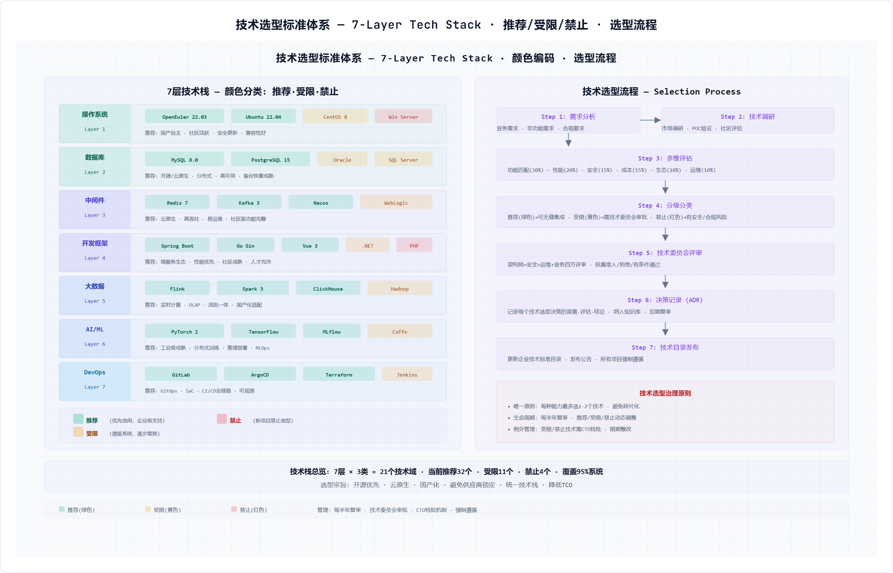</p>

### 5.7.1 技术选型原则

- **业务适配优先**：技术选型必须服务于OMS高并发、MES低延迟、ERP高可靠、数据平台高吞吐等实际需求。
- **主流成熟优先**：核心平台优先选择社区活跃、商业支持充分、人才可获得的技术。
- **开源可控与商业支持平衡**：核心中间件和数据库必须明确版本、补丁、支持和退出方案。
- **统一标准优先**：同类技术收敛，避免每个团队引入不同网关、消息、缓存和监控工具。
- **可观测与可运维内建**：不能纳入监控、日志、链路、告警和安全扫描的技术不得进入生产。

### 5.7.2 三年演进路线

| 阶段 | 重点建设 | 验收标准 |
|---|---|---|
| Y1 奠基 | 私有云资源池、K8s试点、DevOps、API网关、基础监控、MDM/数据平台底座 | OMS/CDP/MA等试点系统容器化；流水线覆盖核心自研项目 |
| Y2 扩展 | 云原生技术中台完善、iPaaS、低代码、服务网格试点、多集群、边缘K3s | 能力中心API纳入网关治理；MES边缘节点试点；低代码接入DevOps |
| Y3 成熟 | 多云统一治理、服务网格规模化、FinOps、智能运维、Serverless/AI算力平台试点 | 核心LTC链路具备全链路可观测和自动弹性；容量和成本可度量优化 |

**附件**：[附件5-5 技术选型标准清单](./附件/附件5-5_技术选型标准清单.xlsx)
---

## 5.12 本章小结

本章将技术架构从传统IT基础设施规划升级为支撑第4章平台+应用模式的完整技术体系。核心变化包括：技术架构纳入云原生技术中台，技术中台覆盖低代码、iPaaS、容器云、DevOps、微服务治理、中间件、数据技术底座和可观测平台；补充微服务开发框架和技术组件选型，明确设计期和运行期治理；建立从应用非功能需求到计算、存储、网络、数据库的资源测算模型，并以OMS系统示例说明测算方法；补充企业内部网络、私有云数据中心分区、中心/区域/边缘云部署架构；同时完善安全、容灾、技术选型和三年演进路线。

新增技术中台SLA定义矩阵(附件5-9)：为20个技术中台组件建立了四级SLA(T0核心交易99.99%、T1核心运营99.95%、T2重要管理99.9%、T3一般应用99.5%)，每个组件定义可用性/延迟P99/吞吐容量/RTO/RPO/监控指标/告警阈值七维SLA，并补充了三年SLA演进路线(Y1建立基线→Y2自动弹性→Y3 FinOps+AIOps+混沌工程)。

> 下一章（第6章 实施规划）应承接本章的技术中台、私有云、网络、安全、容灾和资源测算结果，形成项目组合、投资预算、迁移批次和实施治理机制。

---

## 第5章配图索引

| 编号 | 配图名称 | 文件链接 |
|---|---|------|
| 图5-1 | 技术架构总体蓝图 | [html/图5-1_技术架构蓝图.html](./html/图5-1_技术架构蓝图.html) |
| 图5-2 | 云原生技术中台架构 | [html/图5-9_云原生中台.html](./html/图5-9_云原生中台.html) |
| 图5-3 | 微服务开发框架与治理 | [html/图5-4_容器云原生.html](./html/图5-4_容器云原生.html) |
| 图5-4 | 基础设施与私有云数据中心 | [html/图5-2_基础设施架构.html](./html/图5-2_基础设施架构.html) |
| 图5-5 | 混合云与边缘云架构 | [html/图5-3_混合云架构.html](./html/图5-3_混合云架构.html) |
| 图5-5b | 安全体系 | [html/图5-5_安全体系.html](./html/图5-5_安全体系.html) |
| 图5-6 | 零信任安全架构 | [html/图5-6_零信任架构.html](./html/图5-6_零信任架构.html) |
| 图5-7 | 容灾备份架构 | [html/图5-7_容灾架构.html](./html/图5-7_容灾架构.html) |
| 图5-8 | 技术选型标准体系 | [html/图5-8_技术选型.html](./html/图5-8_技术选型.html) |
| 图5-10 | 技术架构双轮驱动 | [html/图5-10_双轮驱动.html](./html/图5-10_双轮驱动.html) |
| 图-技术中台SLA | 云原生技术中台SLA全景图【新增P2-3】 | [html/图-技术中台SLA全景图.html](./html/图-技术中台SLA全景图.html) |

## 第5章附件索引

| 编号 | 附件名称 | 文件地址 | 说明 |
|---|---|---|------|
| 附件5-1 | 基础设施资产清单 | [./附件/附件5-1_基础设施资产清单.xlsx](./附件/附件5-1_基础设施资产清单.xlsx) | 网络、数据中心和基础设施分区 |
| 附件5-2 | 云平台资源规划表 | [./附件/附件5-2_云平台资源规划表.xlsx](./附件/附件5-2_云平台资源规划表.xlsx) | 中心云、区域云、边缘云和K8s资源规划 |
| 附件5-3 | 安全合规检查清单 | [./附件/附件5-3_安全合规检查清单.xlsx](./附件/附件5-3_安全合规检查清单.xlsx) | 身份、网络、应用、数据和运维安全 |
| 附件5-4 | 容灾备份策略表 | [./附件/附件5-4_容灾备份策略表.xlsx](./附件/附件5-4_容灾备份策略表.xlsx) | 系统分级、RTO/RPO和备份策略 |
| 附件5-5 | 技术选型标准清单 | [./附件/附件5-5_技术选型标准清单.xlsx](./附件/附件5-5_技术选型标准清单.xlsx) | 技术栈推荐、受限、禁止和评审流程 |
| 附件5-6 | 云原生技术中台规划 | [./附件/附件5-6_云原生技术中台规划.xlsx](./附件/附件5-6_云原生技术中台规划.xlsx) | 技术中台子系统和能力清单 |
| 附件5-7 | 基础设施资源测算模型 | [./附件/附件5-7_基础设施资源测算模型.xlsx](./附件/附件5-7_基础设施资源测算模型.xlsx) | 资源测算方法和OMS样例 |
| 附件5-8 | 微服务开发框架与组件选型 | [./附件/附件5-8_微服务开发框架与组件选型.xlsx](./附件/附件5-8_微服务开发框架与组件选型.xlsx) | 微服务技术栈和组件选型 |
| 附件5-9 | 技术中台SLA定义【新增P2-3】 | [./附件/附件5-9_技术中台SLA定义.xlsx](./附件/附件5-9_技术中台SLA定义.xlsx) | 20个技术中台组件四级SLA矩阵 |
